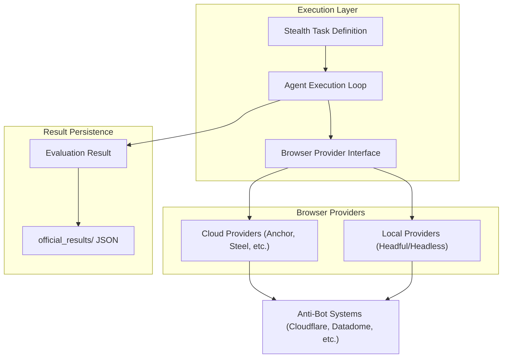
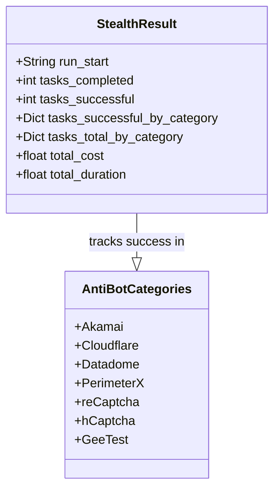

<!-- source: DeepWiki mcp.deepwiki.com · repo browser-use/benchmark · page 6.1 Stealth Bench Evaluation and Results · fetched 2026-10-30 -->

# Stealth Bench Evaluation and Results

Relevant source files

The following files were used as context for generating this wiki page:

- [stealth_bench/official_results/Stealth_Bench_V1_browser_anchor_model_bu-2-0.json](stealth_bench/official_results/Stealth_Bench_V1_browser_anchor_model_bu-2-0.json)
- [stealth_bench/official_results/Stealth_Bench_V1_browser_browser-use-cloud_model_bu-2-0.json](stealth_bench/official_results/Stealth_Bench_V1_browser_browser-use-cloud_model_bu-2-0.json)
- [stealth_bench/official_results/Stealth_Bench_V1_browser_browserbase_model_bu-2-0.json](stealth_bench/official_results/Stealth_Bench_V1_browser_browserbase_model_bu-2-0.json)
- [stealth_bench/official_results/Stealth_Bench_V1_browser_browserless_model_bu-2-0.json](stealth_bench/official_results/Stealth_Bench_V1_browser_browserless_model_bu-2-0.json)
- [stealth_bench/official_results/Stealth_Bench_V1_browser_hyperbrowser_model_bu-2-0.json](stealth_bench/official_results/Stealth_Bench_V1_browser_hyperbrowser_model_bu-2-0.json)
- [stealth_bench/official_results/Stealth_Bench_V1_browser_local_headful_model_bu-2-0.json](stealth_bench/official_results/Stealth_Bench_V1_browser_local_headful_model_bu-2-0.json)
- [stealth_bench/official_results/Stealth_Bench_V1_browser_local_headless_model_bu-2-0.json](stealth_bench/official_results/Stealth_Bench_V1_browser_local_headless_model_bu-2-0.json)
- [stealth_bench/official_results/Stealth_Bench_V1_browser_onkernel_model_bu-2-0.json](stealth_bench/official_results/Stealth_Bench_V1_browser_onkernel_model_bu-2-0.json)
- [stealth_bench/official_results/Stealth_Bench_V1_browser_steel_model_bu-2-0.json](stealth_bench/official_results/Stealth_Bench_V1_browser_steel_model_bu-2-0.json)

Stealth Bench V1 is a specialized benchmark suite within the repository designed to evaluate the anti-bot bypass capabilities of various browser providers. It consists of 71 unique tasks (though validation logic typically expects 80 data points due to multi-run requirements or specific task distributions) that target major bot-detection systems such as Cloudflare, Akamai, and Datadome.

### Evaluation Workflow

The evaluation process for Stealth Bench utilizes the same unified browser provider interface found in the main benchmark suite. This allows for seamless switching between local and cloud-based browser providers while maintaining a consistent execution environment for the agent.

#### Data Flow and Execution
The system initializes a browser session via the `browsers/` module, executes the stealth-specific tasks using an LLM agent, and records the outcome based on whether the agent successfully navigated the anti-bot challenge.

**Stealth Bench Execution Flow**

Sources: [stealth_bench/official_results/Stealth_Bench_V1_browser_anchor_model_bu-2-0.json:1-104](), [stealth_bench/official_results/Stealth_Bench_V1_browser_local_headful_model_bu-2-0.json:1-172]()

### Result Schema

Results are stored in the `stealth_bench/official_results/` directory. Each file follows a naming convention: `Stealth_Bench_V1_browser_{provider}_model_{model}.json`. The schema is an array of objects, where each object represents a complete benchmark run.

#### Key Fields
| Field | Description |
| :--- | :--- |
| `run_start` | A unique identifier (hash) for the specific evaluation run. |
| `tasks_completed` | The total number of tasks attempted in the run. |
| `tasks_successful` | The total number of tasks where the anti-bot was bypassed. |
| `tasks_successful_by_category` | A dictionary mapping anti-bot categories to success counts. |
| `tasks_total_by_category` | A dictionary mapping anti-bot categories to total attempts. |

**Code Entity Association: Result Model**

Sources: [stealth_bench/official_results/Stealth_Bench_V1_browser_browser-use-cloud_model_bu-2-0.json:2-34](), [stealth_bench/official_results/Stealth_Bench_V1_browser_onkernel_model_bu-2-0.json:9-34]()

### Anti-Bot Categories

The benchmark categorizes tasks to provide granular insights into where specific browser providers excel or fail.

*   **Commercial Solutions**: Akamai, Cloudflare, Datadome, PerimeterX, Kasada, and Shape.
*   **CAPTCHA Systems**: reCaptcha, hCaptcha, GeeTest, and Temu Slider.
*   **Custom Logic**: "Custom Antibot" for proprietary or less common detection methods.

### Validation Thresholds

The system implements a validation check during result processing. While the core suite contains 71 tasks, the plotting and aggregation logic often references an `EXPECTED_TASKS` threshold of **80**. This discrepancy usually accounts for repeated tasks or specific test configurations used to ensure statistical significance across multiple runs.

For a run to be considered "complete" in official reporting, it typically must reach this threshold [stealth_bench/official_results/Stealth_Bench_V1_browser_browserbase_model_bu-2-0.json:4-5]().

### Performance Comparison Examples

The following table illustrates the variance in success rates across different browser environments as captured in the `official_results/`:

| Browser Provider | Total Tasks | Successful | Key Strength | Key Weakness |
| :--- | :--- | :--- | :--- | :--- |
| `browser-use-cloud` | 80 | 64 | Cloudflare (22/22) | Shape (0/1) |
| `onkernel` | 80 | 57 | Akamai (6/6) | PerimeterX (6/18) |
| `local_headless` | 80 | 1-3 | None | Almost all categories |
| `local_headful` | 80 | 42 | Datadome (9/13) | Akamai (0/6) |

Sources: [stealth_bench/official_results/Stealth_Bench_V1_browser_browser-use-cloud_model_bu-2-0.json:71-102](), [stealth_bench/official_results/Stealth_Bench_V1_browser_onkernel_model_bu-2-0.json:37-68](), [stealth_bench/official_results/Stealth_Bench_V1_browser_local_headless_model_bu-2-0.json:2-34](), [stealth_bench/official_results/Stealth_Bench_V1_browser_local_headful_model_bu-2-0.json:71-102]()

---

