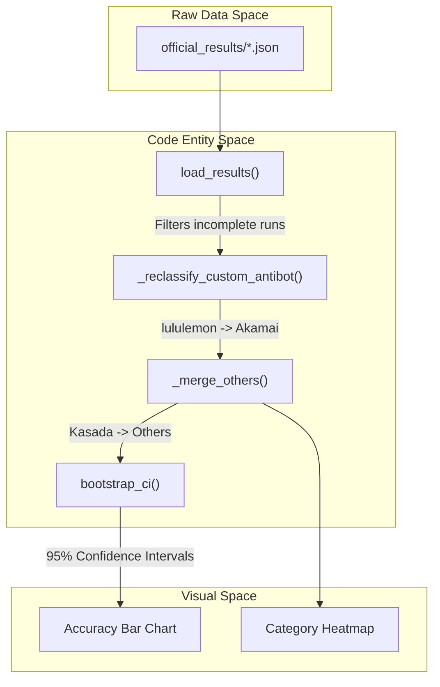
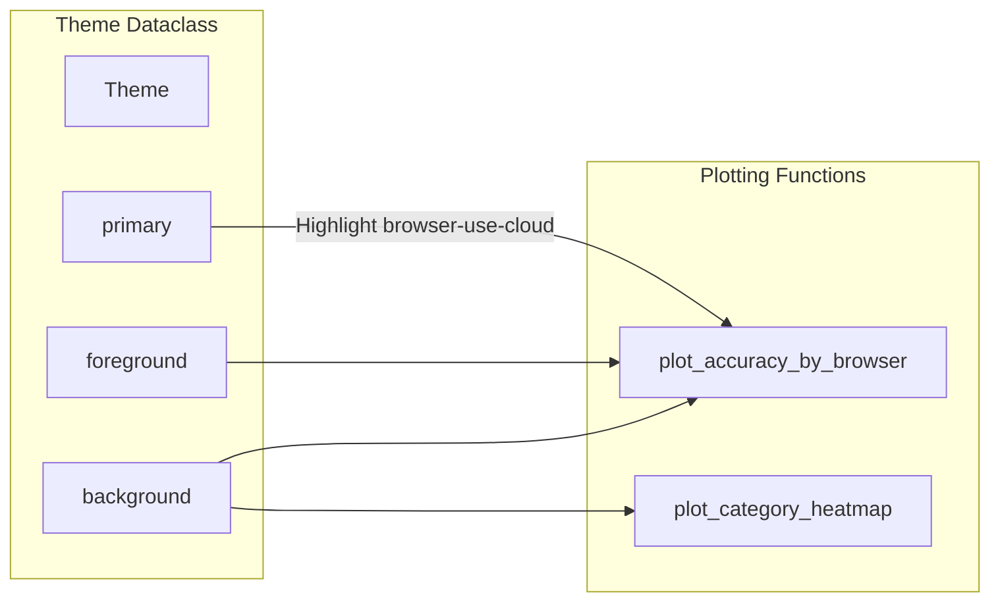

<!-- source: DeepWiki mcp.deepwiki.com · repo browser-use/benchmark · page 6.2 Stealth Bench Plot Generation · fetched 2026-10-30 -->

# Stealth Bench Plot Generation

Relevant source files

The following files were used as context for generating this wiki page:

- [stealth_bench/generate_plots.py](stealth_bench/generate_plots.py)
- [stealth_bench/official_plots/accuracy_by_browser_dark.png](stealth_bench/official_plots/accuracy_by_browser_dark.png)
- [stealth_bench/official_plots/accuracy_by_browser_light.png](stealth_bench/official_plots/accuracy_by_browser_light.png)
- [stealth_bench/official_plots/category_heatmap_dark.png](stealth_bench/official_plots/category_heatmap_dark.png)
- [stealth_bench/official_plots/category_heatmap_light.png](stealth_bench/official_plots/category_heatmap_light.png)

The `stealth_bench/generate_plots.py` script is responsible for visualizing the results of the Stealth Bench V1 benchmark. It processes raw JSON results to produce three distinct types of visualizations—bar charts, breakdown tables, and heatmaps—while applying complex data normalization logic to handle specific anti-bot categories and statistical uncertainty.

### Data Flow and Normalization

The plotting pipeline begins by loading result files from `stealth_bench/official_results/` [stealth_bench/generate_plots.py:26-26](). The script performs several normalization steps to ensure fair comparison across different browser providers.

#### 1. Task Validation and Filtering
The script enforces a strict task count check. Any run that does not match the `EXPECTED_TASKS` (default 80) is skipped [stealth_bench/generate_plots.py:29-29](), [stealth_bench/generate_plots.py:152-157](). Additionally, specific categories defined in `EXCLUDED_CATEGORIES` (e.g., hCaptcha, GeeTest) are removed from the totals before plotting [stealth_bench/generate_plots.py:31-31](), [stealth_bench/generate_plots.py:159-172]().

#### 2. Anti-Bot Reclassification
A key component of the data processing is `_reclassify_custom_antibot()` [stealth_bench/generate_plots.py:87-124](). This function redistributes tasks originally tagged as "Custom Antibot" into more specific technical categories based on the underlying protection found on those sites:
*   **Akamai**: Receives 2 tasks (formerly lululemon and game.co.uk).
*   **Cloudflare**: Receives 1 task (formerly ediblearrangements).
*   **Others**: Receives 1 task (douyin).
*   **Removed**: One site (deviantart) is removed entirely as it was found to be unprotected [stealth_bench/generate_plots.py:33-38]().

#### 3. Category Merging
To simplify visualizations, niche or related categories defined in `MERGE_TO_OTHERS` (Custom Antibot, Kasada, Shape) are consolidated into a single "Others" category via `_merge_others()` [stealth_bench/generate_plots.py:32-32](), [stealth_bench/generate_plots.py:125-137]().

### Code Entity Map: Data Processing

This diagram illustrates how the raw JSON data is transformed through the normalization functions into the final dataset used for plotting.

**Stealth Bench Data Transformation**

Sources: [stealth_bench/generate_plots.py:87-137](), [stealth_bench/generate_plots.py:138-178](), [stealth_bench/generate_plots.py:189-201]()

### Visualization Types

The script generates three primary plot types for both `LIGHT` and `DARK` themes [stealth_bench/generate_plots.py:51-64]().

| Plot Type | Function | Description |
| :--- | :--- | :--- |
| **Accuracy Bar Chart** | `plot_accuracy_by_browser()` | Shows overall success rate per browser with 95% confidence intervals calculated via bootstrapping (`N_BOOTSTRAP=1000`) [stealth_bench/generate_plots.py:28-28](), [stealth_bench/generate_plots.py:204-266](). |
| **Category Breakdown** | `plot_category_breakdown()` | A tabular visualization showing the exact success percentage for every anti-bot category across all browsers [stealth_bench/generate_plots.py:269-346](). |
| **Category Heatmap** | `plot_category_heatmap()` | A color-coded grid (using `RdYlGn` colormap) showing browser performance across major anti-bot categories [stealth_bench/generate_plots.py:349-432](). |

### Theme and Styling
The script uses a `Theme` dataclass to manage colors and styles [stealth_bench/generate_plots.py:42-49](). It also integrates the **Geist Mono** font for a consistent technical aesthetic across all generated PNGs [stealth_bench/generate_plots.py:21-25]().

**Visual Theme Application**

Sources: [stealth_bench/generate_plots.py:42-64](), [stealth_bench/generate_plots.py:211-215]()

### Statistical Implementation
The script utilizes bootstrapping to provide robust error bars. The `bootstrap_ci()` function [stealth_bench/generate_plots.py:189-201]() takes the accuracy values and performs 1,000 resamples with replacement to determine the 2.5th and 97.5th percentiles, representing the 95% confidence interval [stealth_bench/generate_plots.py:194-199]().

### Key Constants
*   `HIGHLIGHT_BROWSER`: Set to `"browser-use-cloud"`, which receives the `primary` theme color in plots [stealth_bench/generate_plots.py:30-30]().
*   `RESULTS_DIR`: Points to `stealth_bench/official_results` [stealth_bench/generate_plots.py:26-26]().
*   `OUTPUT_DIR`: Points to `stealth_bench/official_plots` [stealth_bench/generate_plots.py:27-27]().

Sources: [stealth_bench/generate_plots.py:21-40](), [stealth_bench/generate_plots.py:51-64](), [stealth_bench/generate_plots.py:189-201]()

---

