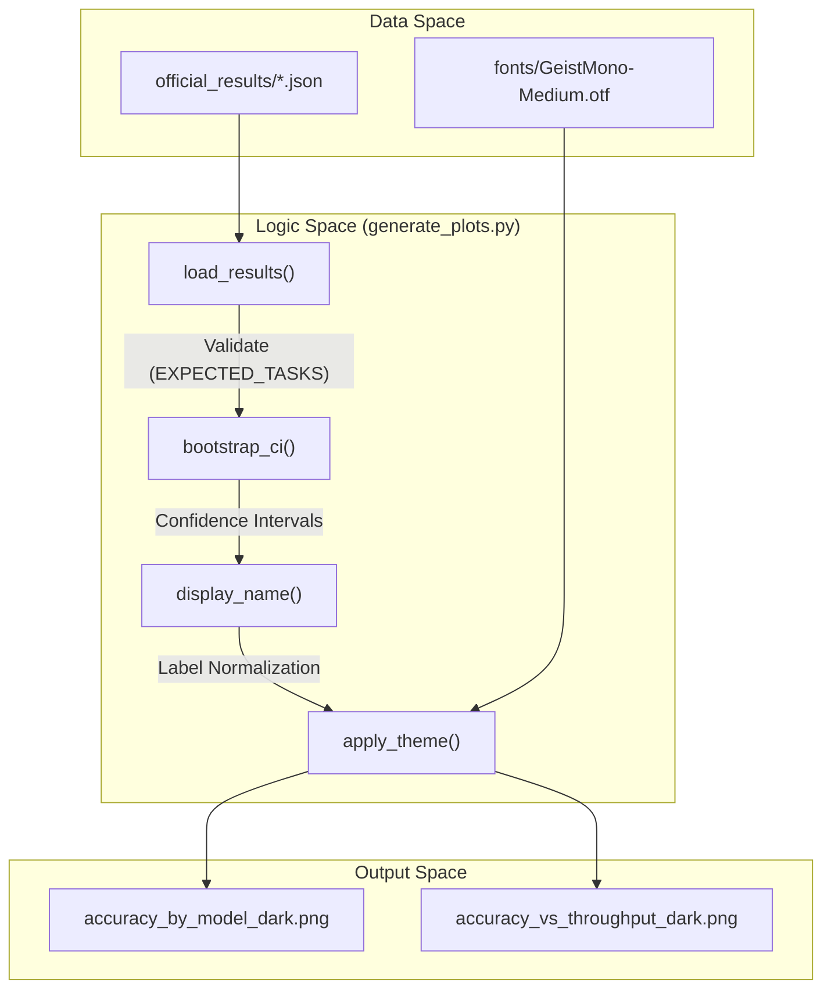
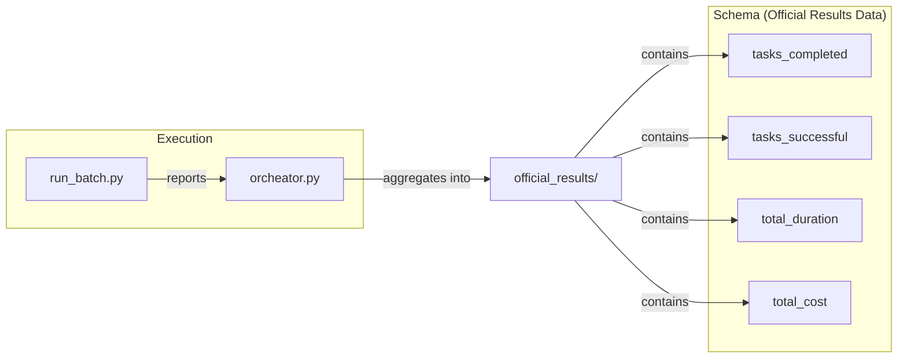

<!-- source: DeepWiki mcp.deepwiki.com · repo browser-use/benchmark · page 7 Results and Visualization · fetched 2026-10-30 -->

# Results and Visualization

Relevant source files

The following files were used as context for generating this wiki page:

- [generate_plots.py](generate_plots.py)
- [official_plots/accuracy_by_model_dark.png](official_plots/accuracy_by_model_dark.png)
- [official_plots/accuracy_by_model_light.png](official_plots/accuracy_by_model_light.png)

This section provides an overview of how benchmark results are stored, validated, and visualized within the repository. The system is designed to handle high-volume data from distributed runs, ensuring that only complete evaluations (e.g., 100/100 tasks) are used for official reporting.

## Result Storage and Organization

Benchmark results are partitioned into two primary directories based on their status and relevance. Each result is stored as a JSON file containing an array of run objects.

*   **`official_results/`**: Contains the latest validated runs for supported models and frameworks. These files serve as the data source for the visualization pipeline [generate_plots.py:17-17]().
*   **`old_results/`**: Archival directory for legacy runs, deprecated framework versions, or models that are no longer part of the active leaderboard.

### File Naming Convention
Result files follow a strict naming convention to ensure the visualization script can correctly parse the framework, browser, and model used:
`{Framework}_{version}_browser_{browser}_model_{model}.json`

The script [generate_plots.py:135-136]() specifically extracts the model identifier by splitting the filename at the `_model_` delimiter.

### Data Schema
Each entry in a result JSON file represents a single execution of the benchmark suite. Key metrics include:
*   `tasks_completed`: Number of tasks attempted (validated against `EXPECTED_TASKS = 100` [generate_plots.py:20-20]()).
*   `tasks_successful`: Number of tasks that passed the judge's criteria.
*   `total_duration`: Time taken for the full run in seconds.
*   `total_steps`: Aggregate number of browser actions taken.
*   `total_cost`: API cost incurred during the run.

For details on the data structure and current model coverage, see [Official Results Data](#7.2).

## Visualization Pipeline

The `generate_plots.py` script transforms raw JSON data into high-fidelity visualizations. It employs statistical methods to ensure accuracy and uses a custom theme engine to produce both light and dark mode assets.

### Data Processing Flow
The pipeline follows a structured sequence to move from raw files to finalized plots:

1.  **Validation**: `load_results()` filters out any runs where `tasks_completed` does not match the `EXPECTED_TASKS` constant [generate_plots.py:133-144]().
2.  **Statistical Analysis**: The script uses a bootstrap method (`bootstrap_ci`) with `N_BOOTSTRAP = 1000` to calculate 95% confidence intervals for accuracy metrics [generate_plots.py:163-174]().
3.  **Categorization**: Models are grouped into categories (`cloud`, `browser-harness`, or `oss`) which determines their color coding in the final charts [generate_plots.py:22-25](), [generate_plots.py:119-123]().

### Visualization Components

| Component | Description | Code Reference |
| :--- | :--- | :--- |
| **Accuracy Bar Chart** | Ranks models by success rate with error bars. | `plot_accuracy_by_model()` [generate_plots.py:214-232]() |
| **Throughput Scatter** | Compares accuracy vs. tasks per hour. | `plot_accuracy_vs_throughput()` [generate_plots.py:270-270]() |
| **Theme Engine** | Applies Geist Mono fonts and consistent color palettes. | `apply_theme()` [generate_plots.py:177-191]() |

For details on the plotting logic and theme configuration, see [generate_plots.py — BU Bench V1 Visualization](#7.1).

## System Architecture: Results to Plots

The following diagram illustrates how raw code entities and data files interact to produce the official benchmark visualizations.

### Visualization Data Flow
"Visualizing the pipeline from JSON results to PNG assets"

**Sources:** [generate_plots.py:12-20](), [generate_plots.py:133-144](), [generate_plots.py:163-174]().

### Result Aggregation Logic
"Mapping framework execution results to the JSON storage schema"

**Sources:** [generate_plots.py:147-160](), [official_plots/accuracy_by_model_dark.png:1-28]().

## Child Pages
- [generate_plots.py — BU Bench V1 Visualization](#7.1)
- [Official Results Data](#7.2)

**Sources:**
- [generate_plots.py:1-240]()
- [official_plots/accuracy_by_model_dark.png:1-28]()
- [official_plots/accuracy_by_model_light.png:1-28]()

---

