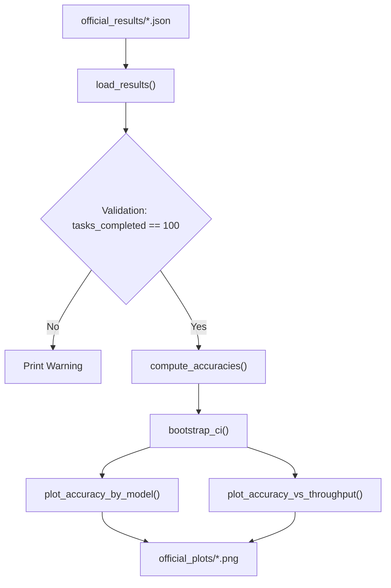
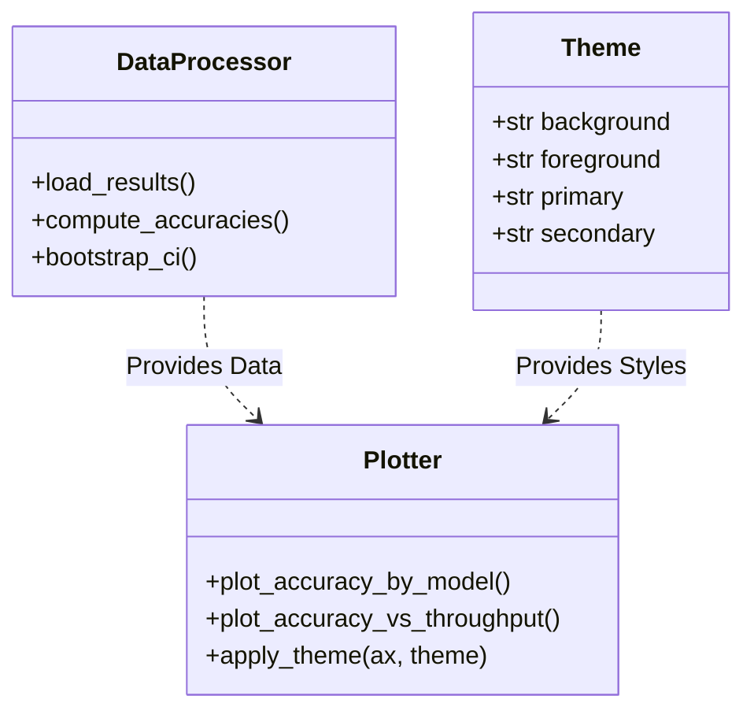

<!-- source: DeepWiki mcp.deepwiki.com · repo browser-use/benchmark · page 7.1 generate_plots.py — BU Bench V1 Visualization · fetched 2026-10-30 -->

# generate_plots.py — BU Bench V1 Visualization

Relevant source files

The following files were used as context for generating this wiki page:

- [BU_Bench_V1.enc](BU_Bench_V1.enc)
- [fonts/GeistMono-Medium.otf](fonts/GeistMono-Medium.otf)
- [generate_plots.py](generate_plots.py)
- [official_plots/accuracy_by_model_dark.png](official_plots/accuracy_by_model_dark.png)
- [official_plots/accuracy_by_model_light.png](official_plots/accuracy_by_model_light.png)
- [official_plots/accuracy_vs_throughput_dark.png](official_plots/accuracy_vs_throughput_dark.png)
- [official_plots/accuracy_vs_throughput_light.png](official_plots/accuracy_vs_throughput_light.png)
- [official_plots/best_of_frameworks_public_dark.png](official_plots/best_of_frameworks_public_dark.png)
- [official_plots/best_of_frameworks_public_light.png](official_plots/best_of_frameworks_public_light.png)
- [official_plots/browser_harness_by_model_dark.png](official_plots/browser_harness_by_model_dark.png)
- [official_plots/browser_harness_by_model_light.png](official_plots/browser_harness_by_model_light.png)
- [official_plots/browser_use_framework_by_model_dark.png](official_plots/browser_use_framework_by_model_dark.png)
- [official_plots/browser_use_framework_by_model_light.png](official_plots/browser_use_framework_by_model_light.png)
- [pyproject.toml](pyproject.toml)
- [uv.lock](uv.lock)

The `generate_plots.py` script is the primary visualization engine for the **BU Bench V1** suite. It processes raw JSON results from the `official_results/` directory, performs statistical validation using bootstrapping, and generates high-fidelity charts for accuracy, throughput, and framework comparisons.

### Overview and Data Flow

The script acts as a data pipeline that transforms per-model benchmark JSON files into visual representations. It uses `matplotlib` for plotting and `numpy` for statistical calculations.

#### System Mapping: Natural Language to Code Entities

| System Concept | Code Entity | Role |
|:---|:---|:---|
| **Data Loader** | `load_results()` | Scans and filters official result files. |
| **Statistical Engine** | `bootstrap_ci()` | Calculates 95% confidence intervals. |
| **Throughput Metric** | `compute_tasks_per_hour()` | Normalizes execution speed to tasks/hour. |
| **Theme Manager** | `Theme` (Dataclass) | Defines color palettes for light and dark modes. |
| **Category Logic** | `MODEL_CATEGORIES` | Maps models to "cloud", "browser-harness", or "oss". |

**Data Processing Pipeline**

Sources: [generate_plots.py:17-20](), [generate_plots.py:133-144]()

---

### Core Data Processing Functions

#### Result Loading and Validation
The script enforces a strict validation rule: only runs that completed exactly 100 tasks are included in the final plots. This ensures that the denominator for accuracy calculations is consistent across all models.
*   **Constant:** `EXPECTED_TASKS = 100` [generate_plots.py:20]()
*   **Function:** `load_results()` [generate_plots.py:133-144]() iterates through `official_results/`, extracting the model name from the filename suffix `_model_{model}.json` [generate_plots.py:136]().

#### Statistical Metrics
*   **`compute_accuracies(runs)`**: Calculates the ratio of `tasks_successful` to `tasks_completed` for every run in the dataset [generate_plots.py:147-152]().
*   **`compute_tasks_per_hour(runs)`**: Converts `total_duration` (seconds) into a throughput metric: $3600 \times \frac{tasks\_completed}{total\_duration}$ [generate_plots.py:155-160]().
*   **`bootstrap_ci(values, n=1000)`**: Uses the bootstrap method to estimate the 95% confidence interval. It generates 1000 resampled means to determine the 2.5th and 97.5th percentiles [generate_plots.py:163-174]().

Sources: [generate_plots.py:147-174]()

---

### Visualization Logic

#### Category and Styling
Models are grouped into three distinct categories to provide context on their architecture:
1.  **Cloud**: Native cloud-hosted agents (e.g., `bu-ultra`).
2.  **Browser Harness**: Open-source models running within the specialized browser-harness (e.g., `bcode-claude-opus-4-7`).
3.  **OSS**: Standard open-source integrations (default).

These categories are defined in `MODEL_CATEGORIES` [generate_plots.py:22-25]() and mapped to specific colors in `CATEGORY_COLOR_ATTR` [generate_plots.py:119-123]().

#### Theming and Typography
The script supports high-quality rendering using the **Geist Mono** font, which is integrated via `font_manager` [generate_plots.py:12-16](). Two visual themes are defined:
*   **`LIGHT`**: White background (`#FAFAFA`), blue secondary accents [generate_plots.py:99-107]().
*   **`DARK`**: Black background (`#0A0A0A`), orange primary accents [generate_plots.py:109-117]().

The `apply_theme(ax, theme)` function [generate_plots.py:177-191]() standardizes the appearance by hiding top/right spines and setting grid colors based on the `Theme` dataclass.

#### Label Normalization
To prevent long model names from cluttering the X-axis, `wrap_label()` [generate_plots.py:56-86]() splits strings at the first non-alphabetic transition (e.g., "gpt-5.5" becomes "gpt\n5.5"). It also utilizes `DISPLAY_NAMES` [generate_plots.py:27-39]() for manual overrides of specific model strings.

Sources: [generate_plots.py:22-117](), [generate_plots.py:177-191]()

---

### Generated Plot Types

#### 1. Accuracy by Model (Bar Chart)
This chart displays the mean success rate per model with error bars representing the bootstrap confidence interval.
*   **Implementation:** `plot_accuracy_by_model()` [generate_plots.py:214-232]().
*   **Visuals:** Bars are colored by category (Cloud/Harness/OSS).

#### 2. Accuracy vs. Throughput (Scatter Plot)
A quadrant-style analysis that plots reliability (Accuracy) against speed (Tasks per Hour).
*   **Implementation:** `plot_accuracy_vs_throughput()` [generate_plots.py:278-356]().
*   **Features:** Includes horizontal and vertical error bars for both dimensions [generate_plots.py:321-332]().

#### 3. Browser-Use Framework Comparison
A specific subset plot that compares different versions and configurations of the `browser-use` framework.
*   **Implementation:** `plot_browser_use_framework_by_model()` [generate_plots.py:360-422]().

**Code Entity Association**

Sources: [generate_plots.py:89-97](), [generate_plots.py:214-422]()

---

