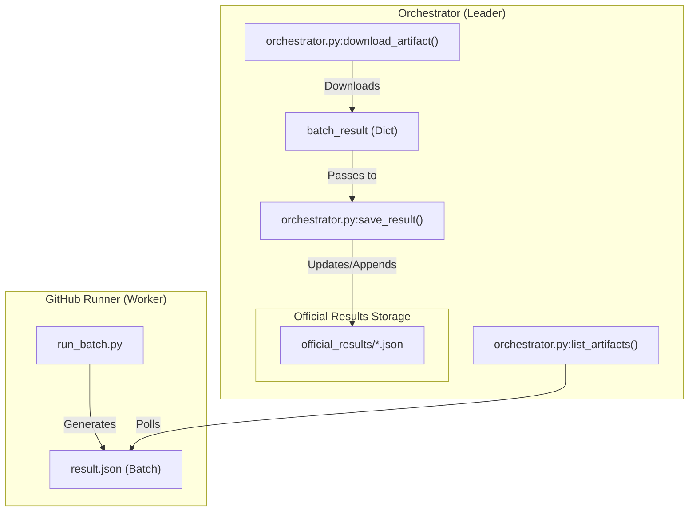
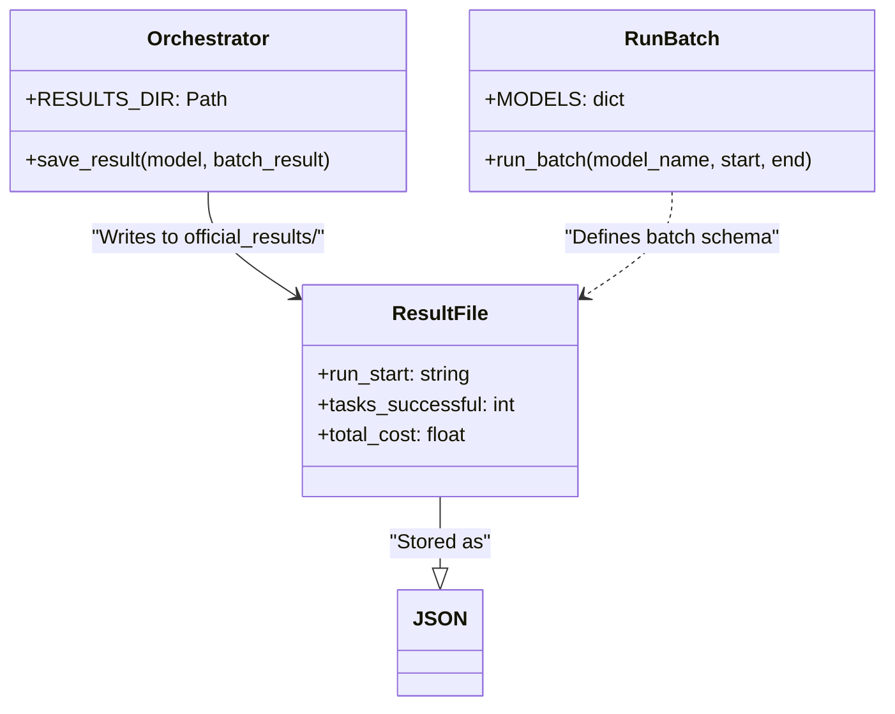

<!-- source: DeepWiki mcp.deepwiki.com · repo browser-use/benchmark · page 7.2 Official Results Data · fetched 2026-10-30 -->

# Official Results Data

Relevant source files

The following files were used as context for generating this wiki page:

- [.github/workflows/eval.yaml](.github/workflows/eval.yaml)
- [official_results/Bcode_v0.0.3_browser_BrowserUseCloud_model_bcode-claude-opus-4-7.json](official_results/Bcode_v0.0.3_browser_BrowserUseCloud_model_bcode-claude-opus-4-7.json)
- [official_results/BrowserUseCloudAPI_v3_browser_integrated_model_bu-ultra.json](official_results/BrowserUseCloudAPI_v3_browser_integrated_model_bu-ultra.json)
- [official_results/BrowserUse_0.11.5_browser_BrowserUseCloud_model_gemini-3-1-pro-preview.json](official_results/BrowserUse_0.11.5_browser_BrowserUseCloud_model_gemini-3-1-pro-preview.json)
- [official_results/BrowserUse_0.11.7_browser_BrowserUseCloud_model_claude-opus-4-7.json](official_results/BrowserUse_0.11.7_browser_BrowserUseCloud_model_claude-opus-4-7.json)
- [official_results/BrowserUse_0.12.6_browser_BrowserUseCloud_model_deepseek-v4-pro-fireworks.json](official_results/BrowserUse_0.12.6_browser_BrowserUseCloud_model_deepseek-v4-pro-fireworks.json)
- [official_results/BrowserUse_0.12.6_browser_BrowserUseCloud_model_gpt-5.5.json](official_results/BrowserUse_0.12.6_browser_BrowserUseCloud_model_gpt-5.5.json)
- [official_results/BrowserUse_0.12.6_browser_BrowserUseCloud_model_kimi-k2.6-fireworks.json](official_results/BrowserUse_0.12.6_browser_BrowserUseCloud_model_kimi-k2.6-fireworks.json)
- [official_results/BrowserUse_0.12.6_browser_BrowserUseCloud_model_qwen3.6-plus-openrouter.json](official_results/BrowserUse_0.12.6_browser_BrowserUseCloud_model_qwen3.6-plus-openrouter.json)
- [official_results/ClaudeCodeHarness_d1d6b59_browser_BrowserUseCloud_model_claude-opus-4-7-cch.json](official_results/ClaudeCodeHarness_d1d6b59_browser_BrowserUseCloud_model_claude-opus-4-7-cch.json)
- [old_results/BrowserUseCloudAPI_v3_browser_integrated_model_bu-max.json](old_results/BrowserUseCloudAPI_v3_browser_integrated_model_bu-max.json)
- [old_results/BrowserUse_0.11.5_browser_BrowserUseCloud_model_ChatBrowserUse-1.json](old_results/BrowserUse_0.11.5_browser_BrowserUseCloud_model_ChatBrowserUse-1.json)
- [old_results/BrowserUse_0.11.5_browser_BrowserUseCloud_model_claude-haiku-4-5.json](old_results/BrowserUse_0.11.5_browser_BrowserUseCloud_model_claude-haiku-4-5.json)
- [old_results/BrowserUse_0.11.5_browser_BrowserUseCloud_model_claude-sonnet-4-5.json](old_results/BrowserUse_0.11.5_browser_BrowserUseCloud_model_claude-sonnet-4-5.json)
- [old_results/BrowserUse_0.11.5_browser_BrowserUseCloud_model_gemini-2.5-flash.json](old_results/BrowserUse_0.11.5_browser_BrowserUseCloud_model_gemini-2.5-flash.json)
- [old_results/BrowserUse_0.11.5_browser_BrowserUseCloud_model_gemini-3-flash-preview.json](old_results/BrowserUse_0.11.5_browser_BrowserUseCloud_model_gemini-3-flash-preview.json)
- [old_results/BrowserUse_0.11.5_browser_BrowserUseCloud_model_gemini-3-pro-preview.json](old_results/BrowserUse_0.11.5_browser_BrowserUseCloud_model_gemini-3-pro-preview.json)
- [old_results/BrowserUse_0.11.5_browser_BrowserUseCloud_model_gpt-5-mini.json](old_results/BrowserUse_0.11.5_browser_BrowserUseCloud_model_gpt-5-mini.json)
- [old_results/BrowserUse_0.11.7_browser_BrowserUseCloud_model_claude-opus-4-6.json](old_results/BrowserUse_0.11.7_browser_BrowserUseCloud_model_claude-opus-4-6.json)
- [old_results/ClaudeCodeHarness_d1d6b59_browser_BrowserUseCloud_model_claude-opus-4-6-cch.json](old_results/ClaudeCodeHarness_d1d6b59_browser_BrowserUseCloud_model_claude-opus-4-6-cch.json)
- [orchestrator.py](orchestrator.py)
- [results/BrowserUse_0.11.5_browser_BrowserUseCloud_model_ChatBrowserUse-2.json](results/BrowserUse_0.11.5_browser_BrowserUseCloud_model_ChatBrowserUse-2.json)
- [run_batch.py](run_batch.py)

This page documents the structure, schema, and management of the benchmark results stored within the `official_results/` and `old_results/` directories. These files represent the source of truth for all performance visualizations and leaderboard calculations.

## Directory Structure and Scope

The benchmark maintains two primary directories for result persistence:

*   `official_results/`: Contains the latest validated benchmark runs for current framework versions and models. [orchestrator.py:38]()
*   `old_results/`: Archives historical data from previous versions of frameworks or deprecated model evaluations to maintain a record of progress over time. [old_results/BrowserUse_0.11.7_browser_BrowserUseCloud_model_claude-opus-4-6.json:1-10]()

### Run Key Naming Convention

Result files follow a strict naming convention to ensure uniqueness and ease of parsing by the visualization pipeline:

`{Framework}_{version}_browser_{browser}_model_{model}.json`

| Component | Description | Example |
| :--- | :--- | :--- |
| `Framework` | The adapter or framework name. | `BrowserUse`, `ClaudeCodeHarness`, `Bcode` |
| `version` | Version string of the framework or harness. | `0.12.6`, `v0.0.3`, `d1d6b59` |
| `browser` | The browser provider used for the run. | `BrowserUseCloud`, `integrated` |
| `model` | The specific LLM identifier. | `gpt-5.5`, `claude-opus-4-7` |

**Sources:** [orchestrator.py:95](), [official_results/BrowserUse_0.12.6_browser_BrowserUseCloud_model_gpt-5.5.json:1-11](), [official_results/Bcode_v0.0.3_browser_BrowserUseCloud_model_bcode-claude-opus-4-7.json:1-11]()

---

## Result Schema

Each JSON file contains an array of "run objects." A single file may contain multiple runs (e.g., 3-5 iterations) to allow for statistical significance and confidence interval calculations. [orchestrator.py:27-36](), [official_results/BrowserUse_0.12.6_browser_BrowserUseCloud_model_qwen3.6-plus-openrouter.json:1-26]()

### Per-Run JSON Fields

| Field | Type | Description |
| :--- | :--- | :--- |
| `run_start` | `string` | Unique timestamp for the run, typically formatted as `YYYYMMDD_HHMMSS_{idx}`. |
| `tasks_completed` | `int` | Number of tasks attempted in this run (usually 100 for a full suite). |
| `tasks_successful` | `int` | Number of tasks that passed the judge's evaluation. |
| `total_steps` | `int` | Cumulative number of browser actions taken across all tasks. |
| `total_duration` | `float` | Total execution time in seconds. |
| `total_cost` | `float` | Total API cost in USD incurred during the run. |

**Sources:** [orchestrator.py:105-113](), [official_results/BrowserUse_0.12.6_browser_BrowserUseCloud_model_qwen3.6-plus-openrouter.json:2-9]()

---

## Data Flow: Accumulation and Aggregation

Results are typically generated in a distributed fashion via GitHub Actions and aggregated by the `orchestrator.py`.

### System Entity Mapping: Data Aggregation

The following diagram shows how raw batch results from workers are mapped to the final official result files.

"Result Aggregation Flow"

**Sources:** [orchestrator.py:51-116](), [run_batch.py:81-83]()

### Accumulation Logic
The `save_result` function in `orchestrator.py` handles the logic of merging batch data into the model-specific JSON files:
1.  **File Identification**: Locates the file based on the framework, browser, and model name. [orchestrator.py:95]()
2.  **Run Matching**: Checks if a run entry for the specific `run_start` timestamp already exists. [orchestrator.py:101-102]()
3.  **Metric Incrementing**: If the entry exists, it increments the counters (`tasks_completed`, `total_steps`, etc.) with the new batch data. This allows 100-task runs to be completed in smaller parallel batches (e.g., batches of 10). [orchestrator.py:109-113]()

---

## Represented Dataset

The current dataset includes evaluations for a wide range of models and frameworks.

### Frameworks and Adapters
*   **BrowserUse**: Native implementation using the `browser-use` library. [official_results/BrowserUse_0.12.6_browser_BrowserUseCloud_model_gpt-5.5.json:1]()
*   **ClaudeCodeHarness (CCH)**: Evaluations using the Claude Code browser harness. [official_results/ClaudeCodeHarness_d1d6b59_browser_BrowserUseCloud_model_claude-opus-4-7-cch.json:1]()
*   **Bcode**: Specialized adapter for bcode evaluations. [official_results/Bcode_v0.0.3_browser_BrowserUseCloud_model_bcode-claude-opus-4-7.json:1]()
*   **BrowserUseCloudAPI**: Direct evaluations against the Cloud API (v3). [old_results/BrowserUseCloudAPI_v3_browser_integrated_model_bu-max.json:1]()

### Models in Dataset
The benchmark tracks major frontier models and specialized browser agents:
*   **OpenAI**: `gpt-5`, `gpt-5-mini`, `gpt-5.5`
*   **Anthropic**: `claude-opus-4-7`, `claude-sonnet-4-5`, `claude-haiku-4-5`
*   **Google**: `gemini-3-1-pro-preview`, `gemini-2.5-flash`
*   **Specialized**: `bu-ultra`, `bu-max`, `qwen3.6-plus`, `deepseek-v4-pro`, `kimi-k2.6`

**Sources:** [orchestrator.py:27-36](), [official_results/BrowserUse_0.12.6_browser_BrowserUseCloud_model_qwen3.6-plus-openrouter.json:1](), [official_results/BrowserUse_0.12.6_browser_BrowserUseCloud_model_deepseek-v4-pro-fireworks.json:1]()

---

## Code Entity Relationship

This diagram illustrates how code entities relate to the physical storage of results.

"Code-to-Result Mapping"

**Sources:** [orchestrator.py:38](), [orchestrator.py:92-116](), [run_batch.py:46-67]()

---

