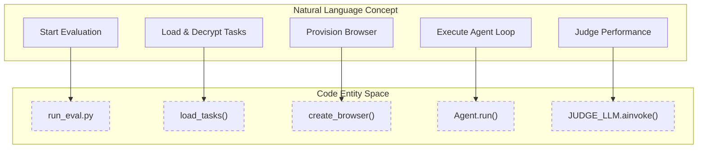
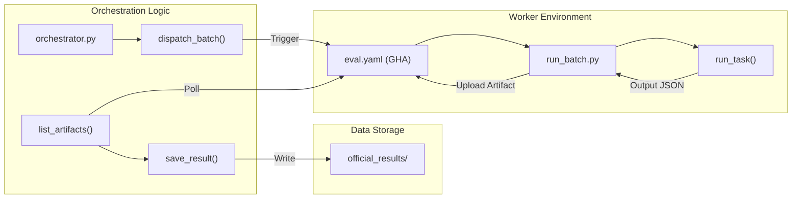

<!-- source: DeepWiki mcp.deepwiki.com · repo browser-use/benchmark · page 8 Glossary · fetched 2026-10-30 -->

# Glossary

Relevant source files

The following files were used as context for generating this wiki page:

- [.github/workflows/eval.yaml](.github/workflows/eval.yaml)
- [BU_Bench_V1.enc](BU_Bench_V1.enc)
- [README.md](README.md)
- [browsers/browser_use_cloud.py](browsers/browser_use_cloud.py)
- [browsers/util.py](browsers/util.py)
- [fonts/GeistMono-Medium.otf](fonts/GeistMono-Medium.otf)
- [frameworks/browser_use/__init__.py](frameworks/browser_use/__init__.py)
- [frameworks/browser_use_cloud_api_v2/run_task.py](frameworks/browser_use_cloud_api_v2/run_task.py)
- [frameworks/browser_use_cloud_api_v3/run_task.py](frameworks/browser_use_cloud_api_v3/run_task.py)
- [frameworks/browserbase_agent/run_task.py](frameworks/browserbase_agent/run_task.py)
- [frameworks/claude_code_harness/run_task.py](frameworks/claude_code_harness/run_task.py)
- [generate_plots.py](generate_plots.py)
- [judge.py](judge.py)
- [models.py](models.py)
- [orchestrator.py](orchestrator.py)
- [pyproject.toml](pyproject.toml)
- [results/BrowserUse_0.11.5_browser_BrowserUseCloud_model_ChatBrowserUse-2.json](results/BrowserUse_0.11.5_browser_BrowserUseCloud_model_ChatBrowserUse-2.json)
- [run_batch.py](run_batch.py)
- [run_eval.py](run_eval.py)
- [stealth_bench/generate_plots.py](stealth_bench/generate_plots.py)
- [uv.lock](uv.lock)

This glossary defines technical terms, domain concepts, and implementation-specific identifiers used throughout the `browser-use/benchmark` repository.

## Core Concepts

### 1. BU Bench V1
The primary benchmark suite consisting of 100 hand-selected tasks designed to evaluate the reasoning and execution capabilities of browser automation agents [README.md:95-97](). It measures performance across five categories: Custom (interaction challenges), WebBench, Mind2Web, GAIA, and VisualWebArena [README.md:185-191]().

### 2. Stealth Bench V1
A specialized benchmark suite containing 71 tasks focused on evaluating a browser's ability to bypass anti-bot protections (e.g., Cloudflare, Akamai) [README.md:35-37](). It focuses on "stealth" rather than complex agentic reasoning.

### 3. Framework Adapter
A standardized interface located in the `frameworks/` directory that allows different agent implementations (e.g., Stagehand, Claude Code, BrowserCode) to be evaluated against the same tasks [README.md:145-147](). Adapters translate task descriptions into framework-specific calls and map outputs back to a unified `ExecutionResult` [frameworks/browser_use_cloud_api_v3/run_task.py:4-10]().

### 4. Browser Provider
A module in the `browsers/` directory that manages the lifecycle of a browser instance. Providers can be cloud-based (e.g., `browser-use-cloud`, `anchor`, `browserbase`) or local (`local_headless`) [run_eval.py:9-12](). They typically return a CDP (Chrome DevTools Protocol) URL for the agent to connect to [run_eval.py:78-81]().

---

## Technical Terms and Implementation Details

| Term | Definition | Code Pointer |
|:---|:---|:---|
| **`ExecutionResult`** | A Dataclass used by framework adapters to return standardized metrics (steps, screenshots, cost, duration) to the judge. | [frameworks/browser_use_cloud_api_v3/run_task.py:24-31]() |
| **`Judge LLM`** | A fixed model (default: `gemini-2.5-flash`) used to grade the agent's performance by comparing its final result and screenshots against ground truth. | [run_eval.py:42-43]() |
| **`run_start`** | A timestamp-based unique identifier (e.g., `20231027_120000_0`) used to group batches belonging to a single full benchmark run. | [orchestrator.py:123-123]() |
| **`tracking_id`** | A UUID assigned to a specific batch of tasks dispatched to a GitHub runner to track its lifecycle and artifact collection. | [orchestrator.py:126-126]() |
| **`interleave`** | A function that reorders tasks from different categories to ensure that a small batch contains a balanced mix of difficulty levels. | [run_batch.py:17-23]() |
| **`Fernet`** | The symmetric encryption implementation used to decrypt `.enc` task files using a key derived from the benchmark name. | [run_eval.py:63-66]() |

---

## System Architecture: Natural Language to Code Entity Space

The following diagrams illustrate how conceptual processes are mapped to specific files and functions within the codebase.

### Evaluation Lifecycle
This diagram bridges the conceptual "Task Execution" to the actual code entities involved in the loop.

**Sources:** [run_eval.py:1-162](), [run_batch.py:46-52]()

### Distributed Orchestration
This diagram maps the "Distributed Run" concept to the GitHub Actions and Orchestrator entities.

**Sources:** [orchestrator.py:1-175](), [.github/workflows/eval.yaml:1-74](), [run_batch.py:70-87]()

---

## Key Model Identifiers
The benchmark uses internal aliases for models, which are mapped to provider-specific strings in the registry.

*   **`bu-2-0`**: Refers to `ChatBrowserUse(model="bu-2-0")` [run_batch.py:28-28]().
*   **`bu-ultra`**: A high-performance variant used in the Browser Use Cloud API [frameworks/browser_use_cloud_api_v3/run_task.py:46-46]().
*   **`gemini-2.5-flash`**: The standard model used for the **Judge LLM** [run_eval.py:43-43]().

## Result Metrics
When reviewing JSON files in `official_results/`, the following keys are used:
*   **`tasks_completed`**: Number of tasks attempted in the run [orchestrator.py:105-105]().
*   **`tasks_successful`**: Number of tasks that received a `verdict: True` from the Judge [orchestrator.py:110-110]().
*   **`total_steps`**: Cumulative number of actions taken by the agent [orchestrator.py:111-111]().
*   **`total_duration`**: Total wall-clock time in seconds for the run [orchestrator.py:112-112]().

**Sources:** [orchestrator.py:92-115](), [run_eval.py:189-200](), [generate_plots.py:147-160]()