# Page: Overview

# Overview

<details>
<summary>Relevant source files</summary>

The following files were used as context for generating this wiki page:

- [.env.example](.env.example)
- [.gitignore](.gitignore)
- [BU_Bench_V1.enc](BU_Bench_V1.enc)
- [README.md](README.md)
- [browsers/__init__.py](browsers/__init__.py)
- [browsers/driver.py](browsers/driver.py)
- [fonts/GeistMono-Medium.otf](fonts/GeistMono-Medium.otf)
- [pyproject.toml](pyproject.toml)
- [uv.lock](uv.lock)

</details>


The `browser-use-benchmark` repository is a specialized evaluation framework designed to measure the performance, reliability, and stealth capabilities of browser-based AI agents. It provides a standardized environment to test various agent frameworks (e.g., `browser-use`, `Claude Code`) against different Large Language Models (LLMs) and browser infrastructure providers.

The project is divided into two primary benchmark suites:
1.  **BU Bench V1**: Focused on task completion, reasoning, and multi-step web navigation.
2.  **Stealth Bench V1**: Focused on the ability of browser configurations to bypass anti-bot protections.

## Core Architecture

The system is built as a modular pipeline that connects three major components: **Framework Adapters**, **LLM Models**, and **Browser Providers**.

### System Relationship Diagram
This diagram illustrates how the core evaluation scripts orchestrate the flow between the agent logic and the infrastructure.

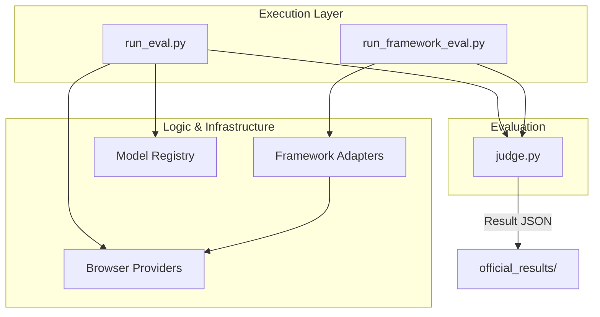
**Sources:** [run_eval.py:1-20](), [run_framework_eval.py:1-30](), [browsers/__init__.py:33-45](), [judge.py:1-15]()

---

## Benchmark Suites

### BU Bench V1
A collection of 100 hand-selected tasks categorized into five areas: Custom challenges, WebBench, Mind2Web, GAIA, and AssistantBench [README.md:183-195](). These tasks are stored in an encrypted format (`BU_Bench_V1.enc`) to prevent model contamination during training [README.md:148-150]().
*   **Purpose**: Evaluate general-purpose web automation capabilities.
*   **Evaluation**: Uses a "Judge LLM" (typically `gemini-2.0-flash`) to grade performance based on screenshots and execution traces [README.md:135-136]().
*   **For details, see [BU Bench V1 — Task Evaluation](#2)**.

### Stealth Bench V1
Consists of 71 tasks specifically designed to test browser stealth across various anti-bot protections [README.md:37]().
*   **Purpose**: Measure how well a browser provider can mimic human behavior and avoid detection.
*   **Evaluation**: Focuses on success rates across categories like Cloudflare, Akamai, and Datadome.
*   **For details, see [Stealth Bench V1](#6)**.

---

## Major Subsystems

### Framework Adapters
The repository includes adapters to run multiple agent frameworks. These adapters normalize the output of different systems into a common `ExecutionResult` format for the judge.
*   **Key Entities**: `frameworks/browser_use/`, `frameworks/claude_code/`, and various JS-based harnesses.
*   **For details, see [Framework Adapters](#3)**.

### Browser Providers
A unified interface (`connect()` / `disconnect()`) allows the benchmark to swap between local browsers and cloud-based CDP providers [browsers/__init__.py:33-45]().
*   **Supported Providers**: `browser-use-cloud`, `anchor`, `browserbase`, `steel`, `local_headful`, and more [browsers/__init__.py:20-31]().
*   **For details, see [Browser Providers](#4)**.

### Model Registry
The `models.py` file serves as a central factory for LLM instances, supporting OpenAI, Anthropic, Google, and OpenRouter [README.md:165-180]().
*   **For details, see [LLM Model Registry](#5)**.

---

## Getting Started & Repository Layout

To begin using the benchmark, you must set up a Python environment using `uv`, configure API keys in a `.env` file, and decrypt the task sets.

*   **Quick Start**: See [Getting Started](#1.1) for installation and your first run.
*   **Project Map**: See [Repository Structure](#1.2) for a detailed breakdown of file locations and result storage.

### Code Entity Mapping
This diagram maps the conceptual components to their specific locations in the codebase.

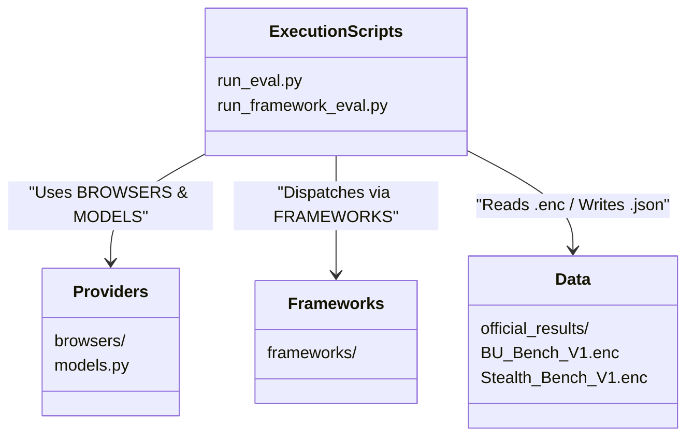
**Sources:** [browsers/__init__.py:33-45](), [pyproject.toml:1-12](), [README.md:138-154]()

---

# Page: Getting Started

# Getting Started

<details>
<summary>Relevant source files</summary>

The following files were used as context for generating this wiki page:

- [.env.example](.env.example)
- [.gitignore](.gitignore)
- [BU_Bench_V1.enc](BU_Bench_V1.enc)
- [browsers/__init__.py](browsers/__init__.py)
- [browsers/driver.py](browsers/driver.py)
- [fonts/GeistMono-Medium.otf](fonts/GeistMono-Medium.otf)
- [pyproject.toml](pyproject.toml)
- [uv.lock](uv.lock)

</details>


This page provides a comprehensive guide for setting up the `browser-use-benchmark` repository. It covers environment configuration, dependency management with `uv`, and the execution of initial evaluations.

The benchmark suite is designed to evaluate browser automation agents across two primary dimensions: functional task completion (BU Bench V1) and anti-bot bypass capabilities (Stealth Bench V1).

## Prerequisites

The project utilizes `uv` for extremely fast Python package management and deterministic builds via `uv.lock`.

*   **Python**: Version 3.11 or higher is required [pyproject.toml:5-5]().
*   **uv**: It is recommended to have `uv` installed to manage the virtual environment and dependencies [uv.lock:1-7]().

## Installation

1.  **Clone the Repository**:
    ```bash
    git clone https://github.com/browser-use/benchmark
    cd benchmark
    ```

2.  **Install Dependencies**:
    The project defines its core requirements in `pyproject.toml`, including `browser-use`, `cryptography` (for task decryption), and `httpx` [pyproject.toml:6-12]().
    ```bash
    # Install main dependencies
    uv sync

    # Install optional dependencies for generating plots
    uv sync --group plots
    ```

3.  **Playwright Setup**:
    If you plan to use local browser providers (`local_headful` or `local_headless`), you must install the Playwright browser binaries [browsers/__init__.py:40-41]().
    ```bash
    uv run playwright install chromium
    ```

## Environment Configuration

The system relies on a `.env` file for API keys. A template is provided in `.env.example` [.env.example:1-24]().

### Required Keys
To run a standard evaluation with the default Judge LLM, you need:
*   `ANTHROPIC_API_KEY`: For running Claude-based agents.
*   `GOOGLE_API_KEY`: Required for the **Judge LLM** (typically `gemini-2.0-flash`), which grades the task outcomes [.env.example:2-4]().

### Provider Keys
If using managed browser clouds instead of local Chromium, you must provide the corresponding key:
*   `BROWSER_USE_API_KEY`: For `browser-use-cloud` [.env.example:1-1]().
*   `STEEL_API_KEY`, `BROWSERBASE_API_KEY`, `HYPERBROWSER_API_KEY`, etc. [.env.example:15-22]().

### Data Flow: Environment to Code
The following diagram illustrates how environment variables are consumed by the browser registry and model factory.

**Configuration Mapping (NL to Code Space)**
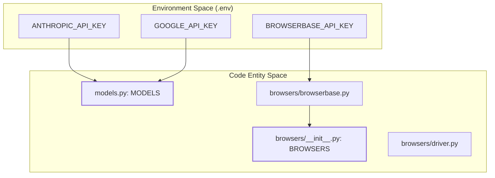
Sources: [.env.example:1-24](), [browsers/__init__.py:33-45](), [browsers/driver.py:9-11]()

## System Architecture Overview

The benchmark bridges high-level task descriptions with low-level browser control.

**Execution Flow: Task to Result**
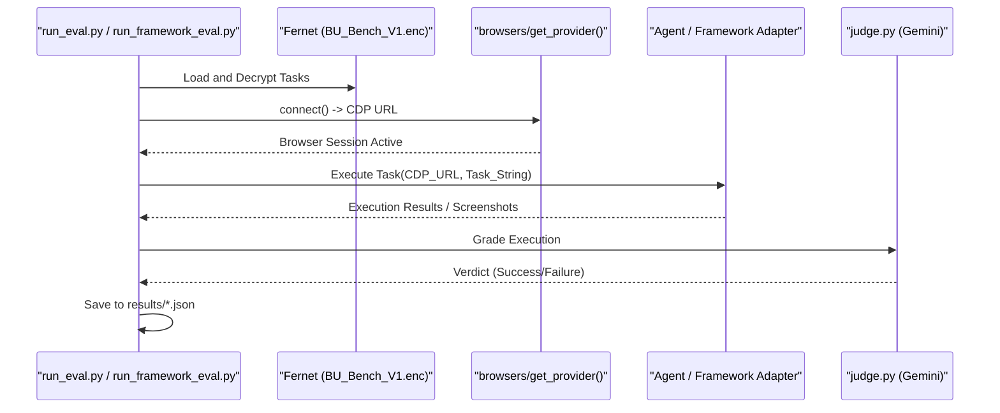
Sources: [browsers/__init__.py:48-52](), [browsers/driver.py:14-28](), [pyproject.toml:9-9]()

## Running Your First Evaluation

### 1. BU Bench V1 (Functional)
To run the standard 100-task functional benchmark using the native `browser-use` agent:

```bash
# Run with local headless browser and Claude 3.5 Sonnet
python run_eval.py --model anthropic/claude-3-5-sonnet-20241022 --browser local_headless
```

### 2. Stealth Bench V1 (Anti-bot)
To evaluate how well a browser provider bypasses bot detection:

```bash
# Run stealth tests against a specific provider
python stealth_bench/run_stealth_eval.py --browser driver
```

## Key Files Summary

| File | Purpose |
| :--- | :--- |
| `pyproject.toml` | Defines project metadata and core dependencies (`browser-use`, `httpx`) [pyproject.toml:1-12](). |
| `uv.lock` | Ensures deterministic dependency resolution across all environments [uv.lock:1-7](). |
| `.env.example` | Template for required API keys for LLMs and Browser Providers [.env.example:1-24](). |
| `BU_Bench_V1.enc` | Encrypted task definitions for the functional benchmark [BU_Bench_V1.enc:1-1](). |
| `browsers/` | Registry of all supported browser connection logic (Local, Steel, Browserbase, etc.) [browsers/__init__.py:33-45](). |

## Troubleshooting

*   **Missing API Keys**: If an evaluation fails immediately, verify that `GOOGLE_API_KEY` is set; the Judge LLM cannot function without it.
*   **429 Rate Limits**: The benchmark includes a `retry_on_429` utility in the browser providers to handle concurrency bottlenecks [browsers/util.py:5-5]().
*   **Dependency Conflicts**: If using `pip` instead of `uv`, ensure your environment matches the versions in `uv.lock` to avoid regressions in `browser-use` behavior [uv.lock:9-39]().

Sources: [pyproject.toml:1-23](), [uv.lock:1-50](), [.env.example:1-24](), [browsers/__init__.py:1-53](), [browsers/driver.py:1-44]()

---

# Page: Repository Structure

# Repository Structure

<details>
<summary>Relevant source files</summary>

The following files were used as context for generating this wiki page:

- [BU_Bench_V1.enc](BU_Bench_V1.enc)
- [README.md](README.md)
- [Stealth_Bench_V1.enc](Stealth_Bench_V1.enc)
- [browsers/anchor.py](browsers/anchor.py)
- [browsers/browserbase.py](browsers/browserbase.py)
- [browsers/browserless.py](browsers/browserless.py)
- [browsers/hyperbrowser.py](browsers/hyperbrowser.py)
- [browsers/local_headful.py](browsers/local_headful.py)
- [fonts/GeistMono-Medium.otf](fonts/GeistMono-Medium.otf)
- [pyproject.toml](pyproject.toml)
- [uv.lock](uv.lock)

</details>


This page provides a technical map of the `browser-use/benchmark` repository. The codebase is structured to support multi-framework evaluation across two distinct benchmark suites: **BU Bench V1** (agentic task completion) and **Stealth Bench V1** (anti-bot bypass).

## Top-Level Directory Layout

The repository follows a modular structure where evaluation logic is separated from framework-specific adapters and browser provisioning logic.

| Directory / File | Description |
| :--- | :--- |
| `frameworks/` | Contains adapters for various agent frameworks (e.g., `browser-use`, `claude-code`, `stagehand`). |
| `browsers/` | Provider-specific modules for connecting to cloud and local browsers. |
| `stealth_bench/` | Sub-project containing task definitions and specialized plotting logic for the Stealth benchmark. |
| `official_results/` | Source of truth for benchmark results used in public comparisons. |
| `results/` | Local directory for storing summary JSON files from evaluation runs (gitignored). |
| `run_data/` | Local directory for detailed execution traces, including screenshots and decrypted task text (gitignored). |
| `run_eval.py` | The primary entry point for running native `browser-use` evaluations [run_eval.py:1-10](). |
| `run_framework_eval.py`| Orchestrator for running benchmarks across different framework adapters [README.md:145-149](). |

### Code Entity Mapping: Evaluation Flow

The following diagram illustrates how the top-level scripts interact with the internal modules to execute a benchmark task.

**Evaluation Component Interconnect**
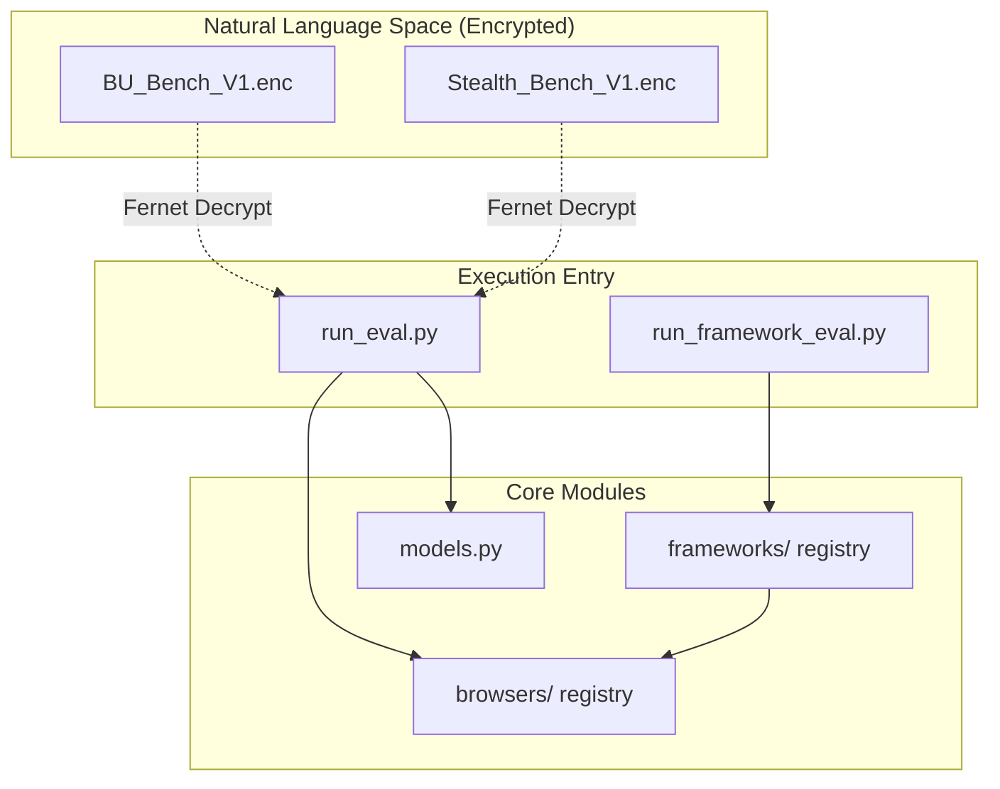
Sources: [README.md:68-83](), [README.md:145-154](), [run_eval.py:1-20]()

---

## Task Definitions and Security

Benchmark tasks are stored in encrypted `.enc` files to prevent data contamination in LLM training sets. 

*   **Encryption Mechanism**: Tasks are encrypted using `cryptography.fernet` [README.md:72-74](). 
*   **BU Bench V1**: 100 tasks covering custom interaction challenges, WebBench, Mind2Web, and GAIA [README.md:181-190]().
*   **Stealth Bench V1**: 71 tasks specifically targeting anti-bot protections like Cloudflare, Akamai, and Datadome [README.md:35-37]().

The `run_eval.py` and `run_framework_eval.py` scripts decrypt these tasks in-memory during the execution loop [README.md:147-149]().

Sources: [README.md:68-78](), [README.md:145-150]()

---

## Frameworks and Adapters

The `frameworks/` directory implements a registry pattern. Each sub-directory (e.g., `frameworks/browser_use/`) contains a `run_task.py` or similar adapter that maps the benchmark's standardized `task` input to the framework's specific API.

*   **Dispatch Logic**: `run_framework_eval.py` uses the `--framework` argument to look up the corresponding adapter in the `FRAMEWORKS` registry.
*   **Isolation**: Many adapters shell out to external processes (like Node.js for `stagehand` or Rust for `but-rust`) to ensure environment isolation.

Sources: [README.md:151-157]()

---

## Browser Provisioning (`browsers/`)

The `browsers/` module provides a unified interface for managing browser lifecycles. Each provider implements a `connect()` and `disconnect()` function.

| Provider Module | Service | Key Implementation Detail |
| :--- | :--- | :--- |
| `anchor.py` | Anchor Browser | Uses `anchor_residential` proxy and enables `extra_stealth` [browsers/anchor.py:27-33](). |
| `browserbase.py` | Browserbase | Manages session IDs via `/v1/sessions` and enables `solveCaptchas` [browsers/browserbase.py:22-35](). |
| `hyperbrowser.py` | Hyperbrowser | Connects via `wsEndpoint` with `useStealth` enabled [browsers/hyperbrowser.py:24-32](). |
| `local_headful.py`| Local Playwright | Returns `None` to signal native local launch [browsers/local_headful.py:6-7](). |

**Browser Connection Entity Map**
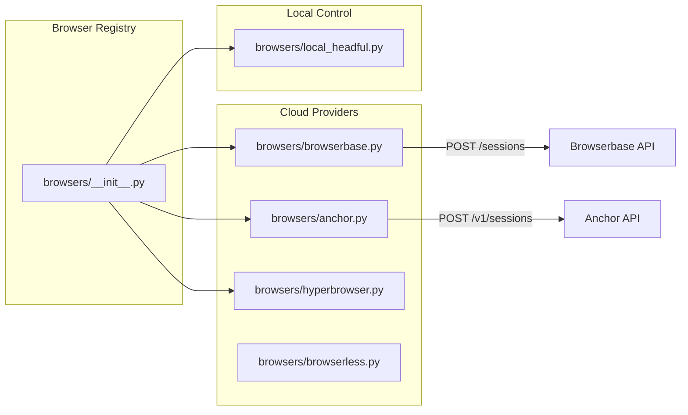
Sources: [browsers/anchor.py:16-44](), [browsers/browserbase.py:16-36](), [browsers/hyperbrowser.py:16-32](), [browsers/local_headful.py:1-11]()

---

## Results and Naming Conventions

The benchmark produces two types of output stored in `results/` and `official_results/`.

### Result File Naming
Files follow a strict naming convention to facilitate automated plotting:
`{Framework}_{version}_browser_{browser}_model_{model}.json`

### Data Flow
1.  **Execution**: `run_eval.py` or `run_framework_eval.py` executes tasks.
2.  **Persistence**: Summary statistics (success rate, duration, cost) are saved to a JSON file. Detailed logs and screenshots are saved to `run_data/{run_id}/`.
3.  **Aggregation**: The `official_results/` directory stores finalized runs that have been verified.
4.  **Visualization**: `generate_plots.py` reads these JSON files to produce the comparison charts seen in the README.

Sources: [README.md:143-144](), [README.md:159-161]()

---

# Page: BU Bench V1 — Task Evaluation

# BU Bench V1 — Task Evaluation

<details>
<summary>Relevant source files</summary>

The following files were used as context for generating this wiki page:

- [README.md](README.md)
- [judge.py](judge.py)
- [run_eval.py](run_eval.py)

</details>


BU Bench V1 is a comprehensive benchmark consisting of **100 hand-selected tasks** designed to evaluate the performance of browser automation agents. The benchmark tests agents across diverse scenarios, ranging from simple information retrieval to complex multi-step web navigation and page interaction challenges.

### Task Composition
The 100 tasks are drawn from both established datasets and custom-built challenges:

| Source | Tasks | Description |
| :--- | :--- | :--- |
| **Custom** | 20 | Specific page interaction and edge-case challenges |
| **WebBench** | 20 | Standard web browsing and search tasks |
| **Mind2Web 2** | 20 | Complex, multi-step web navigation trajectories |
| **GAIA** | 20 | General AI assistant tasks requiring browser access |
| **VisualWebBench** | 20 | Tasks emphasizing visual understanding of web UI |

Sources: [README.md:181-190]()

---

## Evaluation Architecture

The evaluation system is built to be framework-agnostic, allowing for the comparison of different agent architectures (e.g., `browser-use` native, `Claude Code`, `Stagehand`) using a unified judge and browser provisioning layer.

### System Data Flow
The following diagram illustrates how a task moves from the encrypted dataset through the execution and judging phases.

**Task Lifecycle and Code Entities**
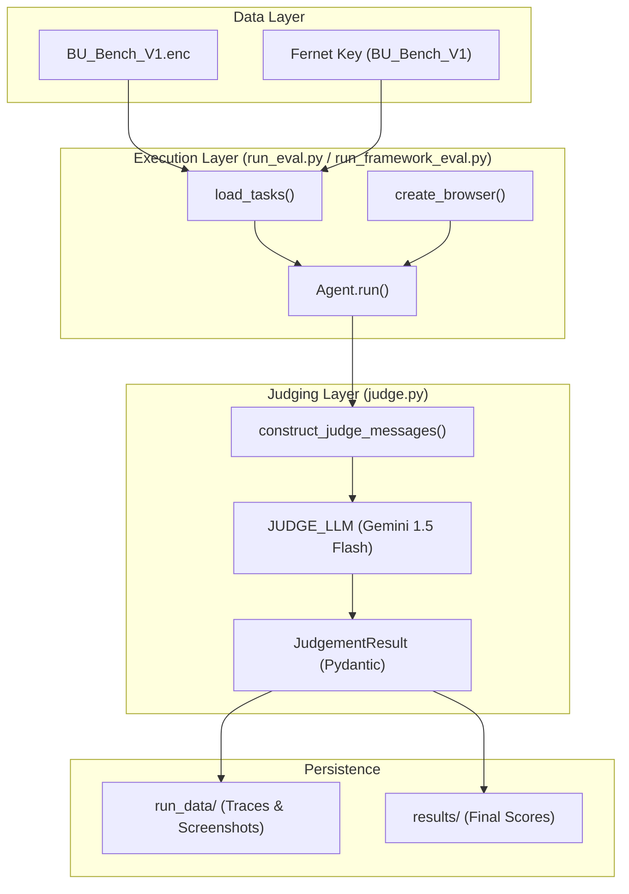
Sources: [run_eval.py:42-46](), [run_eval.py:63-67](), [run_eval.py:103-116](), [run_eval.py:151-161](), [judge.py:14-21]()

---

## Core Components

### 1. Evaluation Scripts
The primary entry point for running the benchmark is `run_eval.py`. It manages the lifecycle of an evaluation run, including:
*   **Decryption**: Loading tasks from `BU_Bench_V1.enc` using a Fernet key derived from the suite name.
*   **Concurrency**: Managing task execution via an `asyncio.Semaphore` (default `MAX_CONCURRENT = 3`).
*   **Browser Provisioning**: Utilizing the `browsers/` module to connect to local or cloud-based browser instances.

For details, see [run_eval.py — Native Evaluation Script](#2.1).

Sources: [run_eval.py:44-46](), [run_eval.py:63-67](), [run_eval.py:98-103]()

### 2. The Judge System
Consistency in evaluation is maintained by a centralized "Judge LLM" (Gemini 1.5 Flash). The judge evaluates the agent's execution trace, including the final text output and a sequence of screenshots. It produces a `JudgementResult` containing a boolean `verdict`, detailed `reasoning`, and flags for `impossible_task` or `reached_captcha`.

For details, see [judge.py — Automated Grading](#2.2).

Sources: [run_eval.py:42-43](), [judge.py:14-21](), [judge.py:79-89]()

### 3. Distributed Runner
To handle large-scale evaluations across many models and frameworks, the repository includes a distributed runner system optimized for GitHub Actions.
*   **`orcheator.py`**: Acts as the leader, dispatching batches of tasks and aggregating results.
*   **`run_batch.py`**: Acts as the worker, executing a specific subset of tasks assigned by the orchestrator.

For details, see [Distributed Runner — orchestrator.py and run_batch.py](#2.3).

---

## Result Storage and Traces

Evaluation outputs are stored in two distinct locations to balance data privacy and analysis needs:

| Directory | Content | Description |
| :--- | :--- | :--- |
| `results/` | JSON Summary | Contains high-level metrics: `tasks_completed`, `tasks_successful`, `total_duration`, and `total_cost`. |
| `run_data/` | Detailed Traces | Includes decrypted task text, ground truth, full step-by-step agent logs, and base64 screenshots. |

**Important**: `run_data/` contains sensitive decrypted task information and is gitignored. It is intended for local verification and debugging only.

Sources: [README.md:143-144](), [README.md:159-161](), [run_eval.py:168-187]()

---

# Page: run_eval.py — Native Evaluation Script

# run_eval.py — Native Evaluation Script

<details>
<summary>Relevant source files</summary>

The following files were used as context for generating this wiki page:

- [README.md](README.md)
- [judge.py](judge.py)
- [run_eval.py](run_eval.py)

</details>


`run_eval.py` is the primary entry point for executing the **BU Bench V1** benchmark suite. It orchestrates the end-to-end evaluation lifecycle, including task decryption, browser provisioning, agent execution, and automated judging. The script is designed for high-concurrency evaluation while maintaining strict isolation between tasks and providing detailed telemetry for each run.

### Implementation Overview

The script follows a structured flow: it initializes the environment, loads encrypted tasks, and enters an asynchronous execution loop managed by a semaphore to control resource usage.

#### Core Logic Flow
1.  **Environment Setup**: Loads `.env` variables and configures logging levels to suppress noise [run_eval.py:15-40]().
2.  **Task Loading**: Decrypts `BU_Bench_V1.enc` using a Fernet key derived from a SHA-256 hash of the benchmark name [run_eval.py:63-66]().
3.  **Concurrency Management**: Uses `asyncio.Semaphore(MAX_CONCURRENT)` to limit the number of active browser sessions [run_eval.py:45, 98]().
4.  **Execution Loop**: For each task, it provisions a browser, runs the `browser_use.Agent`, and invokes the `JUDGE_LLM` (Gemini 2.5 Flash) to determine success [run_eval.py:107-161]().
5.  **Persistence**: Saves granular traces to `run_data/` and summary statistics to `results/` [run_eval.py:168-204]().

### Data Flow and Code Entity Mapping

The following diagram illustrates how the natural language concept of "Evaluating a Task" maps to specific code entities and data structures within the script.

**Task Evaluation Data Flow**
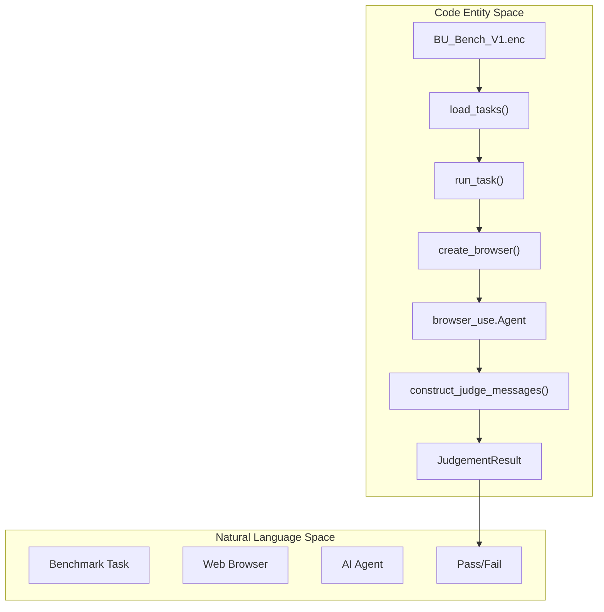
**Sources:** [run_eval.py:63-66](), [run_eval.py:69-81](), [run_eval.py:84-161](), [judge.py:28-49]()

### Task Loading and Decryption

Benchmark tasks are stored in `BU_Bench_V1.enc` to prevent accidental exposure of ground truth and task descriptions to web crawlers or LLM training sets. The decryption process uses the `cryptography.fernet` library.

*   **Key Generation**: A deterministic key is generated by taking the SHA-256 hash of the string `"BU_Bench_V1"` and base64 encoding it [run_eval.py:64]().
*   **Decryption**: The `load_tasks` function reads the file, decodes the base64 content, and decrypts it using the generated key before parsing the resulting JSON [run_eval.py:65-66]().

**Sources:** [run_eval.py:63-67]()

### Browser Provisioning

The `create_browser()` function serves as a factory for browser instances, supporting both local and cloud-based providers.

| Provider Type | Implementation Logic |
| :--- | :--- |
| **Native Cloud** | Uses `Browser(use_cloud=True)` for `browser-use-cloud` [run_eval.py:76-77](). |
| **CDP Proxy** | Connects via `Browser(cdp_url=...)` for providers like Anchor or Steel [run_eval.py:78-81](). |
| **Local** | Launches built-in Chromium via Playwright (headless or headful) [run_eval.py:79-80](). |

**Sources:** [run_eval.py:69-81](), [browsers/__init__.py:1-15]()

### Agent Execution and Timeout

The agent execution is wrapped in a timeout mechanism to prevent hung processes from exhausting resources.

*   **TASK_TIMEOUT**: Each task is capped at 1800 seconds (30 minutes) [run_eval.py:46]().
*   **Execution**: `asyncio.wait_for(agent.run(), timeout=TASK_TIMEOUT)` manages the lifecycle [run_eval.py:114-116]().
*   **Cleanup**: On timeout, the script explicitly calls `browser.stop()` and `browser_provider.disconnect()` to ensure no orphaned processes remain [run_eval.py:118-120]().

**Sources:** [run_eval.py:46](), [run_eval.py:114-132]()

### The Evaluation Loop

The core logic of `run_task()` bridges the execution of the agent with the automated judging system.

**Agent Execution to Judge Workflow**
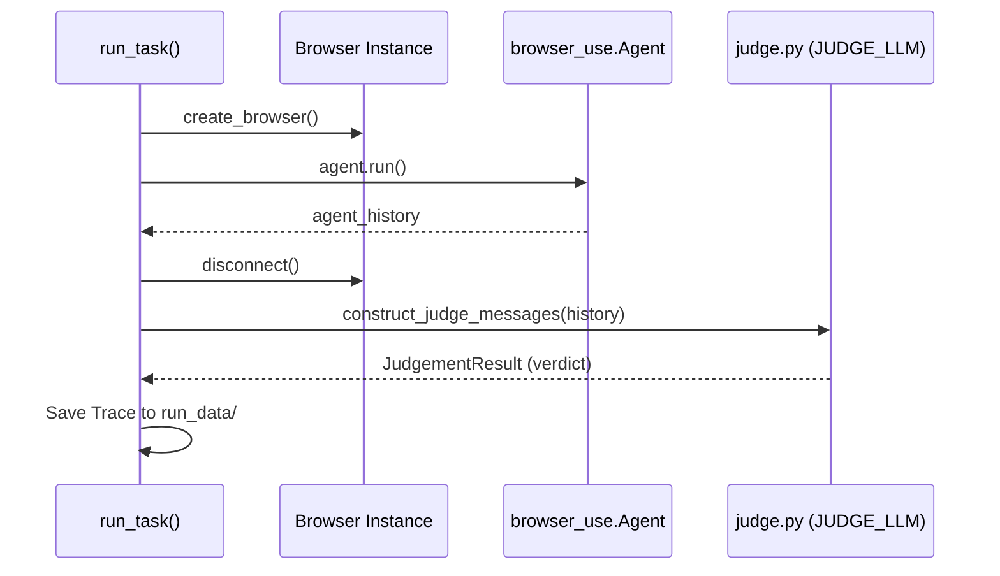
**Sources:** [run_eval.py:84-187](), [judge.py:28-49]()

### Persistence and Results

The script generates two types of output for every evaluation run:

1.  **Run Data (`run_data/{task_id}.json`)**: A detailed trace containing the task description, final result, individual steps, ground truth, and base64-encoded screenshots [run_eval.py:170-187]().
2.  **Summary Results (`results/{filename}.json`)**: A summary file named using the pattern `{Framework}_{Version}_browser_{Browser}_model_{Model}.json`. It aggregates metrics including:
    *   `tasks_completed`: Total tasks attempted.
    *   `tasks_successful`: Count of tasks where the judge gave a `true` verdict.
    *   `total_steps`: Sum of steps across all tasks.
    *   `total_duration`: Total execution time in seconds.
    *   `total_cost`: Aggregated API costs [run_eval.py:189-204, 252-273]().

**Sources:** [run_eval.py:168-204](), [run_eval.py:252-273]()

---

# Page: judge.py — Automated Grading

# judge.py — Automated Grading

<details>
<summary>Relevant source files</summary>

The following files were used as context for generating this wiki page:

- [judge.py](judge.py)
- [run_eval.py](run_eval.py)

</details>


The `judge.py` module provides the automated evaluation logic for the browser-use benchmark. It leverages a high-performance LLM (specifically `gemini-2.5-flash`) to act as a "Judge" that inspects agent execution traces, screenshots, and final outputs to determine if a task was successfully completed according to the user's intent and any provided ground truth.

### Judgement Schema

The system uses a structured Pydantic model to ensure consistent evaluation output. This model captures not just a binary success/failure verdict, but also the reasoning and specific failure modes encountered during the browser session.

#### The JudgementResult Model
Defined in `[judge.py:14-20]()`, the `JudgementResult` class contains:

| Field | Type | Description |
| :--- | :--- | :--- |
| `reasoning` | `str \| None` | A detailed explanation of why the judge reached its conclusion. |
| `verdict` | `bool` | The final pass/fail grade for the task. |
| `failure_reason` | `str \| None` | Specific description of what went wrong if `verdict` is `False`. |
| `impossible_task` | `bool` | Flagged if the task could not be completed due to external factors (e.g., missing credentials). |
| `reached_captcha` | `bool` | Flagged if the agent was blocked by anti-bot measures. |

**Sources:** `[judge.py:14-20]()`

---

### Data Flow and Processing

The judge does not process the raw browser stream. Instead, it operates on an execution trace collected after the agent completes its run.

#### 1. Input Preparation
The `run_task` function in `run_eval.py` collects several inputs from the `agent_history` before calling the judge:
*   **Task Description**: The original prompt.
*   **Final Result**: The text the agent returned as its "done" message.
*   **Agent Steps**: A list of formatted descriptions for every action taken.
*   **Screenshots**: Base64 encoded images of the browser state at various steps.
*   **Ground Truth**: (Optional) Expected factual answers or specific evaluation criteria.

#### 2. Screenshot Deduplication and Selection
To stay within LLM context limits and focus on relevant state changes, `construct_judge_messages` performs deduplication. It selects the last $N$ (default 10) unique screenshots by iterating through the history in reverse order `[judge.py:55-58]()`.

#### 3. Text Truncation
To prevent context overflow, the task description, final result, and step history are truncated to 40,000 characters each using the `_truncate_text` utility `[judge.py:23-25]()`.

#### 4. Message Construction
The `construct_judge_messages` function assembles these components into a list of `BaseMessage` objects (System, User, and Image parts) compatible with the `browser-use` LLM interface `[judge.py:28-64]()`.

**Sources:** `[run_eval.py:134-161]()`, `[judge.py:23-64]()`

---

### Evaluation Criteria

The Judge LLM is governed by a rigorous system prompt that defines five primary evaluation criteria and strict failure conditions.

#### Primary Evaluation Criteria
The judge evaluates the trajectory based on the following hierarchy:
1.  **Task Satisfaction**: Did the agent accomplish the core intent? `[judge.py:84-84]()`
2.  **Output Quality**: Is the final result complete and in the requested format? `[judge.py:85-85]()`
3.  **Tool Effectiveness**: Were browser interactions appropriate and successful? `[judge.py:86-86]()`
4.  **Agent Reasoning**: Quality of planning and decision-making. `[judge.py:87-87]()`
5.  **Browser Handling**: Stability, recovery, and technical execution. `[judge.py:88-88]()`

#### Ground Truth Precedence
If a `ground_truth` is provided in the task definition, it takes **absolute precedence** over all other criteria. If the agent's output contradicts the ground truth, the verdict must be `False` `[judge.py:76-77]()`.

#### Automatic Failure Conditions
The verdict is automatically set to `False` if any of the following occur:
*   Blocked by CAPTCHA or missing authentication `[judge.py:109-109]()`.
*   Agent makes up information not present in screenshots (hallucination) `[judge.py:117-117]()`.
*   The agent calls the "done" action before completing all key points of the task `[judge.py:118-118]()`.
*   Infinite loops or browser crashes `[judge.py:111-114]()`.

**Sources:** `[judge.py:66-119]()`

---

### Technical Architecture Diagrams

#### Judge Integration Flow
This diagram shows how the `run_task` function orchestrates the agent and the judge.

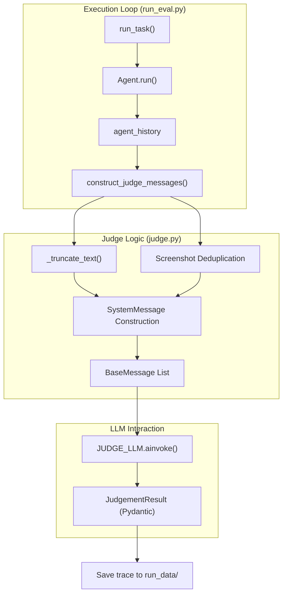
**Sources:** `[run_eval.py:107-161]()`, `[judge.py:28-64]()`

#### Code Entity Mapping: From Trace to Verdict
This diagram bridges the natural language concepts used in the judge's prompt to the specific code entities in the system.

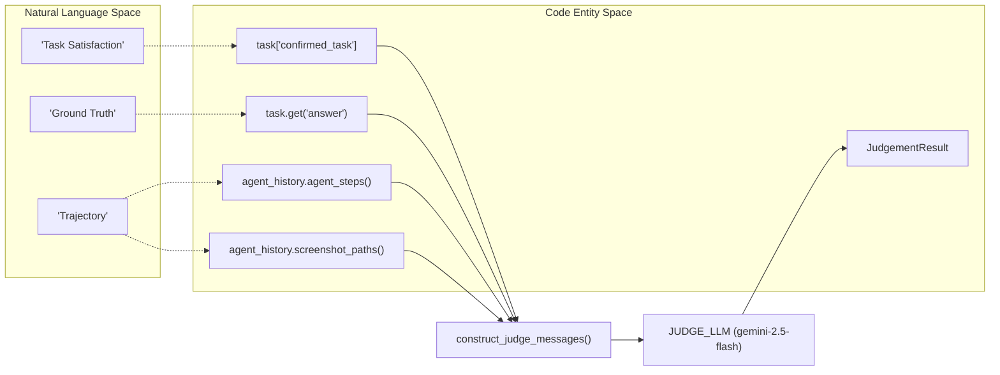
**Sources:** `[run_eval.py:43-44]()`, `[run_eval.py:140-157]()`, `[judge.py:14-20]()`

---

### Implementation Details: Screenshot Selection
The judge deduplicates screenshots to avoid showing the LLM identical frames (e.g., while waiting for a page to load).

```python
# From judge.py:55-58
seen = set()
unique = [s for s in reversed(screenshots_b64) if s not in seen and not seen.add(s)]
selected = list(reversed(unique[:max_images]))
```
This logic ensures that the **most recent** unique states of the browser are prioritized for the judge's evaluation context.

**Sources:** `[judge.py:55-58]()`

---

# Page: Distributed Runner — orchestrator.py and run_batch.py

# Distributed Runner — orchestrator.py and run_batch.py

<details>
<summary>Relevant source files</summary>

The following files were used as context for generating this wiki page:

- [.github/workflows/eval.yaml](.github/workflows/eval.yaml)
- [orchestrator.py](orchestrator.py)
- [results/BrowserUse_0.11.5_browser_BrowserUseCloud_model_ChatBrowserUse-2.json](results/BrowserUse_0.11.5_browser_BrowserUseCloud_model_ChatBrowserUse-2.json)
- [run_batch.py](run_batch.py)

</details>


The distributed runner system enables large-scale benchmarking by parallelizing evaluation tasks across multiple GitHub Actions runners. It follows a leader-worker architecture where `orchestrator.py` acts as the central controller (leader) and `run_batch.py` executes specific task subsets on ephemeral workers.

### System Architecture

The system is designed to handle the full BU Bench V1 suite (100 tasks) across multiple models and multiple iterations per model. To prevent individual runner timeouts and maximize throughput, tasks are partitioned into batches.

#### Distributed Runner Logic Flow
"The following diagram illustrates the interaction between the local Orchestrator, GitHub Actions API, and the Batch Workers."

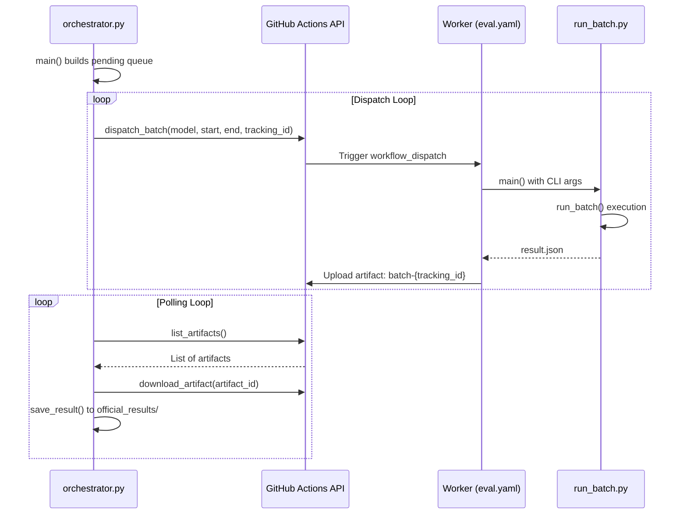
Sources: [orchestrator.py:118-171](), [run_batch.py:70-84](), [.github/workflows/eval.yaml:33-74]()

---

### Orchestrator Logic (`orchestrator.py`)

The orchestrator is responsible for lifecycle management of the entire evaluation run. It maintains a queue of batches and manages concurrency limits to avoid hitting GitHub API rate limits or runner exhaustion.

#### Key Components:
- **Batching**: The 100 tasks in BU Bench V1 are split into batches of 10 (`BATCH_SIZE = 10`) [[orchestrator.py:22-22]()].
- **Tracking**: Each batch is assigned a unique `tracking_id` (UUID) and a `run_start` identifier (timestamp) [[orchestrator.py:123-126]()].
- **Concurrency**: It limits active batches via `MAX_CONCURRENT_BATCHES` (default: 25) [[orchestrator.py:23-23]()].
- **Polling**: Every 30 seconds, it checks for new artifacts using `list_artifacts()` and matches them to dispatched batches using the `batch-{tracking_id}` naming convention [[orchestrator.py:24-24](), [orchestrator.py:153-162]()].

#### Core Functions:
| Function | Description |
| :--- | :--- |
| `dispatch_batch` | Sends a `POST` request to the GitHub `dispatches` endpoint with task indices and model info [[orchestrator.py:43-48]()]. |
| `list_artifacts` | Fetches the latest 100 artifacts from the repository [[orchestrator.py:51-69]()]. |
| `download_artifact` | Downloads the ZIP from GitHub, extracts the JSON, and parses it [[orchestrator.py:72-89]()]. |
| `save_result` | Aggregates metrics (steps, cost, success) into the model's file in `official_results/` [[orchestrator.py:92-115]()]. |

Sources: [orchestrator.py:16-41](), [orchestrator.py:43-115]()

---

### Worker Execution (`run_batch.py`)

The worker script runs within the GitHub Action environment defined in `.github/workflows/eval.yaml`. It is optimized for high-concurrency execution of a specific task slice.

#### Task Interleaving
To ensure that every batch contains a representative mix of task difficulties (ranging from easy to hard), `run_batch.py` uses an `interleave` function. This reorders the 100 tasks (5 categories of 20 tasks each) so that a batch of 10 contains 2 tasks from each category [[run_batch.py:17-23]()].

#### Execution Loop
The `run_batch()` function initializes the requested LLM from the `MODELS` registry and uses an `asyncio.Semaphore` to control local concurrency (default: 3 parallel tasks) [[run_batch.py:46-52]()]. It calls the core `run_task` function from the native evaluation script to perform the actual work [[run_batch.py:13-13](), [run_batch.py:52-52]()].

#### Model Registry (`MODELS`)
The script maintains its own mapping of model strings to `browser_use` LLM factories:
- **Browser-Use**: `ChatBrowserUse(model="bu-1-0")` [[run_batch.py:27-28]()].
- **OpenAI**: `ChatOpenAI` with `gpt-5` variants [[run_batch.py:30-32]()].
- **Anthropic**: `ChatAnthropic` for Claude 3.5 and 4.5 models [[run_batch.py:34-37]()].
- **Google**: `ChatGoogle` for Gemini flash and pro models [[run_batch.py:39-42]()].

Sources: [run_batch.py:17-43](), [run_batch.py:46-67]()

---

### Workflow Definition (`eval.yaml`)

The GitHub Actions workflow serves as the infrastructure provider. It is triggered via `workflow_dispatch` by the orchestrator.

#### Workflow Inputs and Environment
The workflow accepts several inputs that are passed directly to `run_batch.py`:
- `model`, `start`, `end`, `parallel`, `tracking_id`, and `run_start` [[.github/workflows/eval.yaml:5-30]()].

It provides the necessary API keys via GitHub Secrets:
- `OPENAI_API_KEY`, `ANTHROPIC_API_KEY`, `GOOGLE_API_KEY`, and `BROWSER_USE_API_KEY` [[.github/workflows/eval.yaml:54-57]()].

#### Artifact Persistence
After `run_batch.py` completes, the workflow uploads `result.json` as a GitHub artifact named `batch-${{ inputs.tracking_id }}`. This artifact is kept for 30 days [[.github/workflows/eval.yaml:68-73]()].

Sources: [.github/workflows/eval.yaml:4-74]()

---

### Data Aggregation and Schema

The results are aggregated into `official_results/` using a specific naming convention: `BrowserUse_{version}_browser_{provider}_model_{model}.json` [[orchestrator.py:95-95]()].

#### Result Schema (`official_results/`)
Each file contains a list of run objects, keyed by `run_start`.

```json
[
  {
    "run_start": "20260128_200943_0",
    "tasks_completed": 100,
    "tasks_successful": 85,
    "total_steps": 1240,
    "total_duration": 4500.5,
    "total_cost": 0.15
  }
]
```
Sources: [orchestrator.py:105-113](), [results/BrowserUse_0.11.5_browser_BrowserUseCloud_model_ChatBrowserUse-2.json:1-10]()

#### Aggregation Entity Map
"This diagram maps the logical data aggregation concepts to the code variables and files that handle them."

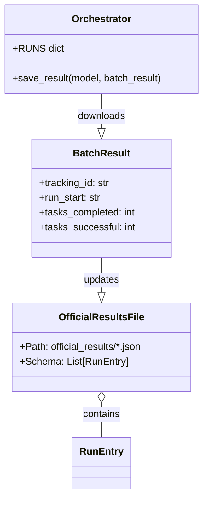
Sources: [orchestrator.py:27-36](), [orchestrator.py:92-115](), [run_batch.py:55-67]()

---

# Page: Framework Adapters

# Framework Adapters

<details>
<summary>Relevant source files</summary>

The following files were used as context for generating this wiki page:

- [frameworks/__init__.py](frameworks/__init__.py)
- [frameworks/browser_use_cloud_api_v2/run_task.py](frameworks/browser_use_cloud_api_v2/run_task.py)
- [frameworks/browser_use_cloud_api_v3/run_task.py](frameworks/browser_use_cloud_api_v3/run_task.py)
- [frameworks/browserbase_agent/package.json](frameworks/browserbase_agent/package.json)
- [frameworks/browserbase_agent/run_task.py](frameworks/browserbase_agent/run_task.py)
- [frameworks/claude_code_harness/run_task.py](frameworks/claude_code_harness/run_task.py)
- [frameworks/claude_code_harness/system_prompt.md](frameworks/claude_code_harness/system_prompt.md)
- [frameworks/claude_code_harness_ab/system_prompt.md](frameworks/claude_code_harness_ab/system_prompt.md)
- [frameworks/claude_code_harness_bu_cli/system_prompt.md](frameworks/claude_code_harness_bu_cli/system_prompt.md)
- [run_framework_eval.py](run_framework_eval.py)

</details>


The framework adapter system allows the benchmark to evaluate any agentic web-browsing framework using a unified interface. While `run_eval.py` is dedicated to the native `browser-use` library, `run_framework_eval.py` serves as a generic orchestrator that dispatches tasks to isolated runners for different frameworks (e.g., Claude Code, Stagehand, or Cloud APIs).

### Framework Dispatch Logic

The `run_framework_eval.py` script manages the high-level evaluation loop. It loads tasks from the encrypted benchmark file and, for each task, spawns a separate subprocess to execute the specific framework's adapter [run_framework_eval.py:1-53](). This isolation ensures that dependency conflicts between different frameworks (like varying Playwright or Pydantic versions) do not interfere with the benchmark orchestrator.

The orchestrator uses a `FRAMEWORKS` registry to validate supported adapters and their compatible browser providers [frameworks/__init__.py:81-143]().

#### Framework Orchestration Flow
"Framework Evaluation Flow"
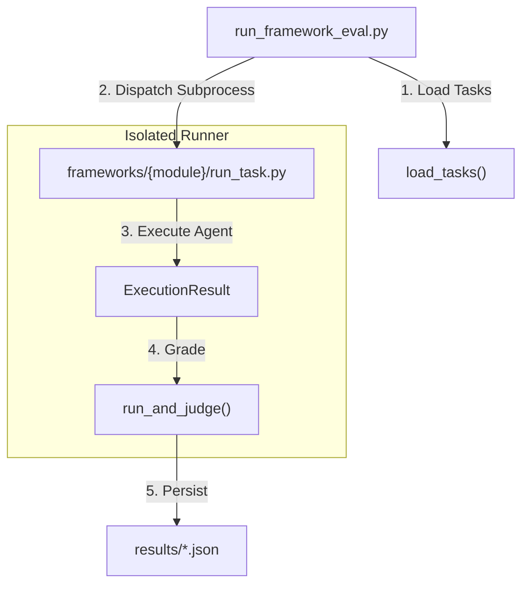
Sources: [run_framework_eval.py:87-157](), [frameworks/__init__.py:63-71](), [frameworks/__init__.py:228-275]()

### The Framework Registry

All supported adapters are registered in `frameworks/__init__.py`. This registry defines which browser providers are valid for a given framework and points to the relevant source repository for version tracking.

| Framework Key | Module Name | Compatible Browsers | Primary Role |
| :--- | :--- | :--- | :--- |
| `browser-use` | `browser_use` | Cloud, Local, etc. | Native library adapter |
| `browser-use-cloud-api-v3` | `browser_use_cloud_api_v3` | `integrated` | Server-side Agent API |
| `claude-code-harness` | `claude_code_harness` | `browser-use-cloud` | Claude Code CLI wrapper |
| `browserbase-agent` | `browserbase_agent` | `integrated` | Stagehand SDK + Cloud |
| `bcode` | `bcode` | `browser-use-cloud` | Browsercode CLI adapter |

Sources: [frameworks/__init__.py:81-143](), [frameworks/__init__.py:146-150]()

### Shared Evaluation Interface

To ensure consistency across frameworks, every adapter must return an `ExecutionResult` dataclass and utilize the `run_and_judge()` helper.

#### ExecutionResult Dataclass
This structure standardizes the output of disparate agents into a format the benchmark judge can process [frameworks/__init__.py:63-71]().
* `final_result`: The text answer provided by the agent.
* `steps`: A list of strings describing actions taken.
* `screenshots_b64`: Base64 encoded images for visual verification.
* `num_steps`: Total count of actions.
* `duration_seconds`: Wall-clock time taken.

#### run_and_judge()
This shared flow performs the following:
1.  **Execution**: Calls the framework-specific `execute_fn`.
2.  **Grading**: Sends the `ExecutionResult` to the `JudgeLLM` (Gemini 2.5 Flash) [frameworks/__init__.py:191-206]().
3.  **Persistence**: Saves detailed traces (including decrypted task text and screenshots) to `run_data/` and summary results to `results/` [frameworks/__init__.py:228-275]().

Sources: [frameworks/__init__.py:63-71](), [frameworks/__init__.py:191-206](), [frameworks/__init__.py:228-275]()

### Adapter Categories

The benchmark supports several categories of adapters, each with unique execution requirements:

*   **Native & Cloud API Adapters**: Python-based adapters that call the `browser-use` library or interact with the Browser Use Cloud REST APIs. See [browser-use and Cloud API Adapters](#3.1).
*   **Claude Code Harnesses**: A family of adapters that wrap the Claude Code CLI. They utilize a `system_prompt.md` to instruct the CLI to use a specific browser-harness for interactions. See [Claude Code Harness Adapters](#3.2).
*   **External & Cross-Language Adapters**: Adapters for frameworks like Stagehand (Node.js) or Browserbase. These often shell out to non-Python executors (e.g., `executor.mjs`) and capture JSON output. See [Other Framework Adapters](#3.3).

"Adapter Execution Mapping"
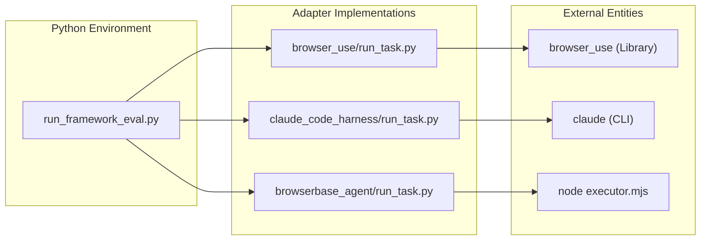
Sources: [frameworks/browser_use_cloud_api_v3/run_task.py:1-10](), [frameworks/claude_code_harness/run_task.py:1-9](), [frameworks/browserbase_agent/run_task.py:11-30]()

---

# Page: browser-use and Cloud API Adapters

# browser-use and Cloud API Adapters

<details>
<summary>Relevant source files</summary>

The following files were used as context for generating this wiki page:

- [frameworks/bcode/run_task.py](frameworks/bcode/run_task.py)
- [frameworks/browser_use/run_task.py](frameworks/browser_use/run_task.py)
- [frameworks/browser_use_cloud_api_v2/run_task.py](frameworks/browser_use_cloud_api_v2/run_task.py)
- [frameworks/browser_use_cloud_api_v3/run_task.py](frameworks/browser_use_cloud_api_v3/run_task.py)
- [frameworks/browserbase_agent/run_task.py](frameworks/browserbase_agent/run_task.py)
- [frameworks/claude_code_harness/run_task.py](frameworks/claude_code_harness/run_task.py)

</details>


This page details the framework adapters responsible for executing benchmark tasks using the native `browser-use` library and the Browser Use Cloud APIs (v2 and v3). These adapters bridge the gap between the benchmark orchestrator and the agent execution environments, handling session management, task dispatching, and result reconstruction.

## Native browser-use Adapter

The native adapter executes tasks using the `browser-use` library installed in the local environment. It leverages the standard `Agent` class and supports direct connection to various browser providers defined in the `browsers/` module.

### Implementation Details
The adapter follows a standard lifecycle:
1.  **Browser Connection**: It retrieves a browser provider from the `BROWSERS` registry and establishes a connection, obtaining a CDP URL if applicable [frameworks/browser_use/run_task.py:47-55]().
2.  **Agent Initialization**: An `Agent` instance is created with the task description, the selected LLM (from the `MODELS` registry), and the browser instance [frameworks/browser_use/run_task.py:57-63]().
3.  **Execution**: The agent runs the task, and the resulting `history` object is used to populate an `ExecutionResult` [frameworks/browser_use/run_task.py:64-85]().
4.  **Cleanup**: The browser and provider connections are explicitly closed in a `finally` block [frameworks/browser_use/run_task.py:65-74]().

### Configuration Parameters
| Parameter | Description | Default |
| :--- | :--- | :--- |
| `use_vision` | Enable/disable vision (screenshots) for the agent. | `true` |
| `framework_repo` | Override GitHub repo for installation (consumed by CI). | N/A |

**Sources:** [frameworks/browser_use/run_task.py:28-31](), [frameworks/browser_use/run_task.py:43-85]()

---

## Cloud API v3 Adapter

The v3 adapter interacts with the high-level Browser Use Agent API. Unlike the native adapter, it does not manage the browser instance directly; instead, it dispatches the entire task to the cloud infrastructure.

### Data Flow and Reconstruction
Because the Cloud API returns a stream of messages rather than a `History` object, the adapter must reconstruct the step-by-step execution log to satisfy the `ExecutionResult` schema.

1.  **Session Creation**: Dispatches the task via `POST /api/v3/sessions` [frameworks/browser_use_cloud_api_v3/run_task.py:67-76]().
2.  **Polling**: Polls `GET /api/v3/sessions/{id}` until the status reaches a terminal state (`stopped`, `error`, `timed_out`) [frameworks/browser_use_cloud_api_v3/run_task.py:40-41](), [frameworks/browser_use_cloud_api_v3/run_task.py:227-240]().
3.  **Message Reconstruction**: Fetches all session messages and groups assistant `tool_calls` with their corresponding `tool` results [frameworks/browser_use_cloud_api_v3/run_task.py:113-205]().

### Model Mapping
The `V3_MODEL_MAP` ensures that benchmark model identifiers are correctly routed to the cloud-specific slugs:
*   `bu-mini` -> `bu-mini`
*   `bu-max` -> `bu-max`
*   `bu-ultra` -> `bu-ultra`

**Sources:** [frameworks/browser_use_cloud_api_v3/run_task.py:43-60](), [frameworks/browser_use_cloud_api_v3/run_task.py:89-110](), [frameworks/browser_use_cloud_api_v3/run_task.py:113-205]()

---

## Cloud API v2 Adapter

The v2 adapter is used for legacy testing and specific model support (e.g., `browser-use-2.0`). It follows a similar polling pattern to v3 but uses the `/api/v2/tasks` endpoint.

### Key Differences
*   **Screenshot Support**: Unlike v3, the v2 API provides `screenshotUrl` per step, which the adapter downloads and encodes to base64 for the judge [frameworks/browser_use_cloud_api_v2/run_task.py:86-93](), [frameworks/browser_use_cloud_api_v2/run_task.py:156-163]().
*   **Model Map**: Includes a wider range of explicit model versions like `browser-use-2.0` and `gpt-4.1` [frameworks/browser_use_cloud_api_v2/run_task.py:38-55]().

**Sources:** [frameworks/browser_use_cloud_api_v2/run_task.py:32-34](), [frameworks/browser_use_cloud_api_v2/run_task.py:62-83](), [frameworks/browser_use_cloud_api_v2/run_task.py:137-176]()

---

## bcode (Browsercode) Adapter

The `bcode` adapter runs a coding agent (an `opencode` fork) that includes a built-in browser harness.

### Architecture
*   **Browser Provisioning**: It pre-provisions a session via the Browser Use Cloud API and passes the CDP URL to the `bcode` process via the `BU_CDP_WS` environment variable [frameworks/bcode/run_task.py:4-7](), [frameworks/bcode/run_task.py:147-156]().
*   **Execution**: It executes the `bcode run` command and parses one JSON event per line from stdout [frameworks/bcode/run_task.py:9-13](), [frameworks/bcode/run_task.py:199-223]().
*   **Screenshots**: It taps into `Page.captureScreenshot` calls. When `BCODE_SCREENSHOT_DIR` is set, images are dumped to disk and read back as base64 for the judge [frameworks/bcode/run_task.py:15-22](), [frameworks/bcode/run_task.py:87-98]().

**Sources:** [frameworks/bcode/run_task.py:56-59](), [frameworks/bcode/run_task.py:171-196](), [frameworks/bcode/run_task.py:228-270]()

---

## System Architecture and Code Mapping

### Execution Flow: Native vs. Cloud
This diagram illustrates the difference in data flow between the native `browser-use` execution and the Cloud API v3 path.

Title: Framework Execution Strategies
```mermaid
graph TD
    subgraph "Native Adapter (run_task.py)"
        [Agent_run] --> [History_Object]
        [History_Object] --> |"agent_steps()"| [ExecutionResult]
        [History_Object] --> |"screenshot_paths()"| [ExecutionResult]
    end

    subgraph "Cloud V3 Adapter (run_task.py)"
        [POST_sessions] --> [Poll_Status]
        [Poll_Status] --> [GET_messages]
        [GET_messages] --> |"_parse_messages_to_steps()"| [ExecutionResult]
    end

    [ExecutionResult] --> [run_and_judge]
```
**Sources:** [frameworks/browser_use/run_task.py:64-85](), [frameworks/browser_use_cloud_api_v3/run_task.py:223-264]()

### Code Entity Mapping: Cloud API Adapters
This diagram maps the API interaction functions to the logical steps of the benchmark execution.

Title: Cloud API Adapter Code Entities
```mermaid
graph LR
    subgraph "API Interaction"
        [_create_session] --> |"POST /sessions"| BU_Cloud
        [_get_session] --> |"GET /sessions/{id}"| BU_Cloud
        [_get_all_messages] --> |"GET /messages (paginated)"| BU_Cloud
    end

    subgraph "Data Processing"
        [_parse_messages_to_steps] --> |"Map TOOL_NAME_MAP"| Steps
        [_duration_seconds] --> |"ISO Timestamp Diff"| Duration
    end

    BU_Cloud --> [_parse_messages_to_steps]
    BU_Cloud --> [_duration_seconds]
    Steps --> [ExecutionResult]
    Duration --> [ExecutionResult]
```
**Sources:** [frameworks/browser_use_cloud_api_v3/run_task.py:49-60](), [frameworks/browser_use_cloud_api_v3/run_task.py:67-110](), [frameworks/browser_use_cloud_api_v3/run_task.py:208-220]()

## Accepted Parameters Summary

| Framework | Parameter | Role |
| :--- | :--- | :--- |
| `browser_use` | `use_vision` | Toggles image processing in the Agent loop [frameworks/browser_use/run_task.py:29](). |
| `browser_use_cloud_api_v3` | `skills` | Toggles long-term skill memory in the cloud session [frameworks/browser_use_cloud_api_v3/run_task.py:36](). |
| `bcode` | `fetch_use` | Toggles the use of the `fetch-use` proxy for web tools [frameworks/bcode/run_task.py:58](). |

**Sources:** [frameworks/browser_use/run_task.py:28-31](), [frameworks/browser_use_cloud_api_v3/run_task.py:35-37](), [frameworks/bcode/run_task.py:56-59]()

---

# Page: Claude Code Harness Adapters

# Claude Code Harness Adapters

<details>
<summary>Relevant source files</summary>

The following files were used as context for generating this wiki page:

- [frameworks/__init__.py](frameworks/__init__.py)
- [frameworks/browserbase_agent/package.json](frameworks/browserbase_agent/package.json)
- [frameworks/claude_code_harness/system_prompt.md](frameworks/claude_code_harness/system_prompt.md)
- [frameworks/claude_code_harness_ab/run_task.py](frameworks/claude_code_harness_ab/run_task.py)
- [frameworks/claude_code_harness_ab/system_prompt.md](frameworks/claude_code_harness_ab/system_prompt.md)
- [frameworks/claude_code_harness_bu_cli/run_task.py](frameworks/claude_code_harness_bu_cli/run_task.py)
- [frameworks/claude_code_harness_bu_cli/system_prompt.md](frameworks/claude_code_harness_bu_cli/system_prompt.md)
- [frameworks/claude_code_harness_js/run_task.py](frameworks/claude_code_harness_js/run_task.py)
- [frameworks/claude_code_harness_js/system_prompt.md](frameworks/claude_code_harness_js/system_prompt.md)
- [frameworks/codex_harness/run_task.py](frameworks/codex_harness/run_task.py)
- [frameworks/codex_harness/system_prompt.md](frameworks/codex_harness/system_prompt.md)

</details>


The **Claude Code Harness** family of adapters facilitates benchmarking the Claude Code agent (and OpenAI Codex) by wrapping their CLI loops. In these adapters, the agent (Claude Code or Codex) owns the execution loop, while the benchmark runner manages the browser lifecycle, provides a specialized system prompt, and parses the agent's structured output to extract steps, costs, and final answers.

## Architecture Overview

These adapters follow a "Harness" pattern where the benchmark runner provisions a remote browser session (typically via `browser-use-cloud`) and then shells out to a CLI agent. The agent is instructed via a `system_prompt.md` to use specific tools (like `browser-harness`, `agent-browser`, or the `browser-use` CLI) to interact with that browser.

### Data Flow and Execution Loop

The execution flow follows a consistent pattern across the family:
1. **Provisioning**: The adapter calls `_start_browser` to allocate a `browser-use-cloud` session and retrieve a CDP WebSocket URL [frameworks/claude_code_harness_ab/run_task.py:115-126]().
2. **Environment Setup**: The CDP URL is passed to the agent via environment variables (e.g., `BU_CDP_WS`) [frameworks/claude_code_harness_ab/run_task.py:6-7]().
3. **Agent Invocation**: The adapter launches the agent CLI (e.g., `claude` or `codex`) with `--output-format stream-json` [frameworks/claude_code_harness_ab/run_task.py:157-158]().
4. **Stream Parsing**: The adapter reads `stdout` line-by-line, parsing JSON events to reconstruct the agent's "steps" (thinking, tool calls, and results) [frameworks/claude_code_harness_ab/run_task.py:270-320]().
5. **Artifact Collection**: Screenshots written by the agent to `/tmp/shots` are collected [frameworks/claude_code_harness_ab/run_task.py:85-90]().
6. **Final Answer Extraction**: The adapter uses `FINAL_ANSWER_RE` to find the required "FINAL ANSWER" string in the agent's terminal message [frameworks/claude_code_harness_ab/run_task.py:55]().

### Component Mapping: Natural Language to Code

| Concept | Code Entity | File |
| :--- | :--- | :--- |
| **Agent CLI** | `claude` or `codex` | `_build_claude_cmd` / `_build_codex_cmd` |
| **Output Parser** | `stream-json` parsing loop | `run_task()` in adapter modules |
| **Browser Interface** | `browser-harness`, `agent-browser`, or `browser-use` CLI | `system_prompt.md` instructions |
| **Task Completion** | `FINAL ANSWER: <text>` | `FINAL_ANSWER_RE` |
| **Screenshot Sink** | `/tmp/shots/` | `SHOTS_DIR` |

Sources: [frameworks/claude_code_harness_ab/run_task.py:52-55](), [frameworks/claude_code_harness_js/run_task.py:50-53](), [frameworks/codex_harness/run_task.py:70-72]()

## Adapter Variants

The repository supports several variants of the harness, differing primarily by the CLI tool the agent uses to drive the browser.

### 1. claude-code-harness (Python)
The agent drives a browser using the Python-based `browser-harness`. It uses `browser-harness <<'PY' ... PY` heredocs to execute Python scripts against the browser [frameworks/claude_code_harness/system_prompt.md:4-5]().

### 2. claude-code-harness-js (TypeScript)
The agent drives the browser via `browser-harness-js`, a Bun-based REPL. It interacts by calling `session.connect({ wsUrl: process.env.BU_CDP_WS })` and executing JavaScript snippets [frameworks/claude_code_harness_js/run_task.py:4-7]().

### 3. claude-code-harness-ab (Agent Browser)
The agent uses the `vercel-labs/agent-browser` Rust-based CLI. It connects using `agent-browser --session "$AB_SESSION" --cdp "$BU_CDP_WS" open <url>` and uses accessibility-tree snapshots for interaction [frameworks/claude_code_harness_ab/system_prompt.md:4-9]().

### 4. claude-code-harness-bu-cli (Browser-Use CLI)
The agent uses the native `browser-use` Python CLI. It attaches via `browser-use --session "$BU_SESSION" --cdp-url "$BU_CDP_WS" open <url>` and uses indexed element interaction (e.g., `click <idx>`) [frameworks/claude_code_harness_bu_cli/system_prompt.md:4-9]().

### 5. codex-harness
A variant for OpenAI's Codex CLI. It mirrors the Python `claude-code-harness` but parses Codex-specific JSONL events like `thread.started`, `turn.completed`, and `item.completed` [frameworks/codex_harness/run_task.py:16-27]().

## Implementation Details

### JSON Stream Parsing
Claude Code emits structured events when run with `--output-format stream-json`. The adapters process these in a `while` loop, focusing on specific event types:
- `assistant_block`: Captured via `_format_assistant_block` to log thinking and tool calls [frameworks/claude_code_harness_ab/run_task.py:173-197]().
- `tool_result`: Captured via `_format_tool_result_block` to log the outcome of browser actions [frameworks/claude_code_harness_ab/run_task.py:200-220]().
- `result`: Indicates the end of the agent's loop. A subtype of `success` is required for a valid completion [frameworks/claude_code_harness_ab/run_task.py:59-66]().

### Screenshot Collection
Unlike native `browser-use` adapters which receive screenshots via API objects, these harness adapters rely on the agent writing files to a local directory.
- **Requirement**: The agent must save PNGs to `/tmp/shots/step_NNN.png` [frameworks/claude_code_harness/system_prompt.md:6]().
- **Extraction**: The function `_collect_screenshots()` reads all PNGs in the directory, sorts them by filename, and encodes them to base64 for the `ExecutionResult` [frameworks/claude_code_harness_ab/run_task.py:85-90]().

### System Prompts
Each adapter provides a specific `system_prompt.md` that acts as the "manual" for the agent. These prompts define:
- **Hard Rules**: Constraints like "Do not ask clarifying questions" and "Do not spawn browser processes" [frameworks/claude_code_harness_ab/system_prompt.md:3-24]().
- **Tool Usage**: Instructions on how to initialize the connection using environment variables like `BU_CDP_WS` [frameworks/claude_code_harness_js/system_prompt.md:5]().
- **Termination**: The mandatory `FINAL ANSWER:` format [frameworks/claude_code_harness_ab/system_prompt.md:25-29]().

### Sequence Diagram: Claude Code Harness Execution

Title: Claude Code Harness Execution Flow
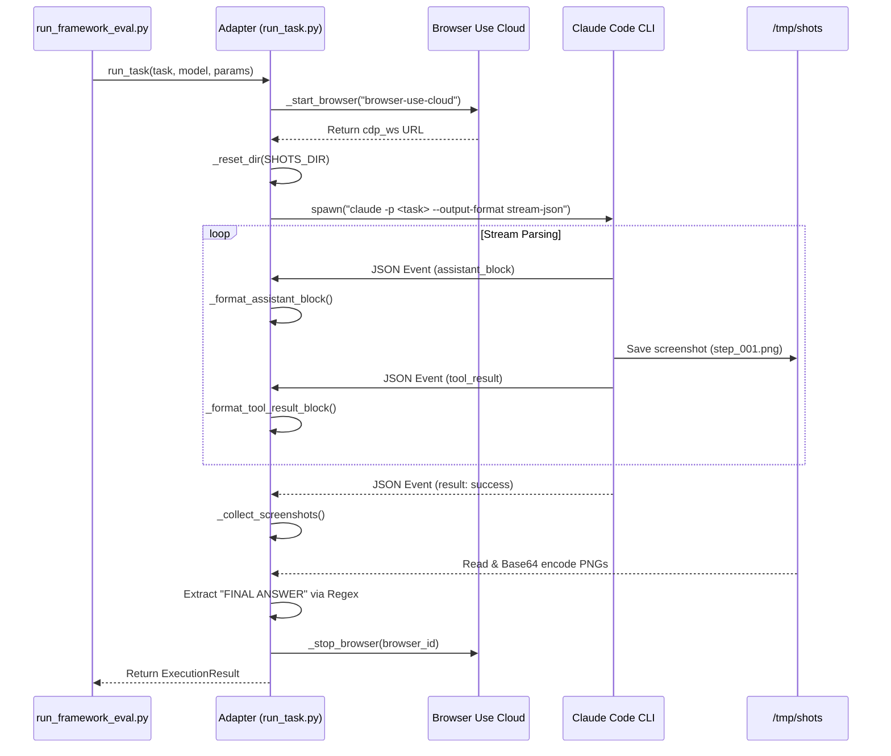
Sources: [frameworks/claude_code_harness_ab/run_task.py:245-340](), [frameworks/claude_code_harness_ab/run_task.py:85-90](), [frameworks/claude_code_harness_ab/run_task.py:115-139]()

### Class/Entity Diagram: Adapter Structure

Title: Claude Code Adapter Logic
```mermaid
classDiagram
    class ExecutionResult {
        +str final_result
        +list steps
        +list screenshots_b64
        +int num_steps
        +float duration_seconds
        +float cost
    }

    class ClaudeCodeHarnessAdapter {
        +ACCEPTED_PARAMS
        +SYSTEM_PROMPT_FILE
        +FINAL_ANSWER_RE
        +_start_browser(browser_name)
        +_build_claude_cmd(task, model, ...)
        +_collect_screenshots()
        +_format_assistant_block(block)
        +run_task(task, model, ...)
    }

    ClaudeCodeHarnessAdapter ..> ExecutionResult : creates
    ClaudeCodeHarnessAdapter --> "/tmp/shots" : reads screenshots
    ClaudeCodeHarnessAdapter --> "system_prompt.md" : appends to agent
```
Sources: [frameworks/__init__.py:63-70](), [frameworks/claude_code_harness_ab/run_task.py:42-55](), [frameworks/claude_code_harness_ab/run_task.py:173-197]()

---

# Page: Other Framework Adapters

# Other Framework Adapters

<details>
<summary>Relevant source files</summary>

The following files were used as context for generating this wiki page:

- [frameworks/browserbase_agent/executor.mjs](frameworks/browserbase_agent/executor.mjs)
- [frameworks/but/run_task.py](frameworks/but/run_task.py)
- [frameworks/but/system_prompt.md](frameworks/but/system_prompt.md)
- [frameworks/but_rust/run_task.py](frameworks/but_rust/run_task.py)
- [frameworks/but_rust/system_prompt.md](frameworks/but_rust/system_prompt.md)
- [frameworks/claude_cua/run_task.py](frameworks/claude_cua/run_task.py)
- [frameworks/pi_harness/run_task.py](frameworks/pi_harness/run_task.py)
- [frameworks/pi_harness/system_prompt.md](frameworks/pi_harness/system_prompt.md)
- [frameworks/pibt/run_task.py](frameworks/pibt/run_task.py)
- [frameworks/pibt/system_prompt.md](frameworks/pibt/system_prompt.md)
- [frameworks/stagehand/executor.js](frameworks/stagehand/executor.js)
- [frameworks/stagehand/run_task.py](frameworks/stagehand/run_task.py)

</details>


This page covers the remaining framework adapters in the benchmark suite: `pi-harness`, `pibt`, `but` (Python), `but-rust`, `stagehand`, `browserbase-agent`, and `claude-cua`. Unlike the native `browser-use` adapter, these frameworks often operate in different runtimes (Node.js, Rust) or use distinct agent loop architectures.

## Architecture Overview

Most adapters in this category follow a "shell-out" pattern. The benchmark's Python runner (`run_framework_eval.py`) invokes these adapters, which then execute the agent loop and return a standardized `ExecutionResult` [frameworks/stagehand/run_task.py:56-63]().

### Browser Wiring Patterns

These adapters generally use one of two methods to connect to browsers:
1.  **Pre-provisioned Cloud Browser**: The adapter calls the Browser-Use Cloud V3 API to create a session, then passes the `webSocketDebuggerUrl` (CDP URL) to the underlying agent [frameworks/but/run_task.py:125-134](), [frameworks/pibt/run_task.py:96-105]().
2.  **Harness Daemon**: A `browser-harness` daemon is started, and the agent interacts with it via shell commands or `heredocs` [frameworks/pi_harness/run_task.py:88-95]().

### Data Flow: Shelling Out to Non-Python Frameworks

The following diagram illustrates how the Python evaluation environment communicates with external framework binaries and scripts.

**Framework Execution Flow**
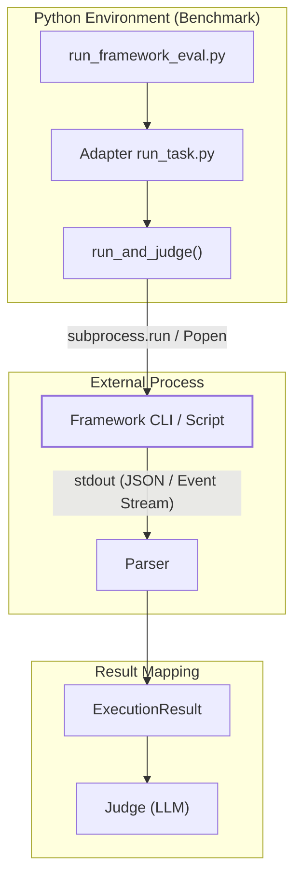
Sources: [frameworks/stagehand/run_task.py:38-63](), [frameworks/but/run_task.py:210-235](), [frameworks/pi_harness/run_task.py:228-255]()

---

## Pi-based Adapters (`pi-harness` & `pibt`)

These adapters use the `@earendil-works/pi-coding-agent` CLI.

### pi-harness
This adapter mirrors the `claude-code-harness`. It uses `pi` to drive a pre-provisioned `browser-harness` daemon via Python heredocs [frameworks/pi_harness/run_task.py:1-7]().
*   **Event Parsing**: It uses `pi --mode json` to capture `tool_execution_start/end` and `message_end` events [frameworks/pi_harness/run_task.py:13-21]().
*   **Screenshot Logic**: Screenshots are saved to `/tmp/shots/` and collected in step order [frameworks/pi_harness/run_task.py:80-86]().

### pibt (Pi Browser Terminal)
Unlike `pi-harness`, `pibt` uses the `pi-agent-extensions` package. The agent calls `cdp_*` tools directly within its own process rather than using an external Python harness [frameworks/pibt/run_task.py:1-6]().
*   **Connection**: The system prompt instructs the agent to use `cdp_connect({ wsUrl: process.env.BU_CDP_WS })` [frameworks/pibt/run_task.py:11-14]().

Sources: [frameworks/pi_harness/run_task.py:1-21](), [frameworks/pibt/run_task.py:1-18]()

---

## Browser-Use-Terminal (`but` & `but-rust`)

These adapters benchmark the `browser-use-terminal` project, which provides a REPL-based agent loop.

| Feature | `but` (Python) | `but-rust` (Rust) |
| :--- | :--- | :--- |
| **Core Runtime** | Python (uv managed) [frameworks/but/run_task.py:68-72]() | Rust Binary [frameworks/but_rust/run_task.py:65-67]() |
| **Browser Ops** | Native Python CDP helpers [frameworks/but/run_task.py:3-7]() | Python worker (`llm_browser_worker`) [frameworks/but_rust/run_task.py:14-18]() |
| **State Storage** | JSONL event log [frameworks/but/run_task.py:24-28]() | SQLite (`state.db`) [frameworks/but_rust/run_task.py:19-20]() |
| **Invocation** | `browser-use-terminal run` [frameworks/but/run_task.py:16-21]() | `run-openai`, `run-anthropic`, etc. [frameworks/but_rust/run_task.py:12-13]() |

**But-Rust Component Mapping**
```mermaid
graph LR
    subgraph "but-rust-process"
        A["Rust Binary (CLI)"] -- "spawns" --> B["Python Worker"]
        A -- "writes" --> C[("SQLite state.db")]
    end
    
    B -- "CDP" --> D["Cloud Browser"]
    E["Benchmark Runner"] -- "reads" --> C
    E -- "executes" --> A
```
Sources: [frameworks/but_rust/run_task.py:1-31]()

---

## TypeScript Adapters (`stagehand` & `browserbase-agent`)

These adapters execute via Node.js.

### stagehand
A wrapper around the Stagehand agent framework. The Python side shells out to `executor.js` [frameworks/stagehand/run_task.py:34-35]().
*   **Execution**: It reads `TASK_DESCRIPTION` and `BROWSER` from environment variables [frameworks/stagehand/executor.js:21-23]().
*   **Result**: Expects a JSON object on stdout containing `final_result`, `steps`, and `screenshots_b64` [frameworks/stagehand/executor.js:7-16]().

### browserbase-agent
This adapter uses the Stagehand SDK locally but points it at Browserbase cloud browsers and the Browserbase Model Gateway [frameworks/browserbase_agent/executor.mjs:18-21]().
*   **Model Routing**: Defaults to `anthropic/claude-sonnet-4-6` via the gateway [frameworks/browserbase_agent/executor.mjs:42]().
*   **Step Formatting**: Maps Stagehand 3.x agent actions (type, instruction, reasoning) into the `ExecutionResult` schema [frameworks/browserbase_agent/executor.mjs:72-84]().

Sources: [frameworks/stagehand/run_task.py:38-63](), [frameworks/browserbase_agent/executor.mjs:1-38]()

---

## Claude Computer Use Agent (`claude-cua`)

The `claude-cua` adapter is designed to control a full desktop environment (Xvfb + browser) [frameworks/claude_cua/run_task.py:3-4](). 

*   **Status**: Currently a placeholder in the public verifier; it raises `NotImplementedError` until the full agent loop (handling `computer_20251124` tool blocks) is integrated [frameworks/claude_cua/run_task.py:62-65]().

Sources: [frameworks/claude_cua/run_task.py:1-11]()

---

## Result Mapping to `ExecutionResult`

Regardless of the framework's internal language or format, all adapters must return an `ExecutionResult` object to the `run_and_judge` function [frameworks/stagehand/run_task.py:77]().

| Field | Description | Mapping Source (Example: `but`) |
| :--- | :--- | :--- |
| `final_result` | The agent's terminal answer. | Extracted from `done` tool call in `events.jsonl` [frameworks/but/run_task.py:166-168](). |
| `steps` | List of actions taken. | Parsed from `tool.started` and `assistant.message` events [frameworks/but/run_task.py:153-175](). |
| `screenshots_b64` | Base64 encoded images. | Read from the framework's artifact/state directory [frameworks/but/run_task.py:218-223](). |
| `cost` | Total USD cost. | Aggregated from model usage metadata in events [frameworks/but/run_task.py:228-232](). |

Sources: [frameworks/__init__.py](), [frameworks/but/run_task.py:210-235]()

---

# Page: Browser Providers

# Browser Providers

<details>
<summary>Relevant source files</summary>

The following files were used as context for generating this wiki page:

- [.env.example](.env.example)
- [Stealth_Bench_V1.enc](Stealth_Bench_V1.enc)
- [browsers/__init__.py](browsers/__init__.py)
- [browsers/anchor.py](browsers/anchor.py)
- [browsers/browser_use_cloud.py](browsers/browser_use_cloud.py)
- [browsers/browserbase.py](browsers/browserbase.py)
- [browsers/browserless.py](browsers/browserless.py)
- [browsers/driver.py](browsers/driver.py)
- [browsers/hyperbrowser.py](browsers/hyperbrowser.py)
- [browsers/local_headful.py](browsers/local_headful.py)
- [browsers/util.py](browsers/util.py)
- [frameworks/browser_use/__init__.py](frameworks/browser_use/__init__.py)

</details>


The `browsers/` module provides a standardized interface for provisioning browser instances across various environments, including local Playwright-managed browsers and third-party cloud browser providers. This abstraction allows the benchmark suites to execute tasks against different browser configurations by simply changing an environment variable or CLI argument.

### Browser Registry

The core of the provider system is the `BROWSERS` registry defined in `browsers/__init__.py`. This dictionary maps provider names to their respective modules, each implementing a common interface for lifecycle management.

*   **Registry Definition**: The `BROWSERS` dictionary lists all supported providers [browsers/__init__.py:33-45]().
*   **Dynamic Loading**: The `get_provider(name)` function facilitates importing provider modules at runtime [browsers/__init__.py:48-53]().
*   **Provider List**: A separate `PROVIDERS` list tracks available options such as `anchor`, `browserbase`, `hyperbrowser`, and `steel` [browsers/__init__.py:20-31]().

### Interface Contract

Every provider module must implement two primary asynchronous functions to be compatible with the benchmark runner:

| Function | Return Value | Purpose |
| :--- | :--- | :--- |
| `connect()` | `str` or `None` | Provisions a new browser session. Returns a CDP (Chrome DevTools Protocol) or WebSocket URL for remote browsers, or `None` for local Playwright instances. |
| `disconnect()` | `None` | Cleans up the session, stops the remote browser, or releases resources. |

#### Rate Limit Handling
Most cloud providers utilize the `retry_on_429` utility located in `browsers/util.py`. This helper wraps API calls in a retry loop with capped exponential backoff (defaulting to 10 retries and a 30s max wait) to handle provider-side rate limiting [browsers/util.py:6-17]().

### Provider Architecture

The following diagram illustrates how the benchmark system interacts with the `browsers/` module to obtain browser access.

**Browser Provisioning Flow**
```mermaid
graph TD
    subgraph "Execution Space"
        RUN["run_eval.py"]
        ADAPT["Framework Adapter"]
    end

    subgraph "browsers/ Module"
        REG["BROWSERS Registry"]
        UTIL["retry_on_429"]
        
        subgraph "Provider Modules"
            BUC["browser_use_cloud.py"]
            BB["browserbase.py"]
            LH["local_headless.py"]
            DRV["driver.py"]
        end
    end

    RUN -->|"get_provider()"| REG
    REG --> BUC
    REG --> BB
    REG --> LH
    
    BUC -->|"POST /browsers"| UTIL
    BB -->|"POST /sessions"| UTIL
    DRV -->|"POST /v1/proxy/session"| UTIL
    
    BUC -->|"returns cdpUrl"| RUN
    BB -->|"returns connectUrl"| RUN
    LH -->|"returns None"| RUN
```
*Sources: [browsers/__init__.py:33-53](), [browsers/util.py:6-17](), [browsers/browser_use_cloud.py:24-40](), [browsers/browserbase.py:16-36]()*

### Cloud Browser Providers

Cloud providers are used for large-scale evaluations or when specific features like residential proxies and automated CAPTCHA solving are required. These modules typically manage a `_session_id` to ensure that `disconnect()` can properly terminate the specific instance created by `connect()`.

*   **Browser-use Cloud**: Connects to `api.browser-use.com` (v2) and returns a `cdpUrl` [browsers/browser_use_cloud.py:14-40]().
*   **CDP Proxies**: Modules like `driver.py` interact with proxy services (e.g., `bu-compat.driver.dev`) to provide hosted browser sessions [browsers/driver.py:9-28]().
*   **Third-Party Services**: Includes dedicated modules for Anchor, Browserbase, Hyperbrowser, Rebrowser, and Steel.

For detailed configuration, API keys, and specific capabilities of each cloud provider, see **[Cloud Browser Providers](#4.1)**.

### Local Browser Providers

Local providers utilize the host machine's resources to launch Chromium via Playwright. These are primarily used for development, debugging, or cost-effective local testing.

*   **Headless vs. Headful**: Controlled via the `HEADLESS` boolean flag within the provider module [browsers/local_headful.py:3]().
*   **Connection Logic**: Unlike cloud providers, local `connect()` implementations typically return `None`, signaling the framework adapter to initialize a local Playwright instance rather than connecting to a remote WebSocket [browsers/local_headful.py:6-7]().

For details on local setup and the `HEADLESS` flag, see **[Local Browser Providers](#4.2)**.

### Configuration

Browser providers require specific API keys defined in the `.env` file. If a key is missing when a provider is requested, the module will raise a `KeyError` during the `connect()` call.

**Key Mapping Examples:**
*   `browser-use-cloud`: Uses `BROWSER_USE_API_KEY` [browsers/browser_use_cloud.py:21]().
*   `browserbase`: Requires `BROWSERBASE_API_KEY` and `BROWSERBASE_PROJECT_ID` [browsers/browserbase.py:4-5]().
*   `anchor`: Requires `ANCHORBROWSER_API_KEY` [browsers/anchor.py:4-5]().

*Sources: [.env.example:1-23](), [browsers/anchor.py:18](), [browsers/browserbase.py:23-25]()*

---

**Sub-pages:**
*   [Cloud Browser Providers](#4.1)
*   [Local Browser Providers](#4.2)

---

# Page: Cloud Browser Providers

# Cloud Browser Providers

<details>
<summary>Relevant source files</summary>

The following files were used as context for generating this wiki page:

- [Stealth_Bench_V1.enc](Stealth_Bench_V1.enc)
- [browsers/anchor.py](browsers/anchor.py)
- [browsers/browser_use_cloud.py](browsers/browser_use_cloud.py)
- [browsers/browserbase.py](browsers/browserbase.py)
- [browsers/browserless.py](browsers/browserless.py)
- [browsers/hyperbrowser.py](browsers/hyperbrowser.py)
- [browsers/local_headful.py](browsers/local_headful.py)
- [browsers/onkernel.py](browsers/onkernel.py)
- [browsers/rebrowser.py](browsers/rebrowser.py)
- [browsers/steel.py](browsers/steel.py)
- [browsers/util.py](browsers/util.py)
- [frameworks/browser_use/__init__.py](frameworks/browser_use/__init__.py)

</details>


This page details the implementation of cloud browser provider modules within the `browsers/` directory. These modules abstract the complexities of provisioning remote Chromium instances, handling authentication, and managing session lifecycles across various vendors.

The primary interface for any provider is a pair of asynchronous functions: `connect()` and `disconnect()`. The `connect()` function typically returns a Chrome DevTools Protocol (CDP) WebSocket URL, which is then used by the framework adapters to control the remote browser [browsers/browser_use_cloud.py:24-40]().

### Session Lifecycle and Reliability

Most cloud providers require an explicit session creation step via a REST API before providing a WebSocket endpoint. To ensure stability during high-concurrency benchmarks, the system utilizes a retry mechanism for rate-limited requests.

#### Rate Limit Handling
The `retry_on_429` utility is used across most provider implementations. It implements a capped exponential backoff strategy when encountering HTTP 429 status codes from provider APIs [browsers/util.py:6-16]().

| Parameter | Value | Description |
| :--- | :--- | :--- |
| `max_retries` | 10 | Maximum number of attempts before failing [browsers/util.py:8]() |
| `max_wait` | 30s | Maximum sleep time between retries [browsers/util.py:14]() |
| `backoff` | 2^attempt | Exponential growth of wait time [browsers/util.py:14]() |

**Sources:** [browsers/util.py:1-17]()

---

### Provider Implementation Details

#### Browser-Use Cloud (`browser_use_cloud.py`)
This is the native cloud provider for the `browser-use` platform. It supports configurable API versions and base URLs via environment variables [browsers/browser_use_cloud.py:14-17]().

*   **API Key:** `BU_CLOUD_API_KEY` or `BROWSER_USE_API_KEY` [browsers/browser_use_cloud.py:21]().
*   **Connection:** POSTs to `/browsers` to retrieve a `cdpUrl` and `id` [browsers/browser_use_cloud.py:27-40]().
*   **Disconnection:** PATCHes the session with `{"action": "stop"}` to release resources [browsers/browser_use_cloud.py:48-53]().

#### Browserbase (`browserbase.py`)
Provides built-in captcha solving and proxy support [browsers/browserbase.py:1-5]().
*   **API Key:** `BROWSERBASE_API_KEY` and `BROWSERBASE_PROJECT_ID`.
*   **Session:** Creates a session with `proxies: True` and `solveCaptchas: True` [browsers/browserbase.py:24-28]().
*   **Disconnection:** Status is updated to `REQUEST_RELEASE` [browsers/browserbase.py:47]().

#### Anchor Browser (`anchor.py`)
Configures an extensive suite of stealth and utility features during session creation [browsers/anchor.py:1-5]().
*   **Features:** Adblock, popup blocker, extra stealth, and residential proxies [browsers/anchor.py:29-35]().
*   **Connection:** Returns a WSS URL formatted with the API key and session ID [browsers/anchor.py:44]().

#### Steel (`steel.py`)
Steel requires a specific monkey-patch for the `socket` library because its WebSocket host does not support IPv6, which can lead to 502 errors in certain environments [browsers/steel.py:6-8]().
*   **Implementation:** The `_getaddrinfo_ipv4_for_steel` function forces `socket.AF_INET` for the host `connect.steel.dev` [browsers/steel.py:22-28]().

**Sources:** [browsers/browser_use_cloud.py:1-56](), [browsers/browserbase.py:1-51](), [browsers/anchor.py:1-58](), [browsers/steel.py:1-62]()

---

### Technical Architecture Diagrams

#### Browser Provider Connection Flow
The following diagram illustrates the relationship between the internal utility functions and the external Cloud Provider APIs during a `connect()` call.

```mermaid
sequenceDiagram
    participant B as benchmark_runner
    participant P as provider_module (e.g. anchor.py)
    participant U as browsers.util.retry_on_429
    participant API as Provider_REST_API
    participant WSS as Provider_CDP_Gateway

    B->>P: connect()
    P->>U: retry_on_429(_create)
    loop Up to 10 retries
        U->>API: POST /sessions (API_KEY)
        API-->>U: 200 OK (sessionId, cdpUrl)
    end
    U-->>P: session_data
    P-->>B: wss://... (CDP URL)
    
    Note over B, WSS: Framework uses CDP URL to attach Playwright/Puppeteer
```
**Sources:** [browsers/util.py:6-16](), [browsers/anchor.py:16-44](), [browsers/browser_use_cloud.py:24-40]()

#### Code Entity Mapping: Cloud Session Management
This diagram maps the natural language concept of "Session Management" to the specific code entities responsible for the lifecycle.

```mermaid
graph TD
    subgraph "Session Lifecycle Entities"
        S_ID["_session_id (Module Global)"]
        CONN["connect() (Async Function)"]
        DISC["disconnect() (Async Function)"]
        RETRY["retry_on_429() (Utility)"]
    end

    subgraph "Provider Modules"
        BUC["browsers/browser_use_cloud.py"]
        BB["browsers/browserbase.py"]
        ST["browsers/steel.py"]
        HB["browsers/hyperbrowser.py"]
    end

    CONN -->|Uses| RETRY
    CONN -->|Sets| S_ID
    DISC -->|Reads| S_ID
    DISC -->|Resets| S_ID
    
    BUC --- S_ID
    BB --- S_ID
    ST --- S_ID
    HB --- S_ID
```
**Sources:** [browsers/browser_use_cloud.py:11,25,44](), [browsers/browserbase.py:13,17,40](), [browsers/steel.py:17,32,52](), [browsers/util.py:6]()

---

### Provider Comparison Table

The following table summarizes the configuration and return values for the various cloud modules.

| Provider | File | API Key Env Var | Session ID Return Key | CDP URL Format |
| :--- | :--- | :--- | :--- | :--- |
| **BU Cloud** | `browser_use_cloud.py` | `BU_CLOUD_API_KEY` | `id` | `data["cdpUrl"]` |
| **Anchor** | `anchor.py` | `ANCHORBROWSER_API_KEY` | `data["data"]["id"]` | `wss://connect.anchorbrowser.io?...` |
| **Browserbase** | `browserbase.py` | `BROWSERBASE_API_KEY` | `id` | `data["connectUrl"]` |
| **Hyperbrowser**| `hyperbrowser.py` | `HYPERBROWSER_API_KEY` | `sessionId` / `id` | `data["wsEndpoint"]` |
| **OnKernel** | `onkernel.py` | `ONKERNEL_API_KEY` | `id` | `data["cdp_ws_url"]` |
| **Steel** | `steel.py` | `STEEL_API_KEY` | `id` | `data["websocketUrl"] + apiKey` |
| **Browserless** | `browserless.py` | `BROWSERLESS_API_KEY` | N/A (Static) | `wss://.../stealth?token=...` |
| **Rebrowser** | `rebrowser.py` | `REBROWSER_API_KEY` | N/A (Static) | `wss://ws.rebrowser.net/?apiKey=...` |

**Sources:** [browsers/browser_use_cloud.py:39-40](), [browsers/anchor.py:43-44](), [browsers/browserbase.py:35-36](), [browsers/hyperbrowser.py:31-32](), [browsers/onkernel.py:31-32](), [browsers/steel.py:47-48](), [browsers/browserless.py:11-14](), [browsers/rebrowser.py:11]()

### Local Fallbacks
While the primary focus is cloud providers, the `browsers/` module includes `local_headful.py` and `local_headless.py`. These return `None` for the connection string, signaling to the evaluation runner to launch a local Playwright instance instead of connecting to a remote CDP endpoint [browsers/local_headful.py:6-7]().

**Sources:** [browsers/local_headful.py:1-11]()

---

# Page: Local Browser Providers

# Local Browser Providers

<details>
<summary>Relevant source files</summary>

The following files were used as context for generating this wiki page:

- [Stealth_Bench_V1.enc](Stealth_Bench_V1.enc)
- [browsers/anchor.py](browsers/anchor.py)
- [browsers/browserbase.py](browsers/browserbase.py)
- [browsers/browserless.py](browsers/browserless.py)
- [browsers/hyperbrowser.py](browsers/hyperbrowser.py)
- [browsers/local_headful.py](browsers/local_headful.py)
- [browsers/local_headless.py](browsers/local_headless.py)

</details>


Local browser providers allow the benchmark suite to execute tasks using a locally installed Chromium instance via Playwright. Unlike cloud providers that return a WebSocket URL (CDP), local providers signal the system to use the native `browser-use` browser management logic.

### Overview

The local provider implementation is split into two modules: `local_headful.py` and `local_headless.py`. These modules serve as configuration flags for the `create_browser()` factory function used during task evaluation. They are primarily used for development, debugging agent behavior visually, or running benchmarks without incurring cloud browser costs.

| Provider | File | HEADLESS Flag | Use Case |
| :--- | :--- | :--- | :--- |
| **Local Headful** | `browsers/local_headful.py` | `False` | Visual debugging, watching the agent interact with the UI. |
| **Local Headless** | `browsers/local_headless.py` | `True` | Local automated runs, CI environments, or performance testing. |

**Sources:**
- [browsers/local_headful.py:1-12]()
- [browsers/local_headless.py:1-12]()

---

### Implementation Details

Both local providers implement the standard browser provider interface but return `None` for the connection string. This informs the calling framework that no remote CDP connection is required, and it should instead initialize a local Playwright instance.

#### Configuration Constants
The primary differentiator between the two providers is the `HEADLESS` boolean constant:
- **local_headful.py**: Sets `HEADLESS = False` [browsers/local_headful.py:3-3]().
- **local_headless.py**: Sets `HEADLESS = True` [browsers/local_headless.py:3-3]().

#### Interface Contract
Both modules provide `connect()` and `disconnect()` functions to satisfy the `BROWSERS` registry requirements in the `browsers/` module:
- `connect()`: Returns `None` [browsers/local_headful.py:6-7](), [browsers/local_headless.py:6-7]().
- `disconnect()`: Performs no operation (pass) [browsers/local_headful.py:10-11](), [browsers/local_headless.py:10-11]().

### Data Flow: Local Initialization

The following diagram illustrates how the `HEADLESS` flag from the local providers propagates through the system to configure the browser.

**Local Browser Configuration Flow**
```mermaid
graph TD
    subgraph "Provider Selection Space"
        A["local_headful.py"] -- "HEADLESS = False" --> C["Provider Interface"]
        B["local_headless.py"] -- "HEADLESS = True" --> C
    end

    subgraph "Code Entity Space"
        C -- "returns None" --> D["run_eval.py: create_browser()"]
        D -- "uses local Chromium" --> E["browser-use: BrowserConfig"]
        F["HEADLESS constant"] -- "passed to" --> E
    end

    E --> G["Playwright Launch"]
```
**Sources:**
- [browsers/local_headful.py:3-7]()
- [browsers/local_headless.py:3-7]()

---

### Integration with Frameworks

When a local provider is selected (e.g., via the `BROWSER` environment variable), the benchmark orchestrator imports the corresponding module. Because `connect()` returns `None`, the system falls back to its internal browser management.

**Code Entity Association**
```mermaid
graph LR
    subgraph "Natural Language Space"
        "Local Browser Mode"
        "Headless Toggle"
        "Cleanup Phase"
    end

    subgraph "Code Entity Space"
        "Local Browser Mode" <--> L1["connect() -> None"]
        "Headless Toggle" <--> L2["HEADLESS: bool"]
        "Cleanup Phase" <--> L3["disconnect() -> None"]
    end

    L1 -.-> F1["browsers/local_headful.py"]
    L2 -.-> F1
    L1 -.-> F2["browsers/local_headless.py"]
    L2 -.-> F2
```

**Sources:**
- [browsers/local_headful.py:3-11]()
- [browsers/local_headless.py:3-11]()

### Usage for Development

Local providers are the recommended way to debug failing tasks in the BU Bench V1 or Stealth Bench V1 suites.

1.  **Headful Debugging**: By setting the provider to `local_headful`, developers can observe the agent's real-time decisions, which is useful for identifying issues in the `judge.py` logic or framework-specific failures.
2.  **Resource Efficiency**: Local providers do not require external API keys (like `BROWSERBASE_API_KEY` or `STEEL_API_KEY`) and are not subject to the rate limits handled by `retry_on_429`.

**Sources:**
- [browsers/local_headful.py:1-3]()
- [browsers/local_headless.py:1-3]()

---

# Page: LLM Model Registry

# LLM Model Registry

<details>
<summary>Relevant source files</summary>

The following files were used as context for generating this wiki page:

- [BU_Bench_V1.enc](BU_Bench_V1.enc)
- [fonts/GeistMono-Medium.otf](fonts/GeistMono-Medium.otf)
- [models.py](models.py)
- [pyproject.toml](pyproject.toml)
- [uv.lock](uv.lock)

</details>


The `models.py` file serves as the central registry for Large Language Model (LLM) configurations used across the benchmark suite. It provides a mapping between standardized model identifiers and factory functions that instantiate the appropriate LLM provider classes from the `browser-use` library.

## Implementation Overview

The registry is implemented using a dictionary named `MODELS` that maps string identifiers to lambda functions. These lambdas encapsulate the logic for initializing provider-specific classes with the correct model names and environment-based API keys.

### Provider Factory Functions
To maintain clean code and handle API key injection, `models.py` defines several private helper functions for major providers:

| Function | Provider Class | Environment Variable | Purpose |
| :--- | :--- | :--- | :--- |
| `_openai` | `ChatOpenAI` | `OPENAI_API_KEY` | Standard OpenAI models [models.py:9-10]() |
| `_anthropic` | `ChatAnthropic` | `ANTHROPIC_API_KEY` | Anthropic Claude models [models.py:13-14]() |
| `_google` | `ChatGoogle` | `GOOGLE_API_KEY` | Google Gemini models [models.py:17-18]() |
| `_openrouter` | `ChatOpenAI` | `OPENROUTER_API_KEY` | Models accessed via OpenRouter API [models.py:21-26]() |

**Sources:** [models.py:1-27]()

## The MODELS Dictionary

The `MODELS` dictionary is the primary entry point for the evaluation pipeline to resolve a model string into an executable LLM object.

### Model Mapping Logic
The registry supports a variety of models, including native `browser-use` models and third-party providers.

```mermaid
graph TD
    subgraph "Registry: MODELS Dictionary"
        ID["Model Identifier (String)"] -->|Lookup| Lambda["Lambda Factory"]
    end

    Lambda --> BU["ChatBrowserUse"]
    Lambda --> OA["ChatOpenAI"]
    Lambda --> AN["ChatAnthropic"]
    Lambda --> GO["ChatGoogle"]
    Lambda --> OR["OpenRouter (ChatOpenAI)"]

    style BU stroke-width:2px
    style OA stroke-width:2px
    style AN stroke-width:2px
    style GO stroke-width:2px
    style OR stroke-width:2px
```

**Key Registry Entries:**
*   **Browser-Use Native:** `bu-1-0`, `bu-2-0` using `ChatBrowserUse` [models.py:30-31]().
*   **OpenAI:** `gpt-4.1`, `gpt-5`, `gpt-5-mini` [models.py:32-34]().
*   **Anthropic:** Various Claude 3.5 and 4.x variants (Haiku, Sonnet, Opus) [models.py:36-42]().
*   **Google:** Gemini 2.5 and 3.x Flash/Pro variants [models.py:43-48]().
*   **OpenRouter:** Integrated via `_openrouter` helper, e.g., `kimi-k2.5` [models.py:49]().

**Sources:** [models.py:29-50]()

## Data Flow: Environment to Execution

Model selection is driven by the `MODEL` environment variable. The evaluation pipeline reads this variable and uses it as a key for the `MODELS` dictionary.

### Model Resolution Pipeline
The following diagram illustrates how a system name (the `MODEL` env var) is translated into a functional code entity (`ChatProvider` instance).

```mermaid
sequenceDiagram
    participant Env as ".env / Shell Environment"
    participant Script as "run_eval.py / run_framework_eval.py"
    participant Registry as "models.py:MODELS"
    participant Provider as "browser_use.llm"

    Env->>Script: MODEL="claude-3-5-haiku"
    Script->>Registry: MODELS.get("claude-3-5-haiku")
    Registry-->>Script: return lambda: _anthropic("claude-3-5-haiku")
    Script->>Registry: invoke lambda()
    Registry->>Provider: ChatAnthropic(model="claude-3-5-haiku", api_key=...)
    Provider-->>Script: LLM Instance
```

**Implementation Details:**
1.  **Environment Variable:** The user sets `MODEL` in the `.env` file or shell.
2.  **Factory Invocation:** The evaluation scripts (e.g., `run_eval.py`) import `MODELS` and call the lambda associated with the chosen identifier.
3.  **Authentication:** The factory functions automatically pull the required API key (e.g., `ANTHROPIC_API_KEY`) from `os.getenv` [models.py:14]().
4.  **Instantiation:** The specific `browser-use` LLM wrapper is instantiated and returned to the agent runner.

**Sources:** [models.py:1-50](), [pyproject.toml:7]()

## OpenRouter Integration
OpenRouter is handled by repurposing the `ChatOpenAI` class but overriding the `base_url` to `https://openrouter.ai/api/v1` [models.py:24](). This allows the benchmark to leverage the OpenAI-compatible API structure for a wider range of models like Moonshot's `kimi-k2.5` [models.py:49]().

**Sources:** [models.py:21-26](), [models.py:49]()

---

# Page: Stealth Bench V1

# Stealth Bench V1

<details>
<summary>Relevant source files</summary>

The following files were used as context for generating this wiki page:

- [README.md](README.md)
- [Stealth_Bench_V1.enc](Stealth_Bench_V1.enc)
- [browsers/anchor.py](browsers/anchor.py)
- [browsers/browserbase.py](browsers/browserbase.py)
- [browsers/browserless.py](browsers/browserless.py)
- [browsers/hyperbrowser.py](browsers/hyperbrowser.py)
- [browsers/local_headful.py](browsers/local_headful.py)
- [stealth_bench/official_plots/category_heatmap_dark.png](stealth_bench/official_plots/category_heatmap_dark.png)
- [stealth_bench/official_plots/category_heatmap_light.png](stealth_bench/official_plots/category_heatmap_light.png)

</details>


Stealth Bench V1 is a specialized sub-project within the browser-use benchmark repository designed to evaluate the anti-bot bypass capabilities of different browser providers [README.md:35-37](). While the primary BU Bench V1 focuses on agent reasoning and task completion, Stealth Bench V1 specifically targets the "stealth" layer of the stack, testing whether browsers can successfully navigate past sophisticated protection mechanisms like Cloudflare, Akamai, and Datadome.

## Project Purpose and Scope

The benchmark consists of 71 tasks [README.md:37]() (validated against a threshold of 80 expected total task entries in some configurations) that probe various dimensions of browser fingerprinting and bot detection. 

### Key Differences from BU Bench V1
*   **Target:** Stealth Bench evaluates the **Browser Provider** (e.g., Anchor, Browserbase, Steel) rather than the LLM or the Agent Framework [README.md:82-85]().
*   **Metric:** The primary metric is "Stealth Accuracy"—the ability to access a page and perform a basic interaction without being blocked by anti-bot software [README.md:37-49]().
*   **Structure:** Tasks are categorized by the specific anti-bot protection they employ (e.g., Cloudflare, Datadome, Akamai, Fingerprinting) [stealth_bench/official_plots/category_heatmap_light.png:8]().

### Repository Structure
The project is contained within the `stealth_bench/` directory, which houses official results and visualization tools [README.md:87]().

| Path | Description |
|:---|:---|
| `Stealth_Bench_V1.enc` | The encrypted task definitions [README.md:74](). |
| `stealth_bench/official_results/` | JSON files containing success/failure data for various browser providers. |
| `stealth_bench/official_plots/` | Generated visualizations (heatmaps, bar charts) [README.md:40-49](). |
| `stealth_bench/generate_plots.py` | The logic for processing results into visual reports. |

Sources: [README.md:35-87](), [stealth_bench/official_plots/category_heatmap_light.png:1-24]()

## System Architecture

The Stealth Bench utilizes the same core execution engine as the main benchmark but shifts the variable from the `Agent` framework to the `Browser` connector.

### Stealth Bench Entity Map
The following diagram illustrates how the Stealth Bench concepts map to specific code entities and browser provider modules.

```mermaid
graph TD
    subgraph "Natural Language Space"
        Task["71 Stealth Tasks"]
        Provider["Browser Provider"]
        Result["Stealth Accuracy"]
    end

    subgraph "Code Entity Space"
        Enc["Stealth_Bench_V1.enc"]
        Runner["run_eval.py --browser"]
        
        subgraph "browsers/ module"
            Anchor["browsers/anchor.py"]
            BBase["browsers/browserbase.py"]
            Hyper["browsers/hyperbrowser.py"]
            BLess["browsers/browserless.py"]
        end
        
        Plotter["stealth_bench/generate_plots.py"]
    end

    Enc -.->|Decrypted by| Runner
    Runner -->|Connects to| Anchor
    Runner -->|Connects to| BBase
    Runner -->|Connects to| Hyper
    Runner -->|Connects to| BLess
    Runner -->|Outputs to| Plotter
    Plotter -->|Visualizes| Result
```
Sources: [README.md:68-85](), [browsers/anchor.py:1-10](), [browsers/browserbase.py:1-5](), [browsers/hyperbrowser.py:1-5](), [browsers/browserless.py:1-5]()

## Evaluation and Plotting Systems

The Stealth Bench lifecycle is divided into execution and visualization, each handled by specific scripts and data schemas.

### Task Evaluation
Evaluation is triggered via `run_eval.py` by specifying a browser provider [README.md:82](). The system decrypts `Stealth_Bench_V1.enc` using a Fernet key derived from the string "Stealth_Bench_V1" [README.md:70-77](). Results are recorded per category to identify specific weaknesses in a provider's stealth implementation.

For details, see [Stealth Bench Evaluation and Results](#6.1).

### Visualization and Plotting
The visualization system in `stealth_bench/generate_plots.py` produces high-fidelity reports, including:
*   **Accuracy by Browser:** A bar chart comparing overall success rates across providers [README.md:42]().
*   **Category Heatmap:** A matrix showing performance against specific anti-bot vendors (Cloudflare, etc.) [README.md:48]().
*   **Data Normalization:** Logic to reclassify custom anti-bot detections and merge niche categories for cleaner reporting.

For details, see [Stealth Bench Plot Generation](#6.2).

### Browser Provider Integration
The bench tests both cloud-based providers and local configurations. Cloud providers often include built-in residential proxies and captcha solvers.

| Provider | File | Key Features |
|:---|:---|:---|
| **Anchor** | [browsers/anchor.py]() | Residential proxy, extra stealth, adblock [browsers/anchor.py:1-5](). |
| **Browserbase** | [browsers/browserbase.py]() | Proxies and captcha solving enabled [browsers/browserbase.py:1-5](). |
| **Hyperbrowser** | [browsers/hyperbrowser.py]() | Stealth mode with residential proxy [browsers/hyperbrowser.py:1-5](). |
| **Browserless** | [browsers/browserless.py]() | Stealth route with residential proxy [browsers/browserless.py:1-5](). |
| **Local** | [browsers/local_headful.py]() | Standard Chromium with GUI [browsers/local_headful.py:1-3](). |

Sources: [README.md:35-85](), [browsers/anchor.py:1-44](), [browsers/browserbase.py:1-36](), [browsers/hyperbrowser.py:1-32](), [browsers/browserless.py:1-14](), [browsers/local_headful.py:1-11]()

---

# Page: Stealth Bench Evaluation and Results

# Stealth Bench Evaluation and Results

<details>
<summary>Relevant source files</summary>

The following files were used as context for generating this wiki page:

- [stealth_bench/official_results/Stealth_Bench_V1_browser_anchor_model_bu-2-0.json](stealth_bench/official_results/Stealth_Bench_V1_browser_anchor_model_bu-2-0.json)
- [stealth_bench/official_results/Stealth_Bench_V1_browser_browser-use-cloud_model_bu-2-0.json](stealth_bench/official_results/Stealth_Bench_V1_browser_browser-use-cloud_model_bu-2-0.json)
- [stealth_bench/official_results/Stealth_Bench_V1_browser_browserbase_model_bu-2-0.json](stealth_bench/official_results/Stealth_Bench_V1_browser_browserbase_model_bu-2-0.json)
- [stealth_bench/official_results/Stealth_Bench_V1_browser_browserless_model_bu-2-0.json](stealth_bench/official_results/Stealth_Bench_V1_browser_browserless_model_bu-2-0.json)
- [stealth_bench/official_results/Stealth_Bench_V1_browser_hyperbrowser_model_bu-2-0.json](stealth_bench/official_results/Stealth_Bench_V1_browser_hyperbrowser_model_bu-2-0.json)
- [stealth_bench/official_results/Stealth_Bench_V1_browser_local_headful_model_bu-2-0.json](stealth_bench/official_results/Stealth_Bench_V1_browser_local_headful_model_bu-2-0.json)
- [stealth_bench/official_results/Stealth_Bench_V1_browser_local_headless_model_bu-2-0.json](stealth_bench/official_results/Stealth_Bench_V1_browser_local_headless_model_bu-2-0.json)
- [stealth_bench/official_results/Stealth_Bench_V1_browser_onkernel_model_bu-2-0.json](stealth_bench/official_results/Stealth_Bench_V1_browser_onkernel_model_bu-2-0.json)
- [stealth_bench/official_results/Stealth_Bench_V1_browser_steel_model_bu-2-0.json](stealth_bench/official_results/Stealth_Bench_V1_browser_steel_model_bu-2-0.json)

</details>


Stealth Bench V1 is a specialized benchmark suite within the repository designed to evaluate the anti-bot bypass capabilities of various browser providers. It consists of 71 unique tasks (though validation logic typically expects 80 data points due to multi-run requirements or specific task distributions) that target major bot-detection systems such as Cloudflare, Akamai, and Datadome.

### Evaluation Workflow

The evaluation process for Stealth Bench utilizes the same unified browser provider interface found in the main benchmark suite. This allows for seamless switching between local and cloud-based browser providers while maintaining a consistent execution environment for the agent.

#### Data Flow and Execution
The system initializes a browser session via the `browsers/` module, executes the stealth-specific tasks using an LLM agent, and records the outcome based on whether the agent successfully navigated the anti-bot challenge.

**Stealth Bench Execution Flow**
```mermaid
graph TD
    subgraph "Execution Layer"
        A["Stealth Task Definition"] --> B["Agent Execution Loop"]
        B --> C["Browser Provider Interface"]
    end

    subgraph "Browser Providers"
        C --> D["Cloud Providers (Anchor, Steel, etc.)"]
        C --> E["Local Providers (Headful/Headless)"]
    end

    subgraph "Result Persistence"
        B --> F["Evaluation Result"]
        F --> G["official_results/ JSON"]
    end

    D --> H["Anti-Bot Systems (Cloudflare, Datadome, etc.)"]
    E --> H
```
Sources: [stealth_bench/official_results/Stealth_Bench_V1_browser_anchor_model_bu-2-0.json:1-104](), [stealth_bench/official_results/Stealth_Bench_V1_browser_local_headful_model_bu-2-0.json:1-172]()

### Result Schema

Results are stored in the `stealth_bench/official_results/` directory. Each file follows a naming convention: `Stealth_Bench_V1_browser_{provider}_model_{model}.json`. The schema is an array of objects, where each object represents a complete benchmark run.

#### Key Fields
| Field | Description |
| :--- | :--- |
| `run_start` | A unique identifier (hash) for the specific evaluation run. |
| `tasks_completed` | The total number of tasks attempted in the run. |
| `tasks_successful` | The total number of tasks where the anti-bot was bypassed. |
| `tasks_successful_by_category` | A dictionary mapping anti-bot categories to success counts. |
| `tasks_total_by_category` | A dictionary mapping anti-bot categories to total attempts. |

**Code Entity Association: Result Model**
```mermaid
classDiagram
    class StealthResult {
        +String run_start
        +int tasks_completed
        +int tasks_successful
        +Dict tasks_successful_by_category
        +Dict tasks_total_by_category
        +float total_cost
        +float total_duration
    }
    class AntiBotCategories {
        +Akamai
        +Cloudflare
        +Datadome
        +PerimeterX
        +reCaptcha
        +hCaptcha
        +GeeTest
    }
    StealthResult --|> AntiBotCategories : tracks success in
```
Sources: [stealth_bench/official_results/Stealth_Bench_V1_browser_browser-use-cloud_model_bu-2-0.json:2-34](), [stealth_bench/official_results/Stealth_Bench_V1_browser_onkernel_model_bu-2-0.json:9-34]()

### Anti-Bot Categories

The benchmark categorizes tasks to provide granular insights into where specific browser providers excel or fail.

*   **Commercial Solutions**: Akamai, Cloudflare, Datadome, PerimeterX, Kasada, and Shape.
*   **CAPTCHA Systems**: reCaptcha, hCaptcha, GeeTest, and Temu Slider.
*   **Custom Logic**: "Custom Antibot" for proprietary or less common detection methods.

### Validation Thresholds

The system implements a validation check during result processing. While the core suite contains 71 tasks, the plotting and aggregation logic often references an `EXPECTED_TASKS` threshold of **80**. This discrepancy usually accounts for repeated tasks or specific test configurations used to ensure statistical significance across multiple runs.

For a run to be considered "complete" in official reporting, it typically must reach this threshold [stealth_bench/official_results/Stealth_Bench_V1_browser_browserbase_model_bu-2-0.json:4-5]().

### Performance Comparison Examples

The following table illustrates the variance in success rates across different browser environments as captured in the `official_results/`:

| Browser Provider | Total Tasks | Successful | Key Strength | Key Weakness |
| :--- | :--- | :--- | :--- | :--- |
| `browser-use-cloud` | 80 | 64 | Cloudflare (22/22) | Shape (0/1) |
| `onkernel` | 80 | 57 | Akamai (6/6) | PerimeterX (6/18) |
| `local_headless` | 80 | 1-3 | None | Almost all categories |
| `local_headful` | 80 | 42 | Datadome (9/13) | Akamai (0/6) |

Sources: [stealth_bench/official_results/Stealth_Bench_V1_browser_browser-use-cloud_model_bu-2-0.json:71-102](), [stealth_bench/official_results/Stealth_Bench_V1_browser_onkernel_model_bu-2-0.json:37-68](), [stealth_bench/official_results/Stealth_Bench_V1_browser_local_headless_model_bu-2-0.json:2-34](), [stealth_bench/official_results/Stealth_Bench_V1_browser_local_headful_model_bu-2-0.json:71-102]()

---

# Page: Stealth Bench Plot Generation

# Stealth Bench Plot Generation

<details>
<summary>Relevant source files</summary>

The following files were used as context for generating this wiki page:

- [stealth_bench/generate_plots.py](stealth_bench/generate_plots.py)
- [stealth_bench/official_plots/accuracy_by_browser_dark.png](stealth_bench/official_plots/accuracy_by_browser_dark.png)
- [stealth_bench/official_plots/accuracy_by_browser_light.png](stealth_bench/official_plots/accuracy_by_browser_light.png)
- [stealth_bench/official_plots/category_heatmap_dark.png](stealth_bench/official_plots/category_heatmap_dark.png)
- [stealth_bench/official_plots/category_heatmap_light.png](stealth_bench/official_plots/category_heatmap_light.png)

</details>


The `stealth_bench/generate_plots.py` script is responsible for visualizing the results of the Stealth Bench V1 benchmark. It processes raw JSON results to produce three distinct types of visualizations—bar charts, breakdown tables, and heatmaps—while applying complex data normalization logic to handle specific anti-bot categories and statistical uncertainty.

### Data Flow and Normalization

The plotting pipeline begins by loading result files from `stealth_bench/official_results/` [stealth_bench/generate_plots.py:26-26](). The script performs several normalization steps to ensure fair comparison across different browser providers.

#### 1. Task Validation and Filtering
The script enforces a strict task count check. Any run that does not match the `EXPECTED_TASKS` (default 80) is skipped [stealth_bench/generate_plots.py:29-29](), [stealth_bench/generate_plots.py:152-157](). Additionally, specific categories defined in `EXCLUDED_CATEGORIES` (e.g., hCaptcha, GeeTest) are removed from the totals before plotting [stealth_bench/generate_plots.py:31-31](), [stealth_bench/generate_plots.py:159-172]().

#### 2. Anti-Bot Reclassification
A key component of the data processing is `_reclassify_custom_antibot()` [stealth_bench/generate_plots.py:87-124](). This function redistributes tasks originally tagged as "Custom Antibot" into more specific technical categories based on the underlying protection found on those sites:
*   **Akamai**: Receives 2 tasks (formerly lululemon and game.co.uk).
*   **Cloudflare**: Receives 1 task (formerly ediblearrangements).
*   **Others**: Receives 1 task (douyin).
*   **Removed**: One site (deviantart) is removed entirely as it was found to be unprotected [stealth_bench/generate_plots.py:33-38]().

#### 3. Category Merging
To simplify visualizations, niche or related categories defined in `MERGE_TO_OTHERS` (Custom Antibot, Kasada, Shape) are consolidated into a single "Others" category via `_merge_others()` [stealth_bench/generate_plots.py:32-32](), [stealth_bench/generate_plots.py:125-137]().

### Code Entity Map: Data Processing

This diagram illustrates how the raw JSON data is transformed through the normalization functions into the final dataset used for plotting.

**Stealth Bench Data Transformation**
```mermaid
graph TD
    subgraph "Raw Data Space"
        A["official_results/*.json"]
    end

    subgraph "Code Entity Space"
        B["load_results()"]
        C["_reclassify_custom_antibot()"]
        D["_merge_others()"]
        E["bootstrap_ci()"]
    end

    subgraph "Visual Space"
        F["Accuracy Bar Chart"]
        G["Category Heatmap"]
    end

    A --> B
    B -- "Filters incomplete runs" --> C
    C -- "lululemon -> Akamai" --> D
    D -- "Kasada -> Others" --> E
    E -- "95% Confidence Intervals" --> F
    D --> G
```
Sources: [stealth_bench/generate_plots.py:87-137](), [stealth_bench/generate_plots.py:138-178](), [stealth_bench/generate_plots.py:189-201]()

### Visualization Types

The script generates three primary plot types for both `LIGHT` and `DARK` themes [stealth_bench/generate_plots.py:51-64]().

| Plot Type | Function | Description |
| :--- | :--- | :--- |
| **Accuracy Bar Chart** | `plot_accuracy_by_browser()` | Shows overall success rate per browser with 95% confidence intervals calculated via bootstrapping (`N_BOOTSTRAP=1000`) [stealth_bench/generate_plots.py:28-28](), [stealth_bench/generate_plots.py:204-266](). |
| **Category Breakdown** | `plot_category_breakdown()` | A tabular visualization showing the exact success percentage for every anti-bot category across all browsers [stealth_bench/generate_plots.py:269-346](). |
| **Category Heatmap** | `plot_category_heatmap()` | A color-coded grid (using `RdYlGn` colormap) showing browser performance across major anti-bot categories [stealth_bench/generate_plots.py:349-432](). |

### Theme and Styling
The script uses a `Theme` dataclass to manage colors and styles [stealth_bench/generate_plots.py:42-49](). It also integrates the **Geist Mono** font for a consistent technical aesthetic across all generated PNGs [stealth_bench/generate_plots.py:21-25]().

**Visual Theme Application**
```mermaid
graph LR
    subgraph "Theme Dataclass"
        T["Theme"]
        T_BG["background"]
        T_FG["foreground"]
        T_PR["primary"]
    end

    subgraph "Plotting Functions"
        P1["plot_accuracy_by_browser"]
        P2["plot_category_heatmap"]
    end

    T_BG --> P1
    T_FG --> P1
    T_PR -- "Highlight browser-use-cloud" --> P1
    T_BG --> P2
```
Sources: [stealth_bench/generate_plots.py:42-64](), [stealth_bench/generate_plots.py:211-215]()

### Statistical Implementation
The script utilizes bootstrapping to provide robust error bars. The `bootstrap_ci()` function [stealth_bench/generate_plots.py:189-201]() takes the accuracy values and performs 1,000 resamples with replacement to determine the 2.5th and 97.5th percentiles, representing the 95% confidence interval [stealth_bench/generate_plots.py:194-199]().

### Key Constants
*   `HIGHLIGHT_BROWSER`: Set to `"browser-use-cloud"`, which receives the `primary` theme color in plots [stealth_bench/generate_plots.py:30-30]().
*   `RESULTS_DIR`: Points to `stealth_bench/official_results` [stealth_bench/generate_plots.py:26-26]().
*   `OUTPUT_DIR`: Points to `stealth_bench/official_plots` [stealth_bench/generate_plots.py:27-27]().

Sources: [stealth_bench/generate_plots.py:21-40](), [stealth_bench/generate_plots.py:51-64](), [stealth_bench/generate_plots.py:189-201]()

---

# Page: Results and Visualization

# Results and Visualization

<details>
<summary>Relevant source files</summary>

The following files were used as context for generating this wiki page:

- [generate_plots.py](generate_plots.py)
- [official_plots/accuracy_by_model_dark.png](official_plots/accuracy_by_model_dark.png)
- [official_plots/accuracy_by_model_light.png](official_plots/accuracy_by_model_light.png)

</details>


This section provides an overview of how benchmark results are stored, validated, and visualized within the repository. The system is designed to handle high-volume data from distributed runs, ensuring that only complete evaluations (e.g., 100/100 tasks) are used for official reporting.

## Result Storage and Organization

Benchmark results are partitioned into two primary directories based on their status and relevance. Each result is stored as a JSON file containing an array of run objects.

*   **`official_results/`**: Contains the latest validated runs for supported models and frameworks. These files serve as the data source for the visualization pipeline [generate_plots.py:17-17]().
*   **`old_results/`**: Archival directory for legacy runs, deprecated framework versions, or models that are no longer part of the active leaderboard.

### File Naming Convention
Result files follow a strict naming convention to ensure the visualization script can correctly parse the framework, browser, and model used:
`{Framework}_{version}_browser_{browser}_model_{model}.json`

The script [generate_plots.py:135-136]() specifically extracts the model identifier by splitting the filename at the `_model_` delimiter.

### Data Schema
Each entry in a result JSON file represents a single execution of the benchmark suite. Key metrics include:
*   `tasks_completed`: Number of tasks attempted (validated against `EXPECTED_TASKS = 100` [generate_plots.py:20-20]()).
*   `tasks_successful`: Number of tasks that passed the judge's criteria.
*   `total_duration`: Time taken for the full run in seconds.
*   `total_steps`: Aggregate number of browser actions taken.
*   `total_cost`: API cost incurred during the run.

For details on the data structure and current model coverage, see [Official Results Data](#7.2).

## Visualization Pipeline

The `generate_plots.py` script transforms raw JSON data into high-fidelity visualizations. It employs statistical methods to ensure accuracy and uses a custom theme engine to produce both light and dark mode assets.

### Data Processing Flow
The pipeline follows a structured sequence to move from raw files to finalized plots:

1.  **Validation**: `load_results()` filters out any runs where `tasks_completed` does not match the `EXPECTED_TASKS` constant [generate_plots.py:133-144]().
2.  **Statistical Analysis**: The script uses a bootstrap method (`bootstrap_ci`) with `N_BOOTSTRAP = 1000` to calculate 95% confidence intervals for accuracy metrics [generate_plots.py:163-174]().
3.  **Categorization**: Models are grouped into categories (`cloud`, `browser-harness`, or `oss`) which determines their color coding in the final charts [generate_plots.py:22-25](), [generate_plots.py:119-123]().

### Visualization Components

| Component | Description | Code Reference |
| :--- | :--- | :--- |
| **Accuracy Bar Chart** | Ranks models by success rate with error bars. | `plot_accuracy_by_model()` [generate_plots.py:214-232]() |
| **Throughput Scatter** | Compares accuracy vs. tasks per hour. | `plot_accuracy_vs_throughput()` [generate_plots.py:270-270]() |
| **Theme Engine** | Applies Geist Mono fonts and consistent color palettes. | `apply_theme()` [generate_plots.py:177-191]() |

For details on the plotting logic and theme configuration, see [generate_plots.py — BU Bench V1 Visualization](#7.1).

## System Architecture: Results to Plots

The following diagram illustrates how raw code entities and data files interact to produce the official benchmark visualizations.

### Visualization Data Flow
"Visualizing the pipeline from JSON results to PNG assets"

```mermaid
graph TD
    subgraph "Data Space"
        OR["official_results/*.json"]
        FT["fonts/GeistMono-Medium.otf"]
    end

    subgraph "Logic Space (generate_plots.py)"
        LR["load_results()"]
        BCI["bootstrap_ci()"]
        DN["display_name()"]
        AT["apply_theme()"]
    end

    subgraph "Output Space"
        P1["accuracy_by_model_dark.png"]
        P2["accuracy_vs_throughput_dark.png"]
    end

    OR --> LR
    LR -- "Validate (EXPECTED_TASKS)" --> BCI
    BCI -- "Confidence Intervals" --> DN
    DN -- "Label Normalization" --> AT
    FT --> AT
    AT --> P1
    AT --> P2
```
**Sources:** [generate_plots.py:12-20](), [generate_plots.py:133-144](), [generate_plots.py:163-174]().

### Result Aggregation Logic
"Mapping framework execution results to the JSON storage schema"

```mermaid
graph LR
    subgraph "Execution"
        RB["run_batch.py"]
        ORC["orcheator.py"]
    end

    subgraph "Schema (Official Results Data)"
        direction TB
        K1["tasks_completed"]
        K2["tasks_successful"]
        K3["total_duration"]
        K4["total_cost"]
    end

    RB -- "reports" --> ORC
    ORC -- "aggregates into" --> OR["official_results/"]
    OR -- "contains" --> K1
    OR -- "contains" --> K2
    OR -- "contains" --> K3
    OR -- "contains" --> K4
```
**Sources:** [generate_plots.py:147-160](), [official_plots/accuracy_by_model_dark.png:1-28]().

## Child Pages
- [generate_plots.py — BU Bench V1 Visualization](#7.1)
- [Official Results Data](#7.2)

**Sources:**
- [generate_plots.py:1-240]()
- [official_plots/accuracy_by_model_dark.png:1-28]()
- [official_plots/accuracy_by_model_light.png:1-28]()

---

# Page: generate_plots.py — BU Bench V1 Visualization

# generate_plots.py — BU Bench V1 Visualization

<details>
<summary>Relevant source files</summary>

The following files were used as context for generating this wiki page:

- [BU_Bench_V1.enc](BU_Bench_V1.enc)
- [fonts/GeistMono-Medium.otf](fonts/GeistMono-Medium.otf)
- [generate_plots.py](generate_plots.py)
- [official_plots/accuracy_by_model_dark.png](official_plots/accuracy_by_model_dark.png)
- [official_plots/accuracy_by_model_light.png](official_plots/accuracy_by_model_light.png)
- [official_plots/accuracy_vs_throughput_dark.png](official_plots/accuracy_vs_throughput_dark.png)
- [official_plots/accuracy_vs_throughput_light.png](official_plots/accuracy_vs_throughput_light.png)
- [official_plots/best_of_frameworks_public_dark.png](official_plots/best_of_frameworks_public_dark.png)
- [official_plots/best_of_frameworks_public_light.png](official_plots/best_of_frameworks_public_light.png)
- [official_plots/browser_harness_by_model_dark.png](official_plots/browser_harness_by_model_dark.png)
- [official_plots/browser_harness_by_model_light.png](official_plots/browser_harness_by_model_light.png)
- [official_plots/browser_use_framework_by_model_dark.png](official_plots/browser_use_framework_by_model_dark.png)
- [official_plots/browser_use_framework_by_model_light.png](official_plots/browser_use_framework_by_model_light.png)
- [pyproject.toml](pyproject.toml)
- [uv.lock](uv.lock)

</details>


The `generate_plots.py` script is the primary visualization engine for the **BU Bench V1** suite. It processes raw JSON results from the `official_results/` directory, performs statistical validation using bootstrapping, and generates high-fidelity charts for accuracy, throughput, and framework comparisons.

### Overview and Data Flow

The script acts as a data pipeline that transforms per-model benchmark JSON files into visual representations. It uses `matplotlib` for plotting and `numpy` for statistical calculations.

#### System Mapping: Natural Language to Code Entities

| System Concept | Code Entity | Role |
|:---|:---|:---|
| **Data Loader** | `load_results()` | Scans and filters official result files. |
| **Statistical Engine** | `bootstrap_ci()` | Calculates 95% confidence intervals. |
| **Throughput Metric** | `compute_tasks_per_hour()` | Normalizes execution speed to tasks/hour. |
| **Theme Manager** | `Theme` (Dataclass) | Defines color palettes for light and dark modes. |
| **Category Logic** | `MODEL_CATEGORIES` | Maps models to "cloud", "browser-harness", or "oss". |

**Data Processing Pipeline**
```mermaid
graph TD
    A["official_results/*.json"] --> B["load_results()"]
    B --> C{"Validation: tasks_completed == 100"}
    C -- "No" --> D["Print Warning"]
    C -- "Yes" --> E["compute_accuracies()"]
    E --> F["bootstrap_ci()"]
    F --> G["plot_accuracy_by_model()"]
    F --> H["plot_accuracy_vs_throughput()"]
    G --> I["official_plots/*.png"]
    H --> I
```
Sources: [generate_plots.py:17-20](), [generate_plots.py:133-144]()

---

### Core Data Processing Functions

#### Result Loading and Validation
The script enforces a strict validation rule: only runs that completed exactly 100 tasks are included in the final plots. This ensures that the denominator for accuracy calculations is consistent across all models.
*   **Constant:** `EXPECTED_TASKS = 100` [generate_plots.py:20]()
*   **Function:** `load_results()` [generate_plots.py:133-144]() iterates through `official_results/`, extracting the model name from the filename suffix `_model_{model}.json` [generate_plots.py:136]().

#### Statistical Metrics
*   **`compute_accuracies(runs)`**: Calculates the ratio of `tasks_successful` to `tasks_completed` for every run in the dataset [generate_plots.py:147-152]().
*   **`compute_tasks_per_hour(runs)`**: Converts `total_duration` (seconds) into a throughput metric: $3600 \times \frac{tasks\_completed}{total\_duration}$ [generate_plots.py:155-160]().
*   **`bootstrap_ci(values, n=1000)`**: Uses the bootstrap method to estimate the 95% confidence interval. It generates 1000 resampled means to determine the 2.5th and 97.5th percentiles [generate_plots.py:163-174]().

Sources: [generate_plots.py:147-174]()

---

### Visualization Logic

#### Category and Styling
Models are grouped into three distinct categories to provide context on their architecture:
1.  **Cloud**: Native cloud-hosted agents (e.g., `bu-ultra`).
2.  **Browser Harness**: Open-source models running within the specialized browser-harness (e.g., `bcode-claude-opus-4-7`).
3.  **OSS**: Standard open-source integrations (default).

These categories are defined in `MODEL_CATEGORIES` [generate_plots.py:22-25]() and mapped to specific colors in `CATEGORY_COLOR_ATTR` [generate_plots.py:119-123]().

#### Theming and Typography
The script supports high-quality rendering using the **Geist Mono** font, which is integrated via `font_manager` [generate_plots.py:12-16](). Two visual themes are defined:
*   **`LIGHT`**: White background (`#FAFAFA`), blue secondary accents [generate_plots.py:99-107]().
*   **`DARK`**: Black background (`#0A0A0A`), orange primary accents [generate_plots.py:109-117]().

The `apply_theme(ax, theme)` function [generate_plots.py:177-191]() standardizes the appearance by hiding top/right spines and setting grid colors based on the `Theme` dataclass.

#### Label Normalization
To prevent long model names from cluttering the X-axis, `wrap_label()` [generate_plots.py:56-86]() splits strings at the first non-alphabetic transition (e.g., "gpt-5.5" becomes "gpt\n5.5"). It also utilizes `DISPLAY_NAMES` [generate_plots.py:27-39]() for manual overrides of specific model strings.

Sources: [generate_plots.py:22-117](), [generate_plots.py:177-191]()

---

### Generated Plot Types

#### 1. Accuracy by Model (Bar Chart)
This chart displays the mean success rate per model with error bars representing the bootstrap confidence interval.
*   **Implementation:** `plot_accuracy_by_model()` [generate_plots.py:214-232]().
*   **Visuals:** Bars are colored by category (Cloud/Harness/OSS).

#### 2. Accuracy vs. Throughput (Scatter Plot)
A quadrant-style analysis that plots reliability (Accuracy) against speed (Tasks per Hour).
*   **Implementation:** `plot_accuracy_vs_throughput()` [generate_plots.py:278-356]().
*   **Features:** Includes horizontal and vertical error bars for both dimensions [generate_plots.py:321-332]().

#### 3. Browser-Use Framework Comparison
A specific subset plot that compares different versions and configurations of the `browser-use` framework.
*   **Implementation:** `plot_browser_use_framework_by_model()` [generate_plots.py:360-422]().

**Code Entity Association**
```mermaid
classDiagram
    class Theme {
        +str background
        +str foreground
        +str primary
        +str secondary
    }
    class Plotter {
        +plot_accuracy_by_model()
        +plot_accuracy_vs_throughput()
        +apply_theme(ax, theme)
    }
    class DataProcessor {
        +load_results()
        +compute_accuracies()
        +bootstrap_ci()
    }
    DataProcessor ..> Plotter : Provides Data
    Theme ..> Plotter : Provides Styles
```
Sources: [generate_plots.py:89-97](), [generate_plots.py:214-422]()

---

# Page: Official Results Data

# Official Results Data

<details>
<summary>Relevant source files</summary>

The following files were used as context for generating this wiki page:

- [.github/workflows/eval.yaml](.github/workflows/eval.yaml)
- [official_results/Bcode_v0.0.3_browser_BrowserUseCloud_model_bcode-claude-opus-4-7.json](official_results/Bcode_v0.0.3_browser_BrowserUseCloud_model_bcode-claude-opus-4-7.json)
- [official_results/BrowserUseCloudAPI_v3_browser_integrated_model_bu-ultra.json](official_results/BrowserUseCloudAPI_v3_browser_integrated_model_bu-ultra.json)
- [official_results/BrowserUse_0.11.5_browser_BrowserUseCloud_model_gemini-3-1-pro-preview.json](official_results/BrowserUse_0.11.5_browser_BrowserUseCloud_model_gemini-3-1-pro-preview.json)
- [official_results/BrowserUse_0.11.7_browser_BrowserUseCloud_model_claude-opus-4-7.json](official_results/BrowserUse_0.11.7_browser_BrowserUseCloud_model_claude-opus-4-7.json)
- [official_results/BrowserUse_0.12.6_browser_BrowserUseCloud_model_deepseek-v4-pro-fireworks.json](official_results/BrowserUse_0.12.6_browser_BrowserUseCloud_model_deepseek-v4-pro-fireworks.json)
- [official_results/BrowserUse_0.12.6_browser_BrowserUseCloud_model_gpt-5.5.json](official_results/BrowserUse_0.12.6_browser_BrowserUseCloud_model_gpt-5.5.json)
- [official_results/BrowserUse_0.12.6_browser_BrowserUseCloud_model_kimi-k2.6-fireworks.json](official_results/BrowserUse_0.12.6_browser_BrowserUseCloud_model_kimi-k2.6-fireworks.json)
- [official_results/BrowserUse_0.12.6_browser_BrowserUseCloud_model_qwen3.6-plus-openrouter.json](official_results/BrowserUse_0.12.6_browser_BrowserUseCloud_model_qwen3.6-plus-openrouter.json)
- [official_results/ClaudeCodeHarness_d1d6b59_browser_BrowserUseCloud_model_claude-opus-4-7-cch.json](official_results/ClaudeCodeHarness_d1d6b59_browser_BrowserUseCloud_model_claude-opus-4-7-cch.json)
- [old_results/BrowserUseCloudAPI_v3_browser_integrated_model_bu-max.json](old_results/BrowserUseCloudAPI_v3_browser_integrated_model_bu-max.json)
- [old_results/BrowserUse_0.11.5_browser_BrowserUseCloud_model_ChatBrowserUse-1.json](old_results/BrowserUse_0.11.5_browser_BrowserUseCloud_model_ChatBrowserUse-1.json)
- [old_results/BrowserUse_0.11.5_browser_BrowserUseCloud_model_claude-haiku-4-5.json](old_results/BrowserUse_0.11.5_browser_BrowserUseCloud_model_claude-haiku-4-5.json)
- [old_results/BrowserUse_0.11.5_browser_BrowserUseCloud_model_claude-sonnet-4-5.json](old_results/BrowserUse_0.11.5_browser_BrowserUseCloud_model_claude-sonnet-4-5.json)
- [old_results/BrowserUse_0.11.5_browser_BrowserUseCloud_model_gemini-2.5-flash.json](old_results/BrowserUse_0.11.5_browser_BrowserUseCloud_model_gemini-2.5-flash.json)
- [old_results/BrowserUse_0.11.5_browser_BrowserUseCloud_model_gemini-3-flash-preview.json](old_results/BrowserUse_0.11.5_browser_BrowserUseCloud_model_gemini-3-flash-preview.json)
- [old_results/BrowserUse_0.11.5_browser_BrowserUseCloud_model_gemini-3-pro-preview.json](old_results/BrowserUse_0.11.5_browser_BrowserUseCloud_model_gemini-3-pro-preview.json)
- [old_results/BrowserUse_0.11.5_browser_BrowserUseCloud_model_gpt-5-mini.json](old_results/BrowserUse_0.11.5_browser_BrowserUseCloud_model_gpt-5-mini.json)
- [old_results/BrowserUse_0.11.7_browser_BrowserUseCloud_model_claude-opus-4-6.json](old_results/BrowserUse_0.11.7_browser_BrowserUseCloud_model_claude-opus-4-6.json)
- [old_results/ClaudeCodeHarness_d1d6b59_browser_BrowserUseCloud_model_claude-opus-4-6-cch.json](old_results/ClaudeCodeHarness_d1d6b59_browser_BrowserUseCloud_model_claude-opus-4-6-cch.json)
- [orchestrator.py](orchestrator.py)
- [results/BrowserUse_0.11.5_browser_BrowserUseCloud_model_ChatBrowserUse-2.json](results/BrowserUse_0.11.5_browser_BrowserUseCloud_model_ChatBrowserUse-2.json)
- [run_batch.py](run_batch.py)

</details>


This page documents the structure, schema, and management of the benchmark results stored within the `official_results/` and `old_results/` directories. These files represent the source of truth for all performance visualizations and leaderboard calculations.

## Directory Structure and Scope

The benchmark maintains two primary directories for result persistence:

*   `official_results/`: Contains the latest validated benchmark runs for current framework versions and models. [orchestrator.py:38]()
*   `old_results/`: Archives historical data from previous versions of frameworks or deprecated model evaluations to maintain a record of progress over time. [old_results/BrowserUse_0.11.7_browser_BrowserUseCloud_model_claude-opus-4-6.json:1-10]()

### Run Key Naming Convention

Result files follow a strict naming convention to ensure uniqueness and ease of parsing by the visualization pipeline:

`{Framework}_{version}_browser_{browser}_model_{model}.json`

| Component | Description | Example |
| :--- | :--- | :--- |
| `Framework` | The adapter or framework name. | `BrowserUse`, `ClaudeCodeHarness`, `Bcode` |
| `version` | Version string of the framework or harness. | `0.12.6`, `v0.0.3`, `d1d6b59` |
| `browser` | The browser provider used for the run. | `BrowserUseCloud`, `integrated` |
| `model` | The specific LLM identifier. | `gpt-5.5`, `claude-opus-4-7` |

**Sources:** [orchestrator.py:95](), [official_results/BrowserUse_0.12.6_browser_BrowserUseCloud_model_gpt-5.5.json:1-11](), [official_results/Bcode_v0.0.3_browser_BrowserUseCloud_model_bcode-claude-opus-4-7.json:1-11]()

---

## Result Schema

Each JSON file contains an array of "run objects." A single file may contain multiple runs (e.g., 3-5 iterations) to allow for statistical significance and confidence interval calculations. [orchestrator.py:27-36](), [official_results/BrowserUse_0.12.6_browser_BrowserUseCloud_model_qwen3.6-plus-openrouter.json:1-26]()

### Per-Run JSON Fields

| Field | Type | Description |
| :--- | :--- | :--- |
| `run_start` | `string` | Unique timestamp for the run, typically formatted as `YYYYMMDD_HHMMSS_{idx}`. |
| `tasks_completed` | `int` | Number of tasks attempted in this run (usually 100 for a full suite). |
| `tasks_successful` | `int` | Number of tasks that passed the judge's evaluation. |
| `total_steps` | `int` | Cumulative number of browser actions taken across all tasks. |
| `total_duration` | `float` | Total execution time in seconds. |
| `total_cost` | `float` | Total API cost in USD incurred during the run. |

**Sources:** [orchestrator.py:105-113](), [official_results/BrowserUse_0.12.6_browser_BrowserUseCloud_model_qwen3.6-plus-openrouter.json:2-9]()

---

## Data Flow: Accumulation and Aggregation

Results are typically generated in a distributed fashion via GitHub Actions and aggregated by the `orchestrator.py`.

### System Entity Mapping: Data Aggregation

The following diagram shows how raw batch results from workers are mapped to the final official result files.

"Result Aggregation Flow"
```mermaid
graph TD
    subgraph "GitHub Runner (Worker)"
        A["run_batch.py"] -- "Generates" --> B["result.json (Batch)"]
    end

    subgraph "Orchestrator (Leader)"
        C["orchestrator.py:list_artifacts()"] -- "Polls" --> B
        D["orchestrator.py:download_artifact()"] -- "Downloads" --> E["batch_result (Dict)"]
        E -- "Passes to" --> F["orchestrator.py:save_result()"]
        
        subgraph "Official Results Storage"
            G["official_results/*.json"]
        end
        
        F -- "Updates/Appends" --> G
    end
```
**Sources:** [orchestrator.py:51-116](), [run_batch.py:81-83]()

### Accumulation Logic
The `save_result` function in `orchestrator.py` handles the logic of merging batch data into the model-specific JSON files:
1.  **File Identification**: Locates the file based on the framework, browser, and model name. [orchestrator.py:95]()
2.  **Run Matching**: Checks if a run entry for the specific `run_start` timestamp already exists. [orchestrator.py:101-102]()
3.  **Metric Incrementing**: If the entry exists, it increments the counters (`tasks_completed`, `total_steps`, etc.) with the new batch data. This allows 100-task runs to be completed in smaller parallel batches (e.g., batches of 10). [orchestrator.py:109-113]()

---

## Represented Dataset

The current dataset includes evaluations for a wide range of models and frameworks.

### Frameworks and Adapters
*   **BrowserUse**: Native implementation using the `browser-use` library. [official_results/BrowserUse_0.12.6_browser_BrowserUseCloud_model_gpt-5.5.json:1]()
*   **ClaudeCodeHarness (CCH)**: Evaluations using the Claude Code browser harness. [official_results/ClaudeCodeHarness_d1d6b59_browser_BrowserUseCloud_model_claude-opus-4-7-cch.json:1]()
*   **Bcode**: Specialized adapter for bcode evaluations. [official_results/Bcode_v0.0.3_browser_BrowserUseCloud_model_bcode-claude-opus-4-7.json:1]()
*   **BrowserUseCloudAPI**: Direct evaluations against the Cloud API (v3). [old_results/BrowserUseCloudAPI_v3_browser_integrated_model_bu-max.json:1]()

### Models in Dataset
The benchmark tracks major frontier models and specialized browser agents:
*   **OpenAI**: `gpt-5`, `gpt-5-mini`, `gpt-5.5`
*   **Anthropic**: `claude-opus-4-7`, `claude-sonnet-4-5`, `claude-haiku-4-5`
*   **Google**: `gemini-3-1-pro-preview`, `gemini-2.5-flash`
*   **Specialized**: `bu-ultra`, `bu-max`, `qwen3.6-plus`, `deepseek-v4-pro`, `kimi-k2.6`

**Sources:** [orchestrator.py:27-36](), [official_results/BrowserUse_0.12.6_browser_BrowserUseCloud_model_qwen3.6-plus-openrouter.json:1](), [official_results/BrowserUse_0.12.6_browser_BrowserUseCloud_model_deepseek-v4-pro-fireworks.json:1]()

---

## Code Entity Relationship

This diagram illustrates how code entities relate to the physical storage of results.

"Code-to-Result Mapping"
```mermaid
classDiagram
    class Orchestrator {
        +save_result(model, batch_result)
        +RESULTS_DIR: Path
    }
    class RunBatch {
        +run_batch(model_name, start, end)
        +MODELS: dict
    }
    class ResultFile {
        +run_start: string
        +tasks_successful: int
        +total_cost: float
    }

    Orchestrator --> ResultFile : "Writes to official_results/"
    RunBatch ..> ResultFile : "Defines batch schema"
    ResultFile --|> JSON : "Stored as"
```
**Sources:** [orchestrator.py:38](), [orchestrator.py:92-116](), [run_batch.py:46-67]()

---

# Page: Glossary

# Glossary

<details>
<summary>Relevant source files</summary>

The following files were used as context for generating this wiki page:

- [.github/workflows/eval.yaml](.github/workflows/eval.yaml)
- [BU_Bench_V1.enc](BU_Bench_V1.enc)
- [README.md](README.md)
- [browsers/browser_use_cloud.py](browsers/browser_use_cloud.py)
- [browsers/util.py](browsers/util.py)
- [fonts/GeistMono-Medium.otf](fonts/GeistMono-Medium.otf)
- [frameworks/browser_use/__init__.py](frameworks/browser_use/__init__.py)
- [frameworks/browser_use_cloud_api_v2/run_task.py](frameworks/browser_use_cloud_api_v2/run_task.py)
- [frameworks/browser_use_cloud_api_v3/run_task.py](frameworks/browser_use_cloud_api_v3/run_task.py)
- [frameworks/browserbase_agent/run_task.py](frameworks/browserbase_agent/run_task.py)
- [frameworks/claude_code_harness/run_task.py](frameworks/claude_code_harness/run_task.py)
- [generate_plots.py](generate_plots.py)
- [judge.py](judge.py)
- [models.py](models.py)
- [orchestrator.py](orchestrator.py)
- [pyproject.toml](pyproject.toml)
- [results/BrowserUse_0.11.5_browser_BrowserUseCloud_model_ChatBrowserUse-2.json](results/BrowserUse_0.11.5_browser_BrowserUseCloud_model_ChatBrowserUse-2.json)
- [run_batch.py](run_batch.py)
- [run_eval.py](run_eval.py)
- [stealth_bench/generate_plots.py](stealth_bench/generate_plots.py)
- [uv.lock](uv.lock)

</details>


This glossary defines technical terms, domain concepts, and implementation-specific identifiers used throughout the `browser-use/benchmark` repository.

## Core Concepts

### 1. BU Bench V1
The primary benchmark suite consisting of 100 hand-selected tasks designed to evaluate the reasoning and execution capabilities of browser automation agents [README.md:95-97](). It measures performance across five categories: Custom (interaction challenges), WebBench, Mind2Web, GAIA, and VisualWebArena [README.md:185-191]().

### 2. Stealth Bench V1
A specialized benchmark suite containing 71 tasks focused on evaluating a browser's ability to bypass anti-bot protections (e.g., Cloudflare, Akamai) [README.md:35-37](). It focuses on "stealth" rather than complex agentic reasoning.

### 3. Framework Adapter
A standardized interface located in the `frameworks/` directory that allows different agent implementations (e.g., Stagehand, Claude Code, BrowserCode) to be evaluated against the same tasks [README.md:145-147](). Adapters translate task descriptions into framework-specific calls and map outputs back to a unified `ExecutionResult` [frameworks/browser_use_cloud_api_v3/run_task.py:4-10]().

### 4. Browser Provider
A module in the `browsers/` directory that manages the lifecycle of a browser instance. Providers can be cloud-based (e.g., `browser-use-cloud`, `anchor`, `browserbase`) or local (`local_headless`) [run_eval.py:9-12](). They typically return a CDP (Chrome DevTools Protocol) URL for the agent to connect to [run_eval.py:78-81]().

---

## Technical Terms and Implementation Details

| Term | Definition | Code Pointer |
|:---|:---|:---|
| **`ExecutionResult`** | A Dataclass used by framework adapters to return standardized metrics (steps, screenshots, cost, duration) to the judge. | [frameworks/browser_use_cloud_api_v3/run_task.py:24-31]() |
| **`Judge LLM`** | A fixed model (default: `gemini-2.5-flash`) used to grade the agent's performance by comparing its final result and screenshots against ground truth. | [run_eval.py:42-43]() |
| **`run_start`** | A timestamp-based unique identifier (e.g., `20231027_120000_0`) used to group batches belonging to a single full benchmark run. | [orchestrator.py:123-123]() |
| **`tracking_id`** | A UUID assigned to a specific batch of tasks dispatched to a GitHub runner to track its lifecycle and artifact collection. | [orchestrator.py:126-126]() |
| **`interleave`** | A function that reorders tasks from different categories to ensure that a small batch contains a balanced mix of difficulty levels. | [run_batch.py:17-23]() |
| **`Fernet`** | The symmetric encryption implementation used to decrypt `.enc` task files using a key derived from the benchmark name. | [run_eval.py:63-66]() |

---

## System Architecture: Natural Language to Code Entity Space

The following diagrams illustrate how conceptual processes are mapped to specific files and functions within the codebase.

### Evaluation Lifecycle
This diagram bridges the conceptual "Task Execution" to the actual code entities involved in the loop.

```mermaid
graph TD
    subgraph "Natural Language Concept"
        A["Start Evaluation"]
        B["Load & Decrypt Tasks"]
        C["Provision Browser"]
        D["Execute Agent Loop"]
        E["Judge Performance"]
    end

    subgraph "Code Entity Space"
        A1["run_eval.py"]
        B1["load_tasks()"]
        C1["create_browser()"]
        D1["Agent.run()"]
        E1["JUDGE_LLM.ainvoke()"]
    end

    A --> A1
    B --> B1
    C --> C1
    D --> D1
    E --> E1

    style A1 stroke-dasharray: 5 5
    style B1 stroke-dasharray: 5 5
    style C1 stroke-dasharray: 5 5
    style D1 stroke-dasharray: 5 5
    style E1 stroke-dasharray: 5 5
```
**Sources:** [run_eval.py:1-162](), [run_batch.py:46-52]()

### Distributed Orchestration
This diagram maps the "Distributed Run" concept to the GitHub Actions and Orchestrator entities.

```mermaid
graph LR
    subgraph "Orchestration Logic"
        O["orchestrator.py"]
        DB["dispatch_batch()"]
        LA["list_artifacts()"]
        SR["save_result()"]
    end

    subgraph "Worker Environment"
        GA["eval.yaml (GHA)"]
        RB["run_batch.py"]
        RT["run_task()"]
    end

    subgraph "Data Storage"
        OR["official_results/"]
    end

    O --> DB
    DB -- "Trigger" --> GA
    GA --> RB
    RB --> RT
    RT -- "Output JSON" --> RB
    RB -- "Upload Artifact" --> GA
    LA -- "Poll" --> GA
    LA --> SR
    SR -- "Write" --> OR
```
**Sources:** [orchestrator.py:1-175](), [.github/workflows/eval.yaml:1-74](), [run_batch.py:70-87]()

---

## Key Model Identifiers
The benchmark uses internal aliases for models, which are mapped to provider-specific strings in the registry.

*   **`bu-2-0`**: Refers to `ChatBrowserUse(model="bu-2-0")` [run_batch.py:28-28]().
*   **`bu-ultra`**: A high-performance variant used in the Browser Use Cloud API [frameworks/browser_use_cloud_api_v3/run_task.py:46-46]().
*   **`gemini-2.5-flash`**: The standard model used for the **Judge LLM** [run_eval.py:43-43]().

## Result Metrics
When reviewing JSON files in `official_results/`, the following keys are used:
*   **`tasks_completed`**: Number of tasks attempted in the run [orchestrator.py:105-105]().
*   **`tasks_successful`**: Number of tasks that received a `verdict: True` from the Judge [orchestrator.py:110-110]().
*   **`total_steps`**: Cumulative number of actions taken by the agent [orchestrator.py:111-111]().
*   **`total_duration`**: Total wall-clock time in seconds for the run [orchestrator.py:112-112]().

**Sources:** [orchestrator.py:92-115](), [run_eval.py:189-200](), [generate_plots.py:147-160]()