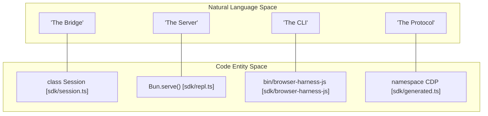
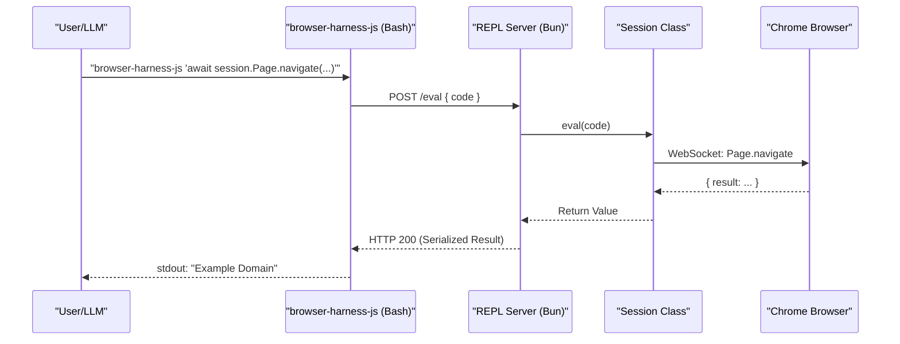

<!-- source: DeepWiki mcp.deepwiki.com · repo browser-use/browser-harness-js · page 1 Overview · fetched 2026-10-30 -->

# Overview

<details>
<summary>Relevant source files</summary>

The following files were used as context for generating this wiki page:

- [.gitignore](.gitignore)
- [LICENSE](LICENSE)
- [README.md](README.md)
- [SKILL.md](SKILL.md)

</details>


`browser-harness-js` is a lightweight, high-performance bridge designed to expose the full power of the **Chrome DevTools Protocol (CDP)** directly to Large Language Models (LLMs) and developers without restrictive abstractions [README.md:3-7](). It provides a persistent WebSocket connection to a Chrome instance, offering 652 fully-typed methods across 56 CDP domains [README.md:7-7]().

## "The Protocol is the API"

The core philosophy of `browser-harness-js` is that the protocol itself is the most efficient and expressive API available [README.md:19-19](). Unlike traditional automation frameworks (like Playwright or Puppeteer) that wrap CDP in higher-level "helper" functions like `click()` or `goto()`, this project provides direct access to the underlying protocol [README.md:53-53]().

### Why Avoid Abstractions?
*   **No Information Loss**: High-level helpers often hide complex parameters. For example, a standard `click(x, y)` helper might ignore 14 additional parameters available in `Input.dispatchMouseEvent` (such as `modifiers`, `pointerType`, or `force`) that an agent might need for sophisticated interactions [README.md:57-57]().
*   **Zero Version Drift**: The SDK is generated directly from upstream `browser_protocol.json` and `js_protocol.json` files [README.md:50-50](). When Chrome adds new features, regenerating the SDK immediately makes those features available as typed TypeScript calls [README.md:60-61]().
*   **Types as Documentation**: Every method call triggers autocomplete with the exact parameters and JSDoc from the CDP reference [README.md:59-59]().

For a deeper dive into these principles, see [Core Concepts and Design Philosophy](#1.2).

## System Architecture

The project consists of a TypeScript SDK and a Bun-native REPL server that maintains a long-lived session with Chrome.

### Component Map: Natural Language to Code Entities

The following diagram maps high-level system concepts to their specific implementations in the codebase.

**System Component Mapping**

Sources: [README.md:46-51](), [SKILL.md:81-88]()

### Execution Flow

When a command is issued, it passes through a thin CLI wrapper to a persistent background server.

**Request Lifecycle**

Sources: [SKILL.md:8-10](), [SKILL.md:31-39](), [README.md:47-49]()

## Key Components

| Component | File | Description |
| :--- | :--- | :--- |
| **CLI Wrapper** | `sdk/browser-harness-js` | A Bash script that manages the server lifecycle (start/stop/restart) and forwards JS snippets to the REPL [README.md:47-47](). |
| **REPL Server** | `sdk/repl.ts` | A Bun-based HTTP server that hosts a single persistent `Session` and evaluates incoming JavaScript [README.md:48-48](). |
| **Session** | `sdk/session.ts` | Manages the WebSocket transport, message routing, and target (tab) switching [README.md:49-49](). |
| **Codegen** | `sdk/gen.ts` | The engine that transforms the Chrome Protocol JSON into the typed `generated.ts` file [README.md:50-51](). |

## Getting Started

To use `browser-harness-js`, you need the `bun` runtime installed on your system [README.md:36-36](). You can install the tool as a "skill" for an AI agent or use it manually by symlinking the CLI into your `PATH` [SKILL.md:14-25]().

Once installed, connecting to a browser and navigating to a page is a simple one-liner:
```bash
browser-harness-js 'await session.connect({port:9222}); await session.Page.navigate({url:"https://example.com"})'
```
Sources: [SKILL.md:33-35]()

For detailed installation steps and first-run verification, see [Getting Started](#1.1).

## Advanced Interaction

While the SDK avoids "helpers," it provides a library of **Interaction Skills**—documented recipes for complex CDP sequences such as handling Shadow DOM, Out-of-Process Iframes (OOPIFs), and file uploads [README.md:70-74](). These are located in the `interaction-skills/` directory.

For more information on these patterns, see the [Interaction Skills](#4) section.

---

