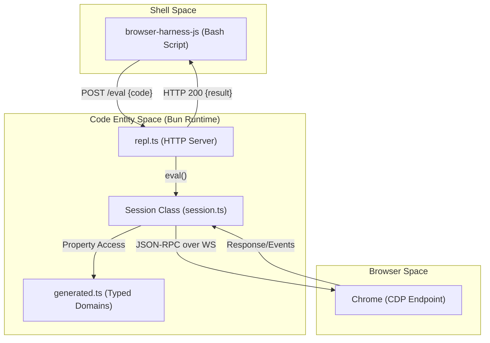
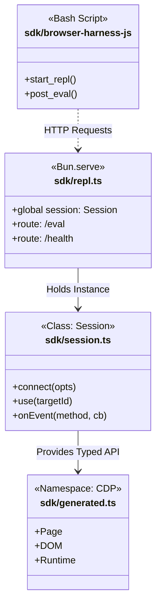

<!-- source: DeepWiki mcp.deepwiki.com · repo browser-use/browser-harness-js · page 1.1 Getting Started · fetched 2026-10-30 -->

# Getting Started

<details>
<summary>Relevant source files</summary>

The following files were used as context for generating this wiki page:

- [README.md](README.md)
- [SKILL.md](SKILL.md)
- [docs/setup-remote-debugging.png](docs/setup-remote-debugging.png)
- [sdk/browser-harness-js](sdk/browser-harness-js)
- [sdk/package.json](sdk/package.json)

</details>


This page provides a step-by-step guide for installing, configuring, and verifying your `browser-harness-js` setup. `browser-harness-js` is designed as a "thin bridge" between execution environments (like LLMs or local scripts) and the Chrome DevTools Protocol (CDP).

## Prerequisites

Before installing, ensure your environment meets the following requirements:

*   **Bun Runtime**: The REPL server is Bun-native and requires `bun` to be available on your `PATH` [README.md:36-36]().
*   **Google Chrome**: A running instance of Chrome (or a Chromium-based browser).
*   **Operating System**: macOS (Intel/Apple Silicon) or Linux.

## Installation

You can install the skill and the underlying SDK using `npx`.

### 1. Add the Skill
Run the following command to download the codebase into your agent's skill directory:

```bash
npx skills add https://github.com/browser-use/browser-harness-js --skill cdp
```
Sources: [README.md:23-25](), [SKILL.md:10-10]()

### 2. Link the CLI to PATH
The `npx` command installs the files but does not globally register the `browser-harness-js` executable. You must symlink the wrapper script [sdk/browser-harness-js:1-111]() to a directory in your `PATH`.

Replace `<skill-dir>` with the actual installation path (e.g., `~/.claude/skills/cdp` or `~/.cursor/skills/cdp`) [SKILL.md:10-10]().

**macOS (Homebrew/Silicon):**
```bash
command -v browser-harness-js >/dev/null || ln -sf <skill-dir>/sdk/browser-harness-js /opt/homebrew/bin/browser-harness-js
```
**Linux (Standard):**
```bash
command -v browser-harness-js >/dev/null || ln -sf <skill-dir>/sdk/browser-harness-js /usr/local/bin/browser-harness-js
```
Sources: [SKILL.md:17-25]()

## Connecting to Chrome

`browser-harness-js` does not launch Chrome for you; it attaches to an existing process. You must enable Remote Debugging in Chrome.

### Remote Debugging Setup
If prompted by Chrome with an "Allow" dialog for remote debugging, you must accept it to allow the SDK to attach [README.md:38-40]().

### Connection Strategies
The `session.connect()` method [sdk/session.ts:54-94]() supports three ways to find the browser:

| Strategy | Parameter | Use Case |
| :--- | :--- | :--- |
| **Profile Directory** | `profileDir` | Recommended for Chrome 144+. Reads `DevToolsActivePort` directly [SKILL.md:135-135](). |
| **Manual Port** | `port` | Used when Chrome is started with `--remote-debugging-port=<port>` [SKILL.md:128-129](). |
| **Direct WebSocket** | `wsUrl` | Used if you already have the full `ws://` string [SKILL.md:131-132](). |

Sources: [SKILL.md:112-137](), [sdk/session.ts:54-94]()

## System Architecture

The following diagram illustrates the data flow from a CLI command through the REPL server to the Chrome DevTools Protocol.

### Data Flow: CLI to CDP

Sources: [sdk/browser-harness-js:52-66](), [sdk/repl.ts:39-66](), [sdk/session.ts:101-135]()

## Verifying the Setup

To verify the installation, run these three commands in sequence. The first command will automatically start the background REPL server [sdk/browser-harness-js:102-108]().

### 1. Connect to the Browser
Update the path to match your OS profile directory.
```bash
browser-harness-js 'await session.connect({ profileDir: "/Users/example/Library/Application Support/Google/Chrome" })'
```

### 2. Select a Target (Tab)
List available tabs and attach the session to the first one.
```bash
browser-harness-js <<'EOF'
const tabs = await listPageTargets();
if (tabs.length > 0) {
  await session.use(tabs[0].targetId);
  return tabs[0].title;
}
EOF
```

### 3. Execute a CDP Command
Navigate the selected tab to a new URL.
```bash
browser-harness-js 'await session.Page.navigate({ url: "https://example.com" })'
```
Sources: [SKILL.md:31-37](), [SKILL.md:58-65](), [SKILL.md:121-126]()

## Troubleshooting

### CLI Status and Logs
If the commands fail, check the background server status or logs:

*   **Check Status**: `browser-harness-js --status` [sdk/browser-harness-js:69-76]()
*   **View Logs**: `browser-harness-js --logs` (defaults to `/tmp/browser-harness-js.log`) [sdk/browser-harness-js:95-97]()
*   **Restart Server**: `browser-harness-js --restart` [sdk/browser-harness-js:89-94]()

### Entity Mapping
The following diagram maps the logical components to the specific files and classes in the codebase.

### Component Mapping

Sources: [sdk/browser-harness-js:1-111](), [sdk/repl.ts:1-100](), [sdk/session.ts:1-300](), [sdk/generated.ts:1-10]()

---

