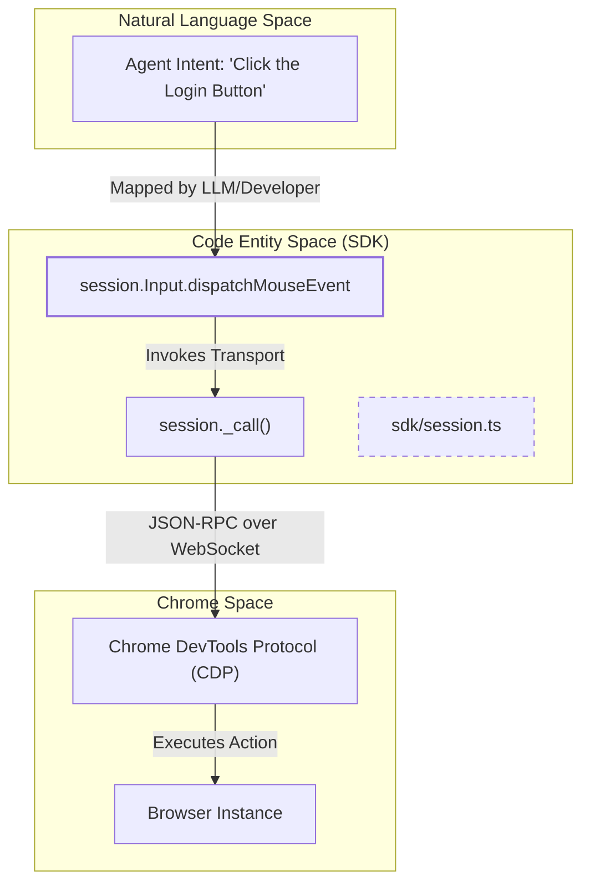
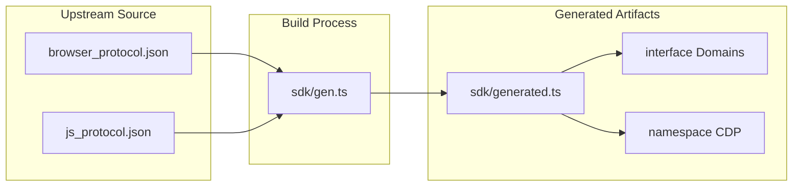

<!-- source: DeepWiki mcp.deepwiki.com · repo browser-use/browser-harness-js · page 1.2 Core Concepts and Design Philosophy · fetched 2026-10-30 -->

# Core Concepts and Design Philosophy

Relevant source files

The following files were used as context for generating this wiki page:

- [README.md](README.md)
- [SKILL.md](SKILL.md)
- [sdk/session.ts](sdk/session.ts)

The `browser-harness-js` project is built on the premise that the Chrome DevTools Protocol (CDP) is already a rich, expressive API for browser automation. Instead of creating a high-level library that abstracts these capabilities away, this project provides a **thin bridge** that exposes the full power of the protocol directly to the user.

## The 'Thin Bridge' Philosophy

The core design philosophy is "The protocol is the API" [README.md:19-19](). Unlike traditional automation frameworks (like Puppeteer or Playwright) that wrap CDP in higher-level abstractions like `click()` or `goto()`, this SDK intentionally avoids pre-baked helpers [README.md:12-16]().

### Why Abstractions are Avoided
1.  **Loss of Control:** A `click(x, y)` helper often hides parameters that an LLM or power user might need, such as `modifiers`, `clickCount`, or `pointerType` [README.md:57-58]().
2.  **Version Drift:** High-level libraries often lag behind Chrome updates. By using a "thin bridge" generated directly from the protocol JSON, new Chrome features are available immediately [README.md:60-61]().
3.  **Documentation Parity:** The SDK's types and JSDoc match the official CDP reference exactly, reducing the mental overhead of learning a proprietary API [README.md:59-59]().

### Bridge Logic Flow
The following diagram illustrates how a developer's intent moves through the "Thin Bridge" to Chrome without being intercepted by complex abstraction layers.

**Intent to Protocol Mapping**

**Sources:** [README.md:9-17](), [sdk/session.ts:115-128]()

---

## Direct Mapping: Domains to Session Properties

In `browser-harness-js`, the `Session` class acts as the central coordinator. To maintain the "thin bridge" feel, every CDP domain (e.g., `Page`, `DOM`, `Network`) is mounted directly as a property on the `Session` instance [sdk/session.ts:38-42]().

### Implementation Details
*   **Lazy Binding:** Domains are bound to the session using `bindDomains(this)` in the constructor [sdk/session.ts:38-38]().
*   **Property Mirroring:** The SDK iterates through all generated domains and mirrors them onto the `Session` instance so that calls read naturally: `session.Page.navigate(...)` [sdk/session.ts:39-42]().
*   **Automatic Routing:** When a domain method is called, the `Session` automatically injects the `activeSessionId` into the message if the method is not a "browser-level" command (like `Target.*` or `Browser.*`) [sdk/session.ts:121-123]().

| Feature | Implementation in `sdk/session.ts` |
| :--- | :--- |
| **Domain Mounting** | `this[k] = this.domains[k]` [sdk/session.ts:41-41]() |
| **Target Switching** | `session.use(targetId)` sets `activeSessionId` [sdk/session.ts:74-78]() |
| **Event Handling** | `session.onEvent()` for global protocol monitoring [sdk/session.ts:90-95]() |
| **Wait Primitives** | `session.waitFor(method, predicate)` for state sync [sdk/session.ts:98-112]() |

**Sources:** [sdk/session.ts:26-43](), [sdk/session.ts:74-112]()

---

## Role of Code Generation

The SDK's currency is maintained via a code generation pipeline. This pipeline transforms the raw JSON definitions of the Chrome DevTools Protocol into a fully-typed TypeScript SDK.

### The Gen Pipeline
1.  **Input:** `browser_protocol.json` and `js_protocol.json` [README.md:50-50]().
2.  **Process:** `sdk/gen.ts` parses these files to create TypeScript namespaces and interfaces for every command, event, and type [README.md:50-50]().
3.  **Output:** `sdk/generated.ts`, which contains 56 domains and 652 typed wrappers [README.md:7-7]().

This process ensures that the "Thin Bridge" is not just thin, but also structurally sound and type-safe.

**Code Generation Data Flow**

**Sources:** [README.md:49-51](), [sdk/session.ts:9-9]()

---

## Session Multiplexing and the 'Flatten' Pattern

A key design decision in the `Session` class is the use of `flatten: true` when attaching to targets [sdk/session.ts:5-7](). 

In standard CDP, communicating with a specific tab often requires nesting messages inside `Target.sendMessageToTarget`. The `browser-harness-js` SDK uses the "flatten" mode, which allows all communications to happen over a single WebSocket connection where messages are distinguished solely by a `sessionId` field [sdk/session.ts:75-76]().

### Key Functions for Session Management
*   `session.use(targetId)`: Attaches to a target and sets it as the active context for subsequent domain calls [sdk/session.ts:74-78]().
*   `_call(method, params)`: The underlying transport method that handles ID incrementing, JSON-RPC formatting, and `sessionId` injection [sdk/session.ts:115-128]().
*   `onMessage(raw)`: Routes incoming WebSocket messages back to the appropriate caller (via `pending` map) or to event listeners [sdk/session.ts:130-144]().

**Sources:** [sdk/session.ts:1-7](), [sdk/session.ts:74-78](), [sdk/session.ts:115-144]()

---

