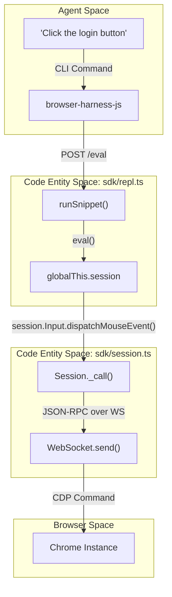
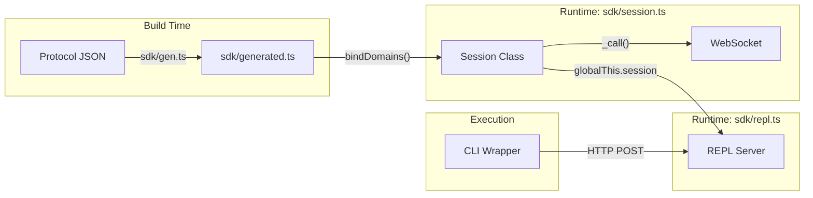

<!-- source: DeepWiki mcp.deepwiki.com · repo browser-use/browser-harness-js · page 2 SDK Architecture · fetched 2026-10-30 -->

# SDK Architecture

Relevant source files

The following files were used as context for generating this wiki page:

- [README.md](README.md)
- [sdk/browser-harness-js](sdk/browser-harness-js)
- [sdk/repl.ts](sdk/repl.ts)
- [sdk/session.ts](sdk/session.ts)

The `browser-harness-js` SDK is designed as a "thin bridge" between an agent and the Chrome DevTools Protocol (CDP). Its internal structure prioritizes direct protocol access over high-level abstractions, ensuring that every CDP capability is available as a typed TypeScript call.

The system consists of four primary layers: a persistent WebSocket **Session**, a **REPL Server** for remote execution, a **CLI Wrapper** for lifecycle management, and a **Code Generation Pipeline** that keeps the API in sync with Chrome's evolution.

### System Overview

The following diagram illustrates the flow from a Natural Language Agent's request through the CLI and REPL into the core `Session` class, which communicates with Chrome.

**Natural Language to Code Entity Mapping**

**Sources:** [README.md:9-17](), [sdk/repl.ts:47-51](), [sdk/session.ts:115-128]()

---

### [Session Class](#2.1)

The `Session` class in `sdk/session.ts` is the core engine of the SDK. It manages a single persistent WebSocket connection to Chrome's browser-level endpoint [sdk/session.ts:46-60](). It handles:
- **Request/Response Mapping**: Using a `pending` Map to associate outgoing JSON-RPC IDs with their corresponding promises [sdk/session.ts:29](), [sdk/session.ts:133-138]().
- **Target Routing**: The `use(targetId)` method allows the session to "attach" to specific tabs or frames, auto-injecting the required `sessionId` into subsequent calls [sdk/session.ts:74-78]().
- **Event Handling**: Primitives like `onEvent()` and `waitFor()` allow agents to react to browser events (e.g., network requests, dialogs) asynchronously [sdk/session.ts:90-112]().

For details, see [Session Class](#2.1).

**Sources:** [sdk/session.ts:26-145]()

---

### [REPL Server](#2.2)

The REPL server (`sdk/repl.ts`) is a Bun-powered HTTP server that hosts a persistent `Session` instance [sdk/repl.ts:19-20](). It provides a bridge for stateless CLI tools or agents to execute stateful JavaScript snippets.
- **Endpoints**: Supports `/eval` for code execution, `/health` for connection status, and `/quit` for graceful shutdown [sdk/repl.ts:5-10]().
- **Global Context**: It exposes `session`, `listPageTargets`, and the `CDP` type library to the global scope, allowing snippets to be concise (e.g., `await session.Page.navigate(...)`) [sdk/repl.ts:20-25]().
- **Smart Eval**: Automatically wraps single expressions in async IIFEs and handles result serialization [sdk/repl.ts:47-51]().

For details, see [REPL Server](#2.2).

**Sources:** [sdk/repl.ts:1-108]()

---

### [CLI Wrapper (browser-harness-js)](#2.3)

The `browser-harness-js` script is a Bash wrapper that manages the REPL's lifecycle and provides a user-friendly interface for the agent [sdk/browser-harness-js:1-19]().
- **Auto-Start**: Spawns the REPL server in the background on the first call if it isn't already running [sdk/browser-harness-js:41-50]().
- **Environment Control**: Uses `CDP_REPL_PORT` and `CDP_REPL_LOG` to manage server configuration [sdk/browser-harness-js:22-35]().
- **Management Flags**: Provides `--status`, `--stop`, `--restart`, and `--logs` for debugging and maintenance [sdk/browser-harness-js:68-97]().

For details, see [CLI Wrapper (browser-harness-js)](#2.3).

**Sources:** [sdk/browser-harness-js:1-111]()

---

### [Code Generation Pipeline](#2.4)

The SDK does not manually define browser methods. Instead, it uses a code generation pipeline (`sdk/gen.ts`) to transform the official Chrome DevTools Protocol JSON definitions into a fully typed TypeScript API [sdk/gen.ts]().
- **Generated Output**: Produces `sdk/generated.ts`, which contains over 600 typed methods organized by CDP Domain (e.g., `Page`, `Runtime`, `Network`) [README.md:50-51]().
- **Domain Binding**: The `bindDomains` factory links these generated types to the `Session._call` transport mechanism [sdk/session.ts:38-42]().

For details, see [Code Generation Pipeline](#2.4).

**Sources:** [README.md:50-51](), [sdk/session.ts:9](), [sdk/session.ts:38-42]()

---

### Component Relationship

The following diagram shows how the generated types and the runtime components interact to provide the final API.

**Architecture Component Interaction**

**Sources:** [sdk/session.ts:9](), [sdk/session.ts:38-42](), [sdk/repl.ts:19-25](), [sdk/browser-harness-js:52-66]()

---

