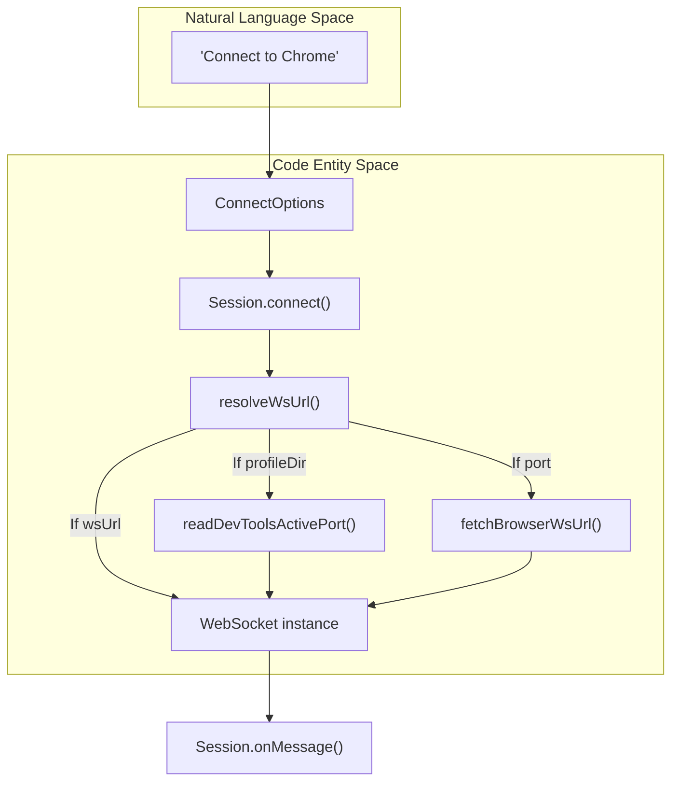
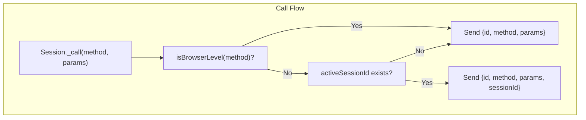

<!-- source: DeepWiki mcp.deepwiki.com · repo browser-use/browser-harness-js · page 2.1 Session Class · fetched 2026-10-30 -->

# Session Class

Relevant source files

The following files were used as context for generating this wiki page:

- [README.md](README.md)
- [sdk/session.ts](sdk/session.ts)

The `Session` class is the central orchestrator of the `browser-harness-js` SDK. It manages a persistent WebSocket connection to the Chrome DevTools Protocol (CDP) browser endpoint and provides the infrastructure for request/response multiplexing, target routing, and event handling.

## Overview and Lifecycle

The `Session` class implements the `Transport` interface defined in the generated bindings [sdk/session.ts:26-26](). Its lifecycle typically follows these stages:

1.  **Initialization**: Upon construction, the `Session` lazily initializes CDP domain bindings using `bindDomains` and mirrors them onto the class instance [sdk/session.ts:37-43]().
2.  **Connection**: The `connect()` method resolves a WebSocket URL and establishes a connection [sdk/session.ts:46-60]().
3.  **Routing**: The `use(targetId)` method attaches to a specific tab or worker [sdk/session.ts:74-78]().
4.  **Execution**: Calls are dispatched via `_call`, which handles message IDs and session multiplexing [sdk/session.ts:115-128]().
5.  **Teardown**: The `close()` method terminates the socket and rejects any outstanding promises [sdk/session.ts:53-58, 66-68]().

### Connection Data Flow

The following diagram illustrates the transition from a high-level `ConnectOptions` object to an active `WebSocket` connection.

**Figure 1: Connection Resolution and Socket Lifecycle**

Sources: [sdk/session.ts:16-24](), [sdk/session.ts:46-60](), [sdk/session.ts:171-185]()

---

## The Pending-Map Pattern

To bridge the asynchronous nature of WebSockets with the `Promise`-based API of the SDK, `Session` uses a "pending-map" pattern [sdk/session.ts:11-14]().

1.  **Request**: Every call to `_call` increments a `nextId` [sdk/session.ts:119-119]().
2.  **Storage**: A `Pending` object (containing `resolve` and `reject` callbacks) is stored in the `pending` Map, keyed by the message `id` [sdk/session.ts:125-125]().
3.  **Response**: When `onMessage` receives a frame with a matching `id`, it retrieves the `Pending` entry, deletes it from the map, and settles the original promise [sdk/session.ts:133-138]().

### Error Handling
If the CDP returns an error object, the `Session` rejects the promise with a `CdpError` [sdk/session.ts:137-137](). This class captures the protocol-level error code and message [sdk/session.ts:147-152]().

Sources: [sdk/session.ts:29-29](), [sdk/session.ts:115-128](), [sdk/session.ts:130-144]()

---

## Session Multiplexing and Routing

The SDK uses a "flattened" session architecture. Instead of nesting messages inside `Target.sendMessageToTarget`, it connects once to the browser endpoint and includes a `sessionId` in the top-level JSON payload for target-specific commands [sdk/session.ts:5-7]().

### The `use()` Method
The `use(targetId)` method is the primary primitive for switching context between tabs [sdk/session.ts:74-78]().
- It calls `Target.attachToTarget` with `flatten: true` [sdk/session.ts:75-75]().
- It stores the returned `sessionId` as the `activeSessionId` [sdk/session.ts:76-76]().

### Automatic Routing Logic
When `_call` is invoked, it automatically injects the `activeSessionId` into the outgoing message unless the method is "browser-level" [sdk/session.ts:121-123](). Browser-level methods (defined in the `Browser` or `Target` domains) always operate on the global browser context and must not include a `sessionId` [sdk/session.ts:155-157]().

**Figure 2: Message Routing Logic in _call()**

Sources: [sdk/session.ts:74-78](), [sdk/session.ts:115-128](), [sdk/session.ts:155-157]()

---

## Event System and Primitives

The `Session` provides two main ways to interact with CDP events (e.g., `Network.requestWillBeSent` or `Page.loadEventFired`).

### `onEvent(fn)`
A low-level subscription mechanism. It adds a callback to the `eventListeners` array and returns an unsubscribe function [sdk/session.ts:90-95](). Whenever a message without an `id` (indicating an event) is received, all listeners are notified [sdk/session.ts:139-143]().

### `waitFor(method, predicate, timeout)`
A high-level primitive for synchronization [sdk/session.ts:98-112](). It:
1.  Subscribes to events using `onEvent`.
2.  Filters by the specified `method`.
3.  Applies an optional `predicate` to the event parameters [sdk/session.ts:106-106]().
4.  Resolves the promise when a match is found or rejects after the `timeoutMs` (default 30s) [sdk/session.ts:100-103]().

| Method | Purpose | Typical Use Case |
| :--- | :--- | :--- |
| `onEvent` | Persistent monitoring | Logging all network traffic or console messages. |
| `waitFor` | Flow control | Waiting for a specific navigation to complete or a file to download. |

Sources: [sdk/session.ts:31-31](), [sdk/session.ts:90-112](), [sdk/session.ts:139-143]()

---

