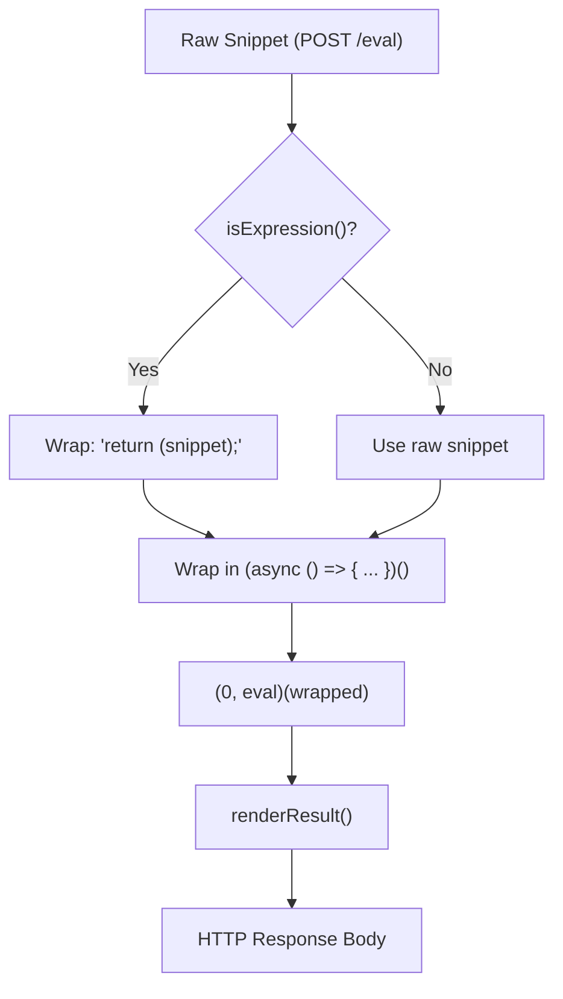
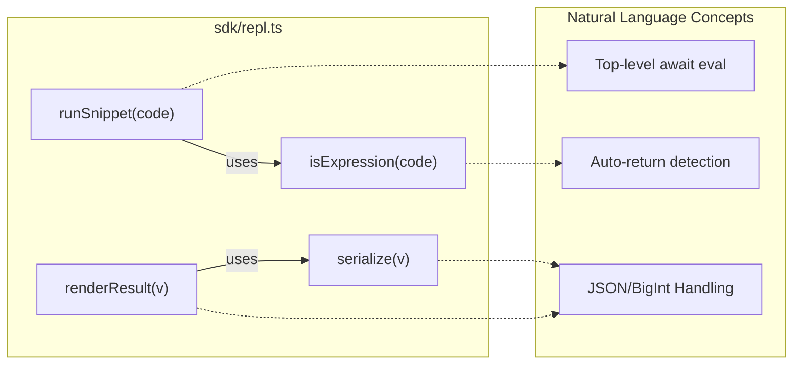

<!-- source: DeepWiki mcp.deepwiki.com · repo browser-use/browser-harness-js · page 2.2 REPL Server · fetched 2026-10-30 -->

# REPL Server

Relevant source files

The following files were used as context for generating this wiki page:

- [SKILL.md](SKILL.md)
- [sdk/repl.ts](sdk/repl.ts)

The REPL Server is a long-lived Bun HTTP process that maintains a persistent `Session` with a Chrome instance. It acts as the execution engine for the `browser-harness-js` CLI, allowing multiple sequential CLI calls to share the same WebSocket connection, authentication state, and global variables [sdk/repl.ts:1-14]().

## Server Lifecycle and Configuration

The server is implemented in `sdk/repl.ts` and uses `Bun.serve` to listen on `127.0.0.1` [sdk/repl.ts:70-72](). By default, it binds to port `9876`, but this can be overridden via the `CDP_REPL_PORT` environment variable [sdk/repl.ts:27]().

### Global Context Initialization
Upon startup, the server initializes a singleton `Session` and populates `globalThis` with several helpers to ensure they are available to any code evaluated via the `/eval` endpoint [sdk/repl.ts:19-25]():

| Global Variable | Purpose |
| :--- | :--- |
| `session` | The persistent `Session` instance for CDP communication [sdk/repl.ts:20](). |
| `listPageTargets()` | Bound helper to list available tabs using the active session [sdk/repl.ts:23](). |
| `resolveWsUrl` | Utility to resolve WebSocket URLs from ports or profile directories [sdk/repl.ts:24](). |
| `CDP` | The full generated namespace for type-name references [sdk/repl.ts:25](). |

**Sources:** [sdk/repl.ts:1-30](), [SKILL.md:81-89]()

## Endpoints

The server exposes three primary endpoints to manage the browser session and execute code.

### 1. `GET /health`
Returns the current status of the REPL server, including uptime and connection state [sdk/repl.ts:76-83]().
- **Response:** `{"ok":true, "uptime":number, "connected":boolean, "sessionId":string|null}`

### 2. `POST /eval`
The primary execution endpoint. It accepts raw JavaScript as the request body [sdk/repl.ts:85-86]().
- **Success (200 OK):** Returns the serialized result of the execution as `text/plain` [sdk/repl.ts:93]().
- **Failure (500 Error):** Returns the error stack or message as `text/plain` [sdk/repl.ts:94-97]().

### 3. `POST /quit`
Triggers a graceful shutdown. It closes the `Session` WebSocket and terminates the Bun process after a 50ms delay to allow the response to flush [sdk/repl.ts:100-104]().

**Sources:** [sdk/repl.ts:70-108]()

## Expression Detection and Async Wrapping

To provide a "REPL-like" experience where single expressions automatically return values, `sdk/repl.ts` performs lightweight syntax analysis before execution.

### Expression Detection
The `isExpression` function determines if the input string is a single expression or a multi-statement block [sdk/repl.ts:30-36]().
- **Expression:** No newlines/semicolons and does not start with keywords like `let`, `const`, `if`, or `function` [sdk/repl.ts:33-34]().
- **Statement:** Contains control flow, declarations, or multiple lines.

### Execution Pipeline
Code is wrapped in an asynchronous IIFE (Immediately Invoked Function Expression) to support top-level `await` [sdk/repl.ts:47-51]().

**REPL Execution Logic**

**Sources:** [sdk/repl.ts:30-51]()

## Result Serialization

The server serializes results into a format optimized for CLI consumption. The `renderResult` function handles the conversion of JavaScript values into `text/plain` strings [sdk/repl.ts:61-68]().

| Value Type | Output Format |
| :--- | :--- |
| `undefined`, `null`, `""`, `{}`, `[]` | Empty string (no output) [sdk/repl.ts:63-66]() |
| `string` | Bare text (no quotes) [sdk/repl.ts:64]() |
| `number`, `boolean`, `object` | JSON stringified [sdk/repl.ts:67]() |
| `bigint` | Converted to string during JSON pass [sdk/repl.ts:41]() |

**Code Entity Mapping: Evaluation and Serialization**

**Sources:** [sdk/repl.ts:38-68](), [SKILL.md:41-47]()

---

