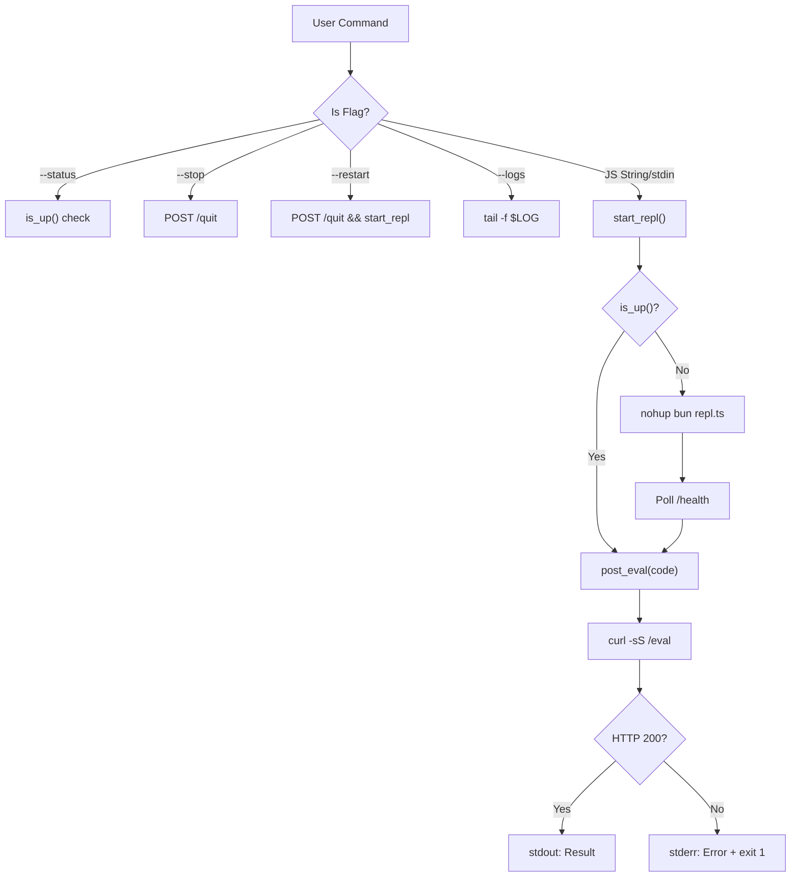
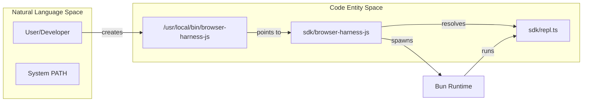

<!-- source: DeepWiki mcp.deepwiki.com · repo browser-use/browser-harness-js · page 2.3 CLI Wrapper (browser-harness-js) · fetched 2026-10-30 -->

# CLI Wrapper (browser-harness-js)

Relevant source files

The following files were used as context for generating this wiki page:

- [SKILL.md](SKILL.md)
- [sdk/browser-harness-js](sdk/browser-harness-js)

The `browser-harness-js` script is a Bash-based CLI wrapper that serves as the primary entry point for interacting with the CDP REPL server. It manages the lifecycle of the persistent Bun process, handles code submission via arguments or `stdin`, and provides diagnostic tools for managing the background session.

## Overview and Purpose

The CLI follows a "thin bridge" philosophy, designed to make the remote CDP session feel like a local script execution [SKILL.md:8-10](). Its primary responsibilities include:
1.  **Auto-starting** the REPL server if it is not already running [sdk/browser-harness-js:41-50]().
2.  **Forwarding JS snippets** to the `/eval` endpoint of the REPL [sdk/browser-harness-js:52-66]().
3.  **Standardizing Output**: Mapping HTTP status codes from the REPL back to shell exit codes and filtering output based on result types [SKILL.md:41-47]().
4.  **Process Management**: Providing flags for status checks, logs, and graceful restarts [sdk/browser-harness-js:68-110]().

### Sources:
- [SKILL.md:8-10]()
- [SKILL.md:41-47]()
- [sdk/browser-harness-js:41-50]()
- [sdk/browser-harness-js:52-66]()
- [sdk/browser-harness-js:68-110]()

---

## Lifecycle Management

The script ensures that a REPL server is always available before attempting to evaluate code.

### Auto-Start Logic
When any evaluation command is issued, the script calls `start_repl` [sdk/browser-harness-js:102,107](). This function checks if the server is responsive on the designated port (default `9876`). If unresponsive, it spawns the REPL using `nohup bun "$REPL"` and polls the `/health` endpoint for up to 10 seconds until it becomes available [sdk/browser-harness-js:41-50]().

### Evaluation Pipeline (`post_eval`)
The `post_eval` function handles the data flow between the shell and the REPL server:
1.  **Request**: It sends the JS code as a binary payload to `$URL/eval` using `curl` [sdk/browser-harness-js:56]().
2.  **Response Splitting**: It uses a custom delimiter (`___STATUS___`) to separate the response body from the HTTP status code [sdk/browser-harness-js:56-58]().
3.  **Exit Codes**: 
    *   HTTP 200: Body is printed to `stdout`, returns 0 [sdk/browser-harness-js:59-61]().
    *   Non-200: Body (usually an error stack) is printed to `stderr`, returns 1 [sdk/browser-harness-js:62-65]().

### CLI Command Flow
The following diagram illustrates how the CLI handles user input and manages the REPL process.

**CLI Execution Flow**

### Sources:
- [sdk/browser-harness-js:37-50]()
- [sdk/browser-harness-js:52-66]()
- [sdk/browser-harness-js:68-110]()

---

## Configuration and Environment

The script's behavior is governed by environment variables and local path resolution.

| Variable | Default | Description |
| :--- | :--- | :--- |
| `CDP_REPL_PORT` | `9876` | The port the Bun REPL server listens on [sdk/browser-harness-js:22](). |
| `CDP_REPL_LOG` | `/tmp/browser-harness-js.log` | File path for server stdout/stderr [sdk/browser-harness-js:35](). |

### Path Resolution
To ensure the script can find `repl.ts` even when called via a symlink (e.g., from `/usr/local/bin`), it implements a recursive symlink resolution loop [sdk/browser-harness-js:27-33](). This allows the script to be symlinked into the user's `PATH` while maintaining its connection to the SDK files in its original directory.

### Sources:
- [sdk/browser-harness-js:22-35]()
- [sdk/browser-harness-js:27-33]()

---

## Installation and Symlinking

The `browser-harness-js` script is designed to be installed as a global CLI tool via symlinks. Because the SDK is often installed into agent-specific skill directories (e.g., `~/.claude/skills/cdp`), users must link the script into their system `PATH` [SKILL.md:10-25]().

**Installation to Code Entities**

### Sources:
- [SKILL.md:10-25]()
- [sdk/browser-harness-js:26-33]()

---

## Command Reference

| Command | Functionality |
| :--- | :--- |
| `browser-harness-js '<js>'` | Evaluates a single-line expression. Auto-returns the value [SKILL.md:71, 56](). |
| `browser-harness-js <<EOF` | Evaluates multi-line snippets from `stdin`. Requires explicit `return` [SKILL.md:72, 56](). |
| `--status` | Returns JSON containing uptime and session connectivity status [sdk/browser-harness-js:69-76](). |
| `--start` | Manually triggers `start_repl` without evaluating code [sdk/browser-harness-js:77-80](). |
| `--stop` | Sends a POST request to `/quit`, terminating the background server [sdk/browser-harness-js:81-88](). |
| `--restart` | Combines `--stop` and `--start` to clear session state [sdk/browser-harness-js:89-94](). |
| `--logs` | Tails the log file defined by `CDP_REPL_LOG` [sdk/browser-harness-js:95-97](). |

### Sources:
- [SKILL.md:56-77]()
- [sdk/browser-harness-js:68-110]()

---

