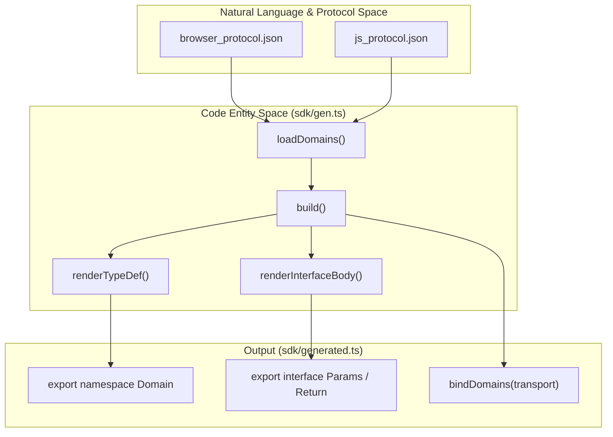
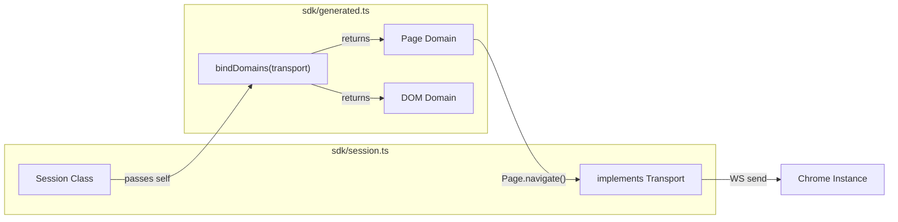

<!-- source: DeepWiki mcp.deepwiki.com · repo browser-use/browser-harness-js · page 2.4 Code Generation Pipeline · fetched 2026-10-30 -->

# Code Generation Pipeline

<details>
<summary>Relevant source files</summary>

The following files were used as context for generating this wiki page:

- [sdk/browser_protocol.json](sdk/browser_protocol.json)
- [sdk/bun.lock](sdk/bun.lock)
- [sdk/gen.ts](sdk/gen.ts)
- [sdk/generated.ts](sdk/generated.ts)
- [sdk/js_protocol.json](sdk/js_protocol.json)
- [sdk/tsconfig.json](sdk/tsconfig.json)

</details>


The `browser-harness-js` SDK follows a "the protocol is the API" philosophy. To maintain strict type safety and keep pace with Chrome DevTools Protocol (CDP) updates without manual maintenance, the project uses an automated code generation pipeline. This pipeline transforms the raw CDP JSON specifications into a fully-typed TypeScript interface used by the `Session` class.

## Overview and Data Flow

The pipeline is centered around `sdk/gen.ts`, a Bun-based script that parses the official Chrome protocol definitions and emits `sdk/generated.ts`.

### Data Flow Diagram: Protocol to TypeScript
This diagram shows how raw CDP definitions are transformed into the code entities used by the SDK.



**Sources:** [sdk/gen.ts:1-9](), [sdk/gen.ts:61-69](), [sdk/gen.ts:166-173]()

---

## The Source Protocols

The generator consumes two primary JSON files which are local copies of the Chrome DevTools Protocol:
1.  **`browser_protocol.json`**: Contains browser-level domains like `Page`, `Network`, `Input`, and `Target`. [sdk/browser_protocol.json:1-177]()
2.  **`js_protocol.json`**: Contains V8-level domains like `Runtime`, `Debugger`, and `Profiler`. [sdk/js_protocol.json:1-182]()

The `loadDomains` function in `sdk/gen.ts` merges these files and sorts the domains alphabetically to ensure deterministic output. [sdk/gen.ts:61-69]()

---

## Generation Logic (`sdk/gen.ts`)

The generator processes the protocol through several specialized rendering functions to produce TypeScript-compatible code.

### Type Mapping
The `renderType` function maps CDP primitive types to TypeScript types:
| CDP Type | TypeScript Type |
| :--- | :--- |
| `string` (with enum) | String Union (e.g., `"log" | "warning"`) |
| `integer` / `number` | `number` |
| `boolean` | `boolean` |
| `binary` | `string` (base64) |
| `any` | `unknown` |
| `array` | `T[]` |
| `object` | Interface or `Record<string, unknown>` |

**Sources:** [sdk/gen.ts:88-118]()

### Namespace and Interface Emission
The pipeline emits code in three distinct phases:

1.  **Domain Namespaces**: For every domain (e.g., `Accessibility`), a TypeScript namespace is created containing its internal types. [sdk/gen.ts:179-191]()
2.  **Command Interfaces**: For every command (e.g., `Page.navigate`), the generator creates `Params` and `Return` interfaces (e.g., `Page.NavigateParams`). [sdk/gen.ts:196-216]()
3.  **The bindDomains Factory**: This is the core functional output. It creates a nested object structure where every method calls the `Transport._call` method. [sdk/gen.ts:223-255]()

### Handling Reserved Words
Since CDP property names can conflict with TypeScript keywords (e.g., `delete`, `default`), the `escId` function wraps reserved words in quotes and checks for valid identifiers using a regex: `[sdk/gen.ts:71-76]()`.

---

## The `bindDomains` Factory

The generated file `sdk/generated.ts` exports a factory function called `bindDomains`. This function takes a `Transport` object (implemented by the `Session` class) and returns a proxy-like object containing all CDP domains.



**Sources:** [sdk/generated.ts:5-7](), [sdk/gen.ts:223-255]()

### Implementation Detail
Inside `bindDomains`, every domain method is generated as an async function that forwards the method string and parameters to `transport._call`.

```typescript
// Example of generated structure in sdk/generated.ts
export function bindDomains(transport: Transport) {
  return {
    Page: {
      navigate: (params: Page.NavigateParams) => 
        transport._call("Page.navigate", params) as Promise<Page.NavigateReturn>,
      // ... other methods
    },
    // ... other domains
  };
}
```
**Sources:** [sdk/gen.ts:241-252]()

---

## Regeneration Workflow

When Chrome is updated and new CDP features are released, the SDK must be regenerated to reflect the new types and commands.

### Steps to Regenerate
1.  **Update JSONs**: Download the latest `browser_protocol.json` and `js_protocol.json` from the [Chrome DevTools Protocol repository](https://github.com/ChromeDevTools/devtools-protocol) and place them in the `sdk/` directory.
2.  **Run Generator**: Execute the generator script using Bun:
    ```bash
    cd sdk
    bun gen.ts
    ```
3.  **Verify**: The script overwrites `sdk/generated.ts`. The TypeScript compiler will immediately flag any breaking changes in the rest of the SDK or user scripts.

**Sources:** [sdk/gen.ts:1-5](), [sdk/gen.ts:173]()

### Constraints and Omissions
-   **Events**: The current pipeline intentionally skips event definitions in the `bindDomains` object, as events are handled via the `Session.onEvent` and `Session.waitFor` primitives in `sdk/session.ts`. [sdk/gen.ts:7-9]()
-   **Redirects**: Commands marked as `redirect` in the JSON are skipped to avoid duplicate canonical definitions. [sdk/gen.ts:198]()
-   **Experimental/Deprecated**: Both experimental and deprecated fields are included to ensure maximum compatibility with different Chrome versions. [sdk/gen.ts:7-9]()

---

