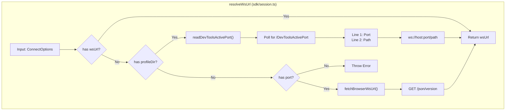
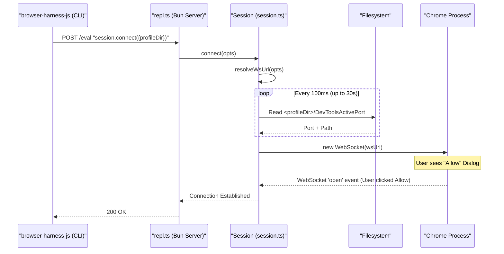

<!-- source: DeepWiki mcp.deepwiki.com · repo browser-use/browser-harness-js · page 3.1 Connection Strategies and Chrome 144+ Compatibility · fetched 2026-10-30 -->

# Connection Strategies and Chrome 144+ Compatibility

<details>
<summary>Relevant source files</summary>

The following files were used as context for generating this wiki page:

- [SKILL.md](SKILL.md)
- [interaction-skills/connection.md](interaction-skills/connection.md)
- [sdk/session.ts](sdk/session.ts)

</details>


This page details the mechanisms `browser-harness-js` uses to establish a persistent connection with a Chrome instance. It covers the resolution logic for WebSocket URLs, the impact of architectural changes in Chrome 144+, and the polling strategies used to handle browser startup delays.

## Connection Strategy Overview

The `Session` class provides a unified `connect()` method that supports three distinct strategies for locating the Chrome DevTools Protocol (CDP) endpoint. Choosing the correct strategy is critical to avoid timeouts and handle modern Chrome security restrictions.

| Strategy | Input | Implementation | Use Case |
| :--- | :--- | :--- | :--- |
| **Direct WS** | `wsUrl` | Connects directly to the provided WebSocket string. | When the URL is already known from a launch script. |
| **Profile Probe** | `profileDir` | Reads the `DevToolsActivePort` file from the Chrome User Data directory. | **Recommended.** Works with `chrome://inspect` and Chrome 144+. |
| **HTTP Probe** | `port` | Queries `http://127.0.0.1:<port>/json/version`. | Legacy/Explicit launches (e.g., `--remote-debugging-port=9222`). |

Sources: [sdk/session.ts:16-24](), [sdk/session.ts:160-170](), [interaction-skills/connection.md:3-11]()

## The resolveWsUrl Resolution Logic

The `resolveWsUrl` function follows a strict order of preference to determine the WebSocket target. It is designed to be resilient to the "Allow" dialog prompt often seen when attaching to an existing Chrome instance.

### Logical Flow of resolveWsUrl

The diagram below illustrates how `resolveWsUrl` processes the `ConnectOptions` and handles the filesystem or network probes.

**Title: resolveWsUrl Logic Flow**

Sources: [sdk/session.ts:171-185](), [sdk/session.ts:193-205](), [sdk/session.ts:213-225]()

## Chrome 144+ Compatibility and the /json/version Failure

Starting with Chrome 144 (specifically when attached via the `chrome://inspect` flow), the browser no longer serves the `/json/version` endpoint over HTTP. 

### Why the HTTP Probe Fails
The legacy `port` strategy relies on `fetchBrowserWsUrl`, which performs an HTTP GET request to retrieve the `webSocketDebuggerUrl` from a JSON response [sdk/session.ts:213-225](). In Chrome 144+, this request returns a 404 or fails to connect, leading to a 30-second timeout in the SDK [SKILL.md:137-138]().

### The Profile Directory Solution
The `profileDir` strategy bypasses the HTTP server entirely. It reads the `DevToolsActivePort` file directly from the disk. Chrome writes this file immediately upon starting the remote debugging server [sdk/session.ts:193-198]().
- **Line 1**: Contains the ephemeral port number.
- **Line 2**: Contains the unique WebSocket path (e.g., `/devtools/browser/<uuid>`).

By combining these, the SDK constructs the full `ws://` URL without needing an intermediate HTTP handshake [sdk/session.ts:175-177]().

Sources: [sdk/session.ts:162-169](), [SKILL.md:134-138](), [interaction-skills/connection.md:19-19]()

## Connection Lifecycle and Polling

The connection process includes built-in retries to account for the time it takes for Chrome to write to disk or for the user to interact with the OS.

### Polling for DevToolsActivePort
The `readDevToolsActivePort` function polls the filesystem for up to 30 seconds [sdk/session.ts:194-197](). This is necessary because the file might not exist yet if the browser is still initializing.

### The "Allow" Dialog
When a debugger first attempts to attach to a running Chrome instance, Chrome may display a modal dialog asking the user to "Allow" the connection.
- The `session.connect()` call will appear to hang during this period [interaction-skills/connection.md:65-67]().
- The underlying `WebSocket` connection attempt in `Session.connect` will wait until the user clicks "Allow", at which point the `open` event fires and the promise resolves [sdk/session.ts:48-51]().

**Title: Connection Handshake Sequence**

Sources: [sdk/session.ts:46-60](), [sdk/session.ts:193-205](), [interaction-skills/connection.md:49-54](), [interaction-skills/connection.md:65-67]()

## Implementation Details

### Key Functions and Classes

| Entity | Location | Role |
| :--- | :--- | :--- |
| `Session` | [sdk/session.ts:26]() | Manages the WebSocket lifecycle and message routing. |
| `resolveWsUrl` | [sdk/session.ts:171]() | Logic for determining the WS endpoint based on provided options. |
| `readDevToolsActivePort` | [sdk/session.ts:193]() | Filesystem utility to extract port/path from Chrome's active profile. |
| `fetchBrowserWsUrl` | [sdk/session.ts:213]() | HTTP utility for legacy `/json/version` discovery. |

### Data Structures
The `ConnectOptions` type defines the interface for these strategies:
```typescript
export type ConnectOptions = {
  wsUrl?: string;     // Explicit URL
  profileDir?: string; // Path to User Data
  port?: number;      // HTTP Port
  host?: string;      // Optional host (default 127.0.0.1)
};
```
Sources: [sdk/session.ts:16-24](), [sdk/session.ts:171-185]()

---

