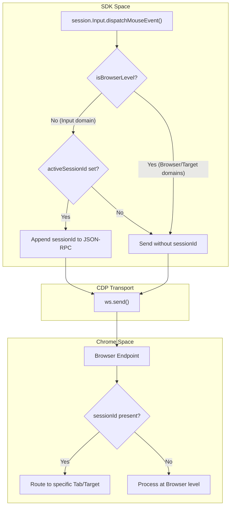
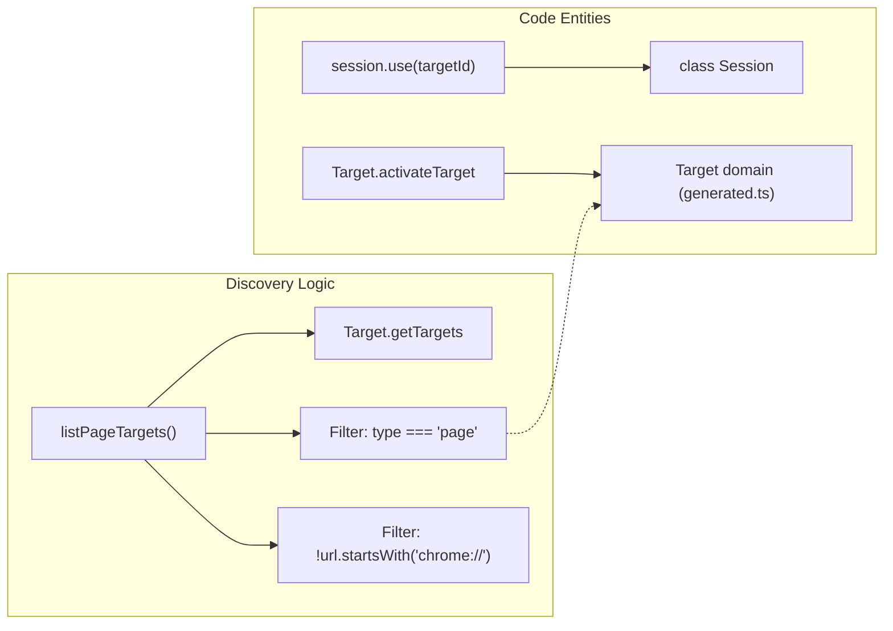

<!-- source: DeepWiki mcp.deepwiki.com · repo browser-use/browser-harness-js · page 3.2 Target Discovery and Session Routing · fetched 2026-10-30 -->

# Target Discovery and Session Routing

Relevant source files

The following files were used as context for generating this wiki page:

- [interaction-skills/connection.md](interaction-skills/connection.md)
- [interaction-skills/tabs.md](interaction-skills/tabs.md)
- [sdk/session.ts](sdk/session.ts)

This page covers the mechanisms for identifying, filtering, and routing CDP commands to specific browser targets (tabs, windows, or iframes) within `browser-harness-js`. It details the distinction between CDP-side session routing and Chrome-side visual focus.

## Overview of Target Discovery

When connecting to a browser instance, the `Session` initially connects to the browser-level endpoint. To interact with a specific page, you must discover its `targetId` and attach to it.

### The listPageTargets() Filter
The `listPageTargets()` utility is the primary way to find interactable tabs. It performs essential filtering to avoid the **Omnibox Popup Problem**—a common trap where CDP identifies internal Chrome components (like the 1px invisible omnibox popup) as valid page targets [interaction-skills/connection.md:21-25]().

If calling the raw `Target.getTargets` method, you must manually filter for `type: "page"` and exclude internal schemes [interaction-skills/connection.md:27-34]().

| Target Type | Scheme | Action |
| :--- | :--- | :--- |
| `page` | `https://`, `http://`, `file://` | **Keep** (Real user tabs) |
| `page` | `chrome://`, `devtools://` | **Discard** (Internal settings/UI) |
| `background_page` | Any | **Discard** (Extensions) |
| `iframe` | Any | **Use session.use()** (See Cross-Origin Iframes) |

### Creating New Targets
If no valid page targets exist, or a fresh environment is required, use `Target.createTarget`. Note that passing a URL directly to `createTarget` can lead to race conditions where the target reports `document.readyState === 'complete'` for `about:blank` before the navigation actually begins [interaction-skills/tabs.md:30-39]().

**Recommended Pattern:**
1. Create a target with `about:blank`.
2. `session.use(targetId)` to route commands.
3. Call `session.Page.navigate({ url })`.
4. Use `session.waitFor('Page.loadEventFired')` to confirm arrival.

Sources: [interaction-skills/connection.md:21-45](), [interaction-skills/tabs.md:7-13](), [interaction-skills/tabs.md:30-39]()

---

## Session Routing vs. Chrome Focus

A critical distinction in `browser-harness-js` is the difference between where the **SDK** is sending commands and which tab the **User** sees as active.

### CDP-Side Routing: `session.use(targetId)`
The `session.use()` method performs a `Target.attachToTarget` call with `flatten: true` [sdk/session.ts:74-78](). This updates the `activeSessionId` within the `Session` instance. Subsequent calls to domain methods (e.g., `session.Page.navigate`) automatically include this `sessionId` in the JSON-RPC payload [sdk/session.ts:120-123]().

### Chrome-Side Focus: `Target.activateTarget`
`Target.activateTarget` tells the Chrome browser to bring a specific tab to the foreground and give it visual focus [interaction-skills/tabs.md:18-19](). Routing commands to a tab via `session.use()` does **not** automatically make it the active visible tab in the browser UI.

### Data Flow: Routing a Command
The following diagram illustrates how a call to `session.Input.dispatchMouseEvent` is routed based on the `activeSessionId`.

**Title: Command Routing Logic**

Sources: [sdk/session.ts:74-78](), [sdk/session.ts:115-128](), [sdk/session.ts:154-157](), [interaction-skills/tabs.md:28-28]()

---

## Tab Order and Platform UI Automation

The order of targets returned by `Target.getTargets` is non-deterministic and does **not** correspond to the visual "left-to-right" order of tabs in the Chrome window [interaction-skills/connection.md:55-57]().

To resolve the visible order or bring the Chrome application itself to the front (OS-level focus), use platform-specific automation.

### Visual Ordering Heuristics
If platform automation is unavailable, use these CDP-native strategies:
1. **Screenshots:** Use `session.Page.captureScreenshot()` to visually verify the tab content [interaction-skills/connection.md:59-59]().
2. **URL/Title:** Match against `Target.getTargets` metadata [interaction-skills/connection.md:60-60]().

### OS-Level Focus
`Target.activateTarget` focuses a tab *within* Chrome, but it may not bring the Chrome window to the front of the OS.

| Platform | Tool | Command / Script |
| :--- | :--- | :--- |
| **macOS** | AppleScript | `tell application "Google Chrome" to activate` [interaction-skills/connection.md:73-73]() |
| **Linux** | `wmctrl` | `wmctrl -a 'Google Chrome'` [interaction-skills/connection.md:76-76]() |
| **Windows** | PowerShell | `(New-Object -ComObject WScript.Shell).AppActivate('Google Chrome')` [interaction-skills/connection.md:80-80]() |

### Mapping Code Entities to Discovery Logic
This diagram bridges the natural language requirements (finding a tab) to the specific code entities involved.

**Title: Target Discovery Entity Map**

Sources: [sdk/session.ts:74-78](), [interaction-skills/connection.md:27-34](), [interaction-skills/tabs.md:8-19]()

---

## Common Traps

1. **Invisible Viewports:** Attaching to `chrome://omnibox-popup.top-chrome/` results in a 1px viewport where actions are invisible to the user [interaction-skills/connection.md:23-23]().
2. **Zero-Size Targets:** If `window.innerWidth` or `innerHeight` report `0`, you are likely attached to a background target or an unrendered tab [interaction-skills/tabs.md:74-76]().
3. **Session Desync:** Calling `Target.activateTarget` changes what the user sees, but if you forget to call `session.use(targetId)`, your commands will still execute against the previous tab [interaction-skills/tabs.md:28-28]().

Sources: [interaction-skills/connection.md:21-34](), [interaction-skills/tabs.md:28-28](), [interaction-skills/tabs.md:74-76]()

---

