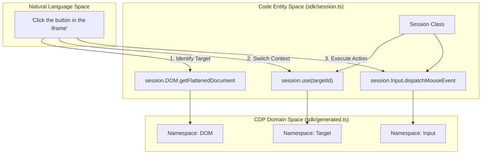
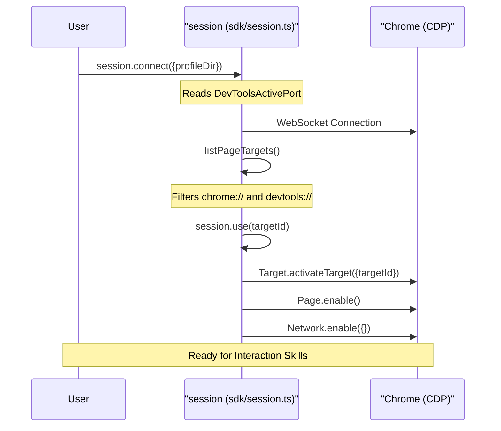

<!-- source: DeepWiki mcp.deepwiki.com · repo browser-use/browser-harness-js · page 4 Interaction Skills · fetched 2026-10-30 -->

# Interaction Skills

Relevant source files

The following files were used as context for generating this wiki page:

- [README.md](README.md)
- [interaction-skills/connection.md](interaction-skills/connection.md)

The `interaction-skills/` directory is a documentation library containing "recipes" for complex browser automation tasks. Unlike traditional frameworks that provide high-level abstractions (e.g., `page.click()`), `browser-harness-js` adheres to a "no-helpers" philosophy [README.md:53-53](). These skills provide the specific sequences of Chrome DevTools Protocol (CDP) calls required to achieve complex outcomes while maintaining full access to the underlying protocol parameters [README.md:57-61]().

## Philosophy: Recipes over Wrappers

The core of the interaction library is the **Bitter Lesson**: every helper is a simplification that eventually limits the agent [README.md:57-58](). Instead of library functions, this documentation provides the CDP patterns for:
*   **Direct Protocol Usage**: Using `session.<Domain>.<method>` directly with typed parameters [README.md:51-51]().
*   **Mechanical Clarity**: Revealing the 14+ parameters of `Input.dispatchMouseEvent` rather than hiding them behind a `click()` helper [README.md:57-57]().
*   **Target Routing**: Using the only two necessary primitives: `session.use(targetId)` to route commands and `session.waitFor(method, pred, timeout)` to handle asynchronous state [README.md:66-67]().

### Mapping Natural Language to Code Entities

The following diagram illustrates how high-level user intent is translated into specific CDP domains and session methods within the `browser-harness-js` architecture.

**Intent to Entity Mapping**

**Sources:** [README.md:14-16](), [sdk/session.ts:1-10](), [sdk/generated.ts:1-20]()

## Skill Categories

The interaction library is divided into specialized pages covering distinct aspects of browser control.

### 4.1 Input and Navigation
Focuses on the mechanics of moving the browser and sending data. This includes coordinate-based mouse events via `Input.dispatchMouseEvent`, keyboard interactions, and scrolling strategies. It also covers viewport emulation and the lifecycle of browser tabs (targets).
For details, see [Input and Navigation](#4.1).

### 4.2 DOM Interaction Patterns
Addresses complex UI components that standard automation often fails to handle. This includes interacting with Shadow DOM, navigating same-origin iframes, and handling non-standard inputs like searchable comboboxes or virtualized lists.
For details, see [DOM Interaction Patterns](#4.2).

### 4.3 Cross-Origin Iframes (OOPIFs)
Explains the architectural shift required for Out-of-Process Iframes. It details how to use `session.use()` to attach to specific iframe targets and the common traps associated with security restrictions and lazy mounting.
For details, see [Cross-Origin Iframes (OOPIFs)](#4.3).

### 4.4 File Uploads and Downloads
Covers the specific CDP methods for file handling, such as `DOM.setFileInputFiles` for inputs and `Browser.setDownloadBehavior` for managing file persistence and transfer events.
For details, see [File Uploads and Downloads](#4.4).

### 4.5 Network, Cookies, and Dialogs
Details how to observe and intercept network traffic, manage browser storage/cookies, and handle synchronous JavaScript dialogs (alerts/confirms) using the `Page.handleJavaScriptDialog` reactive approach.
For details, see [Network, Cookies, and Dialogs](#4.5).

### 4.6 Screenshots and PDF Generation
Covers visual extraction, including viewport and full-page screenshots via `Page.captureScreenshot` and professional PDF rendering using `Page.printToPDF`.
For details, see [Screenshots and PDF Generation](#4.6).

## The Connection Sequence

Before any interaction skill can be applied, a session must be established and routed to a valid target. The following diagram shows the standard startup sequence required to begin interacting with a page.

**Session Initialization Flow**

**Sources:** [interaction-skills/connection.md:47-54](), [interaction-skills/connection.md:13-19](), [interaction-skills/connection.md:28-34]()

## Summary Table: Core Interaction Primitives

| Category | Primary CDP Method | File Reference |
| :--- | :--- | :--- |
| **Mouse** | `Input.dispatchMouseEvent` | [README.md:14-14]() |
| **Keyboard** | `Input.insertText` / `dispatchKeyEvent` | [sdk/generated.ts:1-10]() |
| **Navigation** | `Page.navigate` | [README.md:59-59]() |
| **Targeting** | `session.use(targetId)` | [README.md:66-66]() |
| **Waiting** | `session.waitFor(method, pred)` | [README.md:66-66]() |
| **Files** | `DOM.setFileInputFiles` | [README.md:15-15]() |

**Sources:** [README.md:14-16](), [README.md:59-59](), [README.md:66-67](), [interaction-skills/connection.md:41-44]()

---

