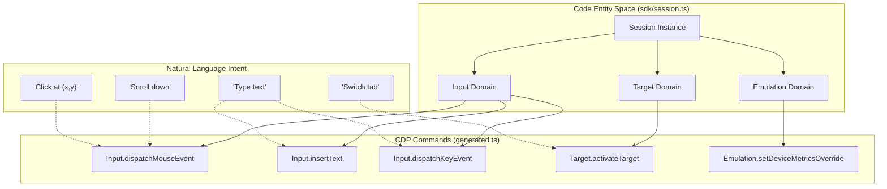
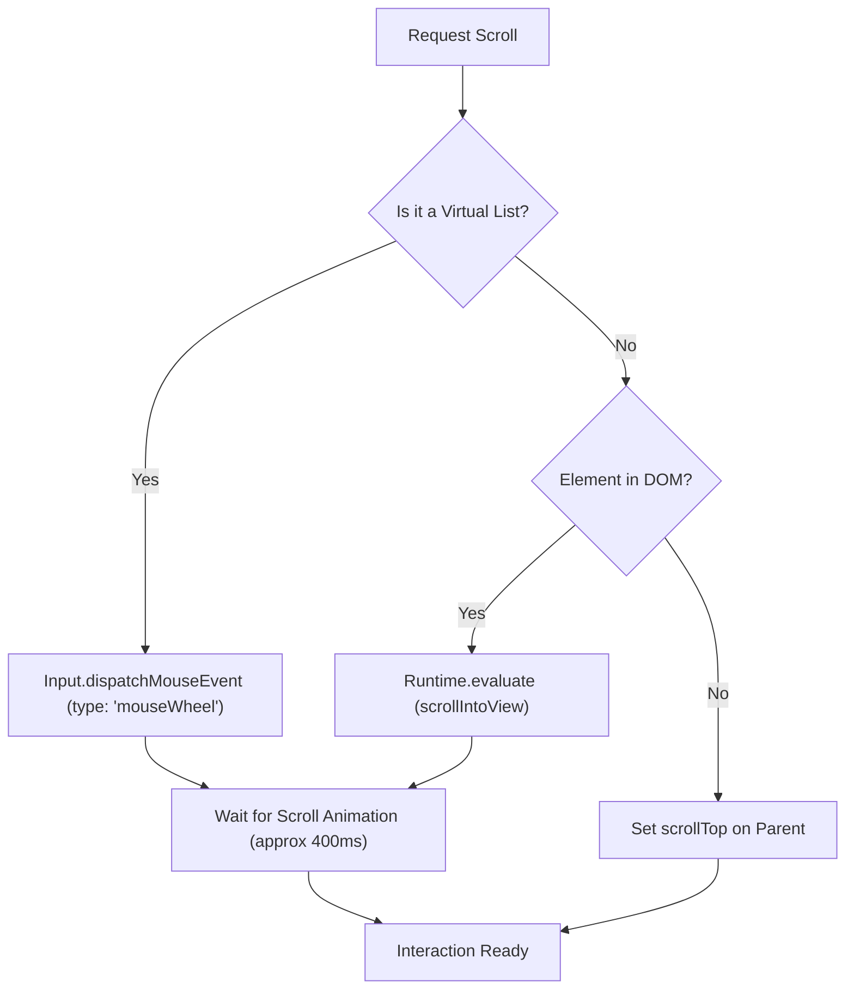
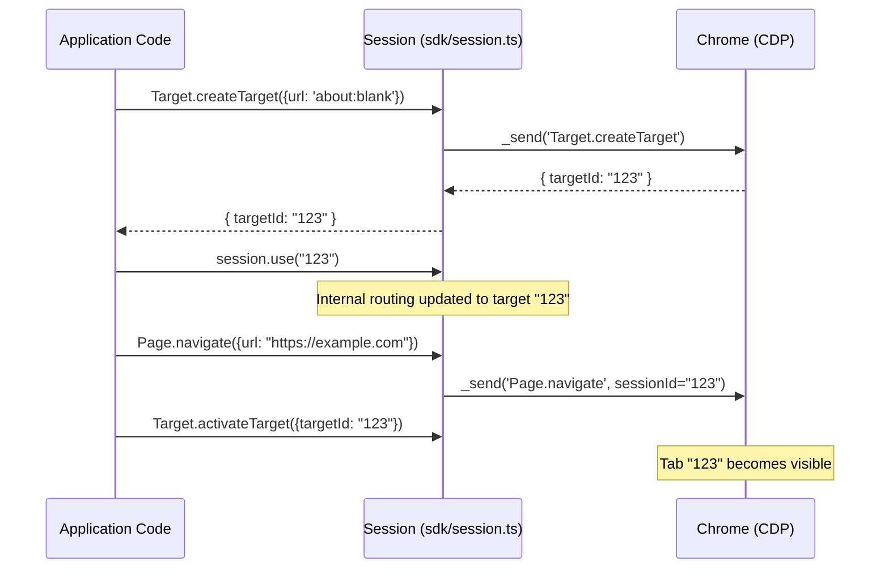

<!-- source: DeepWiki mcp.deepwiki.com · repo browser-use/browser-harness-js · page 4.1 Input and Navigation · fetched 2026-10-30 -->

# Input and Navigation

Relevant source files

The following files were used as context for generating this wiki page:

- [interaction-skills/scrolling.md](interaction-skills/scrolling.md)
- [interaction-skills/tabs.md](interaction-skills/tabs.md)
- [interaction-skills/viewport.md](interaction-skills/viewport.md)

This page covers the technical implementation of browser interaction within `browser-harness-js`. It details coordinate-based mouse events, keyboard input strategies, scrolling mechanics, viewport management via emulation, and tab lifecycle management.

## Overview of Interaction Flow

Interaction in `browser-harness-js` follows the "thin bridge" philosophy. Rather than providing high-level abstractions like `page.click()`, the SDK exposes the raw Chrome DevTools Protocol (CDP) domains (e.g., `Input`, `Emulation`, `Target`) directly on the `Session` instance. This allows for precise control over event dispatching and viewport state.

### Input and Navigation System Map

The following diagram illustrates how natural language intents (e.g., "Click this button") map to specific CDP domain calls within the `Session` class.

**Title: Intent to CDP Mapping**

Sources: [sdk/session.ts:1-50](), [interaction-skills/scrolling.md:5-17](), [interaction-skills/tabs.md:18-22]()

---

## Mouse and Keyboard Input

### Mouse Events
Coordinate-based interaction is handled via `Input.dispatchMouseEvent`. This method is preferred over DOM-based `.click()` because it triggers actual browser hit-testing, ensuring that overlays or obscured elements prevent interaction as they would for a real user.

*   **Clicking:** Requires a sequence of `mousePressed` and `mouseReleased` events at specific coordinates.
*   **Coordinates:** All coordinates are in **CSS pixels**, relative to the top-left of the viewport [interaction-skills/viewport.md:23-24]().

### Keyboard Input
There are two primary ways to input text:
1.  **`Input.insertText`**: Directly inserts a string into the focused element. This is fast and bypasses most key-event listeners [interaction-skills/viewport.md:1-71]().
2.  **`Input.dispatchKeyEvent`**: Sends individual `keyDown`, `keyUp`, and `char` events. This is necessary for simulating physical typing, triggering autocomplete menus, or handling shortcut keys (e.g., `Enter`, `Escape`).

Sources: [interaction-skills/scrolling.md:5-21](), [interaction-skills/viewport.md:23-36]()

---

## Scrolling Strategies

Scrolling is implemented at three levels of abstraction, depending on the target element's behavior.

| Strategy | Implementation | Use Case |
| :--- | :--- | :--- |
| **Wheel Event** | `Input.dispatchMouseEvent` with `type: 'mouseWheel'` | Closest to real user; works for virtualized lists [interaction-skills/scrolling.md:9-24](). |
| **DOM Scroll** | `Runtime.evaluate` calling `scrollIntoView()` | Precise alignment for standard DOM elements [interaction-skills/scrolling.md:26-35](). |
| **Direct Offset** | `Runtime.evaluate` setting `scrollTop` | Blunt force for containers that swallow wheel events [interaction-skills/scrolling.md:37-49](). |

### Scrolling Implementation Flow

**Title: Scroll Execution Logic**

Sources: [interaction-skills/scrolling.md:1-76]()

---

## Viewport and Emulation

Viewport management is critical because coordinate clicks are invalidated if the viewport dimensions change or if the `devicePixelRatio` (DPR) is misunderstood.

### Device Metrics Override
The `Emulation.setDeviceMetricsOverride` command allows pinning the browser to a specific resolution and DPR. This ensures stability for coordinate-based scripts [interaction-skills/viewport.md:28-36]().

*   **Mobile Emulation:** By setting `mobile: true` and enabling `setTouchEmulationEnabled`, the browser triggers responsive breakpoints and touch-start/end events [interaction-skills/viewport.md:44-58]().
*   **DPR Awareness:** Screenshots are captured in physical device pixels, while clicks use CSS pixels. If `deviceScaleFactor` is 2, a coordinate at (400, 300) in a screenshot corresponds to (200, 150) for a click [interaction-skills/viewport.md:67-67]().

Sources: [interaction-skills/viewport.md:1-71]()

---

## Tab and Target Management

`browser-harness-js` distinguishes between **CDP Routing** and **Visual Focus**.

### Core Functions
*   **`session.use(targetId)`**: Directs all subsequent CDP commands (Input, Page, etc.) to a specific target via the `sessionId` mapping [interaction-skills/tabs.md:11-16]().
*   **`Target.activateTarget({ targetId })`**: Visibly brings the tab to the front in the Chrome window [interaction-skills/tabs.md:18-19]().
*   **`Target.createTarget({ url })`**: Opens a new tab. It is recommended to create `about:blank` first, then navigate, to avoid race conditions with `DOMContentLoaded` [interaction-skills/tabs.md:30-39]().

### Target Lifecycle

**Title: Target Management Lifecycle**

Sources: [interaction-skills/tabs.md:5-29](), [sdk/session.ts:1-50]()

### Target Filtering
When discovering targets via `listPageTargets()`, the SDK automatically filters out non-page targets such as `chrome://` extensions and the 1px "Omnibox Popup" to prevent accidental attachment to UI surfaces that do not support standard interaction [interaction-skills/tabs.md:72-76]().

Sources: [interaction-skills/tabs.md:1-76]()

---

