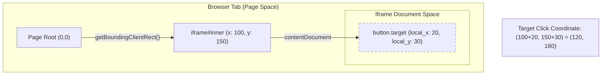
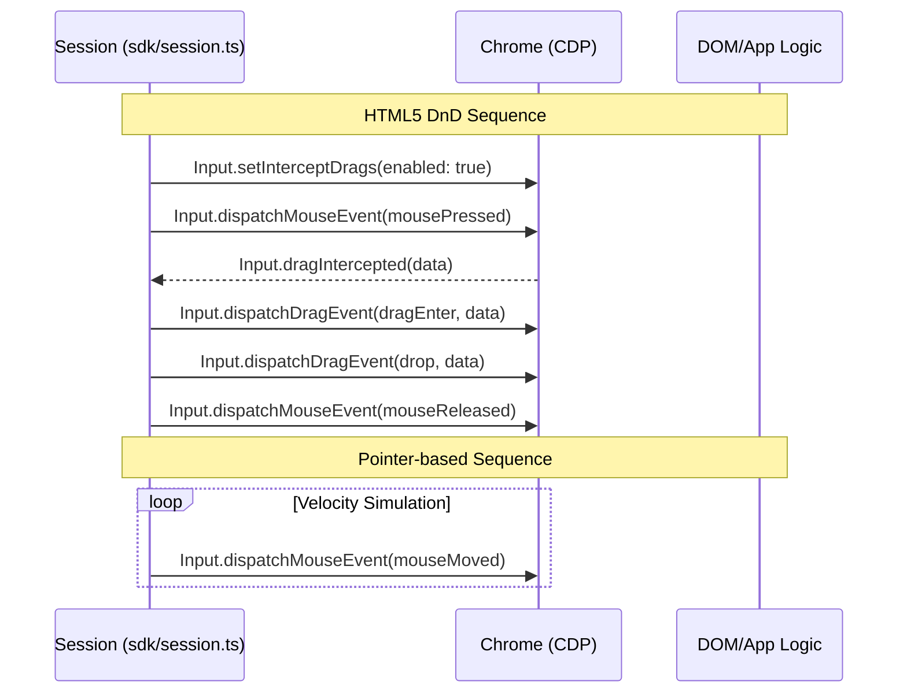

<!-- source: DeepWiki mcp.deepwiki.com · repo browser-use/browser-harness-js · page 4.2 DOM Interaction Patterns · fetched 2026-10-30 -->

# DOM Interaction Patterns

Relevant source files

The following files were used as context for generating this wiki page:

- [interaction-skills/drag-and-drop.md](interaction-skills/drag-and-drop.md)
- [interaction-skills/dropdowns.md](interaction-skills/dropdowns.md)
- [interaction-skills/iframes.md](interaction-skills/iframes.md)
- [interaction-skills/shadow-dom.md](interaction-skills/shadow-dom.md)

This page covers advanced interaction strategies for complex DOM structures, including native and custom dropdowns, frame-traversal, Shadow DOM piercing, and robust drag-and-drop implementations. The core philosophy is to prefer coordinate-based interactions (`Input.dispatchMouseEvent`) for visual elements and JavaScript-based state manipulation (`Runtime.evaluate`) for underlying data consistency.

## Dropdowns and Menus

The strategy for interacting with a dropdown depends entirely on its implementation in the DOM.

### Native Select Elements
Native `<select>` elements should not be interacted with via clicks, as opening them triggers an OS-level menu that the Chrome DevTools Protocol (CDP) cannot control or close. Instead, manipulate the `value` and dispatch a `change` event.

| Step | Action | Method |
| :--- | :--- | :--- |
| 1 | Set Value | `Runtime.evaluate` to set `element.value = 'DE'` |
| 2 | Trigger Logic | Dispatch a bubbling `change` event |
| 3 | Verify | Read back the `value` via `Runtime.evaluate` |

**Implementation Example:**
[interaction-skills/dropdowns.md:9-17]()

### Custom Overlay Menus
Common in modern SPAs (React, Vue), these are often `div`-based menus that appear near the trigger or are portaled to the `<body>`.

1. **Trigger:** Perform a coordinate click on the trigger element.
2. **Re-measure:** Menus often shift the page layout or appear asynchronously. Always re-calculate coordinates for the option *after* the menu is visible.
3. **Selection:** Search the global document (not just the trigger's children) for the option text and perform a coordinate click.

### Searchable Comboboxes
Libraries like Radix, MUI, or Downshift often rely on keyboard events for selection.
- **Input:** Use `Input.insertText` to filter options.
- **Commit:** Dispatch `ArrowDown` followed by `Enter` using `Input.dispatchKeyEvent`. Note that `windowsVirtualKeyCode` (e.g., `40` for Down, `13` for Enter) is often required by framework event listeners.

**Sources:**
- [interaction-skills/dropdowns.md:5-19]() (Native Select)
- [interaction-skills/dropdowns.md:21-50]() (Custom Overlays)
- [interaction-skills/dropdowns.md:52-69]() (Comboboxes)

---

## Iframe Interaction (Same-Origin)

Same-origin iframes allow direct DOM access via `contentDocument`. For cross-origin iframes (OOPIFs), refer to the dedicated page on Target management.

### Coordinate Pass-through
The most efficient way to interact with an iframe is via **page-level coordinates**. The compositor-level input path (`Input.dispatchMouseEvent`) ignores frame boundaries. If an element is visible in a screenshot, it can be clicked using its absolute page coordinates.

### Coordinate Transformation
If you must find an element inside an iframe using JS, you must transform its **iframe-local** coordinates to **page** coordinates:
`Page X = Iframe Offset X + Element Local X`

**Diagram: Iframe Coordinate Mapping**

**Sources:**
- [interaction-skills/iframes.md:5-21]() (Reading/Writing)
- [interaction-skills/iframes.md:22-32]() (Coordinate pass-through)
- [interaction-skills/iframes.md:33-51]() (Coordinate transformation)

---

## Shadow DOM Piercing

Shadow DOM encapsulates elements, making them invisible to standard `document.querySelector` calls.

### The `pierceShadow` Approach
In CDP, `DOM.querySelector` and `DOM.querySelectorAll` can traverse open shadow roots by using the `>>>` combinator in the selector or by passing a `pierceShadow` flag.

### Recursive JS Walk
For maximum portability across different browser versions, a recursive generator can be used to walk the `shadowRoot` of every node.

**Implementation Logic:**
[interaction-skills/shadow-dom.md:33-42]()

### Closed Roots and Slots
- **Closed Roots:** Elements with `{ mode: 'closed' }` cannot be accessed via JS. Use coordinate-based clicks.
- **Slots:** Content inside `<slot>` tags actually resides in the **Light DOM** (the host's children), not the Shadow DOM.

**Sources:**
- [interaction-skills/shadow-dom.md:9-23]() (CDP Piercing)
- [interaction-skills/shadow-dom.md:24-53]() (Recursive Walk)
- [interaction-skills/shadow-dom.md:57-74]() (Input Handling)

---

## Drag and Drop (DnD)

Browser-harness-js distinguishes between three distinct "drags."

### HTML5 Drag and Drop
Used by Trello, Jira, and libraries like `react-dnd`. These rely on `DragEvent`. Standard mouse move sequences will fail because they do not trigger the browser's internal drag lifecycle.

**The Interception Workflow:**
1. Enable interception: `Input.setInterceptDrags({ enabled: true })`.
2. Start drag: `Input.dispatchMouseEvent` (`mousePressed`).
3. Capture data: Wait for the `Input.dragIntercepted` event to receive the `data` object.
4. Dispatch: Use `Input.dispatchDragEvent` with types `dragEnter`, `dragOver`, and `drop`.

### Pointer-based Drag
Used by Canvas-based tools (Figma, Google Maps). These listen for `mousemove` and calculate deltas.
- **Requirement:** Intermediate `mouseMoved` events are critical. Many sites calculate velocity or require a minimum movement delta before triggering a drag state.

**Diagram: Drag and Drop Implementation Flow**

### File Drop Zones
Most "Drop files here" zones are backed by a hidden `<input type="file">`. Instead of simulating a complex drag-and-drop of a file object, identify the input and use `DOM.setFileInputFiles`.

**Sources:**
- [interaction-skills/drag-and-drop.md:5-28]() (HTML5 DnD)
- [interaction-skills/drag-and-drop.md:30-46]() (Pointer-based)
- [interaction-skills/drag-and-drop.md:47-50]() (File Zones)
- [interaction-skills/drag-and-drop.md:51-57]() (Common Traps)

---

