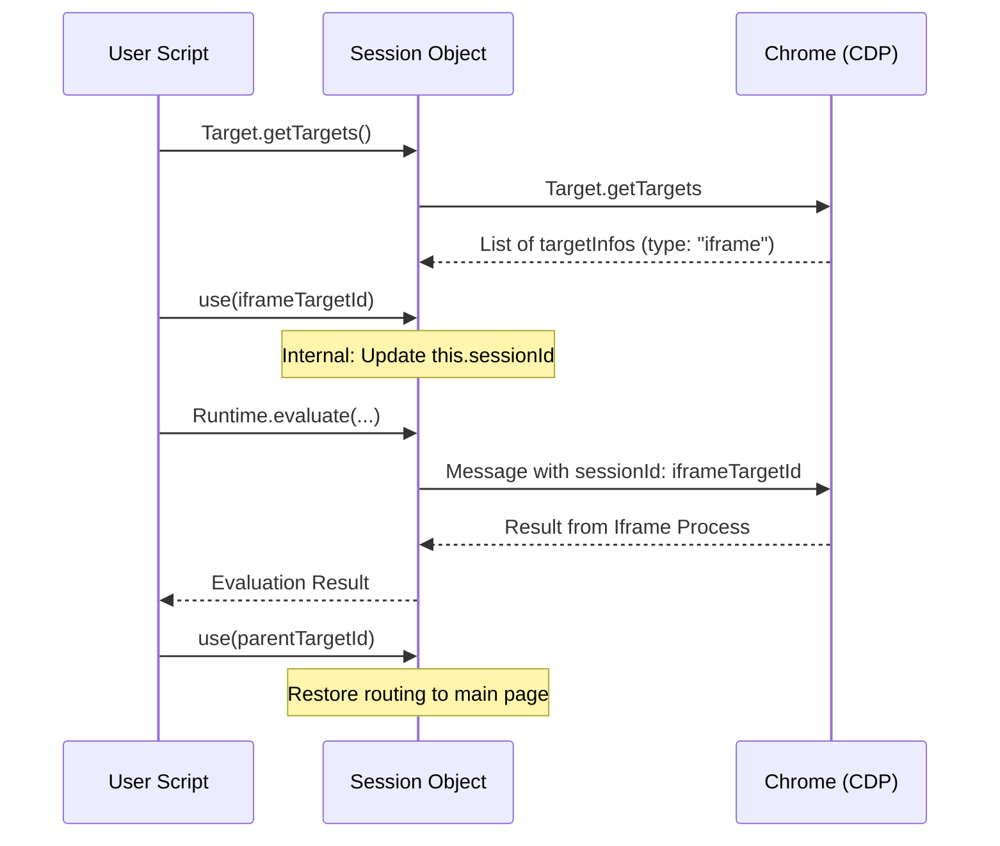

<!-- source: DeepWiki mcp.deepwiki.com · repo browser-use/browser-harness-js · page 4.3 Cross-Origin Iframes (OOPIFs) · fetched 2026-10-30 -->

# Cross-Origin Iframes (OOPIFs)

<details>
<summary>Relevant source files</summary>

The following files were used as context for generating this wiki page:

- [interaction-skills/cross-origin-iframes.md](interaction-skills/cross-origin-iframes.md)
- [interaction-skills/iframes.md](interaction-skills/iframes.md)

</details>


Cross-origin iframes (such as Stripe checkouts, reCAPTCHA, or Salesforce Lightning components) run in **Out-of-Process Iframes (OOPIFs)**. Unlike same-origin iframes, these run in separate OS processes for security and cannot be accessed via `contentDocument` from the parent page's JavaScript context [interaction-skills/cross-origin-iframes.md:1-3]().

## Coordinate-Based Interaction

The simplest way to interact with an OOPIF is via compositor-level input. Since `Input.dispatchMouseEvent` operates on the browser's render tree, it passes through iframe boundaries transparently. If an element is visible in a screenshot, it can be clicked using page-level coordinates without needing to attach to the iframe target [interaction-skills/cross-origin-iframes.md:5-13]().

### Coordinate Pass-Through Logic
| Method | Boundary Behavior | Use Case |
| :--- | :--- | :--- |
| `Input.dispatchMouseEvent` | **Transparent**. Crosses all frame boundaries. | Clicking buttons, focusing inputs. |
| `Input.insertText` | **Focus-dependent**. Hits whichever element has focus. | Typing after a coordinate click. |
| `Runtime.evaluate` | **Isolated**. Cannot see into OOPIFs. | Reading/Writing DOM in the same process. |

**Sources:** [interaction-skills/cross-origin-iframes.md:5-15](), [interaction-skills/iframes.md:22-31]()

## Attaching to OOPIF Targets

When DOM-level access is required (e.g., reading text content or inspecting attributes inside the iframe), you must route CDP commands to the specific target associated with that iframe [interaction-skills/cross-origin-iframes.md:17-19]().

### The `session.use(targetId)` Workflow

The `Session` class provides a `use()` method that handles the complexity of target switching. If the session is not yet attached to the target, `use()` will perform the `Target.attachToTarget` handshake automatically [interaction-skills/cross-origin-iframes.md:38-38]().



**Sources:** [interaction-skills/cross-origin-iframes.md:21-38]()

### Implementation Example
To read a value from a Stripe element:
1. Identify the target using `Target.getTargets` [interaction-skills/cross-origin-iframes.md:22-23]().
2. Switch the session context using `session.use(targetId)` [interaction-skills/cross-origin-iframes.md:26-26]().
3. Execute commands (e.g., `Runtime.evaluate`) [interaction-skills/cross-origin-iframes.md:29-32]().
4. **Crucial:** Switch back to the parent `targetId` to avoid routing subsequent navigation commands to the iframe [interaction-skills/cross-origin-iframes.md:34-35]().

## Disambiguating Multiple Iframes

`Target.getTargets` returns a flat list of all targets. If a page contains multiple iframes from the same origin (e.g., individual fields for Card Number, Expiry, and CVC), you must disambiguate them [interaction-skills/cross-origin-iframes.md:40-42]():

1.  **URL Filtering:** Check for specific path fragments in `targetInfo.url` [interaction-skills/cross-origin-iframes.md:44-44]().
2.  **DOM Mapping:** In the parent page, find all `<iframe>` tags and map their `src` attributes to the target URLs found in the target list [interaction-skills/cross-origin-iframes.md:45-45]().
3.  **Metadata:** Use `Target.getTargetInfo` to inspect the `title` or other metadata [interaction-skills/cross-origin-iframes.md:46-46]().

**Sources:** [interaction-skills/cross-origin-iframes.md:40-47]()

## Event Handling in OOPIFs

Once `session.use(targetId)` is called, the session routes event listeners to that target. You can use `session.onEvent` or `session.waitFor` to capture network requests or lifecycle events originating specifically from the iframe [interaction-skills/cross-origin-iframes.md:48-60]().

```javascript
// Listening for a specific network response inside an OOPIF
await session.use(iframe.targetId);
await session.Network.enable({});
const ev = await session.waitFor(
  'Network.responseReceived',
  (p) => p.response.url.includes('/confirm_payment'),
  10000
);
```

**Sources:** [interaction-skills/cross-origin-iframes.md:50-60]()

## Common Traps and Pitfalls

| Trap | Description | Mitigation |
| :--- | :--- | :--- |
| **Lazy Mounting** | Some OOPIFs (like Stripe) don't exist in the target list until the user interacts with a placeholder [interaction-skills/cross-origin-iframes.md:64-64](). | Coordinate-click the placeholder first, then re-query `Target.getTargets`. |
| **Stale Target IDs** | OOPIF targets are destroyed when the parent page navigates [interaction-skills/cross-origin-iframes.md:65-65](). | Always re-fetch target IDs after a `Page.navigate` or reload. |
| **CSP Restrictions** | Content Security Policies or sandbox attributes may block `Runtime.evaluate` side effects [interaction-skills/cross-origin-iframes.md:66-66](). | Use coordinate-based input for "writes" and `Runtime` only for "reads". |
| **Routing Lock** | Forgetting to call `session.use(parentTargetId)` leaves the session attached to the iframe [interaction-skills/cross-origin-iframes.md:67-67](). | Always wrap OOPIF logic in a try/finally or ensure a switch-back call. |

**Sources:** [interaction-skills/cross-origin-iframes.md:62-68]()

---

