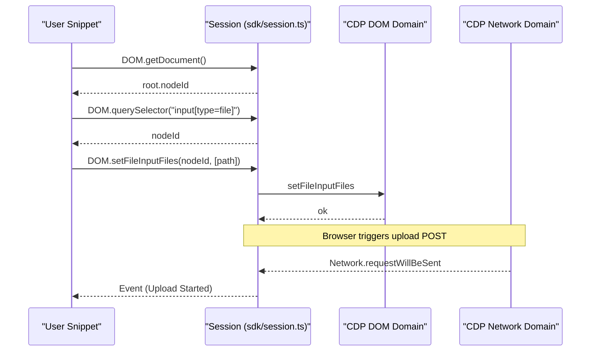
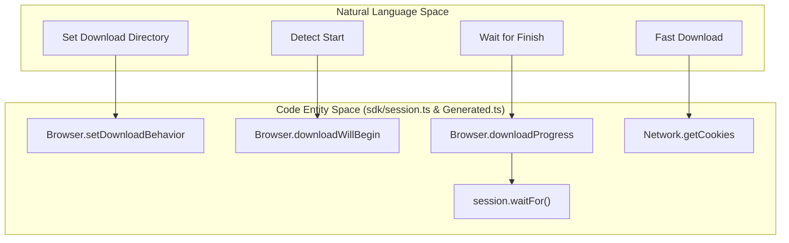

<!-- source: DeepWiki mcp.deepwiki.com · repo browser-use/browser-harness-js · page 4.4 File Uploads and Downloads · fetched 2026-10-30 -->

# File Uploads and Downloads

<details>
<summary>Relevant source files</summary>

The following files were used as context for generating this wiki page:

- [interaction-skills/downloads.md](interaction-skills/downloads.md)
- [interaction-skills/uploads.md](interaction-skills/uploads.md)

</details>


This page covers the technical implementation of file transfers within `browser-harness-js`. It details how to bypass OS-level dialogs for uploads using the Chrome DevTools Protocol (CDP) and how to manage the browser's download lifecycle, including directory routing and event synchronization.

## File Uploads

Uploading files in a headless or automated environment requires bypassing the native OS file picker, which CDP cannot interact with directly. Instead, files are injected into the DOM or synthesized via events.

### The Canonical Upload Path

The standard approach uses `DOM.setFileInputFiles`. This method maps an array of absolute file paths to a specific `nodeId` representing an `<input type="file">` element.

```js
// 1. Enable DOM domain
await session.DOM.enable();

// 2. Get the root document to search from
const { root } = await session.DOM.getDocument({ depth: -1 });

// 3. Locate the file input
const { nodeId } = await session.DOM.querySelector({
  nodeId: root.nodeId,
  selector: 'input[type="file"]',
});

// 4. Inject the file path
await session.DOM.setFileInputFiles({
  nodeId,
  files: ['/absolute/path/to/upload.pdf'],
});
```

**Key Implementation Details:**
*   **Absolute Paths:** Paths must be absolute; relative paths will fail [interaction-skills/uploads.md:22-22]().
*   **Visibility:** This method works even if the input is `display: none` or `visibility: hidden` [interaction-skills/uploads.md:28-36]().
*   **Event Triggering:** Calling `setFileInputFiles` automatically fires the `change` event on the target input [interaction-skills/uploads.md:24-24]().

### Drag-and-Drop Zones

Modern web applications often use "Drop Zones" (e.g., `react-dropzone`). These may or may not have a visible `<input>`.

1.  **Hidden Input Strategy:** Most libraries maintain a hidden input for accessibility. Searching for `input[type="file"]` via `DOM.querySelectorAll` is the preferred method [interaction-skills/uploads.md:42-44]().
2.  **Synthetic Event Strategy:** If no input exists, a `DragEvent` must be synthesized via `Runtime.evaluate`. This involves creating a `DataTransfer` object and dispatching `dragenter`, `dragover`, and `drop` events [interaction-skills/uploads.md:45-60]().

### Data Flow: Upload Verification

The following diagram illustrates the flow from identifying a node to verifying the upload via network activity.

**Upload Logic and Verification Flow**



Sources: [interaction-skills/uploads.md:7-25](), [interaction-skills/uploads.md:63-66]()

---

## File Downloads

Managing downloads involves configuring the browser's download behavior and listening for lifecycle events to ensure files are fully written to disk before proceeding.

### Configuring Download Behavior

The `Browser.setDownloadBehavior` command is browser-scoped and must be set to `allow` to enable programmatic control over the destination [interaction-skills/downloads.md:73-73]().

```js
const downloadDir = `/tmp/my-downloads`;
// Ensure directory exists first (Chrome will not create it)
await session.Browser.setDownloadBehavior({
  behavior: 'allow',
  downloadPath: downloadDir,
  eventsEnabled: true, // Enables Browser.downloadWillBegin and downloadProgress
});
```

### Download Lifecycle Events

To synchronize the script with the download progress, use `session.waitFor` to listen for CDP events.

| Event | Purpose | Key Parameters |
| :--- | :--- | :--- |
| `Browser.downloadWillBegin` | Triggered when a download starts. | `suggestedFilename`, `guid`, `url` |
| `Browser.downloadProgress` | Periodic updates on state. | `state` ('inProgress', 'completed', 'canceled'), `receivedBytes` |

**Completion Synchronization:**
```js
// Wait for the download to finish
await session.waitFor(
  'Browser.downloadProgress',
  (p) => p.state === 'completed',
  60_000 // 60s timeout
);
```

### Direct HTTP Fetch (Optimization)

If the download URL does not require browser-specific state (like complex session cookies or POST-redirect flows), using Bun's native `fetch` is significantly faster [interaction-skills/downloads.md:46-54]().

**Auth Persistence:** If cookies are required, they can be extracted via `Network.getCookies` and injected into the `fetch` headers [interaction-skills/downloads.md:56-58]().

### Entity Mapping: Download Management

This diagram maps the high-level download concepts to the specific CDP domains and session methods used in the SDK.

**Download System Entity Mapping**



Sources: [interaction-skills/downloads.md:13-17](), [interaction-skills/downloads.md:25-42](), [interaction-skills/downloads.md:56-58]()

### Critical Traps and Considerations

*   **Pre-existence:** The `downloadPath` must exist on the filesystem before the download starts; Chrome will silently fail if the directory is missing [interaction-skills/downloads.md:74-74]().
*   **Filename Control:** Files are saved using the browser's `suggestedFilename`. If a specific name is required, the file must be renamed manually after the `completed` state is reached [interaction-skills/downloads.md:75-75]().
*   **Dialog Interference:** Downloads can be blocked by `beforeunload` dialogs. These must be handled via the `Page.handleJavaScriptDialog` command [interaction-skills/downloads.md:76-76]().
*   **Inline Navigation:** If a PDF opens in the browser viewer instead of downloading, `Browser.downloadWillBegin` will not fire. In these cases, use `Page.printToPDF` or `fetch` [interaction-skills/downloads.md:77-77]().

Sources: [interaction-skills/downloads.md:71-78]()

---

