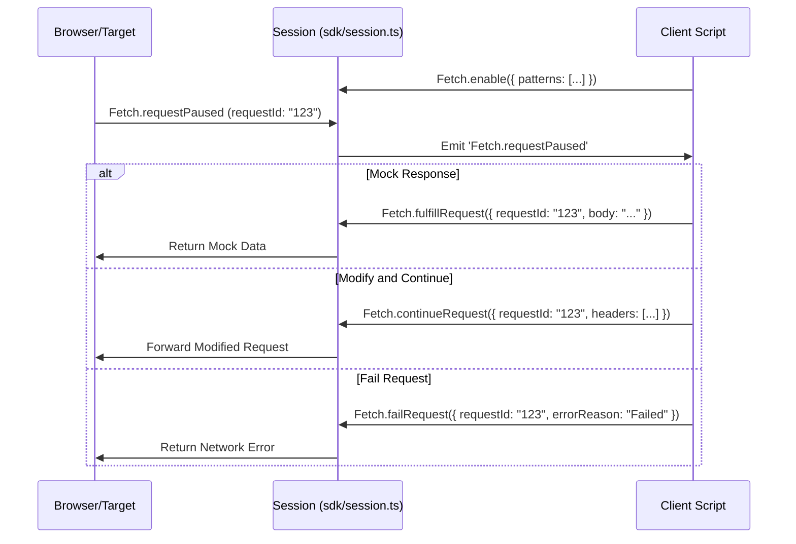
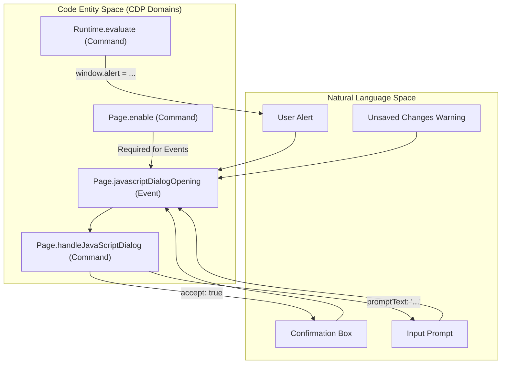

<!-- source: DeepWiki mcp.deepwiki.com · repo browser-use/browser-harness-js · page 4.5 Network, Cookies, and Dialogs · fetched 2026-10-30 -->

# Network, Cookies, and Dialogs

<details>
<summary>Relevant source files</summary>

The following files were used as context for generating this wiki page:

- [interaction-skills/cookies.md](interaction-skills/cookies.md)
- [interaction-skills/dialogs.md](interaction-skills/dialogs.md)
- [interaction-skills/network-requests.md](interaction-skills/network-requests.md)

</details>


This page covers the low-level Chrome DevTools Protocol (CDP) domains used for observing and manipulating browser network traffic, managing persistent storage (cookies), and handling blocking JavaScript dialogs. Unlike high-level frameworks, `browser-harness-js` provides direct access to the `Network`, `Fetch`, `Storage`, and `Page` domains, allowing for precise control over the browser's communication and modal state.

## Network Monitoring and Interception

Network interaction in `browser-harness-js` is divided between the `Network` domain (for observation) and the `Fetch` domain (for interception and modification).

### Watching Requests and Responses
To observe traffic, the `Network` domain must first be enabled for the specific target. Once enabled, the session emits events like `Network.requestWillBeSent` and `Network.responseReceived` [interaction-skills/network-requests.md:8-18]().

The `session.waitFor` primitive is the standard way to synchronize script execution with asynchronous network activity, such as waiting for an API call to complete after a button click [interaction-skills/network-requests.md:31-37]().

### Reading Response Bodies
Response bodies are not included in the initial `Network.responseReceived` event to save memory. They must be explicitly requested using `Network.getResponseBody` with the corresponding `requestId` [interaction-skills/network-requests.md:41-51]().

**Important Constraints:**
*   **Timing:** Bodies must be read immediately after `Network.loadingFinished`. Chrome may discard the body if the request was a redirect, was served from cache, or if the buffer is purged [interaction-skills/network-requests.md:53-53]().
*   **Encoding:** Bodies may be returned as base64-encoded strings (e.g., for binary data or specific encodings). Scripts must check the `base64Encoded` flag [interaction-skills/network-requests.md:49-50]().

### Request Interception (Fetch Domain)
While the `Network` domain is read-only, the `Fetch` domain allows for "pausing" requests to modify headers, change the URL, or provide a completely mocked response (fulfillment) [interaction-skills/network-requests.md:59-79]().

### Network Data Flow
The following diagram illustrates how a request is intercepted and fulfilled using the `Fetch` domain.

**Fetch Interception Lifecycle**

Sources: [interaction-skills/network-requests.md:59-85](), [sdk/session.ts:1-50]()

## Cookies and Storage

Cookie management can be performed at two levels: the `Network` domain (scoped to the current page/origin) and the `Storage` domain (browser-wide) [interaction-skills/cookies.md:3-3]().

### Cookie Operations
| Operation | Domain | Method | Notes |
| :--- | :--- | :--- | :--- |
| **Read (Page)** | `Network` | `getCookies` | Returns cookies visible to the current origin and its frames [interaction-skills/cookies.md:11-11](). |
| **Read (Global)** | `Storage` | `getCookies` | Returns every cookie in the browser profile [interaction-skills/cookies.md:19-19](). |
| **Write** | `Network` | `setCookie` | Sets a single cookie. Silently fails if the domain doesn't match the profile [interaction-skills/cookies.md:28-57](). |
| **Bulk Write** | `Network` | `setCookies` | Efficiently imports multiple cookies (e.g., for auth state) [interaction-skills/cookies.md:40-45](). |
| **Delete** | `Network` | `deleteCookies` | Deletes cookies matching name/domain [interaction-skills/cookies.md:51-51](). |
| **Clear All** | `Network` | `clearBrowserCookies` | Nukes all cookies in the default context [interaction-skills/cookies.md:52-52](). |

### Common Traps
*   **Expiration:** The `expires` field is a float representing **seconds** since the epoch, not milliseconds [interaction-skills/cookies.md:58-58]().
*   **SameSite:** If `sameSite` is set to `'None'`, the `secure` flag **must** be `true` [interaction-skills/cookies.md:60-60]().
*   **Storage Isolation:** Clearing cookies does not clear `localStorage` or `IndexedDB`. Use `Storage.clearDataForOrigin` for a complete logout [interaction-skills/cookies.md:61-61]().

Sources: [interaction-skills/cookies.md:1-62]()

## JavaScript Dialogs

Dialogs (`alert`, `confirm`, `prompt`) and the `beforeunload` event are synchronous and freeze the JavaScript execution thread in the browser. `browser-harness-js` supports two strategies for handling them.

### Reactive Approach (CDP)
This is the preferred method as it works while the JS thread is frozen and is undetectable by anti-bot scripts. It uses the `Page.handleJavaScriptDialog` method [interaction-skills/dialogs.md:5-15]().

To handle dialogs automatically, a listener can be attached to the session:
```javascript
await session.Page.enable()
session.onEvent(async (method, params) => {
  if (method === 'Page.javascriptDialogOpening') {
    await session.Page.handleJavaScriptDialog({ accept: true })
  }
})
```
[interaction-skills/dialogs.md:27-35]()

### Proactive Approach (JS Stubs)
This involves overwriting `window.alert`, `window.confirm`, etc., with custom functions before they are called. This prevents the dialog from ever appearing but is detectable by scripts checking for native function integrity (e.g., `alert.toString()`) [interaction-skills/dialogs.md:37-58]().

### Handling `beforeunload`
The `beforeunload` dialog appears when navigating away from a page with unsaved changes. It can be handled reactively by calling `handleJavaScriptDialog` immediately after a `Page.navigate` call, or proactively by nullifying `window.onbeforeunload` [interaction-skills/dialogs.md:61-75]().

### Dialog Interaction Mapping
The following diagram maps the Natural Language concepts of "Dialogs" to the specific CDP Entities used in the codebase.

**Dialog Management Entity Mapping**

Sources: [interaction-skills/dialogs.md:1-76](), [sdk/session.ts:1-50]()

## Implementation Notes

*   **Per-Target Enabling:** Domains like `Network` and `Page` must be enabled individually for every target (including OOPIF iframes) via `session.use(targetId)` [interaction-skills/network-requests.md:106-107]().
*   **Request ID Scope:** `requestId` values are unique only within the context of a specific target. Passing a `requestId` from an iframe to the main frame's `Network.getResponseBody` will fail [interaction-skills/network-requests.md:108-108]().

Sources: [interaction-skills/network-requests.md:104-110](), [interaction-skills/dialogs.md:1-76](), [interaction-skills/cookies.md:1-62]()

---

