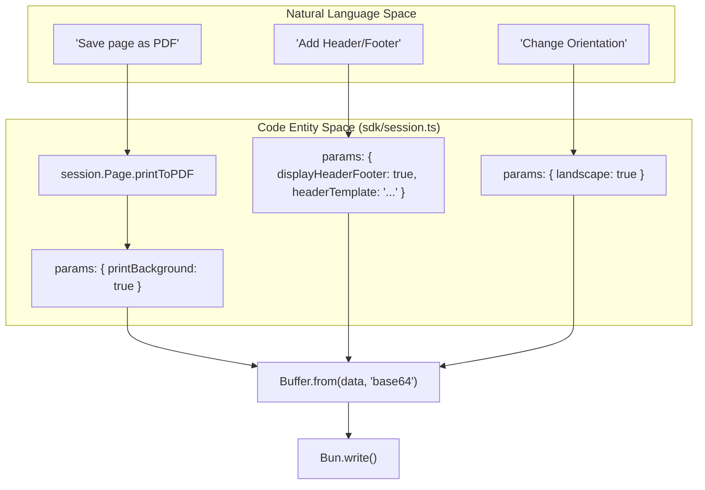
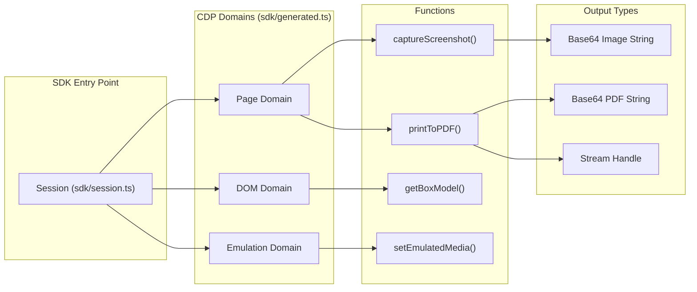

<!-- source: DeepWiki mcp.deepwiki.com · repo browser-use/browser-harness-js · page 4.6 Screenshots and PDF Generation · fetched 2026-10-30 -->

# Screenshots and PDF Generation

Relevant source files

The following files were used as context for generating this wiki page:

- [interaction-skills/print-as-pdf.md](interaction-skills/print-as-pdf.md)
- [interaction-skills/screenshots.md](interaction-skills/screenshots.md)

This section covers the mechanisms for capturing visual output from the browser using the Chrome DevTools Protocol (CDP). It details the technical implementation of pixel-perfect screenshots, element-level clipping, and the generation of PDF documents through direct rendering and print interception.

## 1. Screenshots

The primary method for visual capture is `Page.captureScreenshot` [interaction-skills/screenshots.md:3-3](). This function returns a base64-encoded string of the image data, which can be written to disk using the `Bun.write` utility [interaction-skills/screenshots.md:12-12]().

### 1.1 Capture Scopes

There are three primary ways to define the capture area:

| Scope | Implementation | Behavior |
| :--- | :--- | :--- |
| **Viewport** | Default call [interaction-skills/screenshots.md:8-9]() | Captures exactly what is currently visible in the browser window. |
| **Full Page** | `captureBeyondViewport: true` [interaction-skills/screenshots.md:15-15]() | Stitches the entire scrollable content into one image. Triggers a page re-layout [interaction-skills/screenshots.md:52-52](). |
| **Region/Clip** | `clip: {x, y, width, height, scale}` [interaction-skills/screenshots.md:21-24]() | Captures a specific coordinate-based box within the page. |

### 1.2 Element-Level Screenshots

To capture a specific DOM element, the system must first resolve the element's coordinates using the `DOM` domain.

**Data Flow for Element Capture:**
1. Enable the DOM domain: `session.DOM.enable()` [interaction-skills/screenshots.md:38-38]().
2. Retrieve the root node: `session.DOM.getDocument()` [interaction-skills/screenshots.md:39-39]().
3. Query the specific element: `session.DOM.querySelector()` [interaction-skills/screenshots.md:40-40]().
4. Fetch the box model: `session.DOM.getBoxModel({ nodeId })` [interaction-skills/screenshots.md:41-41]().
5. Extract coordinates: Use the first two values of `model.border` (top-left corner) [interaction-skills/screenshots.md:42-48]().

### 1.3 Technical Considerations and Traps

*   **Device Pixel Ratio (DPR):** On high-DPI displays, screenshots return the device-pixel image. If calculating click coordinates from an image, the CSS-to-device pixel scale must be accounted for [interaction-skills/screenshots.md:53-53]().
*   **Layout Shifts:** Using `captureBeyondViewport` fires resize events. This can disrupt stateful user flows (e.g., closing open menus) [interaction-skills/screenshots.md:52-52]().
*   **Sticky Elements:** Fixed or sticky headers may appear duplicated when stitching a full-page screenshot [interaction-skills/screenshots.md:54-55]().
*   **Format Selection:** PNG is the default for lossless quality; JPEG (with a `quality` parameter) is recommended for ~5x smaller file sizes during discovery [interaction-skills/screenshots.md:17-18]().

**Sources:** [interaction-skills/screenshots.md:1-55]()

---

## 2. PDF Generation

PDF generation in `browser-harness-js` is handled via the `Page.printToPDF` method. This is a "headless" print operation that does not trigger a UI dialog [interaction-skills/print-as-pdf:8-23]().

### 2.1 Direct Rendering

The direct approach involves configuring the print parameters (margins, paper size, scale) and receiving the PDF as a base64 blob or a stream handle [interaction-skills/print-as-pdf:8-30]().

**Entity Association: PDF Rendering Flow**

**Sources:** [interaction-skills/print-as-pdf.md:7-30]()

### 2.2 Handling `window.print()` Interception

Many websites use a "Print" button that triggers `window.print()`. Since CDP cannot interact with OS-level print dialogs, two strategies are employed:

1.  **Function Overriding:** Before clicking the button, inject a script via `Runtime.evaluate` to replace `window.print` with a no-op that sets a flag [interaction-skills/print-as-pdf:41-46](). After the click, manually call `session.Page.printToPDF`.
2.  **URL Extraction:** Identify the print-specific URL (e.g., `?print=1`) and navigate directly to it before calling the PDF generator [interaction-skills/print-as-pdf:54-61]().

### 2.3 Common Traps in PDF Generation

*   **Background Colors:** By default, `printBackground` is `false`. This often results in "empty" looking invoices or receipts where CSS backgrounds are stripped [interaction-skills/print-as-pdf:66-66]().
*   **Media Emulation:** Pages often use `@media print` CSS to hide elements. To capture the page exactly as it appears on screen, use `Emulation.setEmulatedMedia({ media: 'screen' })` before printing [interaction-skills/print-as-pdf:67-67]().
*   **Transfer Modes:** For extremely large documents, the default base64 return can crash the process. Use `transferMode: 'ReturnAsStream'` to handle the data as a stream handle [interaction-skills/print-as-pdf:30-30]().
*   **Font Substitution:** Chrome uses system fonts for rendering. If a webfont is not fully loaded at the time of the call, the PDF will fall back to system defaults [interaction-skills/print-as-pdf:69-69]().

**Sources:** [interaction-skills/print-as-pdf.md:1-70]()

---

## 3. Implementation Summary

The following diagram illustrates the relationship between the SDK's `Session` class and the CDP domains responsible for visual output.

**Entity Association: Capture Implementation**

**Sources:** [sdk/session.ts:1-50](), [interaction-skills/screenshots.md:33-45](), [interaction-skills/print-as-pdf.md:30-30]()

---

