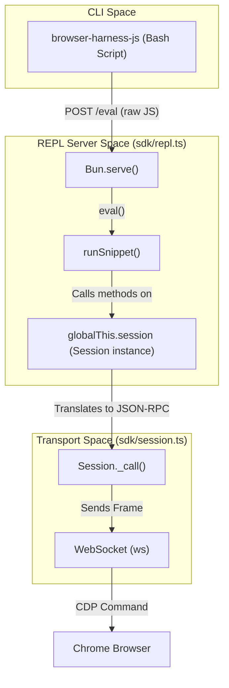
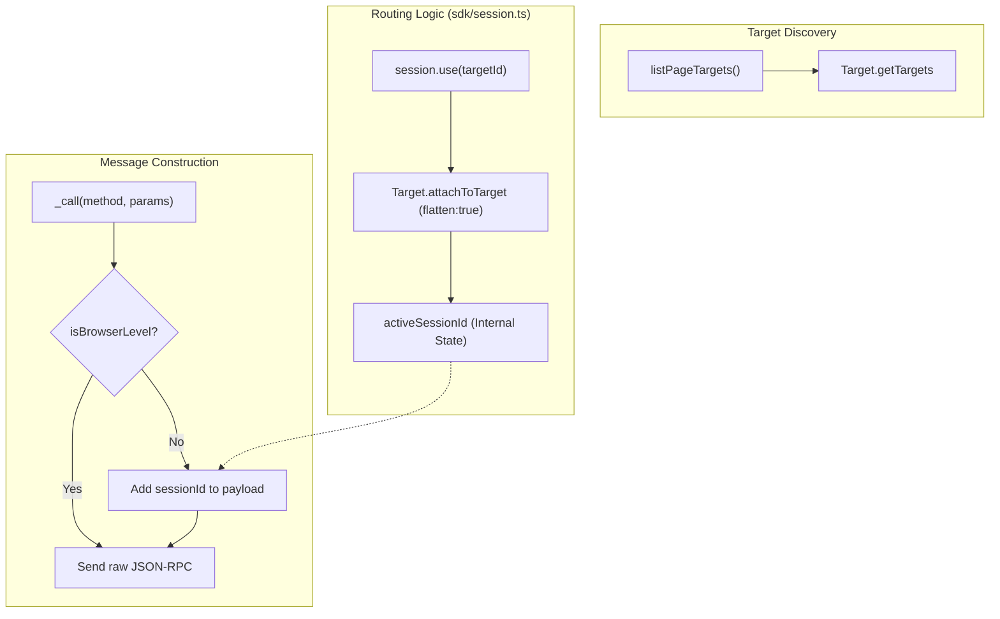

<!-- source: DeepWiki mcp.deepwiki.com · repo browser-use/browser-harness-js · page 5 Glossary · fetched 2026-10-30 -->

# Glossary

Relevant source files

The following files were used as context for generating this wiki page:

- [README.md](README.md)
- [SKILL.md](SKILL.md)
- [interaction-skills/connection.md](interaction-skills/connection.md)
- [interaction-skills/cross-origin-iframes.md](interaction-skills/cross-origin-iframes.md)
- [interaction-skills/network-requests.md](interaction-skills/network-requests.md)
- [interaction-skills/shadow-dom.md](interaction-skills/shadow-dom.md)
- [sdk/browser-harness-js](sdk/browser-harness-js)
- [sdk/gen.ts](sdk/gen.ts)
- [sdk/generated.ts](sdk/generated.ts)
- [sdk/repl.ts](sdk/repl.ts)
- [sdk/session.ts](sdk/session.ts)

This page defines codebase-specific terms, domain concepts, and abbreviations used throughout the `browser-harness-js` project. It provides a mapping between high-level concepts and the specific code entities that implement them.

## Core System Concepts

### The "Thin Bridge"
The design philosophy that avoids creating high-level "helpers" (like `click()` or `goto()`). Instead, the SDK provides direct, typed access to the Chrome DevTools Protocol (CDP).
*   **Implementation**: Found in the code generation logic which maps protocol JSON files directly to TypeScript interfaces and class methods.
*   **Sources**: [README.md:5-19](), [README.md:55-61]()

### The Protocol is the API
The principle that any capability available in Chrome's DevTools is exposed identically in the SDK. If Chrome adds a feature, it appears in the SDK upon regeneration without manual wrapping.
*   **Sources**: [README.md:19-19](), [sdk/gen.ts:3-9]()

---

## Technical Terms & Entities

### Session
The primary class managing the lifecycle of a connection to Chrome. It handles the WebSocket transport, message ID incrementing, and request/response correlation.
*   **Code Entity**: `class Session` in `sdk/session.ts`.
*   **Key Methods**:
    *   `connect(opts)`: Establishes the WebSocket connection [sdk/session.ts:46-60]().
    *   `use(targetId)`: Attaches to a specific tab/frame and routes subsequent calls there [sdk/session.ts:74-78]().
    *   `_call(method, params)`: The low-level transport method used by generated bindings [sdk/session.ts:115-128]().
*   **Sources**: [sdk/session.ts:26-145]()

### REPL Server
A Bun-native HTTP server that maintains a single persistent `Session` instance. It allows external CLI calls to execute JavaScript snippets within the same execution context.
*   **Code Entity**: `sdk/repl.ts`.
*   **Endpoints**:
    *   `POST /eval`: Evaluates raw JS snippets [sdk/repl.ts:85-98]().
    *   `GET /health`: Returns connection status and uptime [sdk/repl.ts:76-83]().
*   **Sources**: [sdk/repl.ts:1-14](), [sdk/repl.ts:70-108]()

### Flattened Session
A CDP connection mode where multiple target sessions (tabs/iframes) share a single physical WebSocket. This is achieved using the `flatten: true` parameter in `Target.attachToTarget`.
*   **Implementation**: Managed via `sessionId` headers on the wire protocol messages.
*   **Sources**: [sdk/session.ts:5-7](), [sdk/session.ts:75-76](), [sdk/session.ts:121-123]()

### OOPIF (Out-of-Process Iframe)
Iframes that run in a separate process from the parent page (usually for cross-origin security). These require explicit target attachment to interact with their DOM.
*   **Domain Concept**: Discussed in interaction recipes.
*   **Handling**: Use `session.use(targetId)` to route calls to the iframe's `sessionId`.
*   **Sources**: [interaction-skills/cross-origin-iframes.md:1-4](), [interaction-skills/cross-origin-iframes.md:18-36]()

---

## Connection Strategies

### DevToolsActivePort
A file created by Chrome in its user profile directory. It contains the ephemeral port and the unique WebSocket path needed to connect.
*   **Function**: `readDevToolsActivePort` in `sdk/session.ts`.
*   **Significance**: This is the only reliable way to connect to Chrome 144+ when attached via `chrome://inspect`, as the standard `/json/version` endpoint is often blocked.
*   **Sources**: [sdk/session.ts:159-170](), [sdk/session.ts:193-205]()

### /json/version Probe
A legacy HTTP-based discovery mechanism. The SDK probes `http://host:port/json/version` to find the `webSocketDebuggerUrl`.
*   **Function**: `fetchBrowserWsUrl` in `sdk/session.ts`.
*   **Sources**: [sdk/session.ts:180-182](), [sdk/session.ts:207-215]()

---

## Architecture Diagrams

### From Snippet to Browser
This diagram bridges the "Natural Language Space" (the JS snippet) to the "Code Entity Space" (the classes and files that process it).

**Data Flow: CLI Snippet Execution**

**Sources**: [sdk/browser-harness-js:52-66](), [sdk/repl.ts:85-98](), [sdk/session.ts:115-128]()

### Target and Session Management
How the system manages multiple tabs and iframes using a single connection.

**Logic Flow: Session Routing**

**Sources**: [sdk/session.ts:74-78](), [sdk/session.ts:115-128](), [sdk/session.ts:155-157]()

---

## Glossary Table

| Term | Definition | File Reference |
| :--- | :--- | :--- |
| **CDP** | Chrome DevTools Protocol. The underlying JSON-RPC protocol used to control Chrome. | [README.md:14-19]() |
| **Domain** | A logical grouping of CDP methods (e.g., `Page`, `DOM`, `Network`). | [sdk/gen.ts:44-51]() |
| **Generated Bindings** | TypeScript classes/interfaces created by `gen.ts` from protocol definitions. | [sdk/generated.ts:1-7]() |
| **Omnibox Popup** | A specific type of invisible Chrome target that often appears in `Target.getTargets` but should be ignored. | [interaction-skills/connection.md:21-23]() |
| **Pierce Shadow** | A CDP flag or selector syntax (`>>>`) used to query elements inside a Shadow DOM. | [interaction-skills/shadow-dom.md:9-22]() |
| **Transport** | An interface defining how JSON-RPC messages are sent to Chrome. | [sdk/generated.ts:5-7]() |
| **WaitPredicate** | A user-provided function passed to `session.waitFor` to filter incoming CDP events. | [sdk/session.ts:98-112]() |

**Sources**: [README.md:46-51](), [sdk/session.ts:98-112](), [sdk/gen.ts:1-9](), [interaction-skills/connection.md:21-23]()