# Page: Overview

# Overview

<details>
<summary>Relevant source files</summary>

The following files were used as context for generating this wiki page:

- [.gitignore](.gitignore)
- [LICENSE](LICENSE)
- [README.md](README.md)
- [SKILL.md](SKILL.md)

</details>


`browser-harness-js` is a lightweight, high-performance bridge designed to expose the full power of the **Chrome DevTools Protocol (CDP)** directly to Large Language Models (LLMs) and developers without restrictive abstractions [README.md:3-7](). It provides a persistent WebSocket connection to a Chrome instance, offering 652 fully-typed methods across 56 CDP domains [README.md:7-7]().

## "The Protocol is the API"

The core philosophy of `browser-harness-js` is that the protocol itself is the most efficient and expressive API available [README.md:19-19](). Unlike traditional automation frameworks (like Playwright or Puppeteer) that wrap CDP in higher-level "helper" functions like `click()` or `goto()`, this project provides direct access to the underlying protocol [README.md:53-53]().

### Why Avoid Abstractions?
*   **No Information Loss**: High-level helpers often hide complex parameters. For example, a standard `click(x, y)` helper might ignore 14 additional parameters available in `Input.dispatchMouseEvent` (such as `modifiers`, `pointerType`, or `force`) that an agent might need for sophisticated interactions [README.md:57-57]().
*   **Zero Version Drift**: The SDK is generated directly from upstream `browser_protocol.json` and `js_protocol.json` files [README.md:50-50](). When Chrome adds new features, regenerating the SDK immediately makes those features available as typed TypeScript calls [README.md:60-61]().
*   **Types as Documentation**: Every method call triggers autocomplete with the exact parameters and JSDoc from the CDP reference [README.md:59-59]().

For a deeper dive into these principles, see [Core Concepts and Design Philosophy](#1.2).

## System Architecture

The project consists of a TypeScript SDK and a Bun-native REPL server that maintains a long-lived session with Chrome.

### Component Map: Natural Language to Code Entities

The following diagram maps high-level system concepts to their specific implementations in the codebase.

**System Component Mapping**
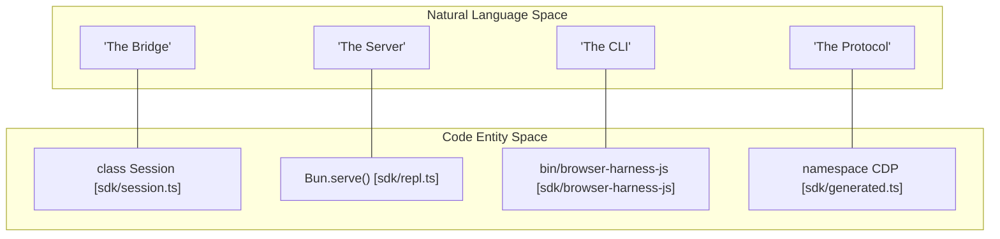
Sources: [README.md:46-51](), [SKILL.md:81-88]()

### Execution Flow

When a command is issued, it passes through a thin CLI wrapper to a persistent background server.

**Request Lifecycle**
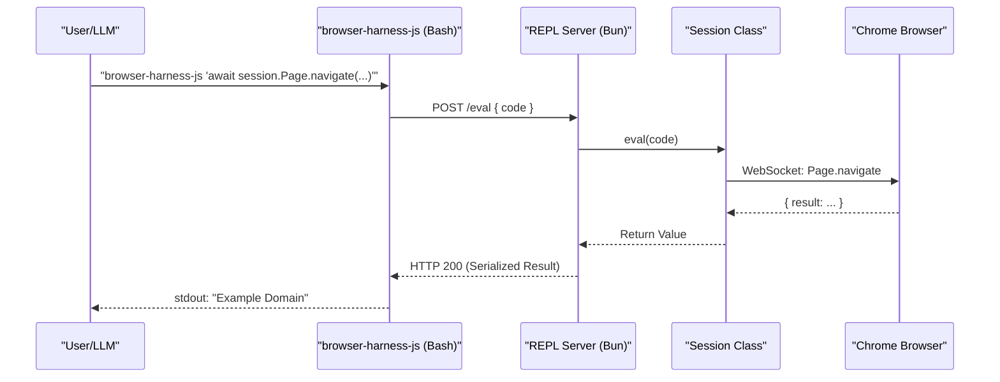
Sources: [SKILL.md:8-10](), [SKILL.md:31-39](), [README.md:47-49]()

## Key Components

| Component | File | Description |
| :--- | :--- | :--- |
| **CLI Wrapper** | `sdk/browser-harness-js` | A Bash script that manages the server lifecycle (start/stop/restart) and forwards JS snippets to the REPL [README.md:47-47](). |
| **REPL Server** | `sdk/repl.ts` | A Bun-based HTTP server that hosts a single persistent `Session` and evaluates incoming JavaScript [README.md:48-48](). |
| **Session** | `sdk/session.ts` | Manages the WebSocket transport, message routing, and target (tab) switching [README.md:49-49](). |
| **Codegen** | `sdk/gen.ts` | The engine that transforms the Chrome Protocol JSON into the typed `generated.ts` file [README.md:50-51](). |

## Getting Started

To use `browser-harness-js`, you need the `bun` runtime installed on your system [README.md:36-36](). You can install the tool as a "skill" for an AI agent or use it manually by symlinking the CLI into your `PATH` [SKILL.md:14-25]().

Once installed, connecting to a browser and navigating to a page is a simple one-liner:
```bash
browser-harness-js 'await session.connect({port:9222}); await session.Page.navigate({url:"https://example.com"})'
```
Sources: [SKILL.md:33-35]()

For detailed installation steps and first-run verification, see [Getting Started](#1.1).

## Advanced Interaction

While the SDK avoids "helpers," it provides a library of **Interaction Skills**—documented recipes for complex CDP sequences such as handling Shadow DOM, Out-of-Process Iframes (OOPIFs), and file uploads [README.md:70-74](). These are located in the `interaction-skills/` directory.

For more information on these patterns, see the [Interaction Skills](#4) section.

---

# Page: Getting Started

# Getting Started

<details>
<summary>Relevant source files</summary>

The following files were used as context for generating this wiki page:

- [README.md](README.md)
- [SKILL.md](SKILL.md)
- [docs/setup-remote-debugging.png](docs/setup-remote-debugging.png)
- [sdk/browser-harness-js](sdk/browser-harness-js)
- [sdk/package.json](sdk/package.json)

</details>


This page provides a step-by-step guide for installing, configuring, and verifying your `browser-harness-js` setup. `browser-harness-js` is designed as a "thin bridge" between execution environments (like LLMs or local scripts) and the Chrome DevTools Protocol (CDP).

## Prerequisites

Before installing, ensure your environment meets the following requirements:

*   **Bun Runtime**: The REPL server is Bun-native and requires `bun` to be available on your `PATH` [README.md:36-36]().
*   **Google Chrome**: A running instance of Chrome (or a Chromium-based browser).
*   **Operating System**: macOS (Intel/Apple Silicon) or Linux.

## Installation

You can install the skill and the underlying SDK using `npx`.

### 1. Add the Skill
Run the following command to download the codebase into your agent's skill directory:

```bash
npx skills add https://github.com/browser-use/browser-harness-js --skill cdp
```
Sources: [README.md:23-25](), [SKILL.md:10-10]()

### 2. Link the CLI to PATH
The `npx` command installs the files but does not globally register the `browser-harness-js` executable. You must symlink the wrapper script [sdk/browser-harness-js:1-111]() to a directory in your `PATH`.

Replace `<skill-dir>` with the actual installation path (e.g., `~/.claude/skills/cdp` or `~/.cursor/skills/cdp`) [SKILL.md:10-10]().

**macOS (Homebrew/Silicon):**
```bash
command -v browser-harness-js >/dev/null || ln -sf <skill-dir>/sdk/browser-harness-js /opt/homebrew/bin/browser-harness-js
```
**Linux (Standard):**
```bash
command -v browser-harness-js >/dev/null || ln -sf <skill-dir>/sdk/browser-harness-js /usr/local/bin/browser-harness-js
```
Sources: [SKILL.md:17-25]()

## Connecting to Chrome

`browser-harness-js` does not launch Chrome for you; it attaches to an existing process. You must enable Remote Debugging in Chrome.

### Remote Debugging Setup
If prompted by Chrome with an "Allow" dialog for remote debugging, you must accept it to allow the SDK to attach [README.md:38-40]().

### Connection Strategies
The `session.connect()` method [sdk/session.ts:54-94]() supports three ways to find the browser:

| Strategy | Parameter | Use Case |
| :--- | :--- | :--- |
| **Profile Directory** | `profileDir` | Recommended for Chrome 144+. Reads `DevToolsActivePort` directly [SKILL.md:135-135](). |
| **Manual Port** | `port` | Used when Chrome is started with `--remote-debugging-port=<port>` [SKILL.md:128-129](). |
| **Direct WebSocket** | `wsUrl` | Used if you already have the full `ws://` string [SKILL.md:131-132](). |

Sources: [SKILL.md:112-137](), [sdk/session.ts:54-94]()

## System Architecture

The following diagram illustrates the data flow from a CLI command through the REPL server to the Chrome DevTools Protocol.

### Data Flow: CLI to CDP
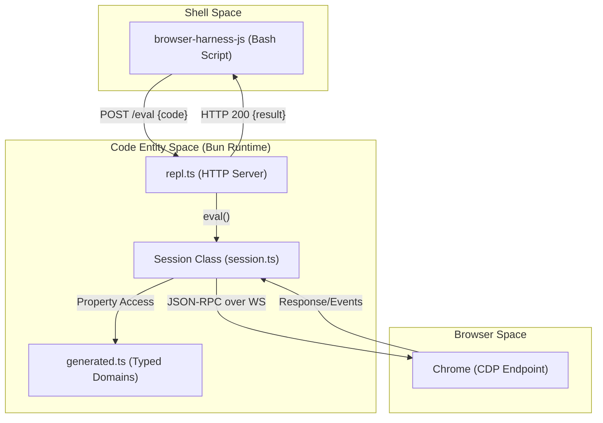
Sources: [sdk/browser-harness-js:52-66](), [sdk/repl.ts:39-66](), [sdk/session.ts:101-135]()

## Verifying the Setup

To verify the installation, run these three commands in sequence. The first command will automatically start the background REPL server [sdk/browser-harness-js:102-108]().

### 1. Connect to the Browser
Update the path to match your OS profile directory.
```bash
browser-harness-js 'await session.connect({ profileDir: "/Users/example/Library/Application Support/Google/Chrome" })'
```

### 2. Select a Target (Tab)
List available tabs and attach the session to the first one.
```bash
browser-harness-js <<'EOF'
const tabs = await listPageTargets();
if (tabs.length > 0) {
  await session.use(tabs[0].targetId);
  return tabs[0].title;
}
EOF
```

### 3. Execute a CDP Command
Navigate the selected tab to a new URL.
```bash
browser-harness-js 'await session.Page.navigate({ url: "https://example.com" })'
```
Sources: [SKILL.md:31-37](), [SKILL.md:58-65](), [SKILL.md:121-126]()

## Troubleshooting

### CLI Status and Logs
If the commands fail, check the background server status or logs:

*   **Check Status**: `browser-harness-js --status` [sdk/browser-harness-js:69-76]()
*   **View Logs**: `browser-harness-js --logs` (defaults to `/tmp/browser-harness-js.log`) [sdk/browser-harness-js:95-97]()
*   **Restart Server**: `browser-harness-js --restart` [sdk/browser-harness-js:89-94]()

### Entity Mapping
The following diagram maps the logical components to the specific files and classes in the codebase.

### Component Mapping
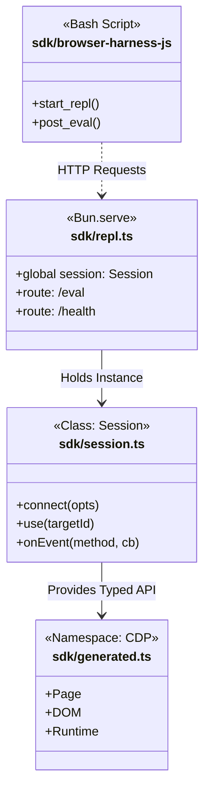
Sources: [sdk/browser-harness-js:1-111](), [sdk/repl.ts:1-100](), [sdk/session.ts:1-300](), [sdk/generated.ts:1-10]()

---

# Page: Core Concepts and Design Philosophy

# Core Concepts and Design Philosophy

<details>
<summary>Relevant source files</summary>

The following files were used as context for generating this wiki page:

- [README.md](README.md)
- [SKILL.md](SKILL.md)
- [sdk/session.ts](sdk/session.ts)

</details>


The `browser-harness-js` project is built on the premise that the Chrome DevTools Protocol (CDP) is already a rich, expressive API for browser automation. Instead of creating a high-level library that abstracts these capabilities away, this project provides a **thin bridge** that exposes the full power of the protocol directly to the user.

## The 'Thin Bridge' Philosophy

The core design philosophy is "The protocol is the API" [README.md:19-19](). Unlike traditional automation frameworks (like Puppeteer or Playwright) that wrap CDP in higher-level abstractions like `click()` or `goto()`, this SDK intentionally avoids pre-baked helpers [README.md:12-16]().

### Why Abstractions are Avoided
1.  **Loss of Control:** A `click(x, y)` helper often hides parameters that an LLM or power user might need, such as `modifiers`, `clickCount`, or `pointerType` [README.md:57-58]().
2.  **Version Drift:** High-level libraries often lag behind Chrome updates. By using a "thin bridge" generated directly from the protocol JSON, new Chrome features are available immediately [README.md:60-61]().
3.  **Documentation Parity:** The SDK's types and JSDoc match the official CDP reference exactly, reducing the mental overhead of learning a proprietary API [README.md:59-59]().

### Bridge Logic Flow
The following diagram illustrates how a developer's intent moves through the "Thin Bridge" to Chrome without being intercepted by complex abstraction layers.

**Intent to Protocol Mapping**
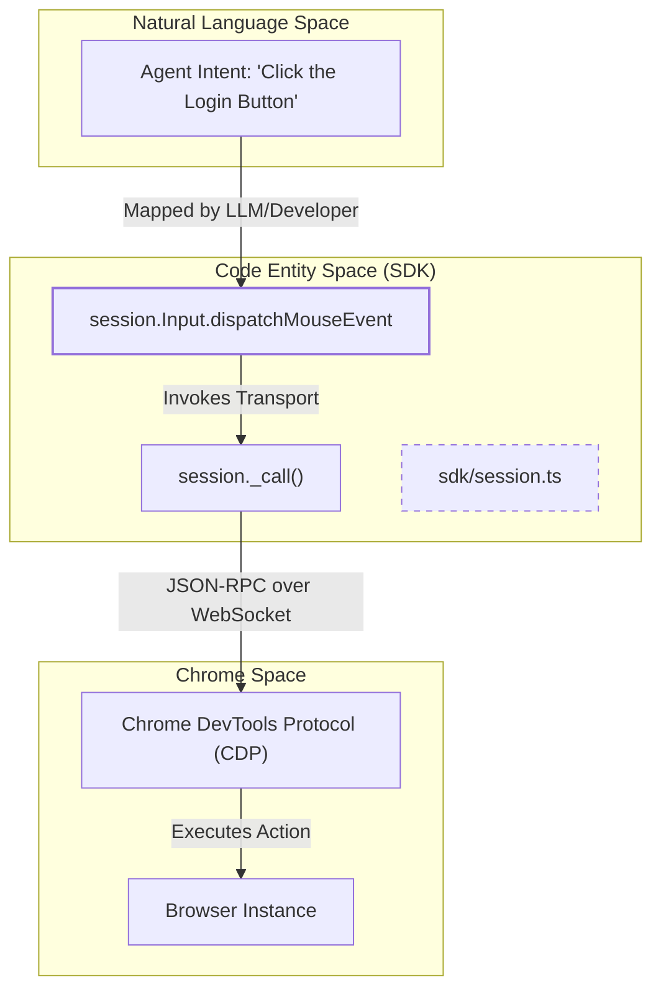
**Sources:** [README.md:9-17](), [sdk/session.ts:115-128]()

---

## Direct Mapping: Domains to Session Properties

In `browser-harness-js`, the `Session` class acts as the central coordinator. To maintain the "thin bridge" feel, every CDP domain (e.g., `Page`, `DOM`, `Network`) is mounted directly as a property on the `Session` instance [sdk/session.ts:38-42]().

### Implementation Details
*   **Lazy Binding:** Domains are bound to the session using `bindDomains(this)` in the constructor [sdk/session.ts:38-38]().
*   **Property Mirroring:** The SDK iterates through all generated domains and mirrors them onto the `Session` instance so that calls read naturally: `session.Page.navigate(...)` [sdk/session.ts:39-42]().
*   **Automatic Routing:** When a domain method is called, the `Session` automatically injects the `activeSessionId` into the message if the method is not a "browser-level" command (like `Target.*` or `Browser.*`) [sdk/session.ts:121-123]().

| Feature | Implementation in `sdk/session.ts` |
| :--- | :--- |
| **Domain Mounting** | `this[k] = this.domains[k]` [sdk/session.ts:41-41]() |
| **Target Switching** | `session.use(targetId)` sets `activeSessionId` [sdk/session.ts:74-78]() |
| **Event Handling** | `session.onEvent()` for global protocol monitoring [sdk/session.ts:90-95]() |
| **Wait Primitives** | `session.waitFor(method, predicate)` for state sync [sdk/session.ts:98-112]() |

**Sources:** [sdk/session.ts:26-43](), [sdk/session.ts:74-112]()

---

## Role of Code Generation

The SDK's currency is maintained via a code generation pipeline. This pipeline transforms the raw JSON definitions of the Chrome DevTools Protocol into a fully-typed TypeScript SDK.

### The Gen Pipeline
1.  **Input:** `browser_protocol.json` and `js_protocol.json` [README.md:50-50]().
2.  **Process:** `sdk/gen.ts` parses these files to create TypeScript namespaces and interfaces for every command, event, and type [README.md:50-50]().
3.  **Output:** `sdk/generated.ts`, which contains 56 domains and 652 typed wrappers [README.md:7-7]().

This process ensures that the "Thin Bridge" is not just thin, but also structurally sound and type-safe.

**Code Generation Data Flow**
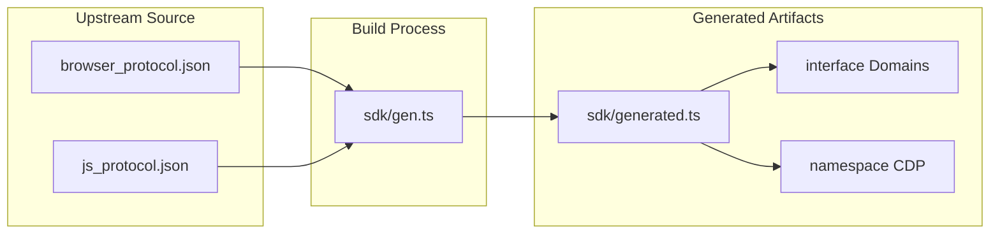
**Sources:** [README.md:49-51](), [sdk/session.ts:9-9]()

---

## Session Multiplexing and the 'Flatten' Pattern

A key design decision in the `Session` class is the use of `flatten: true` when attaching to targets [sdk/session.ts:5-7](). 

In standard CDP, communicating with a specific tab often requires nesting messages inside `Target.sendMessageToTarget`. The `browser-harness-js` SDK uses the "flatten" mode, which allows all communications to happen over a single WebSocket connection where messages are distinguished solely by a `sessionId` field [sdk/session.ts:75-76]().

### Key Functions for Session Management
*   `session.use(targetId)`: Attaches to a target and sets it as the active context for subsequent domain calls [sdk/session.ts:74-78]().
*   `_call(method, params)`: The underlying transport method that handles ID incrementing, JSON-RPC formatting, and `sessionId` injection [sdk/session.ts:115-128]().
*   `onMessage(raw)`: Routes incoming WebSocket messages back to the appropriate caller (via `pending` map) or to event listeners [sdk/session.ts:130-144]().

**Sources:** [sdk/session.ts:1-7](), [sdk/session.ts:74-78](), [sdk/session.ts:115-144]()

---

# Page: SDK Architecture

# SDK Architecture

<details>
<summary>Relevant source files</summary>

The following files were used as context for generating this wiki page:

- [README.md](README.md)
- [sdk/browser-harness-js](sdk/browser-harness-js)
- [sdk/repl.ts](sdk/repl.ts)
- [sdk/session.ts](sdk/session.ts)

</details>


The `browser-harness-js` SDK is designed as a "thin bridge" between an agent and the Chrome DevTools Protocol (CDP). Its internal structure prioritizes direct protocol access over high-level abstractions, ensuring that every CDP capability is available as a typed TypeScript call.

The system consists of four primary layers: a persistent WebSocket **Session**, a **REPL Server** for remote execution, a **CLI Wrapper** for lifecycle management, and a **Code Generation Pipeline** that keeps the API in sync with Chrome's evolution.

### System Overview

The following diagram illustrates the flow from a Natural Language Agent's request through the CLI and REPL into the core `Session` class, which communicates with Chrome.

**Natural Language to Code Entity Mapping**
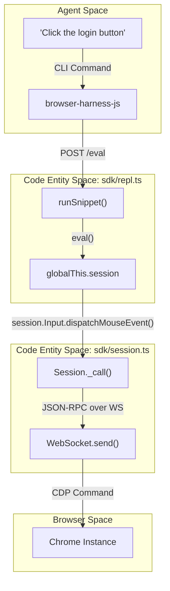
**Sources:** [README.md:9-17](), [sdk/repl.ts:47-51](), [sdk/session.ts:115-128]()

---

### [Session Class](#2.1)

The `Session` class in `sdk/session.ts` is the core engine of the SDK. It manages a single persistent WebSocket connection to Chrome's browser-level endpoint [sdk/session.ts:46-60](). It handles:
- **Request/Response Mapping**: Using a `pending` Map to associate outgoing JSON-RPC IDs with their corresponding promises [sdk/session.ts:29](), [sdk/session.ts:133-138]().
- **Target Routing**: The `use(targetId)` method allows the session to "attach" to specific tabs or frames, auto-injecting the required `sessionId` into subsequent calls [sdk/session.ts:74-78]().
- **Event Handling**: Primitives like `onEvent()` and `waitFor()` allow agents to react to browser events (e.g., network requests, dialogs) asynchronously [sdk/session.ts:90-112]().

For details, see [Session Class](#2.1).

**Sources:** [sdk/session.ts:26-145]()

---

### [REPL Server](#2.2)

The REPL server (`sdk/repl.ts`) is a Bun-powered HTTP server that hosts a persistent `Session` instance [sdk/repl.ts:19-20](). It provides a bridge for stateless CLI tools or agents to execute stateful JavaScript snippets.
- **Endpoints**: Supports `/eval` for code execution, `/health` for connection status, and `/quit` for graceful shutdown [sdk/repl.ts:5-10]().
- **Global Context**: It exposes `session`, `listPageTargets`, and the `CDP` type library to the global scope, allowing snippets to be concise (e.g., `await session.Page.navigate(...)`) [sdk/repl.ts:20-25]().
- **Smart Eval**: Automatically wraps single expressions in async IIFEs and handles result serialization [sdk/repl.ts:47-51]().

For details, see [REPL Server](#2.2).

**Sources:** [sdk/repl.ts:1-108]()

---

### [CLI Wrapper (browser-harness-js)](#2.3)

The `browser-harness-js` script is a Bash wrapper that manages the REPL's lifecycle and provides a user-friendly interface for the agent [sdk/browser-harness-js:1-19]().
- **Auto-Start**: Spawns the REPL server in the background on the first call if it isn't already running [sdk/browser-harness-js:41-50]().
- **Environment Control**: Uses `CDP_REPL_PORT` and `CDP_REPL_LOG` to manage server configuration [sdk/browser-harness-js:22-35]().
- **Management Flags**: Provides `--status`, `--stop`, `--restart`, and `--logs` for debugging and maintenance [sdk/browser-harness-js:68-97]().

For details, see [CLI Wrapper (browser-harness-js)](#2.3).

**Sources:** [sdk/browser-harness-js:1-111]()

---

### [Code Generation Pipeline](#2.4)

The SDK does not manually define browser methods. Instead, it uses a code generation pipeline (`sdk/gen.ts`) to transform the official Chrome DevTools Protocol JSON definitions into a fully typed TypeScript API [sdk/gen.ts]().
- **Generated Output**: Produces `sdk/generated.ts`, which contains over 600 typed methods organized by CDP Domain (e.g., `Page`, `Runtime`, `Network`) [README.md:50-51]().
- **Domain Binding**: The `bindDomains` factory links these generated types to the `Session._call` transport mechanism [sdk/session.ts:38-42]().

For details, see [Code Generation Pipeline](#2.4).

**Sources:** [README.md:50-51](), [sdk/session.ts:9](), [sdk/session.ts:38-42]()

---

### Component Relationship

The following diagram shows how the generated types and the runtime components interact to provide the final API.

**Architecture Component Interaction**
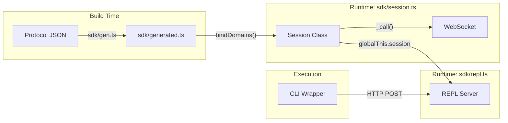
**Sources:** [sdk/session.ts:9](), [sdk/session.ts:38-42](), [sdk/repl.ts:19-25](), [sdk/browser-harness-js:52-66]()

---

# Page: Session Class

# Session Class

<details>
<summary>Relevant source files</summary>

The following files were used as context for generating this wiki page:

- [README.md](README.md)
- [sdk/session.ts](sdk/session.ts)

</details>


The `Session` class is the central orchestrator of the `browser-harness-js` SDK. It manages a persistent WebSocket connection to the Chrome DevTools Protocol (CDP) browser endpoint and provides the infrastructure for request/response multiplexing, target routing, and event handling.

## Overview and Lifecycle

The `Session` class implements the `Transport` interface defined in the generated bindings [sdk/session.ts:26-26](). Its lifecycle typically follows these stages:

1.  **Initialization**: Upon construction, the `Session` lazily initializes CDP domain bindings using `bindDomains` and mirrors them onto the class instance [sdk/session.ts:37-43]().
2.  **Connection**: The `connect()` method resolves a WebSocket URL and establishes a connection [sdk/session.ts:46-60]().
3.  **Routing**: The `use(targetId)` method attaches to a specific tab or worker [sdk/session.ts:74-78]().
4.  **Execution**: Calls are dispatched via `_call`, which handles message IDs and session multiplexing [sdk/session.ts:115-128]().
5.  **Teardown**: The `close()` method terminates the socket and rejects any outstanding promises [sdk/session.ts:53-58, 66-68]().

### Connection Data Flow

The following diagram illustrates the transition from a high-level `ConnectOptions` object to an active `WebSocket` connection.

**Figure 1: Connection Resolution and Socket Lifecycle**
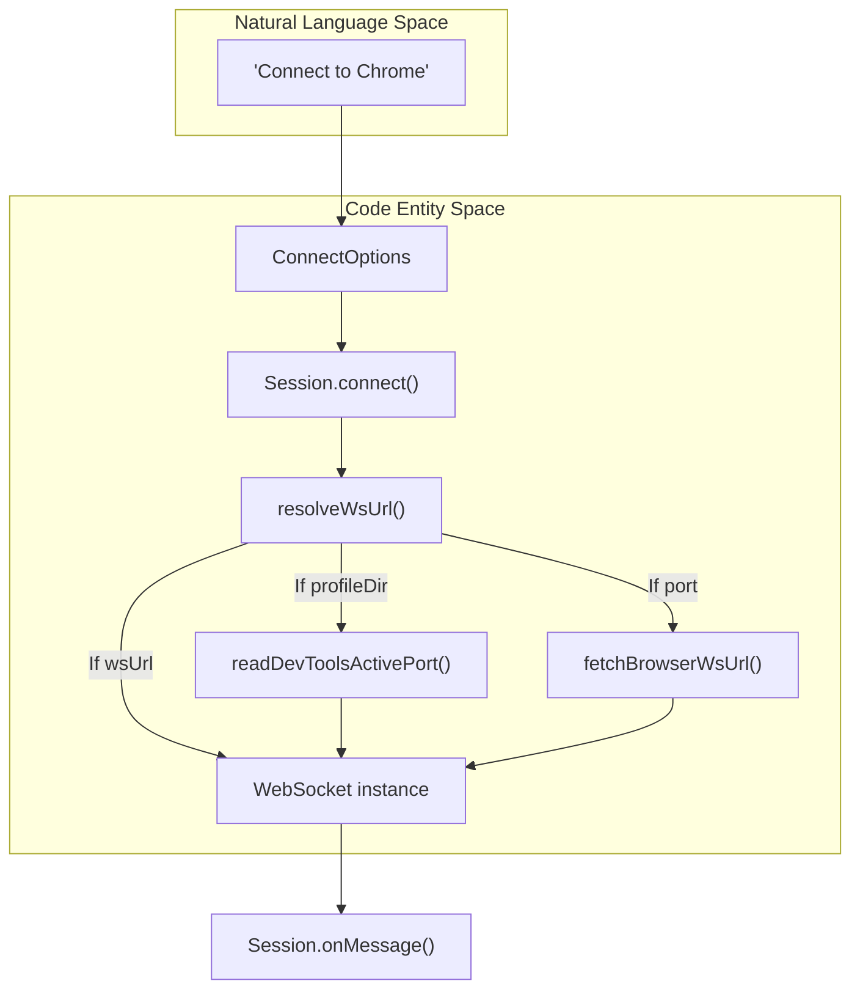
Sources: [sdk/session.ts:16-24](), [sdk/session.ts:46-60](), [sdk/session.ts:171-185]()

---

## The Pending-Map Pattern

To bridge the asynchronous nature of WebSockets with the `Promise`-based API of the SDK, `Session` uses a "pending-map" pattern [sdk/session.ts:11-14]().

1.  **Request**: Every call to `_call` increments a `nextId` [sdk/session.ts:119-119]().
2.  **Storage**: A `Pending` object (containing `resolve` and `reject` callbacks) is stored in the `pending` Map, keyed by the message `id` [sdk/session.ts:125-125]().
3.  **Response**: When `onMessage` receives a frame with a matching `id`, it retrieves the `Pending` entry, deletes it from the map, and settles the original promise [sdk/session.ts:133-138]().

### Error Handling
If the CDP returns an error object, the `Session` rejects the promise with a `CdpError` [sdk/session.ts:137-137](). This class captures the protocol-level error code and message [sdk/session.ts:147-152]().

Sources: [sdk/session.ts:29-29](), [sdk/session.ts:115-128](), [sdk/session.ts:130-144]()

---

## Session Multiplexing and Routing

The SDK uses a "flattened" session architecture. Instead of nesting messages inside `Target.sendMessageToTarget`, it connects once to the browser endpoint and includes a `sessionId` in the top-level JSON payload for target-specific commands [sdk/session.ts:5-7]().

### The `use()` Method
The `use(targetId)` method is the primary primitive for switching context between tabs [sdk/session.ts:74-78]().
- It calls `Target.attachToTarget` with `flatten: true` [sdk/session.ts:75-75]().
- It stores the returned `sessionId` as the `activeSessionId` [sdk/session.ts:76-76]().

### Automatic Routing Logic
When `_call` is invoked, it automatically injects the `activeSessionId` into the outgoing message unless the method is "browser-level" [sdk/session.ts:121-123](). Browser-level methods (defined in the `Browser` or `Target` domains) always operate on the global browser context and must not include a `sessionId` [sdk/session.ts:155-157]().

**Figure 2: Message Routing Logic in _call()**
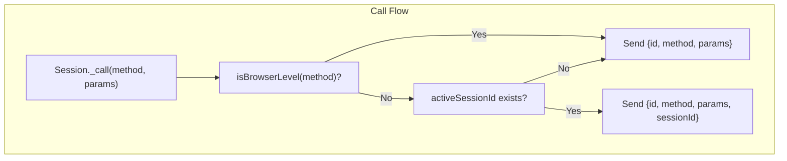
Sources: [sdk/session.ts:74-78](), [sdk/session.ts:115-128](), [sdk/session.ts:155-157]()

---

## Event System and Primitives

The `Session` provides two main ways to interact with CDP events (e.g., `Network.requestWillBeSent` or `Page.loadEventFired`).

### `onEvent(fn)`
A low-level subscription mechanism. It adds a callback to the `eventListeners` array and returns an unsubscribe function [sdk/session.ts:90-95](). Whenever a message without an `id` (indicating an event) is received, all listeners are notified [sdk/session.ts:139-143]().

### `waitFor(method, predicate, timeout)`
A high-level primitive for synchronization [sdk/session.ts:98-112](). It:
1.  Subscribes to events using `onEvent`.
2.  Filters by the specified `method`.
3.  Applies an optional `predicate` to the event parameters [sdk/session.ts:106-106]().
4.  Resolves the promise when a match is found or rejects after the `timeoutMs` (default 30s) [sdk/session.ts:100-103]().

| Method | Purpose | Typical Use Case |
| :--- | :--- | :--- |
| `onEvent` | Persistent monitoring | Logging all network traffic or console messages. |
| `waitFor` | Flow control | Waiting for a specific navigation to complete or a file to download. |

Sources: [sdk/session.ts:31-31](), [sdk/session.ts:90-112](), [sdk/session.ts:139-143]()

---

# Page: REPL Server

# REPL Server

<details>
<summary>Relevant source files</summary>

The following files were used as context for generating this wiki page:

- [SKILL.md](SKILL.md)
- [sdk/repl.ts](sdk/repl.ts)

</details>


The REPL Server is a long-lived Bun HTTP process that maintains a persistent `Session` with a Chrome instance. It acts as the execution engine for the `browser-harness-js` CLI, allowing multiple sequential CLI calls to share the same WebSocket connection, authentication state, and global variables [sdk/repl.ts:1-14]().

## Server Lifecycle and Configuration

The server is implemented in `sdk/repl.ts` and uses `Bun.serve` to listen on `127.0.0.1` [sdk/repl.ts:70-72](). By default, it binds to port `9876`, but this can be overridden via the `CDP_REPL_PORT` environment variable [sdk/repl.ts:27]().

### Global Context Initialization
Upon startup, the server initializes a singleton `Session` and populates `globalThis` with several helpers to ensure they are available to any code evaluated via the `/eval` endpoint [sdk/repl.ts:19-25]():

| Global Variable | Purpose |
| :--- | :--- |
| `session` | The persistent `Session` instance for CDP communication [sdk/repl.ts:20](). |
| `listPageTargets()` | Bound helper to list available tabs using the active session [sdk/repl.ts:23](). |
| `resolveWsUrl` | Utility to resolve WebSocket URLs from ports or profile directories [sdk/repl.ts:24](). |
| `CDP` | The full generated namespace for type-name references [sdk/repl.ts:25](). |

**Sources:** [sdk/repl.ts:1-30](), [SKILL.md:81-89]()

## Endpoints

The server exposes three primary endpoints to manage the browser session and execute code.

### 1. `GET /health`
Returns the current status of the REPL server, including uptime and connection state [sdk/repl.ts:76-83]().
- **Response:** `{"ok":true, "uptime":number, "connected":boolean, "sessionId":string|null}`

### 2. `POST /eval`
The primary execution endpoint. It accepts raw JavaScript as the request body [sdk/repl.ts:85-86]().
- **Success (200 OK):** Returns the serialized result of the execution as `text/plain` [sdk/repl.ts:93]().
- **Failure (500 Error):** Returns the error stack or message as `text/plain` [sdk/repl.ts:94-97]().

### 3. `POST /quit`
Triggers a graceful shutdown. It closes the `Session` WebSocket and terminates the Bun process after a 50ms delay to allow the response to flush [sdk/repl.ts:100-104]().

**Sources:** [sdk/repl.ts:70-108]()

## Expression Detection and Async Wrapping

To provide a "REPL-like" experience where single expressions automatically return values, `sdk/repl.ts` performs lightweight syntax analysis before execution.

### Expression Detection
The `isExpression` function determines if the input string is a single expression or a multi-statement block [sdk/repl.ts:30-36]().
- **Expression:** No newlines/semicolons and does not start with keywords like `let`, `const`, `if`, or `function` [sdk/repl.ts:33-34]().
- **Statement:** Contains control flow, declarations, or multiple lines.

### Execution Pipeline
Code is wrapped in an asynchronous IIFE (Immediately Invoked Function Expression) to support top-level `await` [sdk/repl.ts:47-51]().

**REPL Execution Logic**
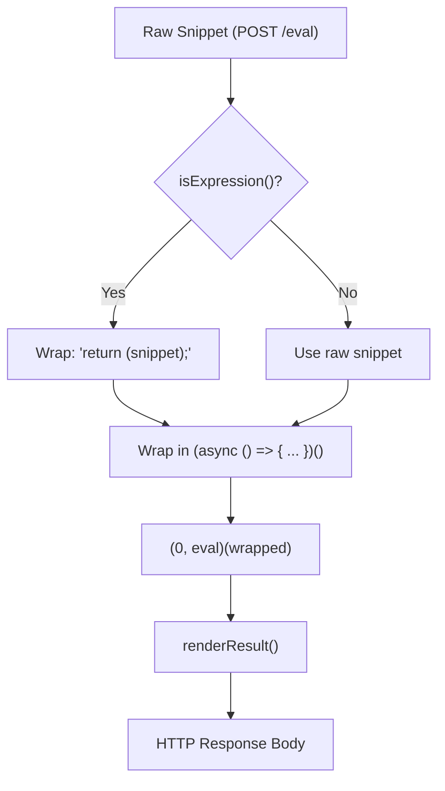

**Sources:** [sdk/repl.ts:30-51]()

## Result Serialization

The server serializes results into a format optimized for CLI consumption. The `renderResult` function handles the conversion of JavaScript values into `text/plain` strings [sdk/repl.ts:61-68]().

| Value Type | Output Format |
| :--- | :--- |
| `undefined`, `null`, `""`, `{}`, `[]` | Empty string (no output) [sdk/repl.ts:63-66]() |
| `string` | Bare text (no quotes) [sdk/repl.ts:64]() |
| `number`, `boolean`, `object` | JSON stringified [sdk/repl.ts:67]() |
| `bigint` | Converted to string during JSON pass [sdk/repl.ts:41]() |

**Code Entity Mapping: Evaluation and Serialization**
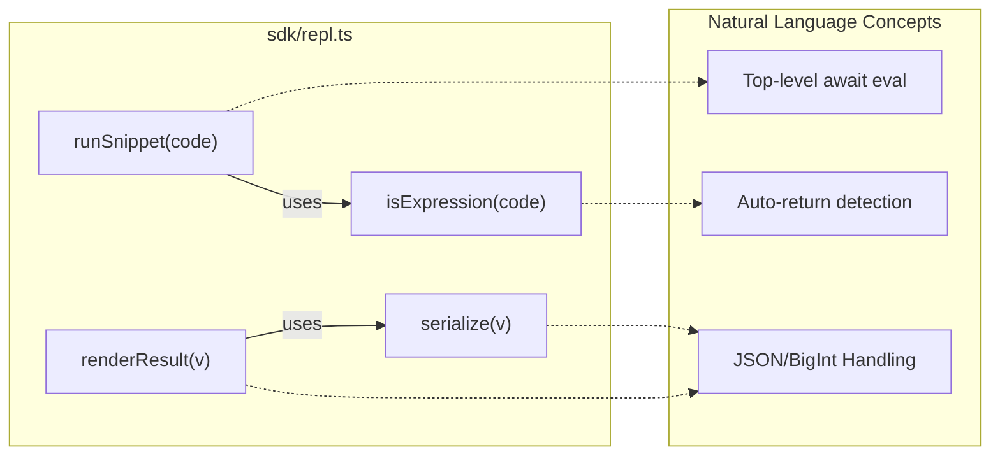

**Sources:** [sdk/repl.ts:38-68](), [SKILL.md:41-47]()

---

# Page: CLI Wrapper (browser-harness-js)

# CLI Wrapper (browser-harness-js)

<details>
<summary>Relevant source files</summary>

The following files were used as context for generating this wiki page:

- [SKILL.md](SKILL.md)
- [sdk/browser-harness-js](sdk/browser-harness-js)

</details>


The `browser-harness-js` script is a Bash-based CLI wrapper that serves as the primary entry point for interacting with the CDP REPL server. It manages the lifecycle of the persistent Bun process, handles code submission via arguments or `stdin`, and provides diagnostic tools for managing the background session.

## Overview and Purpose

The CLI follows a "thin bridge" philosophy, designed to make the remote CDP session feel like a local script execution [SKILL.md:8-10](). Its primary responsibilities include:
1.  **Auto-starting** the REPL server if it is not already running [sdk/browser-harness-js:41-50]().
2.  **Forwarding JS snippets** to the `/eval` endpoint of the REPL [sdk/browser-harness-js:52-66]().
3.  **Standardizing Output**: Mapping HTTP status codes from the REPL back to shell exit codes and filtering output based on result types [SKILL.md:41-47]().
4.  **Process Management**: Providing flags for status checks, logs, and graceful restarts [sdk/browser-harness-js:68-110]().

### Sources:
- [SKILL.md:8-10]()
- [SKILL.md:41-47]()
- [sdk/browser-harness-js:41-50]()
- [sdk/browser-harness-js:52-66]()
- [sdk/browser-harness-js:68-110]()

---

## Lifecycle Management

The script ensures that a REPL server is always available before attempting to evaluate code.

### Auto-Start Logic
When any evaluation command is issued, the script calls `start_repl` [sdk/browser-harness-js:102,107](). This function checks if the server is responsive on the designated port (default `9876`). If unresponsive, it spawns the REPL using `nohup bun "$REPL"` and polls the `/health` endpoint for up to 10 seconds until it becomes available [sdk/browser-harness-js:41-50]().

### Evaluation Pipeline (`post_eval`)
The `post_eval` function handles the data flow between the shell and the REPL server:
1.  **Request**: It sends the JS code as a binary payload to `$URL/eval` using `curl` [sdk/browser-harness-js:56]().
2.  **Response Splitting**: It uses a custom delimiter (`___STATUS___`) to separate the response body from the HTTP status code [sdk/browser-harness-js:56-58]().
3.  **Exit Codes**: 
    *   HTTP 200: Body is printed to `stdout`, returns 0 [sdk/browser-harness-js:59-61]().
    *   Non-200: Body (usually an error stack) is printed to `stderr`, returns 1 [sdk/browser-harness-js:62-65]().

### CLI Command Flow
The following diagram illustrates how the CLI handles user input and manages the REPL process.

**CLI Execution Flow**
```mermaid
graph TD
    A["User Command"] --> B{"Is Flag?"}
    B -- "--status" --> C["is_up() check"]
    B -- "--stop" --> D["POST /quit"]
    B -- "--restart" --> E["POST /quit && start_repl"]
    B -- "--logs" --> F["tail -f $LOG"]
    B -- "JS String/stdin" --> G["start_repl()"]
    
    G --> H{"is_up()?"}
    H -- "No" --> I["nohup bun repl.ts"]
    H -- "Yes" --> J["post_eval(code)"]
    I --> K["Poll /health"]
    K --> J
    
    J --> L["curl -sS /eval"]
    L --> M{"HTTP 200?"}
    M -- "Yes" --> N["stdout: Result"]
    M -- "No" --> O["stderr: Error + exit 1"]
```

### Sources:
- [sdk/browser-harness-js:37-50]()
- [sdk/browser-harness-js:52-66]()
- [sdk/browser-harness-js:68-110]()

---

## Configuration and Environment

The script's behavior is governed by environment variables and local path resolution.

| Variable | Default | Description |
| :--- | :--- | :--- |
| `CDP_REPL_PORT` | `9876` | The port the Bun REPL server listens on [sdk/browser-harness-js:22](). |
| `CDP_REPL_LOG` | `/tmp/browser-harness-js.log` | File path for server stdout/stderr [sdk/browser-harness-js:35](). |

### Path Resolution
To ensure the script can find `repl.ts` even when called via a symlink (e.g., from `/usr/local/bin`), it implements a recursive symlink resolution loop [sdk/browser-harness-js:27-33](). This allows the script to be symlinked into the user's `PATH` while maintaining its connection to the SDK files in its original directory.

### Sources:
- [sdk/browser-harness-js:22-35]()
- [sdk/browser-harness-js:27-33]()

---

## Installation and Symlinking

The `browser-harness-js` script is designed to be installed as a global CLI tool via symlinks. Because the SDK is often installed into agent-specific skill directories (e.g., `~/.claude/skills/cdp`), users must link the script into their system `PATH` [SKILL.md:10-25]().

**Installation to Code Entities**
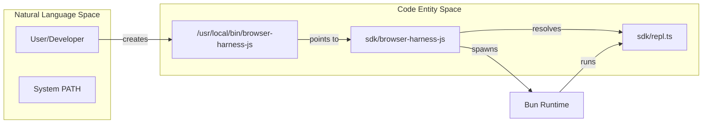

### Sources:
- [SKILL.md:10-25]()
- [sdk/browser-harness-js:26-33]()

---

## Command Reference

| Command | Functionality |
| :--- | :--- |
| `browser-harness-js '<js>'` | Evaluates a single-line expression. Auto-returns the value [SKILL.md:71, 56](). |
| `browser-harness-js <<EOF` | Evaluates multi-line snippets from `stdin`. Requires explicit `return` [SKILL.md:72, 56](). |
| `--status` | Returns JSON containing uptime and session connectivity status [sdk/browser-harness-js:69-76](). |
| `--start` | Manually triggers `start_repl` without evaluating code [sdk/browser-harness-js:77-80](). |
| `--stop` | Sends a POST request to `/quit`, terminating the background server [sdk/browser-harness-js:81-88](). |
| `--restart` | Combines `--stop` and `--start` to clear session state [sdk/browser-harness-js:89-94](). |
| `--logs` | Tails the log file defined by `CDP_REPL_LOG` [sdk/browser-harness-js:95-97](). |

### Sources:
- [SKILL.md:56-77]()
- [sdk/browser-harness-js:68-110]()

---

# Page: Code Generation Pipeline

# Code Generation Pipeline

<details>
<summary>Relevant source files</summary>

The following files were used as context for generating this wiki page:

- [sdk/browser_protocol.json](sdk/browser_protocol.json)
- [sdk/bun.lock](sdk/bun.lock)
- [sdk/gen.ts](sdk/gen.ts)
- [sdk/generated.ts](sdk/generated.ts)
- [sdk/js_protocol.json](sdk/js_protocol.json)
- [sdk/tsconfig.json](sdk/tsconfig.json)

</details>


The `browser-harness-js` SDK follows a "the protocol is the API" philosophy. To maintain strict type safety and keep pace with Chrome DevTools Protocol (CDP) updates without manual maintenance, the project uses an automated code generation pipeline. This pipeline transforms the raw CDP JSON specifications into a fully-typed TypeScript interface used by the `Session` class.

## Overview and Data Flow

The pipeline is centered around `sdk/gen.ts`, a Bun-based script that parses the official Chrome protocol definitions and emits `sdk/generated.ts`.

### Data Flow Diagram: Protocol to TypeScript
This diagram shows how raw CDP definitions are transformed into the code entities used by the SDK.

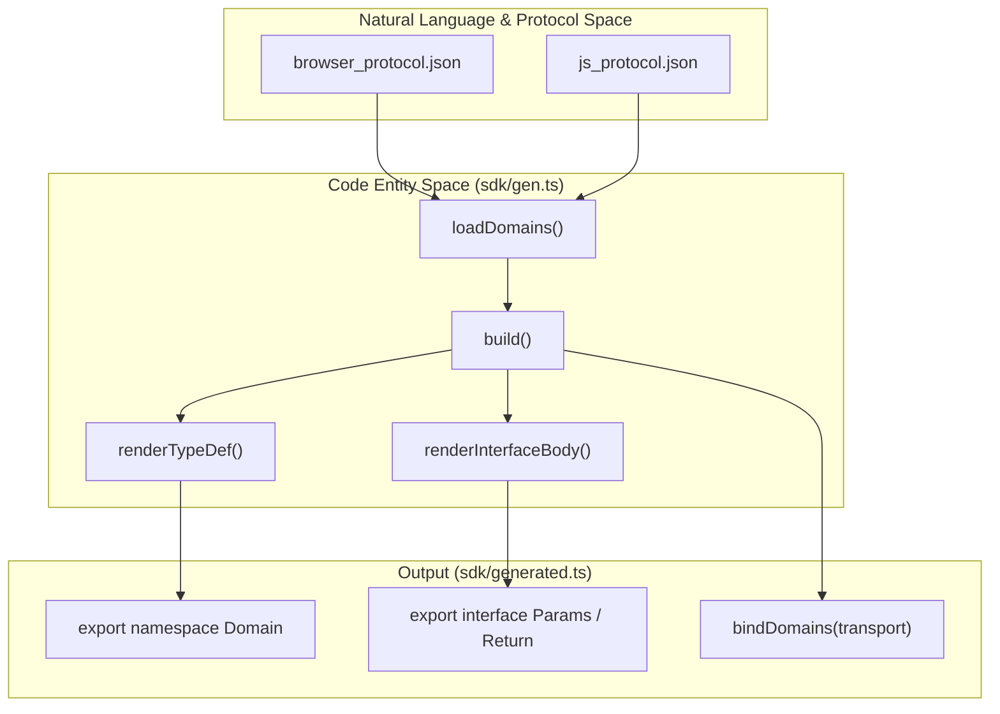

**Sources:** [sdk/gen.ts:1-9](), [sdk/gen.ts:61-69](), [sdk/gen.ts:166-173]()

---

## The Source Protocols

The generator consumes two primary JSON files which are local copies of the Chrome DevTools Protocol:
1.  **`browser_protocol.json`**: Contains browser-level domains like `Page`, `Network`, `Input`, and `Target`. [sdk/browser_protocol.json:1-177]()
2.  **`js_protocol.json`**: Contains V8-level domains like `Runtime`, `Debugger`, and `Profiler`. [sdk/js_protocol.json:1-182]()

The `loadDomains` function in `sdk/gen.ts` merges these files and sorts the domains alphabetically to ensure deterministic output. [sdk/gen.ts:61-69]()

---

## Generation Logic (`sdk/gen.ts`)

The generator processes the protocol through several specialized rendering functions to produce TypeScript-compatible code.

### Type Mapping
The `renderType` function maps CDP primitive types to TypeScript types:
| CDP Type | TypeScript Type |
| :--- | :--- |
| `string` (with enum) | String Union (e.g., `"log" | "warning"`) |
| `integer` / `number` | `number` |
| `boolean` | `boolean` |
| `binary` | `string` (base64) |
| `any` | `unknown` |
| `array` | `T[]` |
| `object` | Interface or `Record<string, unknown>` |

**Sources:** [sdk/gen.ts:88-118]()

### Namespace and Interface Emission
The pipeline emits code in three distinct phases:

1.  **Domain Namespaces**: For every domain (e.g., `Accessibility`), a TypeScript namespace is created containing its internal types. [sdk/gen.ts:179-191]()
2.  **Command Interfaces**: For every command (e.g., `Page.navigate`), the generator creates `Params` and `Return` interfaces (e.g., `Page.NavigateParams`). [sdk/gen.ts:196-216]()
3.  **The bindDomains Factory**: This is the core functional output. It creates a nested object structure where every method calls the `Transport._call` method. [sdk/gen.ts:223-255]()

### Handling Reserved Words
Since CDP property names can conflict with TypeScript keywords (e.g., `delete`, `default`), the `escId` function wraps reserved words in quotes and checks for valid identifiers using a regex: `[sdk/gen.ts:71-76]()`.

---

## The `bindDomains` Factory

The generated file `sdk/generated.ts` exports a factory function called `bindDomains`. This function takes a `Transport` object (implemented by the `Session` class) and returns a proxy-like object containing all CDP domains.

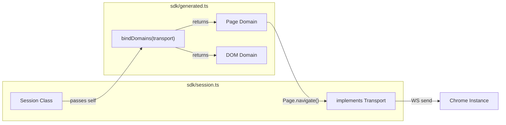

**Sources:** [sdk/generated.ts:5-7](), [sdk/gen.ts:223-255]()

### Implementation Detail
Inside `bindDomains`, every domain method is generated as an async function that forwards the method string and parameters to `transport._call`.

```typescript
// Example of generated structure in sdk/generated.ts
export function bindDomains(transport: Transport) {
  return {
    Page: {
      navigate: (params: Page.NavigateParams) => 
        transport._call("Page.navigate", params) as Promise<Page.NavigateReturn>,
      // ... other methods
    },
    // ... other domains
  };
}
```
**Sources:** [sdk/gen.ts:241-252]()

---

## Regeneration Workflow

When Chrome is updated and new CDP features are released, the SDK must be regenerated to reflect the new types and commands.

### Steps to Regenerate
1.  **Update JSONs**: Download the latest `browser_protocol.json` and `js_protocol.json` from the [Chrome DevTools Protocol repository](https://github.com/ChromeDevTools/devtools-protocol) and place them in the `sdk/` directory.
2.  **Run Generator**: Execute the generator script using Bun:
    ```bash
    cd sdk
    bun gen.ts
    ```
3.  **Verify**: The script overwrites `sdk/generated.ts`. The TypeScript compiler will immediately flag any breaking changes in the rest of the SDK or user scripts.

**Sources:** [sdk/gen.ts:1-5](), [sdk/gen.ts:173]()

### Constraints and Omissions
-   **Events**: The current pipeline intentionally skips event definitions in the `bindDomains` object, as events are handled via the `Session.onEvent` and `Session.waitFor` primitives in `sdk/session.ts`. [sdk/gen.ts:7-9]()
-   **Redirects**: Commands marked as `redirect` in the JSON are skipped to avoid duplicate canonical definitions. [sdk/gen.ts:198]()
-   **Experimental/Deprecated**: Both experimental and deprecated fields are included to ensure maximum compatibility with different Chrome versions. [sdk/gen.ts:7-9]()

---

# Page: Connecting to Chrome

# Connecting to Chrome

<details>
<summary>Relevant source files</summary>

The following files were used as context for generating this wiki page:

- [interaction-skills/connection.md](interaction-skills/connection.md)
- [sdk/session.ts](sdk/session.ts)

</details>


Connecting to Chrome is the first step in the `browser-harness-js` lifecycle. This process involves resolving a WebSocket (WS) URL for the browser-level DevTools endpoint and subsequently attaching to a specific page target.

## Connection Strategies

The SDK provides three primary ways to establish a connection via the `session.connect()` method [sdk/session.ts:46-60](). The choice of strategy depends on how Chrome was launched and the version of Chrome being used.

| Strategy | `ConnectOptions` Key | Use Case |
| :--- | :--- | :--- |
| **Profile Directory** | `profileDir` | **Recommended.** Works with Chrome 144+ and `chrome://inspect` flows. Reads `DevToolsActivePort` directly. |
| **HTTP Probe** | `port` | Legacy. Probes `http://host:port/json/version`. Fails on Chrome 144+ without explicit flags. |
| **Direct WS URL** | `wsUrl` | Escape hatch. Use if you already have the full `ws://...` browser endpoint URL. |

### The Chrome 144+ Compatibility Shift
Starting with Chrome 144, the traditional HTTP endpoint `/json/version` is often not served when attaching via `chrome://inspect`. The `profileDir` strategy bypasses this by reading the `DevToolsActivePort` file directly from the filesystem [sdk/session.ts:159-170]().

For a detailed breakdown of these strategies and why the HTTP probe fails, see [Connection Strategies and Chrome 144+ Compatibility](#3.1).

Sources: [sdk/session.ts:16-24](), [sdk/session.ts:159-170](), [interaction-skills/connection.md:7-12]()

---

## Startup Lifecycle and Target Management

Connecting to the browser is only the beginning. Once the `Session` [sdk/session.ts:26]() is connected to the browser-level WebSocket, you must discover and "use" a specific target (tab or page) to begin interaction.

### Typical Startup Sequence
1.  **Resolve & Connect**: Call `session.connect({profileDir})` [sdk/session.ts:46]().
2.  **Discover Targets**: Use `listPageTargets()` to find available tabs, filtering out internal Chrome pages [interaction-skills/connection.md:21-34]().
3.  **Attach Session**: Call `session.use(targetId)` to route subsequent commands (like `Page` or `DOM`) to that tab [sdk/session.ts:74-78]().
4.  **Visual Focus**: Use `Target.activateTarget` to bring the tab to the front within Chrome [interaction-skills/connection.md:52]().
5.  **Initialize Domains**: Enable required CDP domains (e.g., `session.Page.enable()`) [interaction-skills/connection.md:53]().

### Connection Logic Flow

The following diagram illustrates how the `Session` class interacts with the filesystem and Chrome to establish a functional connection.

**Connection and Target Discovery Flow**
```mermaid
graph TD
    subgraph "Natural Language Space"
        User["User / Script"]
        Chrome["Chrome Browser"]
        FS["File System"]
    end

    subgraph "Code Entity Space"
        S["class Session"]
        RWU["function resolveWsUrl"]
        RDAP["function readDevToolsActivePort"]
        LPT["function listPageTargets"]
    end

    User -->| "session.connect({profileDir})" | S
    S --> RWU
    RWU -->| "Read DevToolsActivePort" | RDAP
    RDAP -.->| "fs.readFile" | FS
    FS -.->| "Port + UUID Path" | RDAP
    RDAP --> RWU
    RWU -->| "ws://127.0.0.1:PORT/PATH" | S
    S -->| "new WebSocket()" | Chrome
    
    User -->| "listPageTargets()" | LPT
    LPT -->| "Target.getTargets" | S
    S -->| "CDP Request" | Chrome
    Chrome -->| "TargetInfo[]" | S
    S -->| "Filter Type: page" | LPT
    LPT --> User
```
Sources: [sdk/session.ts:46-60](), [sdk/session.ts:171-185](), [sdk/session.ts:193-200](), [interaction-skills/connection.md:47-53]()

---

## Target Discovery and Routing

Chrome may report several targets that are not useful for automation, such as the `chrome://omnibox-popup.top-chrome/` or DevTools windows. The SDK provides helpers to filter these and ensure commands are routed to the correct execution context.

### Session Routing with `session.use()`
The `session.use(targetId)` method is a critical primitive. It calls `Target.attachToTarget` with `flatten: true` [sdk/session.ts:74-78](). This allows the `Session` class to automatically append the correct `sessionId` to every subsequent CDP message, effectively "routing" your commands to that specific tab without needing to manage multiple WebSockets.

### Window Focus and Platform UI
While `Target.activateTarget` focuses a tab within the Chrome window, it may not bring the Chrome application itself to the foreground of the OS. The SDK documentation recommends using platform-specific CLI tools (like `osascript` on macOS or `wmctrl` on Linux) to manage window-level focus [interaction-skills/connection.md:69-81]().

For details on filtering targets, handling the "Omnibox Popup" problem, and platform-specific focus commands, see [Target Discovery and Session Routing](#3.2).

Sources: [sdk/session.ts:74-78](), [sdk/session.ts:121-123](), [interaction-skills/connection.md:21-45](), [interaction-skills/connection.md:69-81]()

---

# Page: Connection Strategies and Chrome 144+ Compatibility

# Connection Strategies and Chrome 144+ Compatibility

<details>
<summary>Relevant source files</summary>

The following files were used as context for generating this wiki page:

- [SKILL.md](SKILL.md)
- [interaction-skills/connection.md](interaction-skills/connection.md)
- [sdk/session.ts](sdk/session.ts)

</details>


This page details the mechanisms `browser-harness-js` uses to establish a persistent connection with a Chrome instance. It covers the resolution logic for WebSocket URLs, the impact of architectural changes in Chrome 144+, and the polling strategies used to handle browser startup delays.

## Connection Strategy Overview

The `Session` class provides a unified `connect()` method that supports three distinct strategies for locating the Chrome DevTools Protocol (CDP) endpoint. Choosing the correct strategy is critical to avoid timeouts and handle modern Chrome security restrictions.

| Strategy | Input | Implementation | Use Case |
| :--- | :--- | :--- | :--- |
| **Direct WS** | `wsUrl` | Connects directly to the provided WebSocket string. | When the URL is already known from a launch script. |
| **Profile Probe** | `profileDir` | Reads the `DevToolsActivePort` file from the Chrome User Data directory. | **Recommended.** Works with `chrome://inspect` and Chrome 144+. |
| **HTTP Probe** | `port` | Queries `http://127.0.0.1:<port>/json/version`. | Legacy/Explicit launches (e.g., `--remote-debugging-port=9222`). |

Sources: [sdk/session.ts:16-24](), [sdk/session.ts:160-170](), [interaction-skills/connection.md:3-11]()

## The resolveWsUrl Resolution Logic

The `resolveWsUrl` function follows a strict order of preference to determine the WebSocket target. It is designed to be resilient to the "Allow" dialog prompt often seen when attaching to an existing Chrome instance.

### Logical Flow of resolveWsUrl

The diagram below illustrates how `resolveWsUrl` processes the `ConnectOptions` and handles the filesystem or network probes.

**Title: resolveWsUrl Logic Flow**
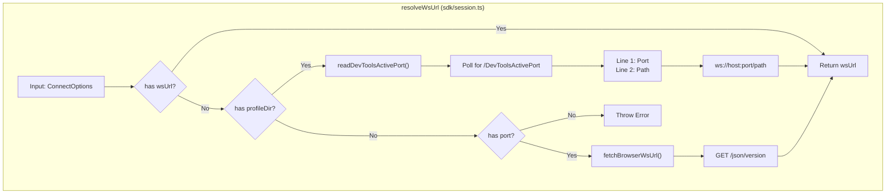
Sources: [sdk/session.ts:171-185](), [sdk/session.ts:193-205](), [sdk/session.ts:213-225]()

## Chrome 144+ Compatibility and the /json/version Failure

Starting with Chrome 144 (specifically when attached via the `chrome://inspect` flow), the browser no longer serves the `/json/version` endpoint over HTTP. 

### Why the HTTP Probe Fails
The legacy `port` strategy relies on `fetchBrowserWsUrl`, which performs an HTTP GET request to retrieve the `webSocketDebuggerUrl` from a JSON response [sdk/session.ts:213-225](). In Chrome 144+, this request returns a 404 or fails to connect, leading to a 30-second timeout in the SDK [SKILL.md:137-138]().

### The Profile Directory Solution
The `profileDir` strategy bypasses the HTTP server entirely. It reads the `DevToolsActivePort` file directly from the disk. Chrome writes this file immediately upon starting the remote debugging server [sdk/session.ts:193-198]().
- **Line 1**: Contains the ephemeral port number.
- **Line 2**: Contains the unique WebSocket path (e.g., `/devtools/browser/<uuid>`).

By combining these, the SDK constructs the full `ws://` URL without needing an intermediate HTTP handshake [sdk/session.ts:175-177]().

Sources: [sdk/session.ts:162-169](), [SKILL.md:134-138](), [interaction-skills/connection.md:19-19]()

## Connection Lifecycle and Polling

The connection process includes built-in retries to account for the time it takes for Chrome to write to disk or for the user to interact with the OS.

### Polling for DevToolsActivePort
The `readDevToolsActivePort` function polls the filesystem for up to 30 seconds [sdk/session.ts:194-197](). This is necessary because the file might not exist yet if the browser is still initializing.

### The "Allow" Dialog
When a debugger first attempts to attach to a running Chrome instance, Chrome may display a modal dialog asking the user to "Allow" the connection.
- The `session.connect()` call will appear to hang during this period [interaction-skills/connection.md:65-67]().
- The underlying `WebSocket` connection attempt in `Session.connect` will wait until the user clicks "Allow", at which point the `open` event fires and the promise resolves [sdk/session.ts:48-51]().

**Title: Connection Handshake Sequence**
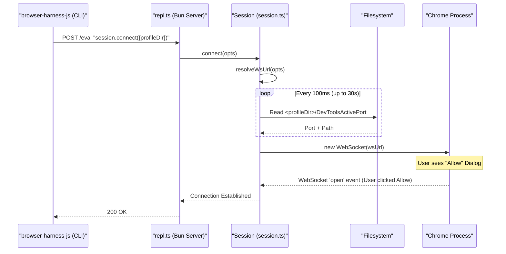
Sources: [sdk/session.ts:46-60](), [sdk/session.ts:193-205](), [interaction-skills/connection.md:49-54](), [interaction-skills/connection.md:65-67]()

## Implementation Details

### Key Functions and Classes

| Entity | Location | Role |
| :--- | :--- | :--- |
| `Session` | [sdk/session.ts:26]() | Manages the WebSocket lifecycle and message routing. |
| `resolveWsUrl` | [sdk/session.ts:171]() | Logic for determining the WS endpoint based on provided options. |
| `readDevToolsActivePort` | [sdk/session.ts:193]() | Filesystem utility to extract port/path from Chrome's active profile. |
| `fetchBrowserWsUrl` | [sdk/session.ts:213]() | HTTP utility for legacy `/json/version` discovery. |

### Data Structures
The `ConnectOptions` type defines the interface for these strategies:
```typescript
export type ConnectOptions = {
  wsUrl?: string;     // Explicit URL
  profileDir?: string; // Path to User Data
  port?: number;      // HTTP Port
  host?: string;      // Optional host (default 127.0.0.1)
};
```
Sources: [sdk/session.ts:16-24](), [sdk/session.ts:171-185]()

---

# Page: Target Discovery and Session Routing

# Target Discovery and Session Routing

<details>
<summary>Relevant source files</summary>

The following files were used as context for generating this wiki page:

- [interaction-skills/connection.md](interaction-skills/connection.md)
- [interaction-skills/tabs.md](interaction-skills/tabs.md)
- [sdk/session.ts](sdk/session.ts)

</details>


This page covers the mechanisms for identifying, filtering, and routing CDP commands to specific browser targets (tabs, windows, or iframes) within `browser-harness-js`. It details the distinction between CDP-side session routing and Chrome-side visual focus.

## Overview of Target Discovery

When connecting to a browser instance, the `Session` initially connects to the browser-level endpoint. To interact with a specific page, you must discover its `targetId` and attach to it.

### The listPageTargets() Filter
The `listPageTargets()` utility is the primary way to find interactable tabs. It performs essential filtering to avoid the **Omnibox Popup Problem**—a common trap where CDP identifies internal Chrome components (like the 1px invisible omnibox popup) as valid page targets [interaction-skills/connection.md:21-25]().

If calling the raw `Target.getTargets` method, you must manually filter for `type: "page"` and exclude internal schemes [interaction-skills/connection.md:27-34]().

| Target Type | Scheme | Action |
| :--- | :--- | :--- |
| `page` | `https://`, `http://`, `file://` | **Keep** (Real user tabs) |
| `page` | `chrome://`, `devtools://` | **Discard** (Internal settings/UI) |
| `background_page` | Any | **Discard** (Extensions) |
| `iframe` | Any | **Use session.use()** (See Cross-Origin Iframes) |

### Creating New Targets
If no valid page targets exist, or a fresh environment is required, use `Target.createTarget`. Note that passing a URL directly to `createTarget` can lead to race conditions where the target reports `document.readyState === 'complete'` for `about:blank` before the navigation actually begins [interaction-skills/tabs.md:30-39]().

**Recommended Pattern:**
1. Create a target with `about:blank`.
2. `session.use(targetId)` to route commands.
3. Call `session.Page.navigate({ url })`.
4. Use `session.waitFor('Page.loadEventFired')` to confirm arrival.

Sources: [interaction-skills/connection.md:21-45](), [interaction-skills/tabs.md:7-13](), [interaction-skills/tabs.md:30-39]()

---

## Session Routing vs. Chrome Focus

A critical distinction in `browser-harness-js` is the difference between where the **SDK** is sending commands and which tab the **User** sees as active.

### CDP-Side Routing: `session.use(targetId)`
The `session.use()` method performs a `Target.attachToTarget` call with `flatten: true` [sdk/session.ts:74-78](). This updates the `activeSessionId` within the `Session` instance. Subsequent calls to domain methods (e.g., `session.Page.navigate`) automatically include this `sessionId` in the JSON-RPC payload [sdk/session.ts:120-123]().

### Chrome-Side Focus: `Target.activateTarget`
`Target.activateTarget` tells the Chrome browser to bring a specific tab to the foreground and give it visual focus [interaction-skills/tabs.md:18-19](). Routing commands to a tab via `session.use()` does **not** automatically make it the active visible tab in the browser UI.

### Data Flow: Routing a Command
The following diagram illustrates how a call to `session.Input.dispatchMouseEvent` is routed based on the `activeSessionId`.

**Title: Command Routing Logic**
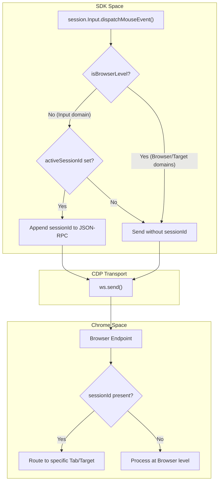
Sources: [sdk/session.ts:74-78](), [sdk/session.ts:115-128](), [sdk/session.ts:154-157](), [interaction-skills/tabs.md:28-28]()

---

## Tab Order and Platform UI Automation

The order of targets returned by `Target.getTargets` is non-deterministic and does **not** correspond to the visual "left-to-right" order of tabs in the Chrome window [interaction-skills/connection.md:55-57]().

To resolve the visible order or bring the Chrome application itself to the front (OS-level focus), use platform-specific automation.

### Visual Ordering Heuristics
If platform automation is unavailable, use these CDP-native strategies:
1. **Screenshots:** Use `session.Page.captureScreenshot()` to visually verify the tab content [interaction-skills/connection.md:59-59]().
2. **URL/Title:** Match against `Target.getTargets` metadata [interaction-skills/connection.md:60-60]().

### OS-Level Focus
`Target.activateTarget` focuses a tab *within* Chrome, but it may not bring the Chrome window to the front of the OS.

| Platform | Tool | Command / Script |
| :--- | :--- | :--- |
| **macOS** | AppleScript | `tell application "Google Chrome" to activate` [interaction-skills/connection.md:73-73]() |
| **Linux** | `wmctrl` | `wmctrl -a 'Google Chrome'` [interaction-skills/connection.md:76-76]() |
| **Windows** | PowerShell | `(New-Object -ComObject WScript.Shell).AppActivate('Google Chrome')` [interaction-skills/connection.md:80-80]() |

### Mapping Code Entities to Discovery Logic
This diagram bridges the natural language requirements (finding a tab) to the specific code entities involved.

**Title: Target Discovery Entity Map**
```mermaid
graph LR
    subgraph "Discovery Logic"
        direction TB
        LPT["listPageTargets()"]
        GTS["Target.getTargets"]
        F1["Filter: type === 'page'"]
        F2["Filter: !url.startsWith('chrome://')"]
    end

    subgraph "Code Entities"
        direction TB
        S["class Session"]
        T["Target domain (generated.ts)"]
        U["session.use(targetId)"]
        A["Target.activateTarget"]
    end

    LPT --> GTS
    LPT --> F1
    LPT --> F2
    F1 -.-> T
    U --> S
    A --> T
```
Sources: [sdk/session.ts:74-78](), [interaction-skills/connection.md:27-34](), [interaction-skills/tabs.md:8-19]()

---

## Common Traps

1. **Invisible Viewports:** Attaching to `chrome://omnibox-popup.top-chrome/` results in a 1px viewport where actions are invisible to the user [interaction-skills/connection.md:23-23]().
2. **Zero-Size Targets:** If `window.innerWidth` or `innerHeight` report `0`, you are likely attached to a background target or an unrendered tab [interaction-skills/tabs.md:74-76]().
3. **Session Desync:** Calling `Target.activateTarget` changes what the user sees, but if you forget to call `session.use(targetId)`, your commands will still execute against the previous tab [interaction-skills/tabs.md:28-28]().

Sources: [interaction-skills/connection.md:21-34](), [interaction-skills/tabs.md:28-28](), [interaction-skills/tabs.md:74-76]()

---

# Page: Interaction Skills

# Interaction Skills

<details>
<summary>Relevant source files</summary>

The following files were used as context for generating this wiki page:

- [README.md](README.md)
- [interaction-skills/connection.md](interaction-skills/connection.md)

</details>


The `interaction-skills/` directory is a documentation library containing "recipes" for complex browser automation tasks. Unlike traditional frameworks that provide high-level abstractions (e.g., `page.click()`), `browser-harness-js` adheres to a "no-helpers" philosophy [README.md:53-53](). These skills provide the specific sequences of Chrome DevTools Protocol (CDP) calls required to achieve complex outcomes while maintaining full access to the underlying protocol parameters [README.md:57-61]().

## Philosophy: Recipes over Wrappers

The core of the interaction library is the **Bitter Lesson**: every helper is a simplification that eventually limits the agent [README.md:57-58](). Instead of library functions, this documentation provides the CDP patterns for:
*   **Direct Protocol Usage**: Using `session.<Domain>.<method>` directly with typed parameters [README.md:51-51]().
*   **Mechanical Clarity**: Revealing the 14+ parameters of `Input.dispatchMouseEvent` rather than hiding them behind a `click()` helper [README.md:57-57]().
*   **Target Routing**: Using the only two necessary primitives: `session.use(targetId)` to route commands and `session.waitFor(method, pred, timeout)` to handle asynchronous state [README.md:66-67]().

### Mapping Natural Language to Code Entities

The following diagram illustrates how high-level user intent is translated into specific CDP domains and session methods within the `browser-harness-js` architecture.

**Intent to Entity Mapping**
```mermaid
graph TD
    subgraph "Natural Language Space"
        Intent["'Click the button in the iframe'"]
    end

    subgraph "Code Entity Space (sdk/session.ts)"
        Session["Session Class"]
        Use["session.use(targetId)"]
        Dispatch["session.Input.dispatchMouseEvent"]
        Query["session.DOM.getFlattenedDocument"]
    end

    subgraph "CDP Domain Space (sdk/generated.ts)"
        InputDomain["Namespace: Input"]
        DOMDomain["Namespace: DOM"]
        TargetDomain["Namespace: Target"]
    end

    Intent -->|"1. Identify Target"| Query
    Query --> DOMDomain
    Intent -->|"2. Switch Context"| Use
    Use --> TargetDomain
    Intent -->|"3. Execute Action"| Dispatch
    Dispatch --> InputDomain
    Session --> Use
    Session --> Dispatch
```

**Sources:** [README.md:14-16](), [sdk/session.ts:1-10](), [sdk/generated.ts:1-20]()

## Skill Categories

The interaction library is divided into specialized pages covering distinct aspects of browser control.

### 4.1 Input and Navigation
Focuses on the mechanics of moving the browser and sending data. This includes coordinate-based mouse events via `Input.dispatchMouseEvent`, keyboard interactions, and scrolling strategies. It also covers viewport emulation and the lifecycle of browser tabs (targets).
For details, see [Input and Navigation](#4.1).

### 4.2 DOM Interaction Patterns
Addresses complex UI components that standard automation often fails to handle. This includes interacting with Shadow DOM, navigating same-origin iframes, and handling non-standard inputs like searchable comboboxes or virtualized lists.
For details, see [DOM Interaction Patterns](#4.2).

### 4.3 Cross-Origin Iframes (OOPIFs)
Explains the architectural shift required for Out-of-Process Iframes. It details how to use `session.use()` to attach to specific iframe targets and the common traps associated with security restrictions and lazy mounting.
For details, see [Cross-Origin Iframes (OOPIFs)](#4.3).

### 4.4 File Uploads and Downloads
Covers the specific CDP methods for file handling, such as `DOM.setFileInputFiles` for inputs and `Browser.setDownloadBehavior` for managing file persistence and transfer events.
For details, see [File Uploads and Downloads](#4.4).

### 4.5 Network, Cookies, and Dialogs
Details how to observe and intercept network traffic, manage browser storage/cookies, and handle synchronous JavaScript dialogs (alerts/confirms) using the `Page.handleJavaScriptDialog` reactive approach.
For details, see [Network, Cookies, and Dialogs](#4.5).

### 4.6 Screenshots and PDF Generation
Covers visual extraction, including viewport and full-page screenshots via `Page.captureScreenshot` and professional PDF rendering using `Page.printToPDF`.
For details, see [Screenshots and PDF Generation](#4.6).

## The Connection Sequence

Before any interaction skill can be applied, a session must be established and routed to a valid target. The following diagram shows the standard startup sequence required to begin interacting with a page.

**Session Initialization Flow**
```mermaid
sequenceDiagram
    participant User
    participant Session as "session (sdk/session.ts)"
    participant Chrome as "Chrome (CDP)"

    User->>Session: session.connect({profileDir})
    Note over Session: Reads DevToolsActivePort
    Session->>Chrome: WebSocket Connection
    Session->>Session: listPageTargets()
    Note over Session: Filters chrome:// and devtools://
    Session->>Session: session.use(targetId)
    Session->>Chrome: Target.activateTarget({targetId})
    Session->>Chrome: Page.enable()
    Session->>Chrome: Network.enable({})
    Note over User, Chrome: Ready for Interaction Skills
```

**Sources:** [interaction-skills/connection.md:47-54](), [interaction-skills/connection.md:13-19](), [interaction-skills/connection.md:28-34]()

## Summary Table: Core Interaction Primitives

| Category | Primary CDP Method | File Reference |
| :--- | :--- | :--- |
| **Mouse** | `Input.dispatchMouseEvent` | [README.md:14-14]() |
| **Keyboard** | `Input.insertText` / `dispatchKeyEvent` | [sdk/generated.ts:1-10]() |
| **Navigation** | `Page.navigate` | [README.md:59-59]() |
| **Targeting** | `session.use(targetId)` | [README.md:66-66]() |
| **Waiting** | `session.waitFor(method, pred)` | [README.md:66-66]() |
| **Files** | `DOM.setFileInputFiles` | [README.md:15-15]() |

**Sources:** [README.md:14-16](), [README.md:59-59](), [README.md:66-67](), [interaction-skills/connection.md:41-44]()

---

# Page: Input and Navigation

# Input and Navigation

<details>
<summary>Relevant source files</summary>

The following files were used as context for generating this wiki page:

- [interaction-skills/scrolling.md](interaction-skills/scrolling.md)
- [interaction-skills/tabs.md](interaction-skills/tabs.md)
- [interaction-skills/viewport.md](interaction-skills/viewport.md)

</details>


This page covers the technical implementation of browser interaction within `browser-harness-js`. It details coordinate-based mouse events, keyboard input strategies, scrolling mechanics, viewport management via emulation, and tab lifecycle management.

## Overview of Interaction Flow

Interaction in `browser-harness-js` follows the "thin bridge" philosophy. Rather than providing high-level abstractions like `page.click()`, the SDK exposes the raw Chrome DevTools Protocol (CDP) domains (e.g., `Input`, `Emulation`, `Target`) directly on the `Session` instance. This allows for precise control over event dispatching and viewport state.

### Input and Navigation System Map

The following diagram illustrates how natural language intents (e.g., "Click this button") map to specific CDP domain calls within the `Session` class.

**Title: Intent to CDP Mapping**
```mermaid
graph TD
    subgraph "Natural Language Intent"
        I1["'Click at (x,y)'"]
        I2["'Type text'"]
        I3["'Scroll down'"]
        I4["'Switch tab'"]
    end

    subgraph "Code Entity Space (sdk/session.ts)"
        S["Session Instance"]
        S --> D1["Input Domain"]
        S --> D2["Target Domain"]
        S --> D3["Emulation Domain"]
    end

    subgraph "CDP Commands (generated.ts)"
        C1["Input.dispatchMouseEvent"]
        C2["Input.insertText"]
        C3["Input.dispatchKeyEvent"]
        C4["Target.activateTarget"]
        C5["Emulation.setDeviceMetricsOverride"]
    end

    I1 -.-> C1
    I2 -.-> C2
    I2 -.-> C3
    I3 -.-> C1
    I4 -.-> C4
    D1 --> C1
    D1 --> C2
    D1 --> C3
    D2 --> C4
    D3 --> C5
```
Sources: [sdk/session.ts:1-50](), [interaction-skills/scrolling.md:5-17](), [interaction-skills/tabs.md:18-22]()

---

## Mouse and Keyboard Input

### Mouse Events
Coordinate-based interaction is handled via `Input.dispatchMouseEvent`. This method is preferred over DOM-based `.click()` because it triggers actual browser hit-testing, ensuring that overlays or obscured elements prevent interaction as they would for a real user.

*   **Clicking:** Requires a sequence of `mousePressed` and `mouseReleased` events at specific coordinates.
*   **Coordinates:** All coordinates are in **CSS pixels**, relative to the top-left of the viewport [interaction-skills/viewport.md:23-24]().

### Keyboard Input
There are two primary ways to input text:
1.  **`Input.insertText`**: Directly inserts a string into the focused element. This is fast and bypasses most key-event listeners [interaction-skills/viewport.md:1-71]().
2.  **`Input.dispatchKeyEvent`**: Sends individual `keyDown`, `keyUp`, and `char` events. This is necessary for simulating physical typing, triggering autocomplete menus, or handling shortcut keys (e.g., `Enter`, `Escape`).

Sources: [interaction-skills/scrolling.md:5-21](), [interaction-skills/viewport.md:23-36]()

---

## Scrolling Strategies

Scrolling is implemented at three levels of abstraction, depending on the target element's behavior.

| Strategy | Implementation | Use Case |
| :--- | :--- | :--- |
| **Wheel Event** | `Input.dispatchMouseEvent` with `type: 'mouseWheel'` | Closest to real user; works for virtualized lists [interaction-skills/scrolling.md:9-24](). |
| **DOM Scroll** | `Runtime.evaluate` calling `scrollIntoView()` | Precise alignment for standard DOM elements [interaction-skills/scrolling.md:26-35](). |
| **Direct Offset** | `Runtime.evaluate` setting `scrollTop` | Blunt force for containers that swallow wheel events [interaction-skills/scrolling.md:37-49](). |

### Scrolling Implementation Flow

**Title: Scroll Execution Logic**
```mermaid
flowchart TD
    Start["Request Scroll"] --> Type{"Is it a Virtual List?"}
    Type -- "Yes" --> Wheel["Input.dispatchMouseEvent (type: 'mouseWheel')"]
    Type -- "No" --> InView{"Element in DOM?"}
    InView -- "Yes" --> SIV["Runtime.evaluate (scrollIntoView)"]
    InView -- "No" --> Container["Set scrollTop on Parent"]
    
    Wheel --> Wait["Wait for Scroll Animation (approx 400ms)"]
    SIV --> Wait
    Container --> End["Interaction Ready"]
    Wait --> End
```
Sources: [interaction-skills/scrolling.md:1-76]()

---

## Viewport and Emulation

Viewport management is critical because coordinate clicks are invalidated if the viewport dimensions change or if the `devicePixelRatio` (DPR) is misunderstood.

### Device Metrics Override
The `Emulation.setDeviceMetricsOverride` command allows pinning the browser to a specific resolution and DPR. This ensures stability for coordinate-based scripts [interaction-skills/viewport.md:28-36]().

*   **Mobile Emulation:** By setting `mobile: true` and enabling `setTouchEmulationEnabled`, the browser triggers responsive breakpoints and touch-start/end events [interaction-skills/viewport.md:44-58]().
*   **DPR Awareness:** Screenshots are captured in physical device pixels, while clicks use CSS pixels. If `deviceScaleFactor` is 2, a coordinate at (400, 300) in a screenshot corresponds to (200, 150) for a click [interaction-skills/viewport.md:67-67]().

Sources: [interaction-skills/viewport.md:1-71]()

---

## Tab and Target Management

`browser-harness-js` distinguishes between **CDP Routing** and **Visual Focus**.

### Core Functions
*   **`session.use(targetId)`**: Directs all subsequent CDP commands (Input, Page, etc.) to a specific target via the `sessionId` mapping [interaction-skills/tabs.md:11-16]().
*   **`Target.activateTarget({ targetId })`**: Visibly brings the tab to the front in the Chrome window [interaction-skills/tabs.md:18-19]().
*   **`Target.createTarget({ url })`**: Opens a new tab. It is recommended to create `about:blank` first, then navigate, to avoid race conditions with `DOMContentLoaded` [interaction-skills/tabs.md:30-39]().

### Target Lifecycle

**Title: Target Management Lifecycle**
```mermaid
sequenceDiagram
    participant App as Application Code
    participant Session as Session (sdk/session.ts)
    participant Chrome as Chrome (CDP)

    App->>Session: Target.createTarget({url: 'about:blank'})
    Session->>Chrome: _send('Target.createTarget')
    Chrome-->>Session: { targetId: "123" }
    Session-->>App: { targetId: "123" }
    
    App->>Session: session.use("123")
    Note over Session: Internal routing updated to target "123"
    
    App->>Session: Page.navigate({url: "https://example.com"})
    Session->>Chrome: _send('Page.navigate', sessionId="123")
    
    App->>Session: Target.activateTarget({targetId: "123"})
    Note over Chrome: Tab "123" becomes visible
```
Sources: [interaction-skills/tabs.md:5-29](), [sdk/session.ts:1-50]()

### Target Filtering
When discovering targets via `listPageTargets()`, the SDK automatically filters out non-page targets such as `chrome://` extensions and the 1px "Omnibox Popup" to prevent accidental attachment to UI surfaces that do not support standard interaction [interaction-skills/tabs.md:72-76]().

Sources: [interaction-skills/tabs.md:1-76]()

---

# Page: DOM Interaction Patterns

# DOM Interaction Patterns

<details>
<summary>Relevant source files</summary>

The following files were used as context for generating this wiki page:

- [interaction-skills/drag-and-drop.md](interaction-skills/drag-and-drop.md)
- [interaction-skills/dropdowns.md](interaction-skills/dropdowns.md)
- [interaction-skills/iframes.md](interaction-skills/iframes.md)
- [interaction-skills/shadow-dom.md](interaction-skills/shadow-dom.md)

</details>


This page covers advanced interaction strategies for complex DOM structures, including native and custom dropdowns, frame-traversal, Shadow DOM piercing, and robust drag-and-drop implementations. The core philosophy is to prefer coordinate-based interactions (`Input.dispatchMouseEvent`) for visual elements and JavaScript-based state manipulation (`Runtime.evaluate`) for underlying data consistency.

## Dropdowns and Menus

The strategy for interacting with a dropdown depends entirely on its implementation in the DOM.

### Native Select Elements
Native `<select>` elements should not be interacted with via clicks, as opening them triggers an OS-level menu that the Chrome DevTools Protocol (CDP) cannot control or close. Instead, manipulate the `value` and dispatch a `change` event.

| Step | Action | Method |
| :--- | :--- | :--- |
| 1 | Set Value | `Runtime.evaluate` to set `element.value = 'DE'` |
| 2 | Trigger Logic | Dispatch a bubbling `change` event |
| 3 | Verify | Read back the `value` via `Runtime.evaluate` |

**Implementation Example:**
[interaction-skills/dropdowns.md:9-17]()

### Custom Overlay Menus
Common in modern SPAs (React, Vue), these are often `div`-based menus that appear near the trigger or are portaled to the `<body>`.

1. **Trigger:** Perform a coordinate click on the trigger element.
2. **Re-measure:** Menus often shift the page layout or appear asynchronously. Always re-calculate coordinates for the option *after* the menu is visible.
3. **Selection:** Search the global document (not just the trigger's children) for the option text and perform a coordinate click.

### Searchable Comboboxes
Libraries like Radix, MUI, or Downshift often rely on keyboard events for selection.
- **Input:** Use `Input.insertText` to filter options.
- **Commit:** Dispatch `ArrowDown` followed by `Enter` using `Input.dispatchKeyEvent`. Note that `windowsVirtualKeyCode` (e.g., `40` for Down, `13` for Enter) is often required by framework event listeners.

**Sources:**
- [interaction-skills/dropdowns.md:5-19]() (Native Select)
- [interaction-skills/dropdowns.md:21-50]() (Custom Overlays)
- [interaction-skills/dropdowns.md:52-69]() (Comboboxes)

---

## Iframe Interaction (Same-Origin)

Same-origin iframes allow direct DOM access via `contentDocument`. For cross-origin iframes (OOPIFs), refer to the dedicated page on Target management.

### Coordinate Pass-through
The most efficient way to interact with an iframe is via **page-level coordinates**. The compositor-level input path (`Input.dispatchMouseEvent`) ignores frame boundaries. If an element is visible in a screenshot, it can be clicked using its absolute page coordinates.

### Coordinate Transformation
If you must find an element inside an iframe using JS, you must transform its **iframe-local** coordinates to **page** coordinates:
`Page X = Iframe Offset X + Element Local X`

**Diagram: Iframe Coordinate Mapping**
```mermaid
graph TD
    subgraph "Browser Tab (Page Space)"
        P["Page Root (0,0)"]
        IF["iframe#inner (x: 100, y: 150)"]
        
        subgraph "Iframe Document Space"
            EL["button.target (local_x: 20, local_y: 30)"]
        end
    end

    P -->|"getBoundingClientRect()"| IF
    IF -->|"contentDocument"| EL
    
    style EL stroke-dasharray: 5 5
    
    note["Target Click Coordinate: (100+20, 150+30) = (120, 180)"]
```

**Sources:**
- [interaction-skills/iframes.md:5-21]() (Reading/Writing)
- [interaction-skills/iframes.md:22-32]() (Coordinate pass-through)
- [interaction-skills/iframes.md:33-51]() (Coordinate transformation)

---

## Shadow DOM Piercing

Shadow DOM encapsulates elements, making them invisible to standard `document.querySelector` calls.

### The `pierceShadow` Approach
In CDP, `DOM.querySelector` and `DOM.querySelectorAll` can traverse open shadow roots by using the `>>>` combinator in the selector or by passing a `pierceShadow` flag.

### Recursive JS Walk
For maximum portability across different browser versions, a recursive generator can be used to walk the `shadowRoot` of every node.

**Implementation Logic:**
[interaction-skills/shadow-dom.md:33-42]()

### Closed Roots and Slots
- **Closed Roots:** Elements with `{ mode: 'closed' }` cannot be accessed via JS. Use coordinate-based clicks.
- **Slots:** Content inside `<slot>` tags actually resides in the **Light DOM** (the host's children), not the Shadow DOM.

**Sources:**
- [interaction-skills/shadow-dom.md:9-23]() (CDP Piercing)
- [interaction-skills/shadow-dom.md:24-53]() (Recursive Walk)
- [interaction-skills/shadow-dom.md:57-74]() (Input Handling)

---

## Drag and Drop (DnD)

Browser-harness-js distinguishes between three distinct "drags."

### HTML5 Drag and Drop
Used by Trello, Jira, and libraries like `react-dnd`. These rely on `DragEvent`. Standard mouse move sequences will fail because they do not trigger the browser's internal drag lifecycle.

**The Interception Workflow:**
1. Enable interception: `Input.setInterceptDrags({ enabled: true })`.
2. Start drag: `Input.dispatchMouseEvent` (`mousePressed`).
3. Capture data: Wait for the `Input.dragIntercepted` event to receive the `data` object.
4. Dispatch: Use `Input.dispatchDragEvent` with types `dragEnter`, `dragOver`, and `drop`.

### Pointer-based Drag
Used by Canvas-based tools (Figma, Google Maps). These listen for `mousemove` and calculate deltas.
- **Requirement:** Intermediate `mouseMoved` events are critical. Many sites calculate velocity or require a minimum movement delta before triggering a drag state.

**Diagram: Drag and Drop Implementation Flow**
```mermaid
sequenceDiagram
    participant S as Session (sdk/session.ts)
    participant C as Chrome (CDP)
    participant D as DOM/App Logic

    Note over S, D: HTML5 DnD Sequence
    S->>C: Input.setInterceptDrags(enabled: true)
    S->>C: Input.dispatchMouseEvent(mousePressed)
    C-->>S: Input.dragIntercepted(data)
    S->>C: Input.dispatchDragEvent(dragEnter, data)
    S->>C: Input.dispatchDragEvent(drop, data)
    S->>C: Input.dispatchMouseEvent(mouseReleased)
    
    Note over S, D: Pointer-based Sequence
    loop Velocity Simulation
        S->>C: Input.dispatchMouseEvent(mouseMoved)
    end
```

### File Drop Zones
Most "Drop files here" zones are backed by a hidden `<input type="file">`. Instead of simulating a complex drag-and-drop of a file object, identify the input and use `DOM.setFileInputFiles`.

**Sources:**
- [interaction-skills/drag-and-drop.md:5-28]() (HTML5 DnD)
- [interaction-skills/drag-and-drop.md:30-46]() (Pointer-based)
- [interaction-skills/drag-and-drop.md:47-50]() (File Zones)
- [interaction-skills/drag-and-drop.md:51-57]() (Common Traps)

---

# Page: Cross-Origin Iframes (OOPIFs)

# Cross-Origin Iframes (OOPIFs)

<details>
<summary>Relevant source files</summary>

The following files were used as context for generating this wiki page:

- [interaction-skills/cross-origin-iframes.md](interaction-skills/cross-origin-iframes.md)
- [interaction-skills/iframes.md](interaction-skills/iframes.md)

</details>


Cross-origin iframes (such as Stripe checkouts, reCAPTCHA, or Salesforce Lightning components) run in **Out-of-Process Iframes (OOPIFs)**. Unlike same-origin iframes, these run in separate OS processes for security and cannot be accessed via `contentDocument` from the parent page's JavaScript context [interaction-skills/cross-origin-iframes.md:1-3]().

## Coordinate-Based Interaction

The simplest way to interact with an OOPIF is via compositor-level input. Since `Input.dispatchMouseEvent` operates on the browser's render tree, it passes through iframe boundaries transparently. If an element is visible in a screenshot, it can be clicked using page-level coordinates without needing to attach to the iframe target [interaction-skills/cross-origin-iframes.md:5-13]().

### Coordinate Pass-Through Logic
| Method | Boundary Behavior | Use Case |
| :--- | :--- | :--- |
| `Input.dispatchMouseEvent` | **Transparent**. Crosses all frame boundaries. | Clicking buttons, focusing inputs. |
| `Input.insertText` | **Focus-dependent**. Hits whichever element has focus. | Typing after a coordinate click. |
| `Runtime.evaluate` | **Isolated**. Cannot see into OOPIFs. | Reading/Writing DOM in the same process. |

**Sources:** [interaction-skills/cross-origin-iframes.md:5-15](), [interaction-skills/iframes.md:22-31]()

## Attaching to OOPIF Targets

When DOM-level access is required (e.g., reading text content or inspecting attributes inside the iframe), you must route CDP commands to the specific target associated with that iframe [interaction-skills/cross-origin-iframes.md:17-19]().

### The `session.use(targetId)` Workflow

The `Session` class provides a `use()` method that handles the complexity of target switching. If the session is not yet attached to the target, `use()` will perform the `Target.attachToTarget` handshake automatically [interaction-skills/cross-origin-iframes.md:38-38]().

```mermaid
sequenceDiagram
    participant User as User Script
    participant Session as Session Object
    participant CDP as Chrome (CDP)

    User->>Session: Target.getTargets()
    Session->>CDP: Target.getTargets
    CDP-->>Session: List of targetInfos (type: "iframe")
    User->>Session: use(iframeTargetId)
    Note over Session: Internal: Update this.sessionId
    User->>Session: Runtime.evaluate(...)
    Session->>CDP: Message with sessionId: iframeTargetId
    CDP-->>Session: Result from Iframe Process
    Session-->>User: Evaluation Result
    User->>Session: use(parentTargetId)
    Note over Session: Restore routing to main page
```

**Sources:** [interaction-skills/cross-origin-iframes.md:21-38]()

### Implementation Example
To read a value from a Stripe element:
1. Identify the target using `Target.getTargets` [interaction-skills/cross-origin-iframes.md:22-23]().
2. Switch the session context using `session.use(targetId)` [interaction-skills/cross-origin-iframes.md:26-26]().
3. Execute commands (e.g., `Runtime.evaluate`) [interaction-skills/cross-origin-iframes.md:29-32]().
4. **Crucial:** Switch back to the parent `targetId` to avoid routing subsequent navigation commands to the iframe [interaction-skills/cross-origin-iframes.md:34-35]().

## Disambiguating Multiple Iframes

`Target.getTargets` returns a flat list of all targets. If a page contains multiple iframes from the same origin (e.g., individual fields for Card Number, Expiry, and CVC), you must disambiguate them [interaction-skills/cross-origin-iframes.md:40-42]():

1.  **URL Filtering:** Check for specific path fragments in `targetInfo.url` [interaction-skills/cross-origin-iframes.md:44-44]().
2.  **DOM Mapping:** In the parent page, find all `<iframe>` tags and map their `src` attributes to the target URLs found in the target list [interaction-skills/cross-origin-iframes.md:45-45]().
3.  **Metadata:** Use `Target.getTargetInfo` to inspect the `title` or other metadata [interaction-skills/cross-origin-iframes.md:46-46]().

**Sources:** [interaction-skills/cross-origin-iframes.md:40-47]()

## Event Handling in OOPIFs

Once `session.use(targetId)` is called, the session routes event listeners to that target. You can use `session.onEvent` or `session.waitFor` to capture network requests or lifecycle events originating specifically from the iframe [interaction-skills/cross-origin-iframes.md:48-60]().

```javascript
// Listening for a specific network response inside an OOPIF
await session.use(iframe.targetId);
await session.Network.enable({});
const ev = await session.waitFor(
  'Network.responseReceived',
  (p) => p.response.url.includes('/confirm_payment'),
  10000
);
```

**Sources:** [interaction-skills/cross-origin-iframes.md:50-60]()

## Common Traps and Pitfalls

| Trap | Description | Mitigation |
| :--- | :--- | :--- |
| **Lazy Mounting** | Some OOPIFs (like Stripe) don't exist in the target list until the user interacts with a placeholder [interaction-skills/cross-origin-iframes.md:64-64](). | Coordinate-click the placeholder first, then re-query `Target.getTargets`. |
| **Stale Target IDs** | OOPIF targets are destroyed when the parent page navigates [interaction-skills/cross-origin-iframes.md:65-65](). | Always re-fetch target IDs after a `Page.navigate` or reload. |
| **CSP Restrictions** | Content Security Policies or sandbox attributes may block `Runtime.evaluate` side effects [interaction-skills/cross-origin-iframes.md:66-66](). | Use coordinate-based input for "writes" and `Runtime` only for "reads". |
| **Routing Lock** | Forgetting to call `session.use(parentTargetId)` leaves the session attached to the iframe [interaction-skills/cross-origin-iframes.md:67-67](). | Always wrap OOPIF logic in a try/finally or ensure a switch-back call. |

**Sources:** [interaction-skills/cross-origin-iframes.md:62-68]()

---

# Page: File Uploads and Downloads

# File Uploads and Downloads

<details>
<summary>Relevant source files</summary>

The following files were used as context for generating this wiki page:

- [interaction-skills/downloads.md](interaction-skills/downloads.md)
- [interaction-skills/uploads.md](interaction-skills/uploads.md)

</details>


This page covers the technical implementation of file transfers within `browser-harness-js`. It details how to bypass OS-level dialogs for uploads using the Chrome DevTools Protocol (CDP) and how to manage the browser's download lifecycle, including directory routing and event synchronization.

## File Uploads

Uploading files in a headless or automated environment requires bypassing the native OS file picker, which CDP cannot interact with directly. Instead, files are injected into the DOM or synthesized via events.

### The Canonical Upload Path

The standard approach uses `DOM.setFileInputFiles`. This method maps an array of absolute file paths to a specific `nodeId` representing an `<input type="file">` element.

```js
// 1. Enable DOM domain
await session.DOM.enable();

// 2. Get the root document to search from
const { root } = await session.DOM.getDocument({ depth: -1 });

// 3. Locate the file input
const { nodeId } = await session.DOM.querySelector({
  nodeId: root.nodeId,
  selector: 'input[type="file"]',
});

// 4. Inject the file path
await session.DOM.setFileInputFiles({
  nodeId,
  files: ['/absolute/path/to/upload.pdf'],
});
```

**Key Implementation Details:**
*   **Absolute Paths:** Paths must be absolute; relative paths will fail [interaction-skills/uploads.md:22-22]().
*   **Visibility:** This method works even if the input is `display: none` or `visibility: hidden` [interaction-skills/uploads.md:28-36]().
*   **Event Triggering:** Calling `setFileInputFiles` automatically fires the `change` event on the target input [interaction-skills/uploads.md:24-24]().

### Drag-and-Drop Zones

Modern web applications often use "Drop Zones" (e.g., `react-dropzone`). These may or may not have a visible `<input>`.

1.  **Hidden Input Strategy:** Most libraries maintain a hidden input for accessibility. Searching for `input[type="file"]` via `DOM.querySelectorAll` is the preferred method [interaction-skills/uploads.md:42-44]().
2.  **Synthetic Event Strategy:** If no input exists, a `DragEvent` must be synthesized via `Runtime.evaluate`. This involves creating a `DataTransfer` object and dispatching `dragenter`, `dragover`, and `drop` events [interaction-skills/uploads.md:45-60]().

### Data Flow: Upload Verification

The following diagram illustrates the flow from identifying a node to verifying the upload via network activity.

**Upload Logic and Verification Flow**

```mermaid
sequenceDiagram
    participant User as "User Snippet"
    participant Session as "Session (sdk/session.ts)"
    participant DOM as "CDP DOM Domain"
    participant Net as "CDP Network Domain"

    User->>Session: DOM.getDocument()
    Session-->>User: root.nodeId
    User->>Session: DOM.querySelector("input[type=file]")
    Session-->>User: nodeId
    User->>Session: DOM.setFileInputFiles(nodeId, [path])
    Session->>DOM: setFileInputFiles
    DOM-->>Session: ok
    Note over Session, Net: Browser triggers upload POST
    Net-->>Session: Network.requestWillBeSent
    Session-->>User: Event (Upload Started)
```

Sources: [interaction-skills/uploads.md:7-25](), [interaction-skills/uploads.md:63-66]()

---

## File Downloads

Managing downloads involves configuring the browser's download behavior and listening for lifecycle events to ensure files are fully written to disk before proceeding.

### Configuring Download Behavior

The `Browser.setDownloadBehavior` command is browser-scoped and must be set to `allow` to enable programmatic control over the destination [interaction-skills/downloads.md:73-73]().

```js
const downloadDir = `/tmp/my-downloads`;
// Ensure directory exists first (Chrome will not create it)
await session.Browser.setDownloadBehavior({
  behavior: 'allow',
  downloadPath: downloadDir,
  eventsEnabled: true, // Enables Browser.downloadWillBegin and downloadProgress
});
```

### Download Lifecycle Events

To synchronize the script with the download progress, use `session.waitFor` to listen for CDP events.

| Event | Purpose | Key Parameters |
| :--- | :--- | :--- |
| `Browser.downloadWillBegin` | Triggered when a download starts. | `suggestedFilename`, `guid`, `url` |
| `Browser.downloadProgress` | Periodic updates on state. | `state` ('inProgress', 'completed', 'canceled'), `receivedBytes` |

**Completion Synchronization:**
```js
// Wait for the download to finish
await session.waitFor(
  'Browser.downloadProgress',
  (p) => p.state === 'completed',
  60_000 // 60s timeout
);
```

### Direct HTTP Fetch (Optimization)

If the download URL does not require browser-specific state (like complex session cookies or POST-redirect flows), using Bun's native `fetch` is significantly faster [interaction-skills/downloads.md:46-54]().

**Auth Persistence:** If cookies are required, they can be extracted via `Network.getCookies` and injected into the `fetch` headers [interaction-skills/downloads.md:56-58]().

### Entity Mapping: Download Management

This diagram maps the high-level download concepts to the specific CDP domains and session methods used in the SDK.

**Download System Entity Mapping**

```mermaid
graph TD
    subgraph "Natural Language Space"
        SetDir["Set Download Directory"]
        StartSignal["Detect Start"]
        FinishSignal["Wait for Finish"]
        NativeFetch["Fast Download"]
    end

    subgraph "Code Entity Space (sdk/session.ts & Generated.ts)"
        BrowserSet["Browser.setDownloadBehavior"]
        WillBegin["Browser.downloadWillBegin"]
        Progress["Browser.downloadProgress"]
        SessionWait["session.waitFor()"]
        NetCookies["Network.getCookies"]
    end

    SetDir --> BrowserSet
    StartSignal --> WillBegin
    FinishSignal --> Progress
    Progress --> SessionWait
    NativeFetch --> NetCookies
```

Sources: [interaction-skills/downloads.md:13-17](), [interaction-skills/downloads.md:25-42](), [interaction-skills/downloads.md:56-58]()

### Critical Traps and Considerations

*   **Pre-existence:** The `downloadPath` must exist on the filesystem before the download starts; Chrome will silently fail if the directory is missing [interaction-skills/downloads.md:74-74]().
*   **Filename Control:** Files are saved using the browser's `suggestedFilename`. If a specific name is required, the file must be renamed manually after the `completed` state is reached [interaction-skills/downloads.md:75-75]().
*   **Dialog Interference:** Downloads can be blocked by `beforeunload` dialogs. These must be handled via the `Page.handleJavaScriptDialog` command [interaction-skills/downloads.md:76-76]().
*   **Inline Navigation:** If a PDF opens in the browser viewer instead of downloading, `Browser.downloadWillBegin` will not fire. In these cases, use `Page.printToPDF` or `fetch` [interaction-skills/downloads.md:77-77]().

Sources: [interaction-skills/downloads.md:71-78]()

---

# Page: Network, Cookies, and Dialogs

# Network, Cookies, and Dialogs

<details>
<summary>Relevant source files</summary>

The following files were used as context for generating this wiki page:

- [interaction-skills/cookies.md](interaction-skills/cookies.md)
- [interaction-skills/dialogs.md](interaction-skills/dialogs.md)
- [interaction-skills/network-requests.md](interaction-skills/network-requests.md)

</details>


This page covers the low-level Chrome DevTools Protocol (CDP) domains used for observing and manipulating browser network traffic, managing persistent storage (cookies), and handling blocking JavaScript dialogs. Unlike high-level frameworks, `browser-harness-js` provides direct access to the `Network`, `Fetch`, `Storage`, and `Page` domains, allowing for precise control over the browser's communication and modal state.

## Network Monitoring and Interception

Network interaction in `browser-harness-js` is divided between the `Network` domain (for observation) and the `Fetch` domain (for interception and modification).

### Watching Requests and Responses
To observe traffic, the `Network` domain must first be enabled for the specific target. Once enabled, the session emits events like `Network.requestWillBeSent` and `Network.responseReceived` [interaction-skills/network-requests.md:8-18]().

The `session.waitFor` primitive is the standard way to synchronize script execution with asynchronous network activity, such as waiting for an API call to complete after a button click [interaction-skills/network-requests.md:31-37]().

### Reading Response Bodies
Response bodies are not included in the initial `Network.responseReceived` event to save memory. They must be explicitly requested using `Network.getResponseBody` with the corresponding `requestId` [interaction-skills/network-requests.md:41-51]().

**Important Constraints:**
*   **Timing:** Bodies must be read immediately after `Network.loadingFinished`. Chrome may discard the body if the request was a redirect, was served from cache, or if the buffer is purged [interaction-skills/network-requests.md:53-53]().
*   **Encoding:** Bodies may be returned as base64-encoded strings (e.g., for binary data or specific encodings). Scripts must check the `base64Encoded` flag [interaction-skills/network-requests.md:49-50]().

### Request Interception (Fetch Domain)
While the `Network` domain is read-only, the `Fetch` domain allows for "pausing" requests to modify headers, change the URL, or provide a completely mocked response (fulfillment) [interaction-skills/network-requests.md:59-79]().

### Network Data Flow
The following diagram illustrates how a request is intercepted and fulfilled using the `Fetch` domain.

**Fetch Interception Lifecycle**
```mermaid
sequenceDiagram
    participant B as Browser/Target
    participant S as Session (sdk/session.ts)
    participant C as Client Script

    C->>S: Fetch.enable({ patterns: [...] })
    B->>S: Fetch.requestPaused (requestId: "123")
    S->>C: Emit 'Fetch.requestPaused'
    
    alt Mock Response
        C->>S: Fetch.fulfillRequest({ requestId: "123", body: "..." })
        S->>B: Return Mock Data
    else Modify and Continue
        C->>S: Fetch.continueRequest({ requestId: "123", headers: [...] })
        S->>B: Forward Modified Request
    else Fail Request
        C->>S: Fetch.failRequest({ requestId: "123", errorReason: "Failed" })
        S->>B: Return Network Error
    end
```
Sources: [interaction-skills/network-requests.md:59-85](), [sdk/session.ts:1-50]()

## Cookies and Storage

Cookie management can be performed at two levels: the `Network` domain (scoped to the current page/origin) and the `Storage` domain (browser-wide) [interaction-skills/cookies.md:3-3]().

### Cookie Operations
| Operation | Domain | Method | Notes |
| :--- | :--- | :--- | :--- |
| **Read (Page)** | `Network` | `getCookies` | Returns cookies visible to the current origin and its frames [interaction-skills/cookies.md:11-11](). |
| **Read (Global)** | `Storage` | `getCookies` | Returns every cookie in the browser profile [interaction-skills/cookies.md:19-19](). |
| **Write** | `Network` | `setCookie` | Sets a single cookie. Silently fails if the domain doesn't match the profile [interaction-skills/cookies.md:28-57](). |
| **Bulk Write** | `Network` | `setCookies` | Efficiently imports multiple cookies (e.g., for auth state) [interaction-skills/cookies.md:40-45](). |
| **Delete** | `Network` | `deleteCookies` | Deletes cookies matching name/domain [interaction-skills/cookies.md:51-51](). |
| **Clear All** | `Network` | `clearBrowserCookies` | Nukes all cookies in the default context [interaction-skills/cookies.md:52-52](). |

### Common Traps
*   **Expiration:** The `expires` field is a float representing **seconds** since the epoch, not milliseconds [interaction-skills/cookies.md:58-58]().
*   **SameSite:** If `sameSite` is set to `'None'`, the `secure` flag **must** be `true` [interaction-skills/cookies.md:60-60]().
*   **Storage Isolation:** Clearing cookies does not clear `localStorage` or `IndexedDB`. Use `Storage.clearDataForOrigin` for a complete logout [interaction-skills/cookies.md:61-61]().

Sources: [interaction-skills/cookies.md:1-62]()

## JavaScript Dialogs

Dialogs (`alert`, `confirm`, `prompt`) and the `beforeunload` event are synchronous and freeze the JavaScript execution thread in the browser. `browser-harness-js` supports two strategies for handling them.

### Reactive Approach (CDP)
This is the preferred method as it works while the JS thread is frozen and is undetectable by anti-bot scripts. It uses the `Page.handleJavaScriptDialog` method [interaction-skills/dialogs.md:5-15]().

To handle dialogs automatically, a listener can be attached to the session:
```javascript
await session.Page.enable()
session.onEvent(async (method, params) => {
  if (method === 'Page.javascriptDialogOpening') {
    await session.Page.handleJavaScriptDialog({ accept: true })
  }
})
```
[interaction-skills/dialogs.md:27-35]()

### Proactive Approach (JS Stubs)
This involves overwriting `window.alert`, `window.confirm`, etc., with custom functions before they are called. This prevents the dialog from ever appearing but is detectable by scripts checking for native function integrity (e.g., `alert.toString()`) [interaction-skills/dialogs.md:37-58]().

### Handling `beforeunload`
The `beforeunload` dialog appears when navigating away from a page with unsaved changes. It can be handled reactively by calling `handleJavaScriptDialog` immediately after a `Page.navigate` call, or proactively by nullifying `window.onbeforeunload` [interaction-skills/dialogs.md:61-75]().

### Dialog Interaction Mapping
The following diagram maps the Natural Language concepts of "Dialogs" to the specific CDP Entities used in the codebase.

**Dialog Management Entity Mapping**
```mermaid
graph TD
    subgraph "Natural Language Space"
        A["User Alert"]
        B["Confirmation Box"]
        C["Input Prompt"]
        D["Unsaved Changes Warning"]
    end

    subgraph "Code Entity Space (CDP Domains)"
        E["Page.javascriptDialogOpening (Event)"]
        F["Page.handleJavaScriptDialog (Command)"]
        G["Runtime.evaluate (Command)"]
        H["Page.enable (Command)"]
    end

    A --> E
    B --> E
    C --> E
    D --> E

    E --> F
    F --> |"accept: true"| B
    F --> |"promptText: '...'"| C
    G --> |"window.alert = ..."| A
    H --> |"Required for Events"| E
```
Sources: [interaction-skills/dialogs.md:1-76](), [sdk/session.ts:1-50]()

## Implementation Notes

*   **Per-Target Enabling:** Domains like `Network` and `Page` must be enabled individually for every target (including OOPIF iframes) via `session.use(targetId)` [interaction-skills/network-requests.md:106-107]().
*   **Request ID Scope:** `requestId` values are unique only within the context of a specific target. Passing a `requestId` from an iframe to the main frame's `Network.getResponseBody` will fail [interaction-skills/network-requests.md:108-108]().

Sources: [interaction-skills/network-requests.md:104-110](), [interaction-skills/dialogs.md:1-76](), [interaction-skills/cookies.md:1-62]()

---

# Page: Screenshots and PDF Generation

# Screenshots and PDF Generation

<details>
<summary>Relevant source files</summary>

The following files were used as context for generating this wiki page:

- [interaction-skills/print-as-pdf.md](interaction-skills/print-as-pdf.md)
- [interaction-skills/screenshots.md](interaction-skills/screenshots.md)

</details>


This section covers the mechanisms for capturing visual output from the browser using the Chrome DevTools Protocol (CDP). It details the technical implementation of pixel-perfect screenshots, element-level clipping, and the generation of PDF documents through direct rendering and print interception.

## 1. Screenshots

The primary method for visual capture is `Page.captureScreenshot` [interaction-skills/screenshots.md:3-3](). This function returns a base64-encoded string of the image data, which can be written to disk using the `Bun.write` utility [interaction-skills/screenshots.md:12-12]().

### 1.1 Capture Scopes

There are three primary ways to define the capture area:

| Scope | Implementation | Behavior |
| :--- | :--- | :--- |
| **Viewport** | Default call [interaction-skills/screenshots.md:8-9]() | Captures exactly what is currently visible in the browser window. |
| **Full Page** | `captureBeyondViewport: true` [interaction-skills/screenshots.md:15-15]() | Stitches the entire scrollable content into one image. Triggers a page re-layout [interaction-skills/screenshots.md:52-52](). |
| **Region/Clip** | `clip: {x, y, width, height, scale}` [interaction-skills/screenshots.md:21-24]() | Captures a specific coordinate-based box within the page. |

### 1.2 Element-Level Screenshots

To capture a specific DOM element, the system must first resolve the element's coordinates using the `DOM` domain.

**Data Flow for Element Capture:**
1. Enable the DOM domain: `session.DOM.enable()` [interaction-skills/screenshots.md:38-38]().
2. Retrieve the root node: `session.DOM.getDocument()` [interaction-skills/screenshots.md:39-39]().
3. Query the specific element: `session.DOM.querySelector()` [interaction-skills/screenshots.md:40-40]().
4. Fetch the box model: `session.DOM.getBoxModel({ nodeId })` [interaction-skills/screenshots.md:41-41]().
5. Extract coordinates: Use the first two values of `model.border` (top-left corner) [interaction-skills/screenshots.md:42-48]().

### 1.3 Technical Considerations and Traps

*   **Device Pixel Ratio (DPR):** On high-DPI displays, screenshots return the device-pixel image. If calculating click coordinates from an image, the CSS-to-device pixel scale must be accounted for [interaction-skills/screenshots.md:53-53]().
*   **Layout Shifts:** Using `captureBeyondViewport` fires resize events. This can disrupt stateful user flows (e.g., closing open menus) [interaction-skills/screenshots.md:52-52]().
*   **Sticky Elements:** Fixed or sticky headers may appear duplicated when stitching a full-page screenshot [interaction-skills/screenshots.md:54-55]().
*   **Format Selection:** PNG is the default for lossless quality; JPEG (with a `quality` parameter) is recommended for ~5x smaller file sizes during discovery [interaction-skills/screenshots.md:17-18]().

**Sources:** [interaction-skills/screenshots.md:1-55]()

---

## 2. PDF Generation

PDF generation in `browser-harness-js` is handled via the `Page.printToPDF` method. This is a "headless" print operation that does not trigger a UI dialog [interaction-skills/print-as-pdf:8-23]().

### 2.1 Direct Rendering

The direct approach involves configuring the print parameters (margins, paper size, scale) and receiving the PDF as a base64 blob or a stream handle [interaction-skills/print-as-pdf:8-30]().

**Entity Association: PDF Rendering Flow**

```mermaid
graph TD
    subgraph "Natural Language Space"
        A["'Save page as PDF'"]
        B["'Add Header/Footer'"]
        C["'Change Orientation'"]
    end

    subgraph "Code Entity Space (sdk/session.ts)"
        A --> D["session.Page.printToPDF"]
        D --> E["params: { printBackground: true }"]
        B --> F["params: { displayHeaderFooter: true, headerTemplate: '...' }"]
        C --> G["params: { landscape: true }"]
    end
    
    E --> H["Buffer.from(data, 'base64')"]
    F --> H
    G --> H
    H --> I["Bun.write()"]
```
**Sources:** [interaction-skills/print-as-pdf.md:7-30]()

### 2.2 Handling `window.print()` Interception

Many websites use a "Print" button that triggers `window.print()`. Since CDP cannot interact with OS-level print dialogs, two strategies are employed:

1.  **Function Overriding:** Before clicking the button, inject a script via `Runtime.evaluate` to replace `window.print` with a no-op that sets a flag [interaction-skills/print-as-pdf:41-46](). After the click, manually call `session.Page.printToPDF`.
2.  **URL Extraction:** Identify the print-specific URL (e.g., `?print=1`) and navigate directly to it before calling the PDF generator [interaction-skills/print-as-pdf:54-61]().

### 2.3 Common Traps in PDF Generation

*   **Background Colors:** By default, `printBackground` is `false`. This often results in "empty" looking invoices or receipts where CSS backgrounds are stripped [interaction-skills/print-as-pdf:66-66]().
*   **Media Emulation:** Pages often use `@media print` CSS to hide elements. To capture the page exactly as it appears on screen, use `Emulation.setEmulatedMedia({ media: 'screen' })` before printing [interaction-skills/print-as-pdf:67-67]().
*   **Transfer Modes:** For extremely large documents, the default base64 return can crash the process. Use `transferMode: 'ReturnAsStream'` to handle the data as a stream handle [interaction-skills/print-as-pdf:30-30]().
*   **Font Substitution:** Chrome uses system fonts for rendering. If a webfont is not fully loaded at the time of the call, the PDF will fall back to system defaults [interaction-skills/print-as-pdf:69-69]().

**Sources:** [interaction-skills/print-as-pdf.md:1-70]()

---

## 3. Implementation Summary

The following diagram illustrates the relationship between the SDK's `Session` class and the CDP domains responsible for visual output.

**Entity Association: Capture Implementation**

```mermaid
graph LR
    subgraph "SDK Entry Point"
        S["Session (sdk/session.ts)"]
    end

    subgraph "CDP Domains (sdk/generated.ts)"
        S --> P["Page Domain"]
        S --> D["DOM Domain"]
        S --> E["Emulation Domain"]
    end

    subgraph "Functions"
        P --> P1["captureScreenshot()"]
        P --> P2["printToPDF()"]
        D --> D1["getBoxModel()"]
        E --> E1["setEmulatedMedia()"]
    end

    subgraph "Output Types"
        P1 --> O1["Base64 Image String"]
        P2 --> O2["Base64 PDF String"]
        P2 --> O3["Stream Handle"]
    end
```
**Sources:** [sdk/session.ts:1-50](), [interaction-skills/screenshots.md:33-45](), [interaction-skills/print-as-pdf.md:30-30]()

---

# Page: Glossary

# Glossary

<details>
<summary>Relevant source files</summary>

The following files were used as context for generating this wiki page:

- [README.md](README.md)
- [SKILL.md](SKILL.md)
- [interaction-skills/connection.md](interaction-skills/connection.md)
- [interaction-skills/cross-origin-iframes.md](interaction-skills/cross-origin-iframes.md)
- [interaction-skills/network-requests.md](interaction-skills/network-requests.md)
- [interaction-skills/shadow-dom.md](interaction-skills/shadow-dom.md)
- [sdk/browser-harness-js](sdk/browser-harness-js)
- [sdk/gen.ts](sdk/gen.ts)
- [sdk/generated.ts](sdk/generated.ts)
- [sdk/repl.ts](sdk/repl.ts)
- [sdk/session.ts](sdk/session.ts)

</details>


This page defines codebase-specific terms, domain concepts, and abbreviations used throughout the `browser-harness-js` project. It provides a mapping between high-level concepts and the specific code entities that implement them.

## Core System Concepts

### The "Thin Bridge"
The design philosophy that avoids creating high-level "helpers" (like `click()` or `goto()`). Instead, the SDK provides direct, typed access to the Chrome DevTools Protocol (CDP).
*   **Implementation**: Found in the code generation logic which maps protocol JSON files directly to TypeScript interfaces and class methods.
*   **Sources**: [README.md:5-19](), [README.md:55-61]()

### The Protocol is the API
The principle that any capability available in Chrome's DevTools is exposed identically in the SDK. If Chrome adds a feature, it appears in the SDK upon regeneration without manual wrapping.
*   **Sources**: [README.md:19-19](), [sdk/gen.ts:3-9]()

---

## Technical Terms & Entities

### Session
The primary class managing the lifecycle of a connection to Chrome. It handles the WebSocket transport, message ID incrementing, and request/response correlation.
*   **Code Entity**: `class Session` in `sdk/session.ts`.
*   **Key Methods**:
    *   `connect(opts)`: Establishes the WebSocket connection [sdk/session.ts:46-60]().
    *   `use(targetId)`: Attaches to a specific tab/frame and routes subsequent calls there [sdk/session.ts:74-78]().
    *   `_call(method, params)`: The low-level transport method used by generated bindings [sdk/session.ts:115-128]().
*   **Sources**: [sdk/session.ts:26-145]()

### REPL Server
A Bun-native HTTP server that maintains a single persistent `Session` instance. It allows external CLI calls to execute JavaScript snippets within the same execution context.
*   **Code Entity**: `sdk/repl.ts`.
*   **Endpoints**:
    *   `POST /eval`: Evaluates raw JS snippets [sdk/repl.ts:85-98]().
    *   `GET /health`: Returns connection status and uptime [sdk/repl.ts:76-83]().
*   **Sources**: [sdk/repl.ts:1-14](), [sdk/repl.ts:70-108]()

### Flattened Session
A CDP connection mode where multiple target sessions (tabs/iframes) share a single physical WebSocket. This is achieved using the `flatten: true` parameter in `Target.attachToTarget`.
*   **Implementation**: Managed via `sessionId` headers on the wire protocol messages.
*   **Sources**: [sdk/session.ts:5-7](), [sdk/session.ts:75-76](), [sdk/session.ts:121-123]()

### OOPIF (Out-of-Process Iframe)
Iframes that run in a separate process from the parent page (usually for cross-origin security). These require explicit target attachment to interact with their DOM.
*   **Domain Concept**: Discussed in interaction recipes.
*   **Handling**: Use `session.use(targetId)` to route calls to the iframe's `sessionId`.
*   **Sources**: [interaction-skills/cross-origin-iframes.md:1-4](), [interaction-skills/cross-origin-iframes.md:18-36]()

---

## Connection Strategies

### DevToolsActivePort
A file created by Chrome in its user profile directory. It contains the ephemeral port and the unique WebSocket path needed to connect.
*   **Function**: `readDevToolsActivePort` in `sdk/session.ts`.
*   **Significance**: This is the only reliable way to connect to Chrome 144+ when attached via `chrome://inspect`, as the standard `/json/version` endpoint is often blocked.
*   **Sources**: [sdk/session.ts:159-170](), [sdk/session.ts:193-205]()

### /json/version Probe
A legacy HTTP-based discovery mechanism. The SDK probes `http://host:port/json/version` to find the `webSocketDebuggerUrl`.
*   **Function**: `fetchBrowserWsUrl` in `sdk/session.ts`.
*   **Sources**: [sdk/session.ts:180-182](), [sdk/session.ts:207-215]()

---

## Architecture Diagrams

### From Snippet to Browser
This diagram bridges the "Natural Language Space" (the JS snippet) to the "Code Entity Space" (the classes and files that process it).

**Data Flow: CLI Snippet Execution**
```mermaid
graph TD
  subgraph "CLI Space"
    A["browser-harness-js (Bash Script)"]
  end

  subgraph "REPL Server Space (sdk/repl.ts)"
    B["Bun.serve()"]
    C["runSnippet()"]
    D["globalThis.session (Session instance)"]
  end

  subgraph "Transport Space (sdk/session.ts)"
    E["Session._call()"]
    F["WebSocket (ws)"]
  end

  A -- "POST /eval (raw JS)" --> B
  B -- "eval()" --> C
  C -- "Calls methods on" --> D
  D -- "Translates to JSON-RPC" --> E
  E -- "Sends Frame" --> F
  F -- "CDP Command" --> G["Chrome Browser"]

```
**Sources**: [sdk/browser-harness-js:52-66](), [sdk/repl.ts:85-98](), [sdk/session.ts:115-128]()

### Target and Session Management
How the system manages multiple tabs and iframes using a single connection.

**Logic Flow: Session Routing**
```mermaid
graph TD
  subgraph "Target Discovery"
    A["listPageTargets()"]
    B["Target.getTargets"]
  end

  subgraph "Routing Logic (sdk/session.ts)"
    C["session.use(targetId)"]
    D["Target.attachToTarget (flatten:true)"]
    E["activeSessionId (Internal State)"]
  end

  subgraph "Message Construction"
    F["_call(method, params)"]
    G{isBrowserLevel?}
    H["Add sessionId to payload"]
    I["Send raw JSON-RPC"]
  end

  A --> B
  C --> D
  D --> E
  E -.-> H
  F --> G
  G -- "No" --> H
  G -- "Yes" --> I
  H --> I
```
**Sources**: [sdk/session.ts:74-78](), [sdk/session.ts:115-128](), [sdk/session.ts:155-157]()

---

## Glossary Table

| Term | Definition | File Reference |
| :--- | :--- | :--- |
| **CDP** | Chrome DevTools Protocol. The underlying JSON-RPC protocol used to control Chrome. | [README.md:14-19]() |
| **Domain** | A logical grouping of CDP methods (e.g., `Page`, `DOM`, `Network`). | [sdk/gen.ts:44-51]() |
| **Generated Bindings** | TypeScript classes/interfaces created by `gen.ts` from protocol definitions. | [sdk/generated.ts:1-7]() |
| **Omnibox Popup** | A specific type of invisible Chrome target that often appears in `Target.getTargets` but should be ignored. | [interaction-skills/connection.md:21-23]() |
| **Pierce Shadow** | A CDP flag or selector syntax (`>>>`) used to query elements inside a Shadow DOM. | [interaction-skills/shadow-dom.md:9-22]() |
| **Transport** | An interface defining how JSON-RPC messages are sent to Chrome. | [sdk/generated.ts:5-7]() |
| **WaitPredicate** | A user-provided function passed to `session.waitFor` to filter incoming CDP events. | [sdk/session.ts:98-112]() |

**Sources**: [README.md:46-51](), [sdk/session.ts:98-112](), [sdk/gen.ts:1-9](), [interaction-skills/connection.md:21-23]()