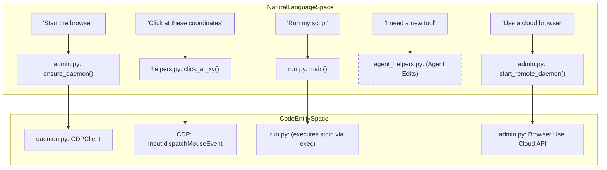
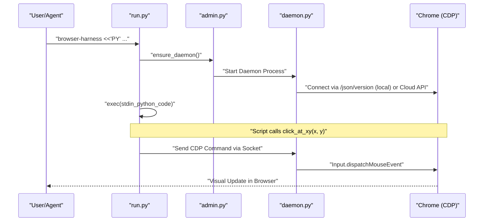

<!-- source: DeepWiki mcp.deepwiki.com · repo browser-use/browser-harness · page 1 Overview · fetched 2026-10-30 -->

# Overview

Relevant source files

The following files were used as context for generating this wiki page:

- [AGENTS.md](AGENTS.md)
- [CLAUDE.md](CLAUDE.md)
- [README.md](README.md)
- [SKILL.md](SKILL.md)
- [install.md](install.md)
- [interaction-skills/make-video.md](interaction-skills/make-video.md)
- [src/browser_harness/video.py](src/browser_harness/video.py)

## Purpose and Scope

`browser-harness` is a minimalist, self-healing automation framework designed to give Large Language Models (LLMs) direct, unencumbered control over a real browser via the Chrome DevTools Protocol (CDP) [README.md:3-5](), [AGENTS.md:1-2](). Unlike traditional automation frameworks that rely on rigid element selectors or heavy abstraction layers, `browser-harness` operates on a coordinate-first interaction model [SKILL.md:38-42](), allowing agents to navigate the web by calculating positions from the Accessibility Tree or screenshots and executing precise mouse and keyboard events.

The harness is intentionally lightweight (~1k lines across its core modules) to ensure that an LLM can ingest the entire codebase into its context window, understand implementation details, and self-heal by editing the harness environment if a required primitive is missing [README.md:5-17](), [AGENTS.md:9-15]().

For installation instructions and environment setup, see [Getting Started & Installation](#1.1).
For deep dives into the coordinate-first model, CDP-direct architecture, and agent-driven lifecycle, see [Core Concepts & Design Philosophy](#1.2).
For packaging details and skill bundles, see [Claude Plugin & Skill Packaging](#1.3).

Sources: [README.md:3-17](), [AGENTS.md:1-15](), [SKILL.md:38-42]()

---

## System Philosophy: The Self-Healing Harness

The core philosophy of `browser-harness` is that **the agent writes what is missing, mid-task** [README.md:5-17](). 

1.  **Direct CDP Access**: The system uses a thin CDP harness to connect to Chrome with minimal intermediate wrappers [README.md:5-7]().
2.  **No Abstraction Rails**: There is no rigid manager layer or complex session manager constraining the agent [SKILL.md:58-65]().
3.  **Agent-Owned Code**: If a helper or domain-specific pattern is missing, the agent edits `agent-workspace/agent_helpers.py` or generates domain skills during execution to solve the task [README.md:10-17](), [AGENTS.md:19-23]().

### Bridge: Natural Language to Code Entities

The following diagram maps high-level natural language intent to the specific Python modules and code entities that implement them.

**System Entity Mapping**

Sources: [README.md:7-17](), [SKILL.md:16-24](), [AGENTS.md:10-15]()

---

## Component Architecture

The codebase is structured into core Python modules within `src/browser_harness/` that manage execution, daemon lifecycle, and browser interaction primitives [AGENTS.md:9-15]().

| Module | Role | Key Entities |
| :--- | :--- | :--- |
| `run.py` | CLI Entry Point & Execution | `main()`, `browser-harness` command |
| `daemon.py` | CDP Bridge & WebSocket Middleman | `CDPClient`, IPC Server |
| `admin.py` | Lifecycle, Diagnostics & Remote | `ensure_daemon()`, `start_remote_daemon()`, `stop_remote_daemon()` |
| `helpers.py` | Browser Automation API | `new_tab()`, `wait_for_load()`, `js()`, `cdp()` |

**Execution Flow & Component Interaction**

Sources: [README.md:49-56](), [AGENTS.md:10-15](), [SKILL.md:16-24]()

---

## Skill Libraries

The framework relies on distinct categories of reusable patterns and domain playbooks:

1.  **Interaction Skills**: Documentation and patterns covering complex browser mechanics such as scrolling, iframes, multi-tab coordination, and dialogs. For details, see [Interaction Skills](#3).
2.  **Domain Skills Library**: Community and agent-contributed site-specific playbooks in `agent-workspace/domain-skills/`, auto-loaded by navigation helpers when `BH_DOMAIN_SKILLS=1` is enabled [SKILL.md:10-17](). For details, see [Domain Skills Library](#4).
3.  **Claude Plugin & Skill Packaging**: Metadata and bundling configurations that expose browser-harness as a skill or plugin. For details, see [Claude Plugin & Skill Packaging](#1.3).

Sources: [SKILL.md:10-17](), [AGENTS.md:19-23]()

---

## Child Pages

*   **[Getting Started & Installation](#1.1)**: Step-by-step installation guide using `uv`, enabling Chrome remote debugging (`chrome://inspect/#remote-debugging`), doctor diagnostics, and environment configuration (`BH_HOME`, `BH_RUNTIME_DIR`, `BU_NAME`) [install.md:10-120]().
*   **[Core Concepts & Design Philosophy](#1.2)**: Detailed breakdown of the coordinate-first model, self-healing harness design, CDP-direct communication, domain vs. interaction skill distinctions, and agent-generated helper lifecycles [SKILL.md:38-57]().
*   **[Claude Plugin & Skill Packaging](#1.3)**: Instructions on skill bundle structures, marketplace configurations, and synchronization scripts (`test_skill.py`) [SKILL.md:1-8]()

Sources: [install.md:10-120](), [SKILL.md:1-57]()

---

