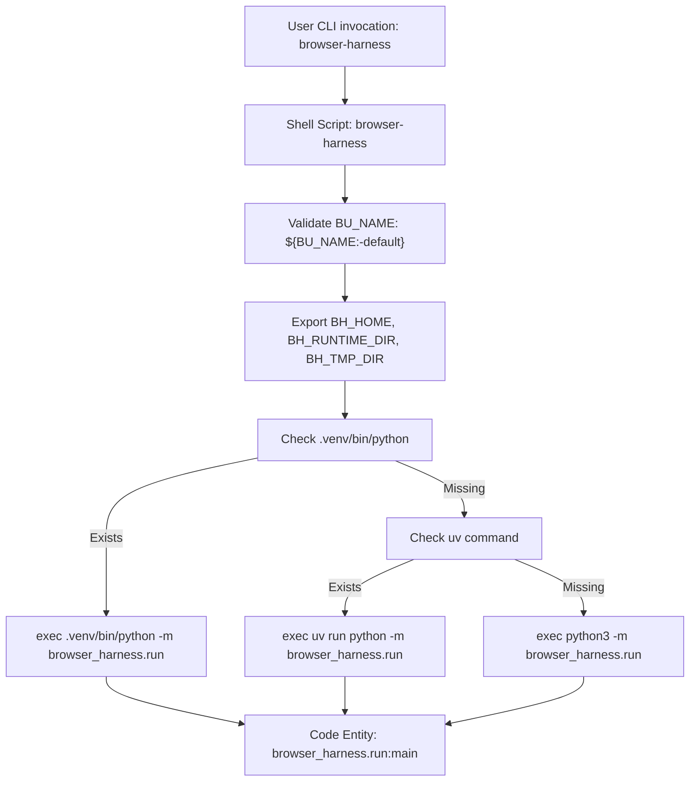
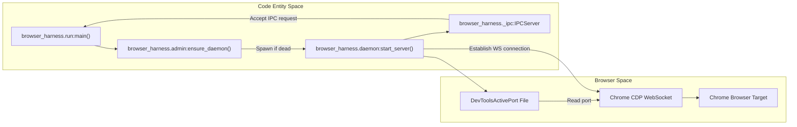

<!-- source: DeepWiki mcp.deepwiki.com · repo browser-use/browser-harness · page 1.1 Getting Started & Installation · fetched 2026-10-30 -->

# Getting Started & Installation

<details>
<summary>Relevant source files</summary>

The following files were used as context for generating this wiki page:

- [.env.example](.env.example)
- [.github/workflows/release.yml](.github/workflows/release.yml)
- [SKILL.md](SKILL.md)
- [browser-harness](browser-harness)
- [docs/setup-remote-debugging.png](docs/setup-remote-debugging.png)
- [docs/snap-linux-headless.md](docs/snap-linux-headless.md)
- [install.md](install.md)
- [pyproject.toml](pyproject.toml)
- [src/browser_harness/SKILL.md](src/browser_harness/SKILL.md)

</details>


This page provides a technical guide for installing `browser-harness`, configuring environment variables (`BH_HOME`, `BH_RUNTIME_DIR`, `BU_NAME`), enabling Chrome remote debugging, verifying connectivity via the built-in doctor utility, utilizing the `browser-harness` shell wrapper, and integrating the harness with agent environments.

---

## Purpose and Scope

The scope of this document covers the initial bootstrap of the `browser-harness` package on local developer machines or agent runners. It details how the CLI entry point (`browser_harness.run:main`), the shell script wrapper (`browser-harness`), and the daemon lifecycle manager (`browser_harness.admin` and `browser_harness.daemon`) coordinate to establish a robust Chrome DevTools Protocol (CDP) session.

Sources: [install.md:1-120](), [pyproject.toml:1-54](), [browser-harness:1-34]()

---

## Installation & Package Management

`browser-harness` is structured as a Python 3.11+ project managed via setuptools [pyproject.toml:10-44]() and distributed through PyPI [.github/workflows/release.yml:1-25](). The recommended installation vector uses `uv` to install the package globally as an isolated tool [install.md:13-23]().

### Fast Path Installation

```bash
uv tool install --python 3.12 --upgrade --force browser-harness
```

*   `--python 3.12`: Enforces Python 3.12 execution to prevent `uv` from matching older, incompatible interpreter versions [install.md:23-23]().
*   `--upgrade --force`: Replaces any existing `browser-harness` installation with the latest PyPI distribution while keeping unrelated tools intact [install.md:23-23]().

The core dependencies defined in `pyproject.toml` include:
*   `cdp-use==1.4.5`: Direct CDP protocol client implementation [pyproject.toml:25-25]().
*   `fetch-use==0.4.0`: HTTP utility library [pyproject.toml:26-26]().
*   `pillow==12.3.0`: Image processing for viewport screenshots [pyproject.toml:27-27]().
*   `websockets==15.0.1`: Async WebSocket transport for CDP communication [pyproject.toml:28-28]().

Sources: [install.md:13-23](), [pyproject.toml:5-33]()

---

## The `browser-harness` Shell Wrapper & Environment Configuration

The repository includes a POSIX shell wrapper script `browser-harness` that resolves runtime environments, sets up ephemeral paths, and dispatches execution to `browser_harness.run` [browser-harness:1-34]().

### CLI Execution and Runtime Routing


Sources: [browser-harness:1-34](), [pyproject.toml:34-37]()

### Environment Variables & Namespacing (`BU_NAME`, `BH_HOME`, `BH_RUNTIME_DIR`)

The wrapper and Python modules rely on specific environment variables for state isolation and namespacing:

| Variable | Description | Default Path / Value |
| :--- | :--- | :--- |
| `BU_NAME` | Logical namespacing identifier for parallel agent daemons [browser-harness:6-6](). | `default` [browser-harness:6-6]() |
| `BH_HOME` | Root configuration and artifact storage directory [install.md:120-120](). | `${XDG_CONFIG_HOME:-~/.config}/browser-harness` [install.md:120-120]() |
| `BH_RUNTIME_DIR` | Directory containing POSIX domain sockets or IPC state [browser-harness:16-19](). | `/tmp/bh-dev-$DEV_ID/runtime` (dev) or OS default |
| `BH_CHROME_PATH` / `CHROME_PATH` | Explicit filesystem path to the native Chrome binary [docs/snap-linux-headless.md:24-26](). | System default lookup |
| `BH_DOMAIN_SKILLS` | Flag to enable or disable loading agent domain skills [SKILL.md:14-14](). | `0` (Disabled) [SKILL.md:14-14]() |

When multiple isolated agents run concurrently, setting a distinct `BU_NAME` ensures that IPC Unix sockets, PID fingerprint files, and background daemon states remain completely partitioned [browser-harness:6-13](), [install.md:101-109]().

Sources: [browser-harness:1-34](), [install.md:120-120](), [docs/snap-linux-headless.md:24-26](), [SKILL.md:14-14]()

---

## Chrome Configuration & CDP Enabling

To control a local browser instance via CDP, remote debugging must be explicitly enabled.

### Connection Approaches

1.  **Way 1 (Interactive Profile)**: Navigate to `chrome://inspect/#remote-debugging` in a standard Google Chrome instance and check "Allow remote debugging for this browser instance" [install.md:50-51]().
2.  **Way 2 (Headless/Isolated Automation)**: Launch Chrome with `--remote-debugging-port=9222` and point `BU_CDP_URL=http://127.0.0.1:9222` [skills/browser-harness/references/install.md:46-46]().

### macOS Permission Handling (`mac-approve`)

On macOS, launching local Chrome can prompt a per-connection Allow dialog. Rather than bringing Chrome to the foreground, the harness provides a helper command [SKILL.md:102-117]():

```bash
browser-harness mac-approve
```

If the helper reports `accessibility-required`, grant accessibility permissions to the host application (Terminal, iTerm, or IDE) under macOS System Settings > Privacy & Security > Accessibility, then re-run `mac-approve` [SKILL.md:112-117]().

### Linux Snap Caveats

Ubuntu and distributions bundling Chromium via `Snap` sandbox filesystem access, frequently blocking external DevTools port binding [docs/snap-linux-headless.md:3-7](). 

*   **Mitigation**: Install Google Chrome natively via the official `.deb` package [docs/snap-linux-headless.md:9-16]().
*   **Resolution**: Set `BH_CHROME_PATH=/usr/bin/google-chrome-stable` [docs/snap-linux-headless.md:30-30]() or run `browser-harness doctor --fix-snap` [docs/snap-linux-headless.md:44-44]().

Sources: [install.md:47-67](), [docs/snap-linux-headless.md:3-45](), [SKILL.md:102-117]()

---

## Daemon Provisioning and Connection Data Flow

When `browser-harness` executes a script, it bootstraps the background daemon through `browser_harness.admin` and connects via `browser_harness.daemon` [install.md:90-111]().

### Daemon Bootstrap and Connection Data Flow


Sources: [install.md:90-111](), [src/browser_harness/run.py](), [src/browser_harness/admin.py](), [src/browser_harness/daemon.py]()

---

## Verification & Doctor Diagnostics

After installation and configuration, verify the connection by executing a basic inspection snippet:

```bash
browser-harness <<'PY'
print(page_info())
PY
```
Sources: [install.md:16-19]()

If connectivity fails, run the integrated health diagnostics tool [install.md:89-93]():

```bash
browser-harness --doctor
```

For automated orchestrators or machine-readable health checks, enforce validation against an active daemon [install.md:101-110]():

```bash
BU_NAME=default browser-harness doctor --json --require-existing-daemon
```
This command evaluates system readiness, checks PID locks, validates the socket transport layer, and exits with a nonzero status if the CDP session is unreachable [install.md:101-110]().

Sources: [install.md:89-110](), [SKILL.md:88-92]()

---

## Agent Environment Integration

To integrate `browser-harness` into AI agent runtimes (such as Claude Code or Codex), register the harness skill bundle [install.md:14-15](), [install.md:25-30]().

### Skill Export and Registration

Export the canonical skill definition directly from the package binary:

```bash
mkdir -p "${CODEX_HOME:-$HOME/.codex}/skills/browser-harness"
browser-harness skill > "${CODEX_HOME:-$HOME/.codex}/skills/browser-harness/SKILL.md"
```
Sources: [install.md:14-15]()

For Claude Code or other multi-agent environments, configure the system prompt with the required trigger rule [install.md:25-29]():

```text
Always use browser-harness for any web interaction: automation, scraping, testing, or site/app work.
```
Sources: [install.md:25-29](), [SKILL.md:1-4]()

---

