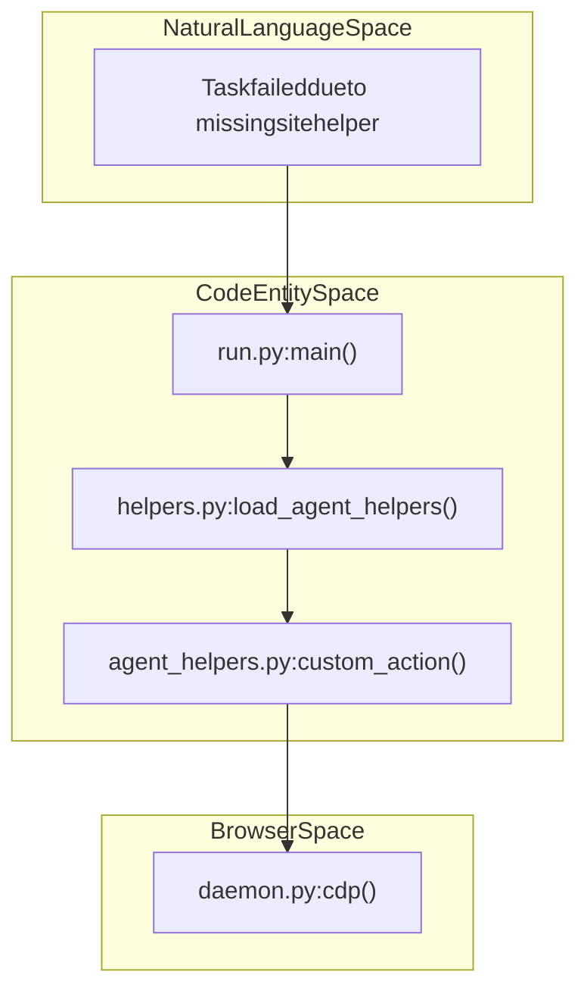
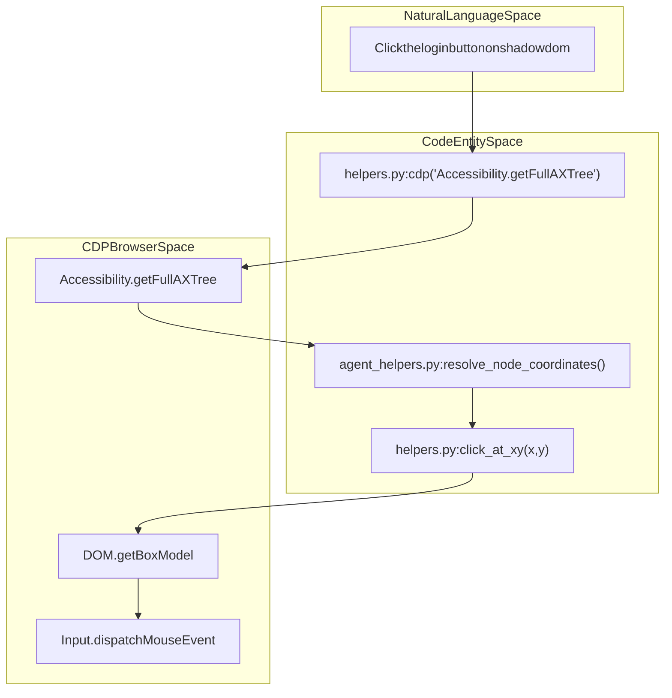
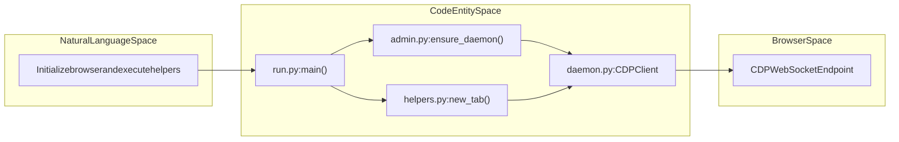

<!-- source: DeepWiki mcp.deepwiki.com · repo browser-use/browser-harness · page 1.2 Core Concepts & Design Philosophy · fetched 2026-10-30 -->

# Core Concepts & Design Philosophy

Relevant source files

The following files were used as context for generating this wiki page:

- [AGENTS.md](AGENTS.md)
- [CLAUDE.md](CLAUDE.md)
- [SKILL.md](SKILL.md)
- [agent-workspace/agent_helpers.py](agent-workspace/agent_helpers.py)
- [agent-workspace/domain-skills/amazon/product-search.md](agent-workspace/domain-skills/amazon/product-search.md)
- [install.md](install.md)
- [interaction-skills/make-video.md](interaction-skills/make-video.md)
- [src/browser_harness/video.py](src/browser_harness/video.py)

## Purpose and Scope
This page defines the foundational architecture and design philosophy of **browser-harness**, explaining its coordinate-first interaction model, self-healing harness patterns, direct Chrome DevTools Protocol (CDP) connectivity, and the distinction between domain and interaction skills [SKILL.md:2-8](), [AGENTS.md:1-15]().

---

## 1. The Self-Healing Harness Pattern & agent_helpers.py Lifecycle

The core philosophy of browser-harness is that the LLM agent should have the autonomy to modify its own automation primitives mid-task [AGENTS.md:19-22](). When an interaction fails or requires specialized selectors, the agent inspects or modifies `agent-workspace/agent_helpers.py` to add task-specific browser primitives [agent-workspace/agent_helpers.py:1-6](), [SKILL.md:8]().

*   **Minimalist Core:** The execution layer is intentionally kept thin, consisting of four primary modules: `run.py`, `daemon.py`, `admin.py`, and `helpers.py` [AGENTS.md:9-15]().
*   **Editable Workspace:** Agents operate primarily within `agent-workspace/`, defining custom helper functions in `agent_helpers.py` that are automatically loaded by `helpers.py` when `BH_AGENT_WORKSPACE` is configured [agent-workspace/agent_helpers.py:1-6](), [AGENTS.md:19-22]().
*   **Persistent Domain Knowledge:** Site-specific recipes, pagination tricks, and selector discoveries are persisted under `agent-workspace/domain-skills/` so subsequent agent turns inherit field-tested knowledge [SKILL.md:14-17](), [AGENTS.md:21-22]().

Sources: [SKILL.md:8-17](), [AGENTS.md:9-22](), [agent-workspace/agent_helpers.py:1-6]()

---

## 2. Coordinate-First Interaction Model

While the harness supports DOM evaluation via `js()`, its architectural design prioritizes coordinate-based actions combined with accessibility tree (`AX Tree`) inspection [SKILL.md:87-88]().

### Implementation Logic
1.  **AX Tree Discovery:** The agent queries the accessibility hierarchy using `cdp("Accessibility.getFullAXTree")` to retrieve roles, names, and node identifiers [SKILL.md:87]().
2.  **Coordinate Mapping:** Viewport coordinates are calculated via box model extraction (`cdp("DOM.getBoxModel")`) [SKILL.md:87]().
3.  **Compositor-Level Dispatch:** Inputs are executed via coordinate clicks (`click_at_xy(x, y)`), which invoke `Input.dispatchMouseEvent` at the browser compositor level [SKILL.md:88]().
4.  **Encapsulation Bypass:** Operating at the compositor level allows coordinate-first actions to naturally penetrate Shadow DOM boundaries and iframes without complex cross-frame traversal code [SKILL.md:150]().

### Natural Language to Code Mapping: Interaction

Sources: [SKILL.md:87-88](), [SKILL.md:150]()

---

## 3. CDP-Direct Architecture

browser-harness communicates directly with running Chrome instances over a WebSocket connection using the Chrome DevTools Protocol (CDP), completely bypassing heavyweight intermediate drivers like Selenium or Playwright [SKILL.md:22-25]().

### Key Architectural Modules
*   **`admin.py`**: Manages daemon lifecycles, health diagnostics (`doctor`), and cloud browser provisioning via `start_remote_daemon` [install.md:75-78](), [install.md:91-92]().
*   **`daemon.py`**: Acts as the long-lived middleman process maintaining the persistent WebSocket connection to Chrome and buffering events [AGENTS.md:12]().
*   **`run.py`**: Implements the CLI entry point (`browser_harness.run:main`), invoking `ensure_daemon()` prior to executing piped Python code [SKILL.md:27-30](), [AGENTS.md:14]().
*   **`helpers.py`**: Exposes the core automation API (`goto_url`, `new_tab`, `click_at_xy`, `wait_for_load`) directly available to agent scripts [AGENTS.md:13](), [SKILL.md:27-30]().

### Natural Language to Code Mapping: Architecture & Daemon Lifecycle

Sources: [AGENTS.md:9-15](), [SKILL.md:27-30](), [install.md:75-78]()

---

## 4. Skills Distinction: Domain vs. Interaction

The harness strictly differentiates between generic browser mechanics and site-specific operational knowledge.

| Category | Target Mechanics | Storage Location | Example Files |
| :--- | :--- | :--- | :--- |
| **Interaction Skills** | Generic browser workflows, scrolling, iframes, shadow DOM traversal, dialog handling. | `interaction-skills/` | `interaction-skills/make-video.md` [make-video.md:1-19]() |
| **Domain Skills** | Site-specific URL patterns, selectors, session gotchas, pagination rules, and API scraping structures. | `agent-workspace/domain-skills/` | `agent-workspace/domain-skills/amazon/product-search.md` [amazon/product-search.md:1-10]() |

Sources: [SKILL.md:12-16](), [AGENTS.md:19-22](), [amazon/product-search.md:1-10](), [make-video.md:1-19]()

---

