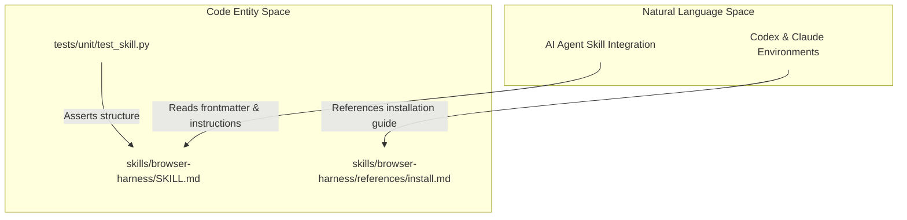
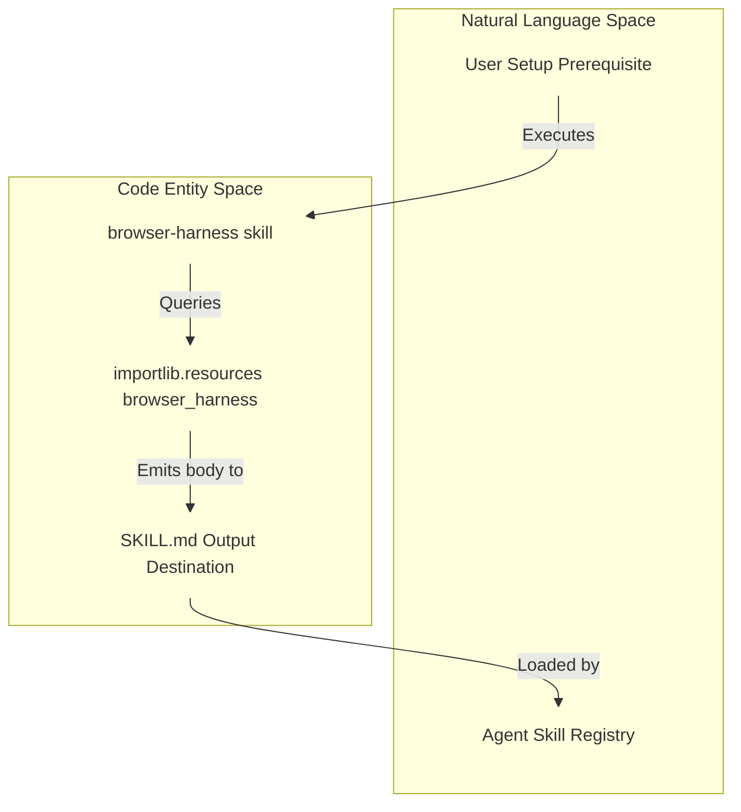

<!-- source: DeepWiki mcp.deepwiki.com · repo browser-use/browser-harness · page 1.3 Claude Plugin & Skill Packaging · fetched 2026-10-30 -->

# Claude Plugin & Skill Packaging

<details>
<summary>Relevant source files</summary>

The following files were used as context for generating this wiki page:

- [.claude-plugin/marketplace.json](.claude-plugin/marketplace.json)
- [.claude-plugin/plugin.json](.claude-plugin/plugin.json)
- [skills/browser-harness/SKILL.md](skills/browser-harness/SKILL.md)
- [skills/browser-harness/references/install.md](skills/browser-harness/references/install.md)
- [tests/unit/test_skill.py](tests/unit/test_skill.py)

</details>


## Purpose and Scope

This page covers the technical packaging architecture of `browser-harness` as a Claude Plugin and agent skill bundle. It details the layout of the `skills/browser-harness` skill bundle, the plugin manifests under `.claude-plugin/`, how the CLI command `browser-harness skill` emits skill payloads, and how the test suite (`tests/unit/test_skill.py`) enforces frontmatter correctness and schema synchronization.

Sources: `skills/browser-harness/SKILL.md:1-130`, `.claude-plugin/marketplace.json:1-25`, `.claude-plugin/plugin.json:1-13`, `tests/unit/test_skill.py:1-36`

---

## 1. Skill Bundle and Directory Layout

The core instructions exposed to AI coding assistants and agent environments are packaged inside the `skills/browser-harness/` directory. This bundle contains metadata, reference documents, and operational guidelines for controlling a real browser via Chrome DevTools Protocol (CDP).

The principal entry point for the skill is `skills/browser-harness/SKILL.md`, which begins with a strict YAML frontmatter block defining the skill's identity and summary description [skills/browser-harness/SKILL.md:1-4](). 

```yaml
---
name: browser-harness
description: "Control a real browser via CDP: clicking, typing, navigation, logged-in sessions, JS-rendered or bot-protected pages. Not for plain HTTP fetches of public content - use curl for those."
---
```

Supplemental reference documentation lives alongside the main skill definition, such as `skills/browser-harness/references/install.md`, which provides instructions on installing the CLI tool via `uv tool install` and bootstrapping the connection environment [skills/browser-harness/references/install.md:1-54]().


*Figure 1: Bridging agent instructions to bundled markdown files.*

Sources: `skills/browser-harness/SKILL.md:1-130`, `skills/browser-harness/references/install.md:1-55`

---

## 2. Claude Marketplace and Plugin Manifests

To integrate with the Claude Plugin ecosystem and marketplace distribution channels, `browser-harness` utilizes two configuration files housed in the `.claude-plugin/` directory:

1. **`marketplace.json`**: Defines marketplace-level metadata, owner information, and plugin listings including source pointers, categories (`automation`), and searchable keywords (`browser`, `cdp`, `chrome`, `scraping`, `screenshot`) [.claude-plugin/marketplace.json:1-25]().
2. **`plugin.json`**: Establishes plugin identification (`browser-harness`), versioning (`0.1.0`), license (`MIT`), homepage/repository links, and the concise capabilities summary required by the plugin loader [.claude-plugin/plugin.json:1-13]().

| Manifest File | Key Fields | Purpose |
| :--- | :--- | :--- |
| `.claude-plugin/marketplace.json` | `name`, `owner`, `plugins` (array with `source: "."`) | Marketplace registry entry for direct repository installation [.claude-plugin/marketplace.json:1-25]() |
| `.claude-plugin/plugin.json` | `name`, `version`, `description`, `repository`, `keywords` | Runtime metadata and description for the loaded plugin instance [.claude-plugin/plugin.json:1-13]() |

Sources: `.claude-plugin/marketplace.json:1-25`, `.claude-plugin/plugin.json:1-13`

---

## 3. Skill Emission and CLI Integration

During environment setup, agents or setup scripts register the skill by reading the bundled instruction file or invoking the command line interface to emit the skill body. 

As detailed in the installation guide, users register the skill by executing CLI commands or redirecting the output of `browser-harness skill` into target agent directories such as `${CODEX_HOME}/skills/browser-harness/SKILL.md` [skills/browser-harness/references/install.md:16-29]().


*Figure 2: Flow of skill emission from package resources to agent skill directories.*

Sources: `skills/browser-harness/references/install.md:1-55`

---

## 4. Synchronization and Automated Frontmatter Testing

To prevent regressions in packaged skill definitions, the test suite includes automated assertions that validate the structural integrity of the embedded `SKILL.md` file.

The unit test `tests/unit/test_skill.py` loads `SKILL.md` from the `browser_harness` package resources via `importlib.resources`, parses the YAML frontmatter block, and verifies strict key-value conformance [tests/unit/test_skill.py:1-35]().

```python
def test_packaged_skill_frontmatter_is_valid_simple_yaml():
    text = resources.files("browser_harness").joinpath("SKILL.md").read_text()
    metadata = {}
    ...
    assert metadata == {
        "name": "browser-harness",
        "description": "Control a real browser via CDP: clicking, typing, navigation, logged-in sessions, JS-rendered or bot-protected pages. Not for plain HTTP fetches of public content - use curl for those.",
    }
```

This validation logic ensures that:
- The file starts with valid `---` YAML frontmatter delimiters [tests/unit/test_skill.py:4-8]().
- Only permitted keys (`name`, `description`) are present [tests/unit/test_skill.py:18]().
- String values are correctly quoted and non-empty [tests/unit/test_skill.py:20-27]().
- The parsed metadata matches the exact expected string contracts required by agent loaders [tests/unit/test_skill.py:32-35]().

Sources: `tests/unit/test_skill.py:1-36`

---

