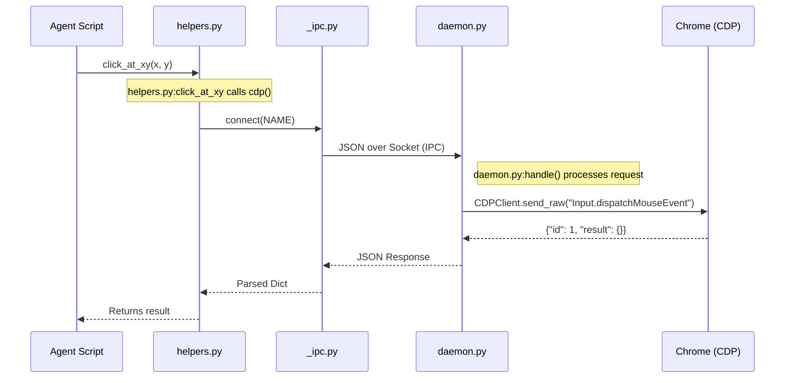

<!-- source: DeepWiki mcp.deepwiki.com · repo browser-use/browser-harness · page 2 Architecture & Core Components · fetched 2026-10-30 -->

# Architecture & Core Components

<details>
<summary>Relevant source files</summary>

The following files were used as context for generating this wiki page:

- [.github/workflows/release.yml](.github/workflows/release.yml)
- [AGENTS.md](AGENTS.md)
- [CLAUDE.md](CLAUDE.md)
- [browser-harness](browser-harness)
- [interaction-skills/make-video.md](interaction-skills/make-video.md)
- [pyproject.toml](pyproject.toml)
- [src/browser_harness/SKILL.md](src/browser_harness/SKILL.md)
- [src/browser_harness/run.py](src/browser_harness/run.py)
- [src/browser_harness/video.py](src/browser_harness/video.py)
- [tests/unit/test_run.py](tests/unit/test_run.py)

</details>


This page provides a high-level overview of the `browser-harness` architecture. The system is designed as a "thin" bridge between an LLM agent and the Chrome DevTools Protocol (CDP). It avoids heavy frameworks in favor of a self-healing, agent-editable structure built around core Python modules in `src/browser_harness` (`run`, `daemon`, `admin`, `helpers`, `_ipc`, `auth`, `telemetry`, `paths`, and `macos`).

## System Overview

The codebase is organized into primary Python modules that manage the lifecycle of the browser connection, the execution of agent scripts, local path resolution, security, and the interaction API [AGENTS.md:9-14]().

| Module | Role | Key File |
| :--- | :--- | :--- |
| **Execution** | CLI entry point for running Python code with pre-loaded helpers. | `run.py` [src/browser_harness/run.py:33-65]() |
| **Daemon** | Manages the persistent CDP WebSocket and IPC relay. | `daemon.py` [src/browser_harness/daemon.py:1-2]() |
| **Lifecycle** | Handles process management, diagnostics, and remote provisioning. | `admin.py` [src/browser_harness/admin.py:11-29]() |
| **API** | The "Harness" library used by agents to control the browser. | `helpers.py` [src/browser_harness/helpers.py:1-5]() |
| **Transport** | POSIX Unix sockets vs Windows TCP loopback + token auth. | `_ipc.py` |
| **Authentication** | Browser Use Cloud API key storage and login flow. | `auth.py` |
| **Environment** | Directory resolution (`BH_HOME`, `BH_RUNTIME_DIR`, `BH_TMP_DIR`). | `paths.py` |
| **Diagnostics** | Telemetry event emission and macOS remote-debugging approval. | `telemetry.py`, `macos.py` |

### Communication Flow

The system uses a two-tier communication model:
1.  **IPC Socket:** `run.py` (and the agent's script) communicates with `daemon.py` via the `_ipc` module [src/browser_harness/helpers.py:10-11](). On POSIX, this uses a Unix domain socket with `0600` umask; on Windows, it uses a TCP loopback with an authorization token [src/browser_harness/daemon.py:1-2](), [src/browser_harness/daemon.py:34]().
2.  **CDP WebSocket:** `daemon.py` maintains a persistent WebSocket connection to the browser's remote debugging port using `CDPClient` [src/browser_harness/daemon.py:8-10]().

Sources: [src/browser_harness/run.py:33-65](), [src/browser_harness/daemon.py:1-10](), [src/browser_harness/admin.py:11-29]()

---

## Core Layers & Child Pages

### 2.1. Daemon & CDP Connection Layer
The `daemon.py` module is the backbone of the system. It discovers the browser's debugging port by reading the `DevToolsActivePort` file from local browser profile paths across Linux, macOS, and Windows [src/browser_harness/daemon.py:76-86](), [src/browser_harness/daemon.py:104-122](). It manages session attachment, event buffering, stale-session auto-recovery, and dedicated tabs for named daemons using the tab marker.

For full details, see [Daemon & CDP Connection Layer](#2.1).

Sources: [src/browser_harness/daemon.py:76-122]()

### 2.2. run.py & admin.py — Execution and Lifecycle Management
The CLI entry point `run.py` handles stdin code execution, subcommand routing, auto-bootstrap precedence, and helper tracing. Meanwhile, `admin.py` manages daemon lifecycle functions (`ensure_daemon`, `restart_daemon`, `require_existing_daemon`), browser launching, spawn locks, PID fingerprinting, doctor diagnostics, and update flows [src/browser_harness/run.py:33-70](), [src/browser_harness/admin.py:11-29]().

For full details, see [run.py & admin.py — Execution and Lifecycle Management](#2.2).

Sources: [src/browser_harness/run.py:33-70](), [src/browser_harness/admin.py:11-29]()

### 2.3. helpers.py — Browser Automation API
`helpers.py` provides all helper functions available inside a browser-harness script: navigation (`goto_url`, `new_tab`, `wait_for_load/element/network_idle`), input emulation (`click_at_xy`, `type_text`, `fill_input`, `press_key`, `scroll`), tab/target management, screenshots, DOM utilities (`js`, `upload_file`, `http_get`), and the `_send`/`_load_env` internals [src/browser_harness/helpers.py:1-5]().

For full details, see [helpers.py — Browser Automation API](#2.3).

Sources: [src/browser_harness/helpers.py:1-5]()

### 2.4. Cloud Browser & Profile Sync
Integrates with Browser Use Cloud API to provision remote browsers (`start_remote_daemon`/`stop_remote_daemon`), manage keys via `auth.py`, list/sync profiles with cookie-only persistence, and support domain skills like `browser-use-cloud` for zombie sessions [src/browser_harness/admin.py:26-31](), [src/browser_harness/auth.py]().

For full details, see [Cloud Browser & Profile Sync](#2.4).

Sources: [src/browser_harness/admin.py:26-31]()

### 2.5. IPC, Paths & Telemetry Internals
Covers `_ipc.py` socket transport, `paths.py` directory resolution (`BH_HOME`, `BH_RUNTIME_DIR`, `BH_TMP_DIR`), `telemetry.py` event emission, and `macos.py` remote-debugging approval automation (`mac-approve`) [src/browser_harness/run.py:54]().

For full details, see [IPC, Paths & Telemetry Internals](#2.5).

Sources: [src/browser_harness/run.py:54]()

---

## Entity Mapping: Natural Language to Code

### Component Interaction Diagram

```mermaid
graph TD
    subgraph "User/Agent Space"
        [AgentScript]
    end

    subgraph "Execution Layer (run.py)"
        [run_main]
        [helpers_cdp]
    end

    subgraph "Daemon Layer (daemon.py)"
        [_ipc_connect]
        [Daemon_handle]
        [CDPClient]
    end

    subgraph "Browser Space"
        [ChromeProcess]
        [DevToolsActivePort]
    end

    [AgentScript] -->|ExecutedBy| [run_main]
    [run_main] -->|Calls| [helpers_cdp]
    [helpers_cdp] -->|JSONViaSend| [_ipc_connect]
    [_ipc_connect] -->|RoutesTo| [Daemon_handle]
    [Daemon_handle] -->|send_raw| [CDPClient]
    [CDPClient] -->|WebSocket| [ChromeProcess]
    [ChromeProcess] -->|WritesPort| [DevToolsActivePort]
    [Daemon_handle] -.->|get_ws_url_reads| [DevToolsActivePort]
```
Sources: [src/browser_harness/run.py:13-31](), [src/browser_harness/helpers.py:43-56](), [src/browser_harness/daemon.py:125-151](), [src/browser_harness/daemon.py:8-10]()

### Data Flow & Protocols


Sources: [src/browser_harness/helpers.py:43-56](), [src/browser_harness/helpers.py:152-172](), [src/browser_harness/daemon.py:1-2](), [src/browser_harness/daemon.py:8-10]()

---

