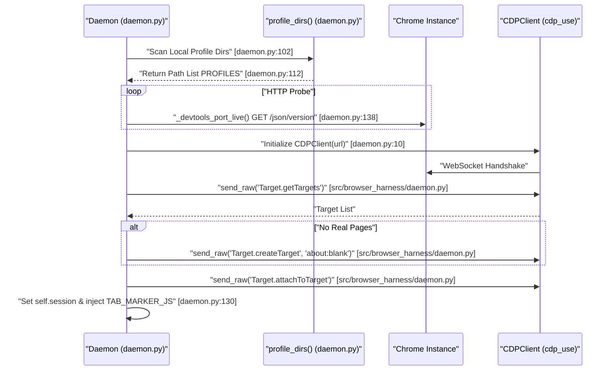
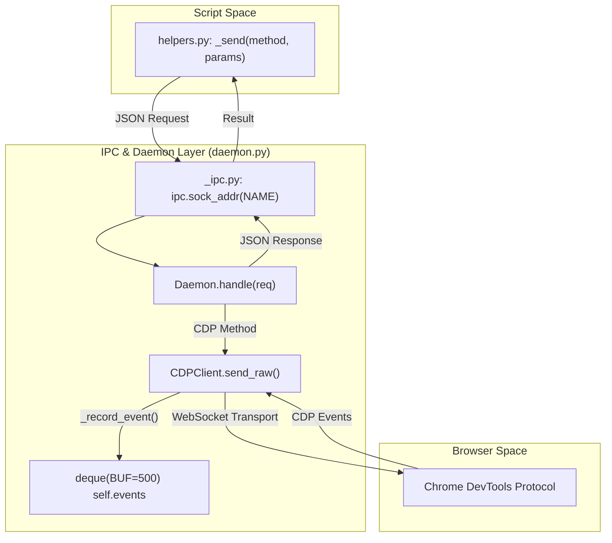

<!-- source: DeepWiki mcp.deepwiki.com · repo browser-use/browser-harness · page 2.1 Daemon & CDP Connection Layer · fetched 2026-10-30 -->

# Daemon & CDP Connection Layer

Relevant source files

The following files were used as context for generating this wiki page:

- [src/browser_harness/daemon.py](src/browser_harness/daemon.py)
- [tests/unit/test_daemon.py](tests/unit/test_daemon.py)

The **Daemon** (`daemon.py`) is the persistent bridge between high-level Python automation scripts and the low-level Chrome DevTools Protocol (CDP). It manages WebSocket discovery, session state, target attachment, and event buffering, providing a stable IPC interface (Unix domain socket on POSIX, TCP loopback on Windows) for the `run.py` and `helpers.py` layers, isolated per `BU_NAME` [src/browser_harness/daemon.py:1-11]().

---

## WebSocket Discovery & Initialization

The daemon identifies the active Chrome instance by scanning local filesystem paths for the `DevToolsActivePort` file. This file, generated by Chrome when remote debugging is enabled, contains the ephemeral port and a unique WebSocket path suffix [src/browser_harness/daemon.py:138-153]().

### Discovery Logic & Environment Resolution
1.  **Environment Variables**: The daemon first evaluates `BU_NAME` to namespace sockets and PIDs [src/browser_harness/daemon.py:33-36](), and checks connection overrides like `BU_CDP_WS` or `BU_CDP_URL` [src/browser_harness/daemon.py:117]().
2.  **Path Scanning**: It iterates through platform-specific profile directories (`profile_dirs()`), supporting macOS (`_MAC_PROFILES`), Linux (`_LINUX_PROFILES`), and Windows (`_WINDOWS_PROFILES`), covering variants such as Chrome, Chrome Canary, Edge, Brave, and Chromium [src/browser_harness/daemon.py:38-110]().
3.  **DevToolsActivePort**: It reads the port from `DevToolsActivePort` and confirms liveness via `_devtools_port_live()` to ensure stale lock files from closed browsers do not trigger false connections [src/browser_harness/daemon.py:138-153]().
4.  **HTTP Resolution**: Queries `http://127.0.0.1:{port}/json/version` to resolve the live `webSocketDebuggerUrl` [src/browser_harness/daemon.py:168]().

### CDPClient Initialization
The daemon uses `cdp_use.client.CDPClient` to establish the primary WebSocket connection [src/browser_harness/daemon.py:10](). Upon startup, it initializes the `Daemon` class and attaches to the first available target via `attach_first_page()` [src/browser_harness/daemon.py:279-285]().

Sources: `[src/browser_harness/daemon.py:1-11]()`, `[src/browser_harness/daemon.py:33-110]`, `[src/browser_harness/daemon.py:138-185]()`

---

## Target Attachment, Session Management & The Tab Marker

Chrome contains internal targets (extensions, `chrome-untrusted://`, `devtools://`, `about:`) that are unsuitable for automation. The daemon filters these and manages user-visible tabs.

### Target Filtering & Attachment
-   **`is_real_page(t)`**: Filters out non-page targets and internal schemes listed in `INTERNAL` (`chrome://`, `about:`, etc.) [src/browser_harness/daemon.py:113]()
-   **Session Activation**: When attaching to targets via `Target.attachToTarget` with `flatten=True`, the daemon enables default domains (`Page`, `DOM`, `Runtime`, `Network`) using `_enable_default_domains()` [tests/unit/test_daemon.py:148-174]().

### The Tab Marker
To visually distinguish controlled browser tabs from manual browsing sessions, the daemon injects a cosmetic tab title marker (`\U0001F434` 🐴 emoji) into the page title using `TAB_MARKER_JS` [src/browser_harness/daemon.py:130-136]().
-   **Configurability**: Controlled by `BH_TAB_MARKER`. If set to `0`, `false`, `no`, or `off`, marker injection is skipped [src/browser_harness/daemon.py:133-135](), [tests/unit/test_daemon.py:96-112]().
-   **Timing**: Injected asynchronously upon `set_session` or page load events unless explicitly disabled [tests/unit/test_daemon.py:114-147]().

Sources: `[src/browser_harness/daemon.py:113-136]()`, `[tests/unit/test_daemon.py:96-190]()`

---

## IPC Relay & Event Buffering

The daemon acts as a JSON-RPC request-response server over a local IPC socket (`_ipc.py`) [src/browser_harness/_ipc.py:1]().

### IPC Protocol & Meta Commands
Clients send JSON payloads to the daemon socket. The `Daemon.handle()` dispatcher handles meta commands or forwards CDP methods:
*   `ping`: Returns daemon PID and liveness state.
*   `drain_events`: Flushes and returns the internal event buffer `self.events` [src/browser_harness/daemon.py:37]().
*   `set_session`: Updates active `self.session` and `self.target_id`, re-enabling default domains (`Page.enable`, `DOM.enable`, `Runtime.enable`, `Network.enable`) [tests/unit/test_daemon.py:148-174]().

### Event Buffering
The daemon maintains a fixed-size `deque` buffer (`BUF = 500`) (`self.events`) that taps incoming CDP notifications (e.g., `Page.loadEventFired`, `Network.requestWillBeSent`) for asynchronous inspection by high-level automation helpers [src/browser_harness/daemon.py:37](), [src/browser_harness/daemon.py:247-255]().

Sources: `[src/browser_harness/daemon.py:37]`, `[src/browser_harness/daemon.py:247-273]`, `[src/browser_harness/_ipc.py:1-5]()`

---

## Stale-Session Auto-Recovery & PID Management

-   **Stale-Session Recovery**: When session references expire or tabs close unexpectedly, the daemon handles session switching and tears down event subscriptions on old sessions to prevent background event pollution [tests/unit/test_daemon.py:91-113]().
-   **PID Fingerprinting**: `_publish_own_pid()` safely updates the daemon PID record without truncating active process start metadata established by parent spawn locks [src/browser_harness/daemon.py:77-100](), [tests/unit/test_daemon.py:9-25]().

Sources: `[src/browser_harness/daemon.py:77-100]`, `[tests/unit/test_daemon.py:9-25]()`

---

## System Architecture Diagrams

### Connection Lifecycle & Discovery
This diagram bridges natural language concepts to specific code entities in `daemon.py`.

Sources: `[src/browser_harness/daemon.py:10]`, `[src/browser_harness/daemon.py:102-136]`, `[src/browser_harness/daemon.py:138-153]()`

### Request/Event Relay Flow
This diagram details the flow between script helpers, IPC transport, and the daemon event buffer.

Sources: `[src/browser_harness/daemon.py:33-37]`, `[src/browser_harness/daemon.py:247-273]`, `[src/browser_harness/_ipc.py:1-106]()`

---

