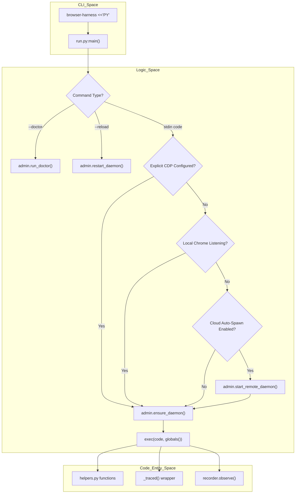
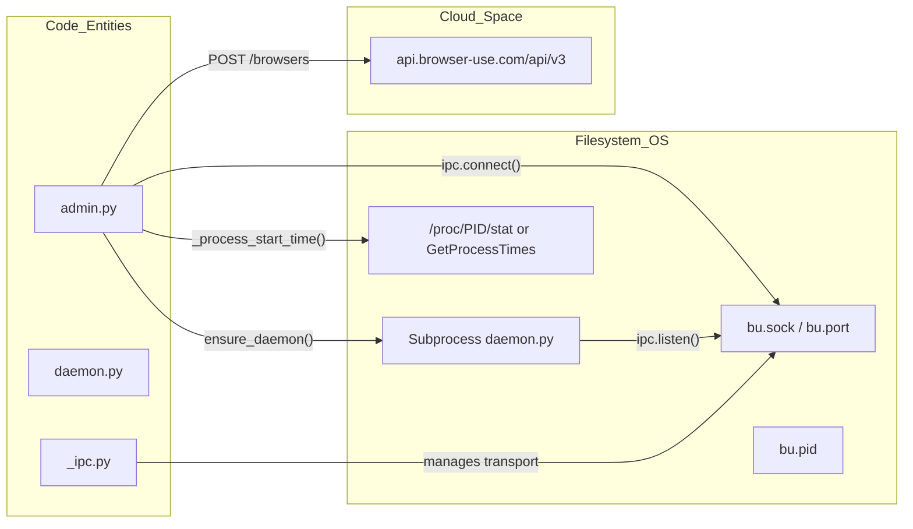

<!-- source: DeepWiki mcp.deepwiki.com · repo browser-use/browser-harness · page 2.2 run.py & admin.py — Execution and Lifecycle Management · fetched 2026-10-30 -->

# run.py & admin.py — Execution and Lifecycle Management

Relevant source files

The following files were used as context for generating this wiki page:

- [src/browser_harness/admin.py](src/browser_harness/admin.py)
- [src/browser_harness/run.py](src/browser_harness/run.py)
- [tests/unit/test_admin.py](tests/unit/test_admin.py)
- [tests/unit/test_brave_origin.py](tests/unit/test_brave_origin.py)
- [tests/unit/test_run.py](tests/unit/test_run.py)

This page covers the execution entry point and the administrative lifecycle management of the `browser-harness` system. It details how Python code is executed via `run.py`, how the background daemon is managed via `admin.py`, how remote browsers are provisioned via the Browser Use cloud API, and how robust process fingerprinting prevents PID-reuse hazards during lifecycle recovery.

## Execution Entry Point (run.py)

`run.py` serves as the primary CLI entry point for the harness, handling stdin code execution, environment bootstrap precedence, command routing, and helper tracing [run.py:33-65]().

### Initialization and Configuration
1. **UTF-8 Enforcement**: On Windows, default stream encodings can cause `UnicodeEncodeError` when printing helper outputs or tab titles containing emojis (such as the 🐴 marker). `run.py` reconfigures `sys.stdout` and `sys.stderr` to UTF-8 with error replacement [run.py:4-11]().
2. **Environment Loading**: `admin.py` is imported and immediately executes `_load_env()`, scanning the repository root and workspace directory for `.env` files to configure runtime variables [admin.py:107-126]().
3. **Helper Tracing and Injection**: Functions from `helpers.py` are injected into the execution context and wrapped with `_traced()` to record step telemetry, execution duration, and recorder observations [run.py:31](), [run.py:156-178](), [run.py:181-190]().

### Execution Logic and Auto-Bootstrap Precedence
When invoked without subcommands, `run.py` expects Python code over `stdin` [run.py:212](). Before execution, it determines whether to start a local daemon or auto-bootstrap a remote browser:
* **Explicit CDP Checks**: `_explicit_cdp_configured()` inspects `BU_CDP_URL` and `BU_CDP_WS`. If either is set, it blocks cloud auto-bootstrap to respect explicit user endpoints and prevent unintended billing [run.py:99-100]().
* **Local Chrome Discovery**: `_local_chrome_listening()` probes ports `9222` and `9223` for a valid DevTools endpoint `[run.py:82-91]()`.
* **Cloud Auto-Spawn**: If `BU_AUTOSPAWN` is enabled, cloud auth is valid via `_cloud_auth_configured()`, and neither a local Chrome nor an existing daemon is active, `run.py` calls `start_remote_daemon()` to provision a cloud browser instance [run.py:103-109](), [run.py:239-247]().
* **Daemon Readiness**: Calls `ensure_daemon()` to verify or start the background control process before executing the script via `exec(code, globals())` [run.py:249-251]().

**run.py Execution Flow**
Title: "run.py Execution Flow"

Sources: [run.py:82-109](), [run.py:156-190](), [run.py:239-251]()

---

## Lifecycle Management (admin.py)

`admin.py` manages the background daemon process, IPC sockets, process fingerprinting, and remote browser integrations [admin.py:12-15]().

### Process Identification and Fingerprinting
To prevent PID-reuse hazards where a dead daemon's process ID is reassigned to an unrelated system process, `admin.py` implements `_process_start_time(pid)` [admin.py:16-31](). This returns an opaque start-time fingerprint:
* **Linux**: Reads `/proc/<pid>/stat` and parses field 22 (starttime clock ticks since boot) [admin.py:34-46]().
* **macOS**: Runs `ps -o lstart= -p <pid>` to retrieve an absolute start timestamp [admin.py:47-56]().
* **Windows**: Uses `GetProcessTimes` via `ctypes` to read the kernel 64-bit `FILETIME` creation timestamp [admin.py:57-105]().

### Key Lifecycle Functions

| Function | Role | Implementation Detail |
| :--- | :--- | :--- |
| `daemon_alive(name)` | Health Check | Performs an IPC ping handshake to ensure the listener is active and responsive [admin.py:178-181](). |
| `ensure_daemon(...)` | Idempotent Start | Checks daemon liveness; if unresponsive, launches `daemon.py` via `subprocess.Popen` with independent session grouping [admin.py:348-380](). |
| `restart_daemon(name)` | Recovery | Utilizes process fingerprints to safely force-kill hung daemons without risking PID collisions [admin.py:426-451](). |
| `run_doctor()` | Diagnostics | Validates dependencies, environment variables, Chrome remote debugging state, and IPC connectivity [admin.py:512-566](). |

### Remote Browser Provisioning
`admin.py` interfaces with the Browser Use Cloud API (`https://api.browser-use.com/api/v3`) to manage remote browsers [admin.py:128]().
* **`start_remote_daemon`**: Sends a `POST /browsers` request to provision a remote browser session, then launches a local daemon configured with the assigned `cdpUrl` [admin.py:232-268]().
* **`stop_remote_daemon`**: Gracefully tears down the remote daemon by sending a `PATCH /browsers/<id>` request to release the cloud instance [admin.py:271-291]().

**System Entity Mapping**
Title: "Lifecycle Management Entities"

Sources: [admin.py:16-105](), [admin.py:127-181](), [admin.py:232-380]()

---

## Profile and Version Management

### Profile Synchronization
`admin.py` supports discovering, syncing, and listing local and cloud browser profiles to maintain session authentication states across environments.
* **`list_local_profiles()`**: Discovers local browser user-data directories across operating systems [admin.py:474-502]().
* **`sync_local_profile()`**: Synchronizes local cookies and profile data to a cloud profile target [admin.py:294-320]().
* **`list_cloud_profiles()`**: Queries the Cloud API to retrieve available remote profile configurations [admin.py:323-345]().

### Self-Updates and Banners
* **`run_update()`**: Inspects installation metadata to pull and apply the latest version from PyPI or git [admin.py:569-605]().
* **`print_update_banner()`**: Checks for newer versions against PyPI JSON endpoints, caching responses in `VERSION_CACHE` to avoid redundant network calls [admin.py:129-132](), [admin.py:608-623]().

Sources: [admin.py:129-132](), [admin.py:294-345](), [admin.py:474-502](), [admin.py:569-623]()

---

