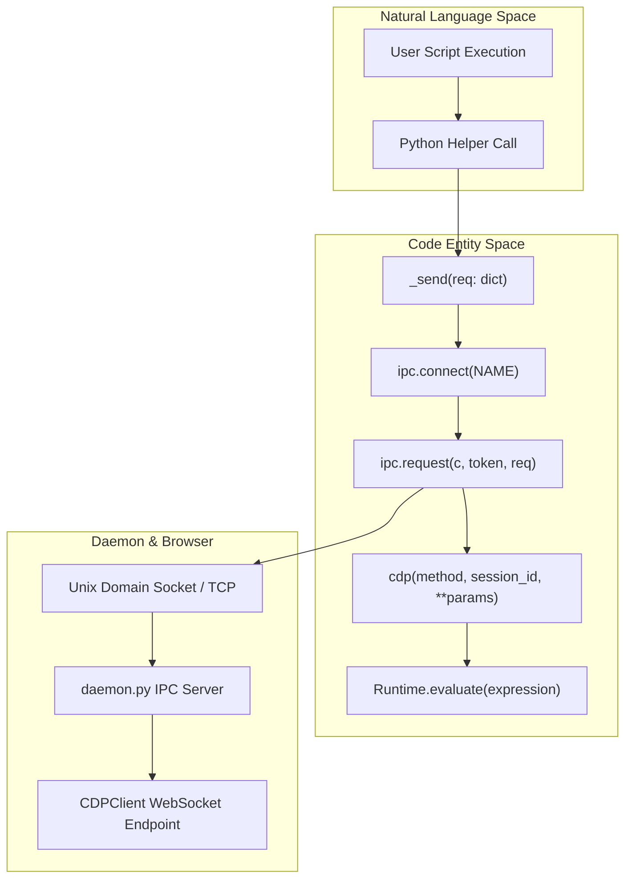
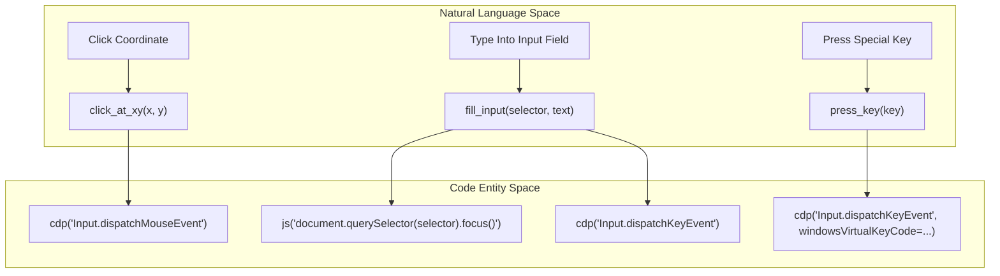

<!-- source: DeepWiki mcp.deepwiki.com · repo browser-use/browser-harness · page 2.3 helpers.py — Browser Automation API · fetched 2026-10-30 -->

# helpers.py — Browser Automation API

Relevant source files

The following files were used as context for generating this wiki page:

- [src/browser_harness/helpers.py](src/browser_harness/helpers.py)
- [tests/integration/test_js.py](tests/integration/test_js.py)
- [tests/unit/test_helpers.py](tests/unit/test_helpers.py)

The `helpers.py` module provides the high-level Python API for interacting with the browser. It abstracts raw Chrome DevTools Protocol (CDP) commands into ergonomic functions for navigation, input emulation, and tab management. These helpers are pre-imported into the execution environment when running scripts via `browser-harness`.

Sources: [src/browser_harness/helpers.py:1-5]()

---

## Core Communication & Environment

The API communicates with the daemon process via a Unix domain socket or TCP loopback, depending on the platform. It uses a request-response pattern where Python dictionaries are serialized to JSON and sent over the wire.

### Internal Mechanics
- **`_load_env()`**: Automatically loads environment variables from `.env` files located in the repository root and the agent workspace. It populates `os.environ` without overwriting existing variables [src/browser_harness/helpers.py:19-36]().
- **`_send(req, response_timeout)`**: The low-level transport function. It connects to the IPC socket (`SOCK`), sets a timeout (e.g., `DEFAULT_IPC_RESPONSE_TIMEOUT_SECONDS` or `SCREENSHOT_IPC_RESPONSE_TIMEOUT_SECONDS`), transmits the request dictionary via `ipc.request()`, and returns the decoded response dictionary. Raises an `_IPCResponseTimeout` mapped to a descriptive `RuntimeError` if timeouts occur [src/browser_harness/helpers.py:48-69]().
- **`cdp(method, session_id=None, ...)`**: The primary wrapper for raw CDP calls. It wraps method names and parameters into a dictionary and dispatches it through `_send()` [src/browser_harness/helpers.py:72-77]().
- **`_runtime_evaluate(expression, ...)`**: Evaluates JavaScript in the browser context via `Runtime.evaluate`. It features robust error parsing (`_runtime_value()`, `_js_exception_description()`) to handle `exceptionDetails` and unserializable JavaScript values like `NaN`, `Infinity`, `-Infinity`, `-0`, and `BigInt` [src/browser_harness/helpers.py:83-141](), [tests/integration/test_js.py:144-168]().

### Data Flow: Script to Browser
The following diagram bridges natural language concepts of script execution to the concrete code entities handling IPC transport and CDP dispatch.

Sources: [src/browser_harness/helpers.py:19-77](), [src/browser_harness/helpers.py:116-141]()

---

## Navigation & Page Inspection

Navigation helpers handle moving between URLs, inspecting document dimensions, and executing arbitrary expressions.

| Function | Description | Implementation Detail |
| :--- | :--- | :--- |
| `goto_url(url)` | Navigates the current tab to a URL using `Page.navigate`. | Optionally checks for matching `domain-skills` directories under `AGENT_WORKSPACE` when `BH_DOMAIN_SKILLS=1` [src/browser_harness/helpers.py:152-158](), [tests/unit/test_helpers.py:91-98](). |
| `page_info()` | Returns viewport metrics, scroll position, page title, and URL. | Evaluates a JSON-stringified JS object (`innerWidth`, `scrollX`, etc.). Checks for `pending_dialog` first [src/browser_harness/helpers.py:159-170](). |
| `js(expression)` | Executes arbitrary JavaScript in the page context. | Automatically wraps expressions in an IIFE or `return` statement via `_wrap_js_function()` if a top-level return is detected [src/browser_harness/helpers.py:83-149](), [tests/integration/test_js.py:48-56](). |

**Page State and Dialogs:** `page_info()` verifies if a native JS dialog (`alert`, `confirm`, `prompt`, `beforeunload`) is active by querying `pending_dialog` via a meta-request. If active, it returns dialog metadata instead of viewport metrics because the page's JS thread is blocked [src/browser_harness/helpers.py:165-168]().

Sources: [src/browser_harness/helpers.py:152-170](), [tests/integration/test_js.py:48-56]()

---

## Input Emulation

Input operations in `browser-harness` leverage coordinate-based and CDP-level input dispatching to bypass DOM abstraction layers.

### Mouse & Keyboard
- **`click_at_xy(x, y, button, clicks)`**: Dispatches `mousePressed` and `mouseReleased` CDP events at specific coordinates. If `BH_DEBUG_CLICKS` is enabled, it overlays a visual target using PIL [src/browser_harness/helpers.py:172-185]().
- **`fill_input(selector, text, clear_first)`**: Focuses an element via JavaScript, selects all text using OS-appropriate modifiers (`Meta` on macOS, `Ctrl` elsewhere), issues a backspace if `clear_first=True`, types characters, and triggers `input` and `change` events [src/browser_harness/helpers.py:177-203](), [tests/unit/test_helpers.py:126-146]().
- **`press_key(key, modifiers)`**: Translates abstract keys (e.g., `Enter`, `Backspace`, `ArrowDown`) using an internal virtual key code mapping (`_KEYS`), dispatching `keyDown` and `keyUp` events [src/browser_harness/helpers.py:207-218]().
- **`scroll_at_xy(x, y, dy, dx)`**: Dispatches `mouseWheel` events at targeted coordinates to scroll nested elements or virtual lists [src/browser_harness/helpers.py:204-205]().

Sources: [src/browser_harness/helpers.py:172-218](), [tests/unit/test_helpers.py:126-146]()

---

## Tab & Target Management

The harness manages multiple browser tabs and targets by maintaining a session identifier (`session_id`) routed through the daemon IPC protocol.

### Functions
- **`list_tabs(include_chrome)`**: Queries target pages, filtering out internal schemes (`chrome://`, `devtools://`, `about:`, etc.) unless `include_chrome=True` [src/browser_harness/helpers.py:232-239]().
- **`switch_tab(target_id)`**: Switches the active daemon session to the specified target ID and calls `_mark_tab()` to visually inject a marker into the page title [src/browser_harness/helpers.py:250-258]().
- **`new_tab(url)`**: Creates a new target via `Target.createTarget`, switches to it, and loads the target URL [src/browser_harness/helpers.py:260-268]().
- **`iframe_target(url_substr)`**: Filters targets for iframe types matching a URL substring to support cross-origin frame interaction [src/browser_harness/helpers.py:275-278]().

Sources: [src/browser_harness/helpers.py:232-278]()

---

## Utilities & File Handling

### Visuals & Files
- **`capture_screenshot(path, full, max_dim)`**: Captures the viewport or entire layout (via `Page.getLayoutMetrics` and metrics override when `full=True`), writing a PNG image. Uses PIL to enforce `max_dim` downscaling if specified [src/browser_harness/helpers.py:301-334](), [tests/unit/test_helpers.py:12-29]().
- **`upload_file(selector, paths)`**: Resolves a CSS selector to a `backendNodeId` using `DOM.describeNode` and sets files on the input node via `DOM.setFileInputFiles` [src/browser_harness/helpers.py:347-353]().

### Network & Data
- **`http_get(url, headers)`**: Performs a direct HTTP request using `urllib.request` without spinning up heavy browser cycles [src/browser_harness/helpers.py:356-364]().
- **`drain_events()`**: Retrieves buffered asynchronous CDP events accumulated by the daemon since the previous drain call [src/browser_harness/helpers.py:80]().

Sources: [src/browser_harness/helpers.py:80](), [src/browser_harness/helpers.py:301-364](), [tests/unit/test_helpers.py:12-29]()

---

