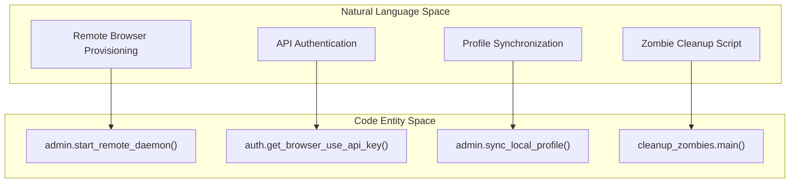
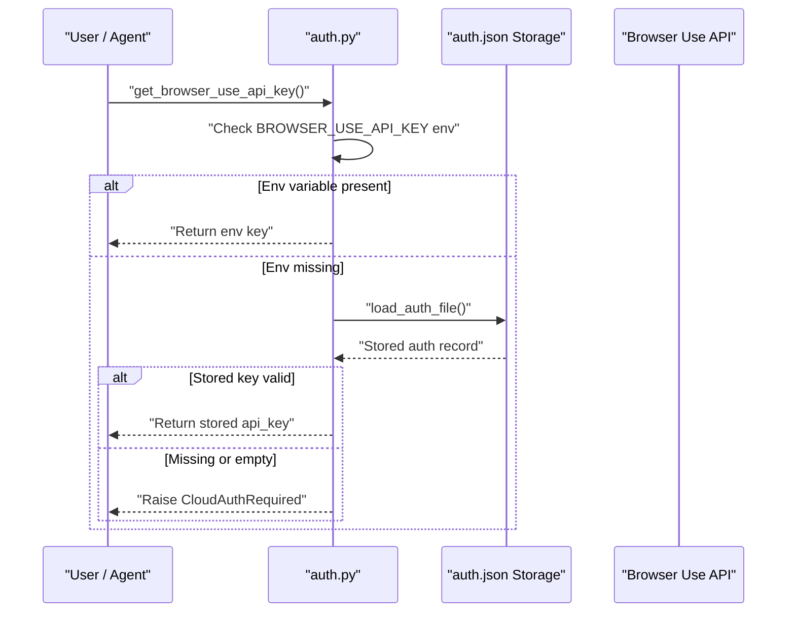
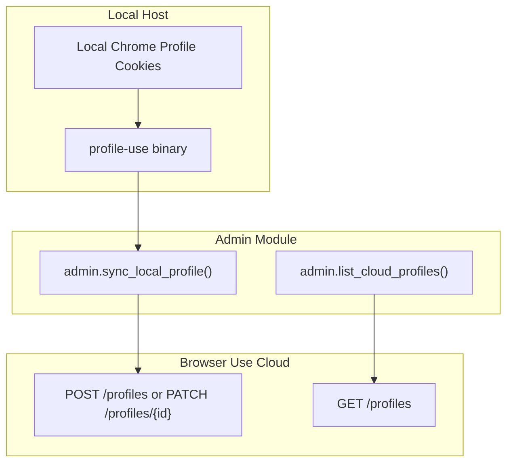

<!-- source: DeepWiki mcp.deepwiki.com · repo browser-use/browser-harness · page 2.4 Cloud Browser & Profile Sync · fetched 2026-10-30 -->

# Cloud Browser & Profile Sync

Relevant source files

The following files were used as context for generating this wiki page:

- [agent-workspace/domain-skills/browser-use-cloud/cleanup-zombies.py](agent-workspace/domain-skills/browser-use-cloud/cleanup-zombies.py)
- [agent-workspace/domain-skills/browser-use-cloud/cloud.md](agent-workspace/domain-skills/browser-use-cloud/cloud.md)
- [interaction-skills/profile-sync.md](interaction-skills/profile-sync.md)
- [src/browser_harness/admin.py](src/browser_harness/admin.py)
- [src/browser_harness/auth.py](src/browser_harness/auth.py)
- [src/browser_harness/paths.py](src/browser_harness/paths.py)
- [src/browser_harness/telemetry.py](src/browser_harness/telemetry.py)
- [tests/unit/test_auth.py](tests/unit/test_auth.py)
- [tests/unit/test_brave_origin.py](tests/unit/test_brave_origin.py)

This page explains the Browser Use cloud API integration within `browser-harness`, covering remote browser provisioning (`start_remote_daemon` / `stop_remote_daemon`), authentication key storage and OAuth flows in `auth.py`, local and cloud profile synchronization, cookie-only persistence mechanics, and the `browser-use-cloud` domain skill for zombie session management.

Sources: [src/browser_harness/admin.py:1-404](), [src/browser_harness/auth.py:1-222](), [interaction-skills/profile-sync.md:1-90]()

---

## 1. Overview and Core Integration Architecture

The cloud integration layer allows `browser-harness` to delegate execution to remote browser instances hosted on Browser Use infrastructure. This decouples local machine capabilities from heavy browser automation tasks, enabling parallel runs, headless server execution, and authenticated profile persistence.

The core modules involved are:
- `admin.py`: Handles API interactions with `https://api.browser-use.com/api/v3`, remote browser lifecycle control, and local process management [src/browser_harness/admin.py:1-150]()
- `auth.py`: Manages credential storage, OAuth PKCE flows, and environment-based API key retrieval [src/browser_harness/auth.py:1-200]()
- `paths.py`: Resolves configuration and storage directories under `BH_HOME` [src/browser_harness/paths.py:1-49]()

### Natural Language to Code Entity Mapping: Cloud Infrastructure

Sources: [src/browser_harness/admin.py:321-345](), [src/browser_harness/auth.py:182-191](), [src/browser_harness/admin.py:376-404](), [agent-workspace/domain-skills/browser-use-cloud/cleanup-zombies.py:87-160]()

---

## 2. Authentication & Credential Storage (`auth.py`)

The `auth.py` module manages authentication against the Browser Use cloud backend. Credentials can be supplied via environment variables (`BROWSER_USE_API_KEY`) or persisted in a local configuration file (`auth.json`) via OAuth flows [src/browser_harness/auth.py:126-191]().

### Key Functions and Data Structures
- `get_browser_use_api_key()`: Resolves the API key from `os.environ["BROWSER_USE_API_KEY"]` or falls back to the stored JSON record, raising `CloudAuthRequired` if neither is present [src/browser_harness/auth.py:182-191]().
- `auth_status()`: Inspects the current authentication state and source (`env` vs `stored` vs `missing`) [src/browser_harness/auth.py:193-200]().
- `save_auth_record()`: Persists an `AuthRecord` securely to the configuration path with restricted file permissions (`0o600`) [src/browser_harness/auth.py:146-156](), [src/browser_harness/paths.py:19-24]().

### Authentication Data Flow

Sources: [src/browser_harness/auth.py:133-191](), [src/browser_harness/paths.py:10-16]()

---

## 3. Profile Synchronization & Cookie Persistence

To maintain sessions across remote browser restarts, `browser-harness` supports syncing local browser cookies to remote cloud profiles via the `profile-use` binary helper [interaction-skills/profile-sync.md:3-11]().

### Cookie-Only Persistence Model
The synchronization model is strictly **cookies-only**; `localStorage`, `IndexedDB`, and browser extensions are excluded [interaction-skills/profile-sync.md:74-75](). This provides enough state for session-cookie based platforms (Google, GitHub, Stripe, SaaS) while avoiding heavy storage sync overhead.

### Key Functions in `admin.py`
- `list_cloud_profiles()`: Queries `GET /profiles` to retrieve all remote profiles associated with the API key [interaction-skills/profile-sync.md:81-82]().
- `list_local_profiles()`: Invokes the external `profile-use` CLI to discover local Chrome and Edge profiles [interaction-skills/profile-sync.md:19-20]().
- `sync_local_profile()`: Pushes local cookies to the cloud profile (creating one or updating an existing ID via `cloud_profile_id`), supporting domain filters via `include_domains` and `exclude_domains` [interaction-skills/profile-sync.md:22-27]().

### Profile Sync Architecture

Sources: [src/browser_harness/admin.py:220-229](), [interaction-skills/profile-sync.md:3-35]()

---

## 4. Remote Browser Lifecycle Management

Provisioning and teardown of remote browser sessions are handled via `admin.py` interfacing with `https://api.browser-use.com/api/v3` [src/browser_harness/admin.py:129-345]().

### Provisioning (`start_remote_daemon`)
When `start_remote_daemon(name, profileName=..., profileId=...)` is invoked:
1. Client-side profile name resolution resolves `profileName` to a UUID via `list_cloud_profiles()` if needed [interaction-skills/profile-sync.md:82-83]().
2. An HTTP `POST` request is sent to `/browsers` with parameters such as `profileId`, `proxyCountryCode` (defaulting to `"us"` or `null` to disable), and `timeout` [agent-workspace/domain-skills/browser-use-cloud/cloud.md:37-48]().
3. The API returns a session object containing `id`, `cdpUrl`, and `liveUrl` [agent-workspace/domain-skills/browser-use-cloud/cloud.md:50-68]().
4. A local `daemon.py` instance is spawned, configured with `BU_CDP_WS` pointing to the remote browser's CDP endpoint [src/browser_harness/admin.py:341-345]().

### Shutdown and Billing (`stop_remote_daemon`)
Remote browsers incur continuous billing until terminated. `stop_remote_daemon(name)` signals the daemon to execute its shutdown sequence [src/browser_harness/admin.py:266-277](), which issues a `PATCH` request to `/browsers/{REMOTE_ID}` with `{"action": "stop"}` [agent-workspace/domain-skills/browser-use-cloud/cloud.md:73-77](). This cleanly ends billing and commits any mutated session cookies back to the cloud profile [interaction-skills/profile-sync.md:76-77]().

### Zombie Session Management (`cleanup-zombies.py`)
The `browser-use-cloud` domain skill includes `cleanup-zombies.py` to audit and purge abandoned or zombie cloud sessions [agent-workspace/domain-skills/browser-use-cloud/cleanup-zombies.py:1-21](). It queries active sessions via `GET /browsers`, calculates session age based on `startedAt`, and issues `PATCH /browsers/{id}` with `{"action": "stop"}` for sessions exceeding the threshold (default 30 minutes) [agent-workspace/domain-skills/browser-use-cloud/cleanup-zombies.py:58-84]().

Sources: [src/browser_harness/admin.py:266-345](), [agent-workspace/domain-skills/browser-use-cloud/cloud.md:35-79](), [agent-workspace/domain-skills/browser-use-cloud/cleanup-zombies.py:1-163]()

---

