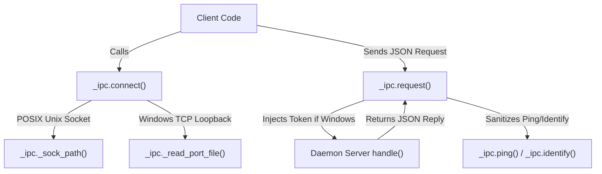
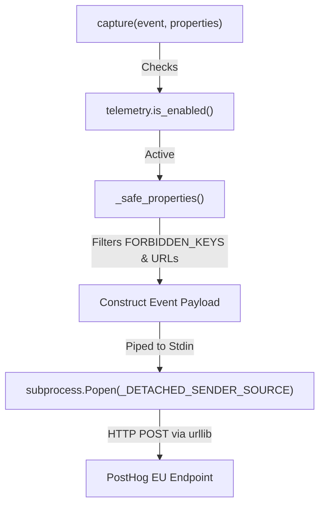
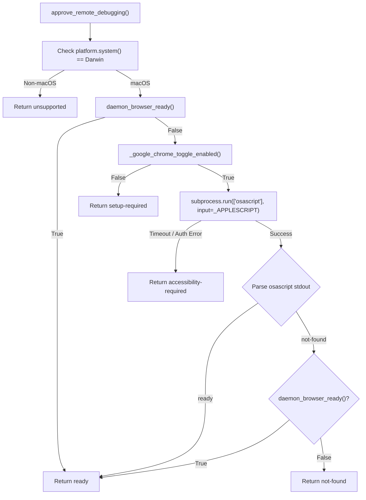

<!-- source: DeepWiki mcp.deepwiki.com · repo browser-use/browser-harness · page 2.5 IPC, Paths & Telemetry Internals · fetched 2026-10-30 -->

# IPC, Paths & Telemetry Internals

<details>
<summary>Relevant source files</summary>

The following files were used as context for generating this wiki page:

- [.github/VOUCHED.td](.github/VOUCHED.td)
- [interaction-skills/profile-sync.md](interaction-skills/profile-sync.md)
- [src/browser_harness/_ipc.py](src/browser_harness/_ipc.py)
- [src/browser_harness/macos.py](src/browser_harness/macos.py)
- [src/browser_harness/paths.py](src/browser_harness/paths.py)
- [src/browser_harness/telemetry.py](src/browser_harness/telemetry.py)
- [tests/unit/test_ipc.py](tests/unit/test_ipc.py)
- [tests/unit/test_macos.py](tests/unit/test_macos.py)

</details>


This page details the implementation of foundational support layers in `browser-harness`: inter-process communication (`_ipc.py`), filesystem layout resolution (`paths.py`), opt-out analytics telemetry (`telemetry.py`), and macOS remote-debugging permission automation (`macos.py`).

---

## 1. IPC Transport & Protocol (`_ipc.py`)

The daemon communication layer uses different transport mechanisms depending on the operating system, governed by `IS_WINDOWS` [src/browser_harness/_ipc.py:7] and managed inside `src/browser_harness/_ipc.py`.

### Transport Mechanisms
* **POSIX:** Uses Unix domain sockets (`socket.AF_UNIX`) [src/browser_harness/_ipc.py:86-89]. Security relies on filesystem permissions (`chmod 0600` on the runtime directory), restricting access to the owning user UID.
* **Windows:** Uses TCP loopback (`127.0.0.1`) [src/browser_harness/_ipc.py:90-93] because Windows lacks Unix domain socket support in standard library bindings and file permission equivalents for TCP ports. Since any local process can connect to a loopback port, Windows sockets require token-based authentication (`_server_token`) [src/browser_harness/_ipc.py:28-31]. Every JSON request must carry the token under the `"token"` key [src/browser_harness/_ipc.py:96-99].

### Path Traversal Guards and Naming
To prevent directory traversal attacks via malicious `BU_NAME` inputs, `_check()` validates the name against a strict regular expression (`\A[A-Za-z0-9_-]{1,64}\Z`) [src/browser_harness/_ipc.py:35-38]. 

Depending on whether `BH_RUNTIME_DIR` or `BH_TMP_DIR` are shared or isolated, `_runtime_stem()` and `_tmp_stem()` determine file naming prefixes [src/browser_harness/_ipc.py:41-48]:
* If isolated, filenames use a bare `"bu"` stem [src/browser_harness/_ipc.py:43, 48].
* If shared (`BH_RUNTIME_DIR_SHARED=1`), filenames incorporate the instance identifier as `bu-<name>` [src/browser_harness/_ipc.py:43, 48].

### Protocol and Payload Sanitation
Client connections are established via `connect(name)` [src/browser_harness/_ipc.py:83-93], and data is exchanged using newline-delimited JSON through `request(c, token, req)` [src/browser_harness/_ipc.py:96-107].

Integrity checks (`ping()` and `identify()`) defend against stale `.port` files and port reuse by verifying that responding endpoints return valid daemon control structures rather than unrelated services [src/browser_harness/_ipc.py:109-149]:
* `ping()` verifies that the response is a dictionary where `resp.get("pong") is True` [src/browser_harness/_ipc.py:118-122].
* `identify()` verifies the pong and extracts the daemon's process ID, explicitly rejecting booleans (since `isinstance(True, int)` is true in Python) [src/browser_harness/_ipc.py:147-148], missing keys, non-dictionary payloads, and non-positive PIDs (`<= 0`) to prevent dangerous `os.kill()` signals [tests/unit/test_ipc.py:44-96].


*Sources: [src/browser_harness/_ipc.py:1-201](), [tests/unit/test_ipc.py:1-128]()*

---

## 2. Directory Resolution & Layout (`paths.py`)

Filesystem locations are centralized in `src/browser_harness/paths.py`, allowing callers to override default directories using environment variables.

### Environment Variables
* `BH_HOME` (or `BROWSER_HARNESS_HOME`): Root directory for configuration, runtimes, temporary files, and agent workspaces [src/browser_harness/paths.py:9-10]. If unset, it falls back to `XDG_CONFIG_HOME` or `~/.config/browser-harness` [src/browser_harness/paths.py:13-16].
* `BH_CONFIG_DIR`: Overrides configuration storage [src/browser_harness/paths.py:27-29].
* `BH_RUNTIME_DIR`: Overrides socket, PID, and port file storage [src/browser_harness/paths.py:37-40].
* `BH_TMP_DIR`: Overrides logs, screenshots, and debug overlays [src/browser_harness/paths.py:42-45].
* `BH_AGENT_WORKSPACE`: Overrides the root directory for domain skills [src/browser_harness/paths.py:47-50].

### Private Directory Security
`ensure_private_dir()` creates target directories with recursive parent creation, enforcing strict POSIX permissions (`0o700`) to prevent unauthorized local users from reading sensitive runtime data or session cookies [src/browser_harness/paths.py:19-24].

```mermaid
graph TD
    Env["Environment Variables<br/>(BH_HOME, BH_RUNTIME_DIR, etc.)"] -->|Resolved by| Paths["paths.py Functions"]
    Paths -->|config_dir()| Config["~/.config/browser-harness"]
    Paths -->|runtime_dir()| Runtime["runtime/ (Sockets & PIDs)"]
    Paths -->|tmp_dir()| Tmp["tmp/ (Logs & Screenshots)"]
    Paths -->|workspace_dir()| Workspace["agent-workspace/ (Skills)"]
    Config -->|Secured via| Perms["ensure_private_dir() -> 0o700"]
    Runtime -->|Secured via| Perms
    Tmp -->|Secured via| Perms
    Workspace -->|Secured via| Perms
```
*Sources: [src/browser_harness/paths.py:1-49]()*

---

## 3. Telemetry Subsystem (`telemetry.py`)

`src/browser_harness/telemetry.py` implements opt-out, best-effort telemetry reporting to PostHog (`POSTHOG_KEY` at `POSTHOG_HOST`) [src/browser_harness/telemetry.py:1-19].

### Disabling Telemetry
Telemetry is disabled if:
1. Any environment variable in `DISABLE_ENVS` (`BH_TELEMETRY`, `BROWSER_HARNESS_TELEMETRY`, `ANONYMIZED_TELEMETRY`) evaluates to `"0"`, `"false"`, `"no"`, or `"off"` [src/browser_harness/telemetry.py:20, 82-85].
2. The local telemetry configuration file (`telemetry.json`) contains `"disabled": true` [src/browser_harness/telemetry.py:48-56, 102-106].

### Privacy and Redaction
Before emission, event properties pass through `_safe_properties()` [src/browser_harness/telemetry.py:128-144]:
* Keys are sanitized and truncated to 80 characters [src/browser_harness/telemetry.py:131].
* Any key matching or containing terms in `FORBIDDEN_KEYS` (e.g., `api_key`, `content`, `cookie`, `email`, `password`, `secret`, `token`, `url`) is completely dropped [src/browser_harness/telemetry.py:22-41, 133-134].
* String values containing `://` are replaced with `[redacted]` to prevent inadvertent URL or credential leakage [src/browser_harness/telemetry.py:141-143].

### Non-Blocking Execution
To ensure telemetry collection never impacts CLI responsiveness, events are transmitted asynchronously via `_send_detached()`, which spawns a detached Python subprocess via `subprocess.Popen` with `start_new_session=True` [src/browser_harness/telemetry.py:173-207].


*Sources: [src/browser_harness/telemetry.py:1-231]()*

---

## 4. macOS Remote-Debugging Approval Automation (`macos.py`)

On macOS, running local Chrome instances with remote debugging enabled triggers a native system modal sheet: *"Allow remote debugging?"*. `src/browser_harness/macos.py` automates the approval process without stealing window focus from the user.

### Automation Workflow
1. **Platform Check:** Verifies `platform.system() == "Darwin"`; returns `"unsupported"` otherwise [src/browser_harness/macos.py:69-72].
2. **Readiness Check:** If the browser daemon is already responding (`daemon_browser_ready()`), it immediately returns `"ready"` [src/browser_harness/macos.py:74-75].
3. **Toggle Validation:** Confirms that remote debugging is enabled for the active Chrome profile path (`_google_chrome_toggle_enabled()`) [src/browser_harness/macos.py:77-82].
4. **AppleScript Execution:** Runs `osascript` with an embedded AppleScript routine (`_APPLESCRIPT`) that inspects System Events for the Google Chrome process, navigates window sheets, identifies the `"Allow remote debugging?"` sheet, and invokes the `AXPress` action on the `"Allow"` button [src/browser_harness/macos.py:12-51, 85-92].

### Status Codes
`approve_remote_debugging()` returns a `(status, detail)` tuple corresponding to these states:
* `("ready", None)`: Dialog successfully clicked or daemon already active [src/browser_harness/macos.py:75, 109].
* `("setup-required", detail)`: Persistent checkbox disabled in Chrome settings [src/browser_harness/macos.py:78-82].
* `("accessibility-required", detail)`: macOS System Settings > Privacy & Security > Accessibility permission missing for the launching terminal [src/browser_harness/macos.py:94, 101-104].
* `("not-found", detail)`: Prompt sheet not currently visible [src/browser_harness/macos.py:110-117].
* `("error", detail)`: Subprocess or execution failure [src/browser_harness/macos.py:96, 105, 118].


*Sources: [src/browser_harness/macos.py:1-131](), [tests/unit/test_macos.py:1-127]()*

---

