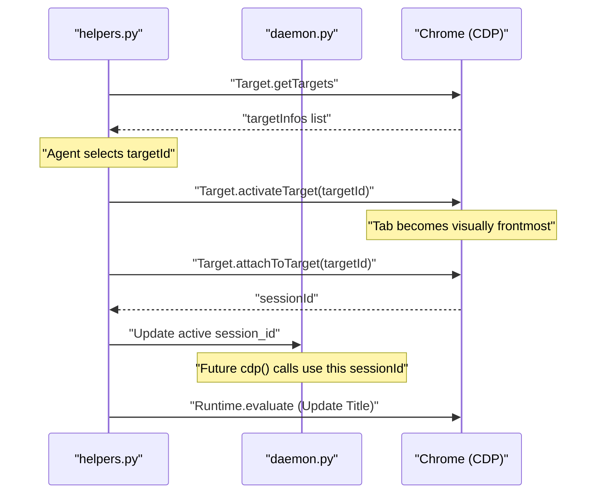
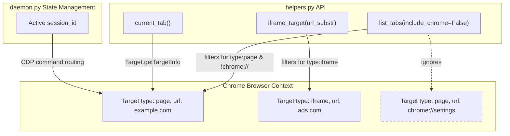

<!-- source: DeepWiki mcp.deepwiki.com · repo browser-use/browser-harness · page 3.2 Frames, Shadow DOM & Multi-Tab · fetched 2026-10-30 -->

# Frames, Shadow DOM & Multi-Tab

Relevant source files

The following files were used as context for generating this wiki page:

- [interaction-skills/connection.md](interaction-skills/connection.md)
- [interaction-skills/cross-origin-iframes.md](interaction-skills/cross-origin-iframes.md)
- [interaction-skills/iframes.md](interaction-skills/iframes.md)
- [interaction-skills/scrolling.md](interaction-skills/scrolling.md)
- [interaction-skills/shadow-dom.md](interaction-skills/shadow-dom.md)
- [interaction-skills/tabs.md](interaction-skills/tabs.md)

This page explains how `browser-harness` navigates complex document structures and manages multiple execution contexts. It covers the technical implementation of iframe traversal (both same-origin and cross-origin), Shadow DOM piercing, and the mechanics of tab management via the Chrome DevTools Protocol (CDP).

Sources: [interaction-skills/iframes.md:1-3](), [interaction-skills/cross-origin-iframes.md:1-3](), [interaction-skills/shadow-dom.md:1-3](), [interaction-skills/tabs.md:1-4]()

---

## Iframe Traversal

The harness distinguishes between same-origin iframes, which are accessible via the parent document's DOM, and cross-origin iframes, which require separate CDP target attachment.

### Same-Origin Iframes
For iframes sharing the same protocol, host, and port, the harness can traverse into the frame using standard JavaScript execution. This is typically handled via `contentDocument` or `contentWindow` within a `js()` call [interaction-skills/iframes.md:3-3]().

### Cross-Origin Iframes
Cross-origin iframes are treated as separate targets by Chrome. To interact with these frames using DOM-level commands, the harness must identify the specific `targetId` for that frame.

*   **`iframe_target(url_substr)`**: This function iterates through all available targets using `Target.getTargets`. It filters for targets of type `iframe` and returns the `targetId` of the first match where the URL contains the provided substring [interaction-skills/cross-origin-iframes.md:3-3]().
*   **Execution**: Once a `targetId` is obtained, it can be passed to the `js()` function (which accepts an optional `target_id` parameter) to execute code specifically within that frame's context [interaction-skills/cross-origin-iframes.md:3-3]().

**Note on Coordinates**: While DOM operations require frame-specific contexts, coordinate-based interactions (like clicking via `click_at_xy`) are often lower-friction as they operate at the compositor level relative to the main viewport, bypassing the need to switch targets for simple interactions [interaction-skills/cross-origin-iframes.md:3-3]().

Sources: [interaction-skills/iframes.md:1-3](), [interaction-skills/cross-origin-iframes.md:1-3]()

---

## Shadow DOM Piercing

Shadow DOM creates encapsulation boundaries that standard `document.querySelector` cannot cross. The harness strategy for Shadow DOM involves recursive traversal of `shadowRoot` properties.

*   **Recursive Traversal**: To find elements inside a web component, scripts must check for the existence of a `shadowRoot` on host elements and continue the search within that root [interaction-skills/shadow-dom.md:3-3]().
*   **Coordinate Strategy**: In deeply nested component trees, the harness often prefers calculating the absolute viewport coordinates of an element once and using coordinate-clicking rather than maintaining complex piercing logic [interaction-skills/shadow-dom.md:3]().

Sources: [interaction-skills/shadow-dom.md:1-3]()

---

## Multi-Tab Management

The harness manages multiple tabs by switching the active CDP session. A key distinction is made between the "active target" (what the user sees) and the "attached session" (what the harness controls) [interaction-skills/tabs.md:1-4]().

### Key Functions
| Function | Description |
| :--- | :--- |
| `list_tabs(include_chrome)` | Returns a list of all `page` targets. Can filter out internal `chrome://` pages [interaction-skills/tabs.md:8-9](). |
| `new_tab(url)` | Creates a new target and attaches the harness to it [interaction-skills/tabs.md:10-10](). |
| `switch_tab(target_id)` | Attaches the harness to a new target and updates the internal session [interaction-skills/tabs.md:11-11](). |
| `current_tab()` | Returns metadata for the currently attached target [interaction-skills/tabs.md:13-13](). |
| `page_info()` | Returns details about the current page state [interaction-skills/tabs.md:14-14](). |

### Visual Activation vs. Background Control
When `switch_tab()` is called, it intentionally does *not* change Chrome's visible tab by default [interaction-skills/tabs.md:64-64](). Static screenshots and CDP input work fine on attached background tabs [interaction-skills/tabs.md:65-65](). 
*   `activate_tab(target_id)` uses `Target.activateTarget` under the hood and is reserved exclusively for a user-requested visible switch [interaction-skills/tabs.md:12-12, 66-66]().

### CDP vs. Visible Order
There is a discrepancy between the order of targets returned by CDP and the visual "tab strip" order seen by the user [interaction-skills/tabs.md:24-25]().
*   **CDP Order**: `Target.getTargets` returns targets in initialization order rather than UI order [interaction-skills/tabs.md:24-25]().
*   **Visible Order**: On macOS, visible order can be retrieved via AppleScript querying `every tab of front window` [interaction-skills/tabs.md:32-42](). On Linux, tools like `xdotool` or `wmctrl` are used [interaction-skills/tabs.md:58-59]().

### Multi-Tab Data Flow
The following diagram illustrates how the harness switches its execution context between different browser tabs.

Title: Tab Switching Logic Sequence

Sources: [interaction-skills/tabs.md:1-61](), [interaction-skills/connection.md:1-52]()

---

## Target Identification and Filtering

Not every target returned by CDP is an interactable web page. The harness implements filtering to ensure the agent does not interact with hidden internal browser surfaces.

### Internal Target Filtering
The harness identifies internal targets such as `chrome://newtab/` or `chrome://omnibox-popup.top-chrome/` (which features a 1px invisible viewport) and filters them out for user-facing lists [interaction-skills/tabs.md:66-71](), [interaction-skills/connection.md:3-5]().

### Target Metadata Mapping
This diagram bridges the natural language concept of "Tabs" and "Iframes" to specific CDP entities and harness module code functions.

Title: Target and Session Mapping Architecture

### Common Pitfalls
1.  **Invisible Targets**: Targets with `width=0` or `height=0` often indicate the harness is attached to a non-window surface [interaction-skills/tabs.md:72-72]().
2.  **Omnibox Popups**: Chrome can expose the address bar dropdown as a target; these should be ignored for user-facing tab lists [interaction-skills/tabs.md:71-71]().
3.  **Dynamic UIs**: For pages with dynamic overlays or modals, element rects should be re-read before coordinate-clicking [interaction-skills/tabs.md:73-73]().

Sources: [interaction-skills/tabs.md:62-73](), [interaction-skills/connection.md:3-8]()

---

