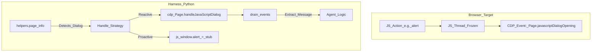
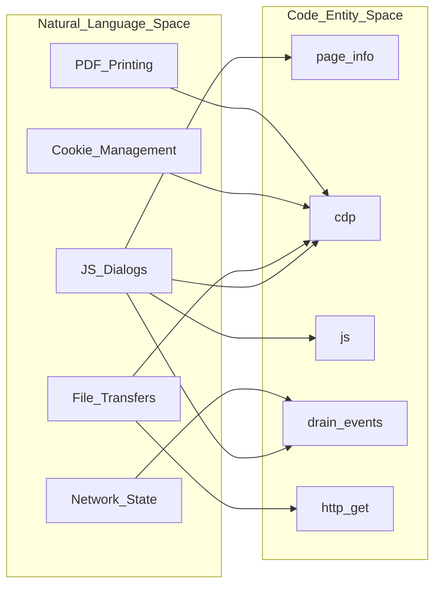

<!-- source: DeepWiki mcp.deepwiki.com · repo browser-use/browser-harness · page 3.3 Dialogs, Downloads, Uploads & Network · fetched 2026-10-30 -->

# Dialogs, Downloads, Uploads & Network

Relevant source files

The following files were used as context for generating this wiki page:

- [interaction-skills/cookies.md](interaction-skills/cookies.md)
- [interaction-skills/dialogs.md](interaction-skills/dialogs.md)
- [interaction-skills/downloads.md](interaction-skills/downloads.md)
- [interaction-skills/drag-and-drop.md](interaction-skills/drag-and-drop.md)
- [interaction-skills/network-requests.md](interaction-skills/network-requests.md)
- [interaction-skills/print-as-pdf.md](interaction-skills/print-as-pdf.md)
- [interaction-skills/screenshots.md](interaction-skills/screenshots.md)
- [interaction-skills/uploads.md](interaction-skills/uploads.md)
- [interaction-skills/viewport.md](interaction-skills/viewport.md)

This page covers the management of browser-level interactions that exist outside the standard DOM tree, including JavaScript dialogs, file transfers (uploads and downloads), cookie management, network activity monitoring, and PDF generation. These interactions often require direct communication with the Chrome DevTools Protocol (CDP) because they can freeze the JavaScript execution thread or involve operating system-level interfaces.

## JavaScript Dialogs

Browser dialogs (`alert`, `confirm`, `prompt`, and `beforeunload`) are modal windows that freeze the page's JavaScript execution until they are resolved [interaction-skills/dialogs.md:3-3](). In `browser-harness`, these are handled via two primary strategies: Reactive (CDP-based) and Proactive (JS-stubbing) [interaction-skills/dialogs.md:9-30]().

### Detection
The `page_info()` helper automatically detects if a dialog is currently blocking the page. If a dialog is open, `page_info()` returns a specialized dictionary containing the dialog's metadata (`{"dialog": {"type", "message", ...}}`) instead of the standard viewport information [interaction-skills/dialogs.md:7-7]().

### Reactive Handling via CDP
This is the preferred method as it works even when the JS thread is frozen and is undetectable by anti-bot scripts [interaction-skills/dialogs.md:9-11]().

*   **Action**: Use `cdp("Page.handleJavaScriptDialog", ...)` with `accept=True` (OK/Leave) or `accept=False` (Cancel/Stay) [interaction-skills/dialogs.md:15-16]().
*   **Metadata**: Use `drain_events()` to retrieve the dialog type (`alert`, `confirm`, `prompt`, `beforeunload`) and the message text from the buffered `Page.javascriptDialogOpening` event [interaction-skills/dialogs.md:18-24]().

### Proactive Handling via JS Stubs
For scenarios involving high-frequency dialogs, developers can inject JavaScript to overwrite the native window methods before they are called [interaction-skills/dialogs.md:28-30]().

*   **Implementation**: Stubs push messages into a global array (e.g., `window.__dialogs__`) and return default values (e.g., `true` for `confirm`) [interaction-skills/dialogs.md:33-38]().
*   **Tradeoffs**: Stubs are lost on navigation, cannot handle `beforeunload`, and are detectable by anti-bot scripts via `window.alert.toString()` inspection [interaction-skills/dialogs.md:43-47]().

### The `beforeunload` Event
This dialog appears when navigating away from pages with unsaved changes. It can be handled reactively by calling `goto_url()` and then dismissing the resulting dialog, or proactively by nullifying the handler (`window.onbeforeunload=null`) before navigation [interaction-skills/dialogs.md:49-64]().

**Dialog Management Data Flow**

Sources: [interaction-skills/dialogs.md:1-64]()

## File Uploads and Downloads

### File Uploads
Uploads involve bypassing OS-level file picker dialogs. While standard input interactions use coordinates, file uploads specifically target file input elements using the `DOM.setFileInputFiles` CDP command to programmatically attach local files to the browser session [interaction-skills/uploads.md:1]().

### Downloads
The harness distinguishes between browser-triggered downloads (clicking a "Download" button) and direct fetches using `http_get(...)` [interaction-skills/downloads.md:3-3]().
*   **Browser-triggered**: Requires monitoring for download progress signals to verify that a download actually started [interaction-skills/downloads.md:3]().
*   **Direct fetch**: `http_get(...)` is used for direct data retrieval when the URL is known and doesn't require complex browser UI interaction [interaction-skills/downloads.md:3-3]().

Sources: [interaction-skills/uploads.md:1](), [interaction-skills/downloads.md:1-3]()

## Cookie Management

Cookie management requires careful handling to get, save, and set cookies without confusing browser runtime state with target page state [interaction-skills/cookies.md:3-3]().
*   **Operations**: Cookies can be retrieved and injected via CDP storage domains (`Network.getCookies`, `Network.setCookie`) to maintain session persistence across runs or perform authenticated bootstrapping without repeating login UI flows.
*   **State Isolation**: Care must be taken to isolate cookie persistence layers from ephemeral page modifications so that profile data remains consistent.

Sources: [interaction-skills/cookies.md:1-3]()

## Network Request Monitoring

In Single Page Applications (SPAs) or complex submission flows, DOM changes may be subtle or delayed. Network monitoring provides a reliable signal for action success [interaction-skills/network-requests.md:3]().
*   **Monitoring Activity**: By watching network activity, the harness can infer the state of submit flows and SPA actions that succeed without obvious DOM changes [interaction-skills/network-requests.md:3]().

Sources: [interaction-skills/network-requests.md:1-3]()

## PDF Generation

The harness supports PDF creation through two primary flows:
1.  **Direct CDP Generation**: Using `Page.printToPDF` to generate a PDF of the current page state [interaction-skills/print-as-pdf.md:3]().
2.  **Print Flow Handling**: Interacting with sites that expose a visible "Print" button. This requires clicking the button and then handling the browser's internal print dialog flow [interaction-skills/print-as-pdf.md:3]().

Sources: [interaction-skills/print-as-pdf.md:1-3]()

## System Interaction Mapping

The following diagram maps high-level concepts to the specific code entities used to manage these external-to-DOM interactions.

Sources: [interaction-skills/dialogs.md:7-24](), [interaction-skills/downloads.md:3-3](), [interaction-skills/cookies.md:3-3](), [interaction-skills/network-requests.md:3](), [interaction-skills/print-as-pdf.md:3]()

---

