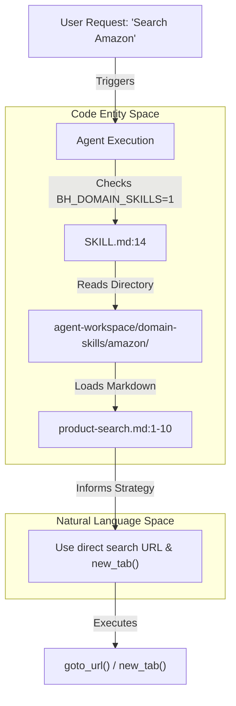
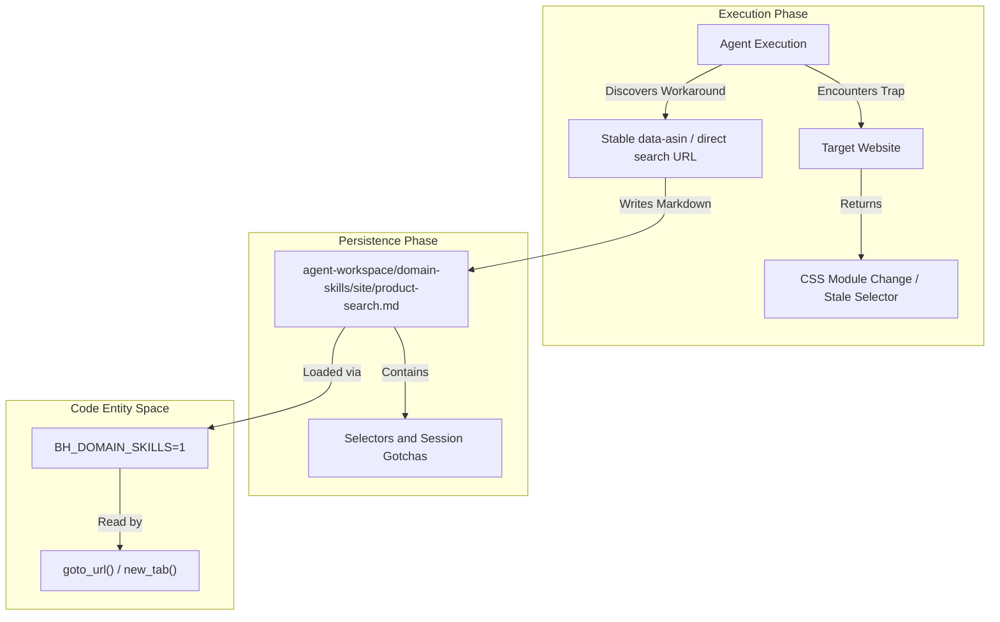

<!-- source: DeepWiki mcp.deepwiki.com · repo browser-use/browser-harness · page 4 Domain Skills Library · fetched 2026-10-30 -->

# Domain Skills Library

Relevant source files

The following files were used as context for generating this wiki page:

- [SKILL.md](SKILL.md)
- [agent-workspace/agent_helpers.py](agent-workspace/agent_helpers.py)
- [agent-workspace/domain-skills/amazon/product-search.md](agent-workspace/domain-skills/amazon/product-search.md)
- [install.md](install.md)

The `agent-workspace/domain-skills/` directory serves as the persistent memory and expertise layer of `browser-harness`. While interaction skills handle generic browser mechanics like scrolling, clicking, and iframe traversal, **Domain Skills** capture the durable shape of specific websites: private APIs, stable selectors, URL patterns, and framework quirks [SKILL.md:10-17]().

Sources: [SKILL.md:10-17]()

## What are Domain Skills?

Domain skills are agent-generated markdown files documenting how to efficiently interact with specific web domains. Instead of rediscovering selectors or site traps on every run, agents consult these files to skip redundant exploration [SKILL.md:10-17]().

- **Discovery and Auto-loading**: When `BH_DOMAIN_SKILLS=1` is set, agents read files in the matching `$BH_AGENT_WORKSPACE/domain-skills/<site>/` directory before inventing an approach [SKILL.md:14-17]().
- **Structure**: Skills are organized by domain under `agent-workspace/domain-skills/` (e.g., `amazon/product-search.md`) [agent-workspace/domain-skills/amazon/product-search.md:1-10]().
- **Content**: Each file provides field-tested patterns, such as direct search URLs, container selectors, session gotchas (like using `new_tab()` on first navigation), and pagination logic [agent-workspace/domain-skills/amazon/product-search.md:6-156]().

### The Skill Lifecycle
Domain skills follow an agent-driven lifecycle:
1. **Search**: The agent checks the domain-skills directory when `BH_DOMAIN_SKILLS=1` is active [SKILL.md:14-17]().
2. **Execution**: The agent executes browser actions via harness primitives [SKILL.md:20-24]().
3. **Learning**: Upon discovering non-obvious selectors or session quirks (e.g., Amazon's migration to CSS modules for best sellers) [agent-workspace/domain-skills/amazon/product-search.md:120-122](), the agent documents them.
4. **Persistence**: New patterns are saved back to the domain-skills repository.

### Natural Language to Code Mapping: Skill Resolution

Title: "Domain Skill Resolution Flow"

Sources: [SKILL.md:14-17](), [agent-workspace/domain-skills/amazon/product-search.md:1-10]()

---

## Skill Categories

The library is organized into six data categories covering various web architectures and platforms.

### 4.1 Public Data APIs — Science, Finance & Geography
Focuses on high-throughput data extraction using browser automation and bulk HTTP fetches. Covers complex pagination strategies (offset, cursor, OAI-PMH) and data normalization quirks for sources like REST Countries, World Bank, NASA, arXiv, Wayback Machine, FRED, PubMed, OpenAlex, CrossRef, MusicBrainz, OpenStreetMap, and weather portals.
For details, see [Public Data APIs — Science, Finance & Geography](#4.1).

Sources: [SKILL.md:10-17]()

### 4.2 E-Commerce & Marketplace Platforms
Handles dynamic e-commerce platforms such as Amazon, eBay, Etsy, Walmart, Craigslist, Zillow, Flipkart, Spreadshirt, and travel/booking platforms like Expedia, Booking.com, Ctrip, ly.com, WeHotel, AA, and Alaska. Covers selector stability, session gotchas (e.g., Amazon `new_tab()` requirement), anti-bot considerations, and booking workflows.
For details, see [E-Commerce & Marketplace Platforms](#4.2).

Sources: [SKILL.md:10-17](), [agent-workspace/domain-skills/amazon/product-search.md:1-173]()

### 4.3 Developer & Professional Platforms
Documents scraping skills for developer and professional platforms including GitHub, Hacker News, Stack Overflow, SEC EDGAR, Coursera, DuckDuckGo, LinkedIn, Glassdoor, Wellfound, general job boards, Vercel, Trello, Loom, Gmail compose, and Claude.ai share transcript exports.
For details, see [Developer & Professional Platforms](#4.3).

Sources: [SKILL.md:10-17]()

### 4.4 Media, Entertainment & Social Platforms
Covers media-heavy and social platforms such as Spotify, SoundCloud, TikTok, Goodreads, Letterboxd, Metacritic, RAWG, Steam, itch.io, HowLongToBeat, Medium, Dev.to, Genius, Quora, Reddit, ProductHunt, Gutenberg, Open Library, IMDB, YouTube, Substack, Bilibili, Xiaohongshu, WeRead, Facebook, and X/Twitter posting and article source recovery.
For details, see [Media, Entertainment & Social Platforms](#4.4).

Sources: [SKILL.md:10-17]()

### 4.5 Financial, Review & Aggregator Platforms
Documents scraping skills for review platforms (Trustpilot, Capterra, G2), financial tracking sites (Macrotrends, TradingView, CoinGecko, CoinMarketCap), Eventbrite, package registries (npm/PyPI), Polymarket prediction markets, and news aggregation. Covers financial data APIs and review platform patterns.
For details, see [Financial, Review & Aggregator Platforms](#4.5).

Sources: [SKILL.md:10-17]()

### 4.6 Specialized & SaaS Domain Skills
Covers specialized skills for Atlas recruitment, TikTok Studio upload, Salesforce, Framer web editor, TheTechGeeks, Shopify Admin (Polaris inputs, embedded apps, forms app, knowledge base), TaskSquad AI, Perplexity/Manus, BOSS Zhipin, CentileBrain, BigBang HR checkout, Articulate Rise, AgentList, HubSpot private app webhooks, and QuickBooks Online report export.
For details, see [Specialized & SaaS Domain Skills](#4.6).

Sources: [SKILL.md:10-17]()

---

## Contributing New Skills

Domain skills are maintained by agents during task execution when durable patterns, stable selectors, or site-specific quirks are discovered [SKILL.md:16-17]().

Title: "Agent Skill Generation and Persistence Flow"

Sources: [SKILL.md:14-17](), [agent-workspace/domain-skills/amazon/product-search.md:1-142]()

---

