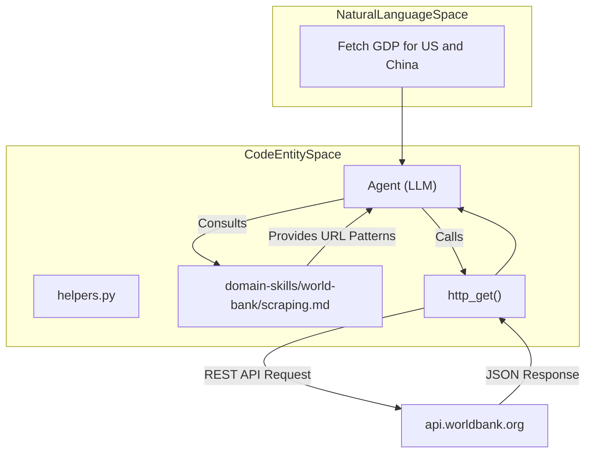

<!-- source: DeepWiki mcp.deepwiki.com · repo browser-use/browser-harness · page 4.1 Public Data APIs — Science, Finance & Geography · fetched 2026-10-30 -->

# Public Data APIs — Science, Finance & Geography

<details>
<summary>Relevant source files</summary>

The following files were used as context for generating this wiki page:

- [agent-workspace/domain-skills/archive-org/scraping.md](agent-workspace/domain-skills/archive-org/scraping.md)
- [agent-workspace/domain-skills/arxiv-bulk/scraping.md](agent-workspace/domain-skills/arxiv-bulk/scraping.md)
- [agent-workspace/domain-skills/arxiv/scraping.md](agent-workspace/domain-skills/arxiv/scraping.md)
- [agent-workspace/domain-skills/crossref/scraping.md](agent-workspace/domain-skills/crossref/scraping.md)
- [agent-workspace/domain-skills/fred/scraping.md](agent-workspace/domain-skills/fred/scraping.md)

</details>


This page documents the scraping skills and programmatic data extraction strategies for major public data repositories. These domains prioritize high-volume, structured data retrieval via REST APIs and OAI-PMH harvesters over browser-based DOM interaction.

Sources: [agent-workspace/domain-skills/archive-org/scraping.md:1-10](), [agent-workspace/domain-skills/arxiv-bulk/scraping.md:1-10](), [agent-workspace/domain-skills/crossref/scraping.md:1-5](), [agent-workspace/domain-skills/fred/scraping.md:1-5]()

## Core Implementation Strategy

For the majority of these providers, the codebase utilizes `http_get` from `helpers.py` to interact directly with JSON/XML endpoints. This bypasses the overhead of the Chrome DevTools Protocol (CDP) and avoids common anti-bot triggers associated with headless browsers.

### Data Flow Architecture

The following diagram illustrates the transition from Natural Language requests to the execution of specialized API logic within the `domain-skills/` framework.

**Skill Execution Flow**

Sources: [agent-workspace/domain-skills/archive-org/scraping.md:1-30](), [helpers.py:1-50]()

---

## Scientific & Academic Repositories

### arXiv & Semantic Scholar
The system supports both real-time search and bulk harvesting of pre-prints. Bulk operations utilize the OAI-PMH protocol, which requires handling resumption tokens for pagination.

*   **OAI-PMH Pattern:** Uses `verb=ListRecords` with `metadataPrefix=arXiv` [agent-workspace/domain-skills/arxiv-bulk/scraping.md:73-79]().
*   **Pagination:** Implements a `resumptionToken` loop via `fetch_oai_page`. The server requires a mandatory 5-second delay between page requests [agent-workspace/domain-skills/arxiv-bulk/scraping.md:34-41](), [agent-workspace/domain-skills/arxiv-bulk/scraping.md:90-92]().
*   **Enrichment:** ArXiv IDs are cross-referenced with the Semantic Scholar API to retrieve `citationCount` and `influentialCitationCount` [agent-workspace/domain-skills/arxiv-bulk/scraping.md:183-187]().
*   **Alternative Access:** For single papers, `citation_*` meta tags are extracted from the HTML abstract page via regex [agent-workspace/domain-skills/arxiv/scraping.md:150-170]().

### CrossRef
CrossRef provides scholarly DOI and citation metadata. It is completely free and requires no authentication.
*   **Polite Pool:** Always add a `mailto` parameter to the query string. This moves the request into the "polite pool," doubling rate limits and concurrency allowances [agent-workspace/domain-skills/crossref/scraping.md:5-9]().
*   **Data Parsing:** Abstracts often contain JATS XML tags (e.g., `<jats:p>`) which must be stripped for plain text usage [agent-workspace/domain-skills/crossref/scraping.md:42-44]().
*   **Batching:** Supports parallel fetches via `ThreadPoolExecutor`. A concurrency of 5 is safe for the polite pool [agent-workspace/domain-skills/crossref/scraping.md:127-129]().

Sources: [agent-workspace/domain-skills/arxiv-bulk/scraping.md:1-187](), [agent-workspace/domain-skills/arxiv/scraping.md:1-170](), [agent-workspace/domain-skills/crossref/scraping.md:1-179]()

---

## Financial & Economic Data

### FRED (Federal Reserve Economic Data)
FRED is the canonical source for US macroeconomic time series. 
*   **Auth Requirement:** Requires a free 32-character API key. Web-based CSV/JSON exports (`fred.stlouisfed.org`) are blocked for headless HTTP and will consistently timeout [agent-workspace/domain-skills/fred/scraping.md:3-22]().
*   **Data Quirks:** Observation values are returned as strings and may be `.` for missing data. Logic must check for this before casting to `float` [agent-workspace/domain-skills/fred/scraping.md:87-89]().

**FRED Observation Retrieval Logic**
```mermaid
graph LR
    subgraph "FRED_API_Entity"
        Request[""GET /series/observations""]
        APIKey[""api_key={FRED_KEY}""]
        Sort[""sort_order=desc""]
    end

    subgraph "Data_Normalization"
        ValueCheck{""Value == '.'?"}
        Cast[""float(value)""]
        Skip[""Ignore Null""]
    end

    Request --> APIKey
    APIKey --> Sort
    Sort --> ValueCheck
    ValueCheck -- "No" --> Cast
    ValueCheck -- "Yes" --> Skip
```
Sources: [agent-workspace/domain-skills/fred/scraping.md:66-93]()

### World Bank
Provides global economic indicators like GDP and inflation via public REST endpoints.
*   **Response Structure:** Responses are typically a 2-element list containing metadata and dataset values.

Sources: [agent-workspace/domain-skills/fred/scraping.md:1-184]()

---

## Archival & Media Data

### Wayback Machine (Internet Archive)
The primary interface is the **CDX API**, which is significantly more reliable than the standard Availability API [agent-workspace/domain-skills/archive-org/scraping.md:7-8]().
*   **CDX Querying:** Supports filtering by `statuscode` and `mimetype` directly in the URL query string [agent-workspace/domain-skills/archive-org/scraping.md:14-17]().
*   **Snapshot Logic:** Uses `collapse=timestamp:N` to retrieve unique snapshots per year (`:4`), month (`:6`), or day (`:8`) [agent-workspace/domain-skills/archive-org/scraping.md:66-83]().
*   **Pagination:** Implements a `resumeKey` strategy for large result sets via `showResumeKey=true`. The logic handles the specific CDX response structure where the last row contains the resume token [agent-workspace/domain-skills/archive-org/scraping.md:133-154]().

Sources: [agent-workspace/domain-skills/archive-org/scraping.md:1-194]()

---

## Technical Summary Table

| API | Format | Pagination Strategy | Auth / Requirement |
| :--- | :--- | :--- | :--- |
| **ArXiv Bulk** | XML | `resumptionToken` | None |
| **Wayback CDX** | JSON | `resumeKey` + `showResumeKey=true` | None |
| **FRED** | JSON | `offset` + `limit` | 32-char API Key |
| **CrossRef** | JSON | `rows` + `offset` | `mailto` parameter |

Sources: [agent-workspace/domain-skills/arxiv-bulk/scraping.md:39-41](), [agent-workspace/domain-skills/archive-org/scraping.md:133-154](), [agent-workspace/domain-skills/fred/scraping.md:79-81](), [agent-workspace/domain-skills/crossref/scraping.md:151]()

---

