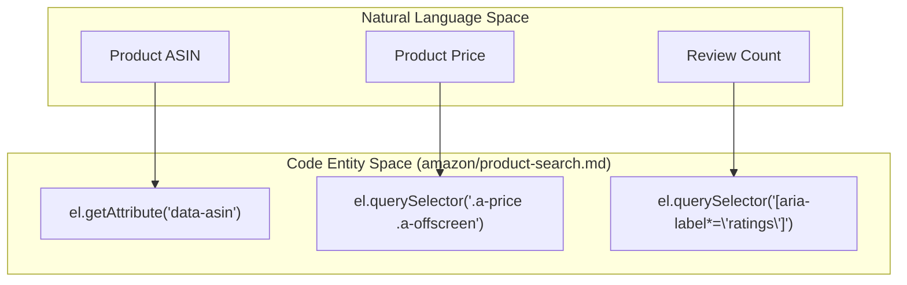
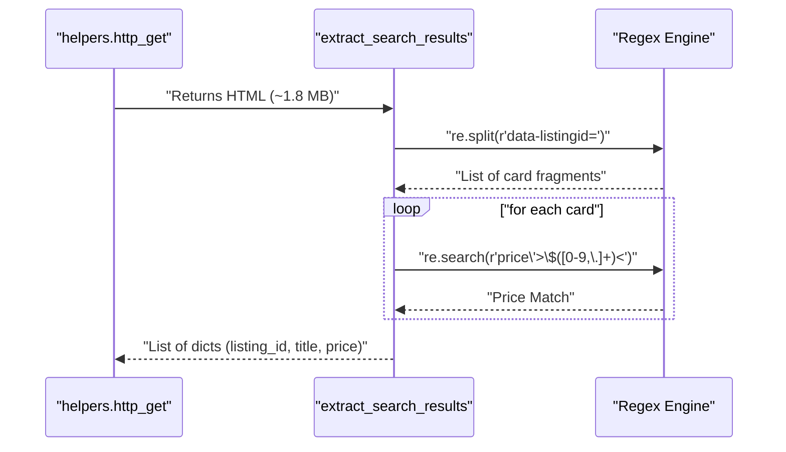
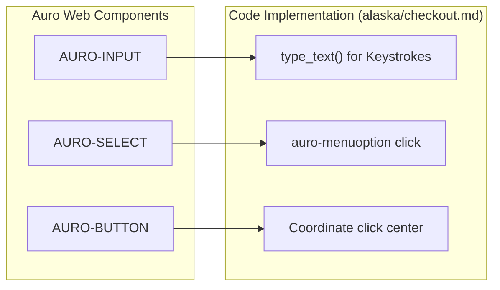

<!-- source: DeepWiki mcp.deepwiki.com · repo browser-use/browser-harness · page 4.2 E-Commerce & Marketplace Platforms · fetched 2026-10-30 -->

# E-Commerce & Marketplace Platforms

Relevant source files

The following files were used as context for generating this wiki page:

- [agent-workspace/domain-skills/aa/checkout.md](agent-workspace/domain-skills/aa/checkout.md)
- [agent-workspace/domain-skills/alaska/checkout.md](agent-workspace/domain-skills/alaska/checkout.md)
- [agent-workspace/domain-skills/booking-com/scraping.md](agent-workspace/domain-skills/booking-com/scraping.md)
- [agent-workspace/domain-skills/craigslist/scraping.md](agent-workspace/domain-skills/craigslist/scraping.md)
- [agent-workspace/domain-skills/ctrip/hotels.md](agent-workspace/domain-skills/ctrip/hotels.md)
- [agent-workspace/domain-skills/ebay/scraping.md](agent-workspace/domain-skills/ebay/scraping.md)
- [agent-workspace/domain-skills/etsy/scraping.md](agent-workspace/domain-skills/etsy/scraping.md)
- [agent-workspace/domain-skills/expedia/automation.md](agent-workspace/domain-skills/expedia/automation.md)
- [agent-workspace/domain-skills/flipkart/shopping.md](agent-workspace/domain-skills/flipkart/shopping.md)
- [agent-workspace/domain-skills/ly-com/hotels.md](agent-workspace/domain-skills/ly-com/hotels.md)
- [agent-workspace/domain-skills/wehotel/hotels.md](agent-workspace/domain-skills/wehotel/hotels.md)

This page documents technical implementation details for scraping and interacting with major e-commerce, marketplace, and travel booking platforms. It covers data extraction strategies (HTML vs. JSON-LD), bot detection bypasses, selector stability, and complex multi-step checkout workflows.

## Platform Strategy Overview

The `browser-harness` library employs a hybrid approach: using `http_get` for platforms where server-side rendering (SSR) provides accessible data, and full CDP-based browser automation for platforms protected by advanced anti-bot measures or those requiring SPA hydration.

| Platform | Primary Method | Bot Protection | Key Data Source |
| :--- | :--- | :--- | :--- |
| **Amazon** | Browser (CDP) | CAPTCHA | DOM Selectors |
| **eBay** | `http_get` / Browser | IP Rate Limits | HTML / JSON-LD |
| **Booking.com**| Browser (CDP) | AWS WAF JS | GraphQL / DOM |
| **Flipkart** | Browser (CDP) | Login Popup | `__NEXT_DATA__` |
| **Ctrip / ly.com**| Browser (CDP) | Login Walls | SSR State / XHR |
| **Etsy** | Browser (CDP) | DataDome | JSON-LD / `__NEXT_DATA__` |
| **Expedia** | Browser (CDP) | Fragile UI | URL Parameters |
| **WeHotel** | Browser (CDP) | SPA Shell | DOM / XHR |

Sources: [agent-workspace/domain-skills/amazon/product-search.md:1-45](), [agent-workspace/domain-skills/ebay/scraping.md:1-35](), [agent-workspace/domain-skills/booking-com/scraping.md:1-25](), [agent-workspace/domain-skills/flipkart/shopping.md:1-20](), [agent-workspace/domain-skills/ctrip/hotels.md:1-20](), [agent-workspace/domain-skills/ly-com/hotels.md:1-23](), [agent-workspace/domain-skills/etsy/scraping.md:1-15](), [agent-workspace/domain-skills/expedia/automation.md:1-15](), [agent-workspace/domain-skills/wehotel/hotels.md:1-23]()

---

## Amazon: Product Search & Data Extraction

Amazon interactions require a real browser session. Direct URL navigation is preferred over UI interaction for speed.

### Navigation and Session Management
To ensure a clean state and avoid navigation failures, always use `new_tab()` for the initial Amazon request in a session [agent-workspace/domain-skills/amazon/product-search.md:40-45](). Subsequent navigations can use `goto_url()`.

### Search and Detail Extraction
Amazon search results are contained within `[data-component-type="s-search-result"]` elements [agent-workspace/domain-skills/amazon/product-search.md:55-55](). Detail pages require constructing the price from `.a-price-whole` and `.a-price-fraction` as legacy ID selectors like `#priceblock_ourprice` are now null [agent-workspace/domain-skills/amazon/product-search.md:109-112]().

**Data Flow: Amazon Search Result Extraction**

Sources: [agent-workspace/domain-skills/amazon/product-search.md:1-184]()

---

## eBay: High-Performance Scraping

eBay is accessible via `http_get`, provided specific headers are used to avoid "Pardon Our Interruption" blocks [agent-workspace/domain-skills/ebay/scraping.md:6-14]().

### Extraction Implementation
*   **Search Results:** Do not contain JSON-LD. Data is extracted from `<li>` elements using `data-listingid` [agent-workspace/domain-skills/ebay/scraping.md:101-110]().
*   **Detail Pages:** Use the `/itm/{id}` pattern and contain reliable JSON-LD blocks [agent-workspace/domain-skills/ebay/scraping.md:93-94]().

Sources: [agent-workspace/domain-skills/ebay/scraping.md:1-203]()

---

## Marketplace & Classifieds

### Flipkart
Flipkart requires dismissing a login modal on every new session using a JS-based `click()` or coordinate click at `(720, 180)` [agent-workspace/domain-skills/flipkart/shopping.md:64-87](). Data extraction should prioritize the `__NEXT_DATA__` JSON block [agent-workspace/domain-skills/flipkart/shopping.md:198-205]().

### Etsy
`http_get` is blocked by DataDome (HTTP 403) [agent-workspace/domain-skills/etsy/scraping.md:7-12](). Scraping requires the browser. Always use `new_tab()` for the first navigation to establish the session [agent-workspace/domain-skills/etsy/scraping.md:166-167]().

Sources: [agent-workspace/domain-skills/flipkart/shopping.md:1-210](), [agent-workspace/domain-skills/etsy/scraping.md:1-190]()

---

## Travel & Booking Platforms

Travel platforms often employ aggressive JS challenges or login walls for pricing.

### Booking.com & Expedia
*   **Booking.com:** `http_get` is ineffective due to an AWS WAF JS challenge requiring `challenge.js` execution [agent-workspace/domain-skills/booking-com/scraping.md:10-15](). XML sitemaps are whitelisted for Googlebot UA [agent-workspace/domain-skills/booking-com/scraping.md:79-85]().
*   **Expedia:** UI interaction is fragile. The recommended strategy is "URL-first": encode destination, dates, and ages into the `goto()` URL [agent-workspace/domain-skills/expedia/automation.md:151-153](). Use JS `.click()` for traveller increments instead of coordinate clicks [agent-workspace/domain-skills/expedia/automation.md:155-157]().

### Chinese Hotel Portals (Ctrip, ly.com, WeHotel)
*   **Ctrip:** Prices are visible without login *only* if the URL includes a full parameter schema (e.g., `cityId`, `provinceId`, `districtId`, `countryId`, `flexType`). Simplified URLs redirect to login [agent-workspace/domain-skills/ctrip/hotels.md:45-49]().
*   **ly.com (Tongcheng):** Prices are gated behind login; anonymous users see `￥？` placeholders [agent-workspace/domain-skills/ly-com/hotels.md:10-13](). Metadata is available in `window.__NUXT__` SSR state [agent-workspace/domain-skills/ly-com/hotels.md:113-118]().
*   **WeHotel:** The most scrape-friendly; works anonymously for both list and detail pages with no login wall [agent-workspace/domain-skills/wehotel/hotels.md:11-19](). Note that param-name capitalization is inconsistent between list (`checkinDate`) and detail (`checkInDate`) [agent-workspace/domain-skills/wehotel/hotels.md:45-47]().

Sources: [agent-workspace/domain-skills/booking-com/scraping.md:1-188](), [agent-workspace/domain-skills/expedia/automation.md:1-168](), [agent-workspace/domain-skills/ctrip/hotels.md:1-198](), [agent-workspace/domain-skills/ly-com/hotels.md:1-204](), [agent-workspace/domain-skills/wehotel/hotels.md:1-203]()

---

## Airline Checkout Workflows

Automating airline checkouts requires handling Web Components (Shadow DOM) and cross-origin payment iframes.

### American Airlines (aa.com)
Uses an Angular app with **Open Shadow Roots**. Inputs must be addressed by `formcontrolname` on the host, but the real `<input>` is inside the `shadowRoot` [agent-workspace/domain-skills/aa/checkout.md:47-48]().
*   **Fill Recipe:** Requires a native setter pattern using `Object.getOwnPropertyDescriptor` to dispatch `input`, `change`, and `blur` events so Angular state updates correctly [agent-workspace/domain-skills/aa/checkout.md:121-130]().

### Alaska Airlines (alaskaair.com)
Built on the **Auro design system**. Programmatic `.value` assignments fail validation; inputs must be focused and filled via `type_text()` (CDP keystrokes) [agent-workspace/domain-skills/alaska/checkout.md:15-18]().
*   **Payment Iframes:** PAN and CVV fields are in **CyberSource Flex Microform** cross-origin iframes. The harness must find the `targetId` via `cdp("Target.getTargets")`, focus the inner element via `js("document.getElementById('number').focus()", target_id=...)`, and then call `type_text()` [agent-workspace/domain-skills/alaska/checkout.md:24-32]().

**Entity Mapping: Alaska Airlines Checkout Components**

Sources: [agent-workspace/domain-skills/aa/checkout.md:1-141](), [agent-workspace/domain-skills/alaska/checkout.md:1-69]()

---

