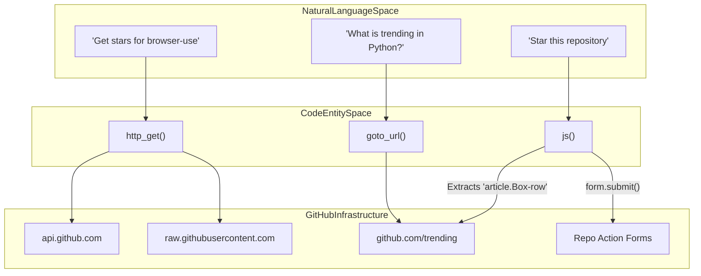
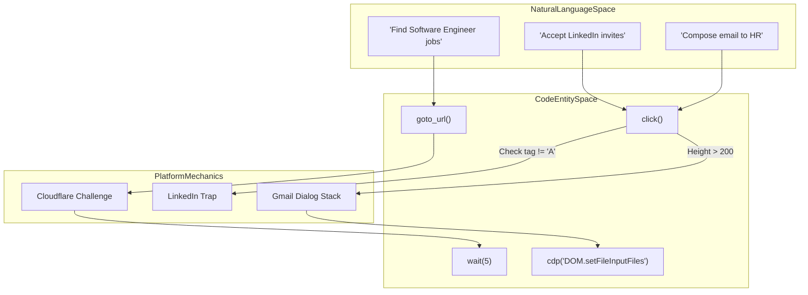

<!-- source: DeepWiki mcp.deepwiki.com · repo browser-use/browser-harness · page 4.3 Developer & Professional Platforms · fetched 2026-10-30 -->

# Developer & Professional Platforms

Relevant source files

The following files were used as context for generating this wiki page:

- [agent-workspace/domain-skills/claude-ai/extract-share-transcript.py](agent-workspace/domain-skills/claude-ai/extract-share-transcript.py)
- [agent-workspace/domain-skills/claude-ai/share-export.md](agent-workspace/domain-skills/claude-ai/share-export.md)
- [agent-workspace/domain-skills/coursera/scraping.md](agent-workspace/domain-skills/coursera/scraping.md)
- [agent-workspace/domain-skills/duckduckgo/scraping.md](agent-workspace/domain-skills/duckduckgo/scraping.md)
- [agent-workspace/domain-skills/github/repo-actions.md](agent-workspace/domain-skills/github/repo-actions.md)
- [agent-workspace/domain-skills/github/scraping.md](agent-workspace/domain-skills/github/scraping.md)
- [agent-workspace/domain-skills/glassdoor/scraping.md](agent-workspace/domain-skills/glassdoor/scraping.md)
- [agent-workspace/domain-skills/gmail/compose.md](agent-workspace/domain-skills/gmail/compose.md)
- [agent-workspace/domain-skills/hackernews/scraping.md](agent-workspace/domain-skills/hackernews/scraping.md)
- [agent-workspace/domain-skills/job-boards/indeed-glassdoor.md](agent-workspace/domain-skills/job-boards/indeed-glassdoor.md)
- [agent-workspace/domain-skills/linkedin/invitation-manager.md](agent-workspace/domain-skills/linkedin/invitation-manager.md)
- [agent-workspace/domain-skills/loom/folder-enumeration.md](agent-workspace/domain-skills/loom/folder-enumeration.md)
- [agent-workspace/domain-skills/qbo/report-export.md](agent-workspace/domain-skills/qbo/report-export.md)
- [agent-workspace/domain-skills/vercel/vercel.md](agent-workspace/domain-skills/vercel/vercel.md)

This page documents the scraping and data extraction strategies for major developer ecosystems, professional networks, and job platforms. The `browser-harness` approach prioritizes high-performance REST API or `http_get` methods where possible, falling back to browser-based extraction only for dynamic, JS-henyl, or anti-bot protected interfaces.

Sources: [agent-workspace/domain-skills/github/scraping.md:1-15](), [agent-workspace/domain-skills/glassdoor/scraping.md:5-26]()

## GitHub Data Extraction & Repo Actions

GitHub data is accessible via a hybrid approach: the **REST API** for structured metadata and the **Browser** for the Trending page, which lacks a public API equivalent.

### API vs. Browser Strategy
*   **REST API**: Use for repository metadata, user profiles, commits, releases, and issues. It returns clean JSON but is subject to rate limits (60 req/hour unauthenticated) [agent-workspace/domain-skills/github/scraping.md:7-16]().
*   **Raw Content**: Use `raw.githubusercontent.com` for file contents to bypass API rate limits and base64 decoding requirements [agent-workspace/domain-skills/github/scraping.md:18-23]().
*   **Browser**: Mandatory for `github.com/trending`. This page requires JS execution and a manual wait of ~2s to allow React hydration to complete after `readyState` is complete [agent-workspace/domain-skills/github/scraping.md:47-50](), [agent-workspace/domain-skills/github/scraping.md:172-175]().
*   **Repo Actions**: To star/unstar or watch repositories, use `form.submit()` via `js()` instead of clicking buttons. GitHub's React buttons often swallow synthetic clicks, and the form submission sidesteps coordinate-click issues with hidden fallback elements [agent-workspace/domain-skills/github/repo-actions.md:3-5](), [agent-workspace/domain-skills/github/repo-actions.md:30-37]().

### GitHub Extraction Flow

Title: GitHub Data Access Architecture

Sources: [agent-workspace/domain-skills/github/scraping.md:7-16](), [agent-workspace/domain-skills/github/scraping.md:18-23](), [agent-workspace/domain-skills/github/scraping.md:47-50](), [agent-workspace/domain-skills/github/repo-actions.md:12-20]()

## Hacker News (news.ycombinator.com)

Hacker News is highly accessible and rarely requires a browser. Three primary paths exist depending on the latency and depth requirements.

| Path | Implementation | Latency | Use Case |
| :--- | :--- | :--- | :--- |
| **DOM Scraping** | `http_get` + Regex | ~170ms | Real-time front page (30 stories) [agent-workspace/domain-skills/hackernews/scraping.md:19-22]() |
| **Algolia API** | `hn.algolia.com/api/v1` | ~400ms | Historical search & nested comment trees [agent-workspace/domain-skills/hackernews/scraping.md:84-86]() |
| **Firebase API** | `hacker-news.firebaseio.com` | ~200ms | Live ID feeds and specific item lookups [agent-workspace/domain-skills/hackernews/scraping.md:181-184]() |

### Technical Nuances
*   **HTML Entities**: Titles extracted via regex must be processed with `html.unescape()` as they contain encoded characters like `&#x27;` [agent-workspace/domain-skills/hackernews/scraping.md:75-76]().
*   **Comment Trees**: The Algolia `items` API is preferred for comments as it returns a nested structure. Total counts can be calculated by recursively walking the `children` list [agent-workspace/domain-skills/hackernews/scraping.md:156-175]().

Sources: [agent-workspace/domain-skills/hackernews/scraping.md:7-14](), [agent-workspace/domain-skills/hackernews/scraping.md:24-73](), [agent-workspace/domain-skills/hackernews/scraping.md:185-201]()

## Cloud & Professional Platforms

### Vercel Dashboard
Vercel automation relies on browser cookies for API authentication.
*   **Auth**: Extract cookies via `cdp("Network.getCookies", ...)` to construct headers for `http_get` calls [agent-workspace/domain-skills/vercel/vercel.md:7-12]().
*   **REST API**: Use `/api/v6/deployments` for listing and `/api/v3/deployments/<uid>/events` for full build logs [agent-workspace/domain-skills/vercel/vercel.md:30-42](), [agent-workspace/domain-skills/vercel/vercel.md:63-80]().
*   **Virtual Lists**: The UI uses virtual lists for logs; `document.body.innerText` only captures visible rows. Use the API with `limit=5000` for complete data [agent-workspace/domain-skills/vercel/vercel.md:112-112](), [agent-workspace/domain-skills/vercel/vercel.md:128-128]().

Sources: [agent-workspace/domain-skills/vercel/vercel.md:1-50]()

### Coursera
Coursera's public catalog is best accessed via `api.coursera.org`.
*   **Catalog**: Iterate `api.coursera.org/api/courses.v1` with `start` and `limit` parameters for bulk enumeration. Pagination ends when `paging.next` is absent [agent-workspace/domain-skills/coursera/scraping.md:8-12](), [agent-workspace/domain-skills/coursera/scraping.md:89-91]().
*   **Entities**: Partners (Universities), Specializations, and Instructors are available via `partners.v1`, `onDemandSpecializations.v1`, and `instructors.v1` endpoints [agent-workspace/domain-skills/coursera/scraping.md:101-113](), [agent-workspace/domain-skills/coursera/scraping.md:143-150](), [agent-workspace/domain-skills/coursera/scraping.md:170-180]().

Sources: [agent-workspace/domain-skills/coursera/scraping.md:1-193]()

### DuckDuckGo (Instant Answer API)
DuckDuckGo provides an "Instant Answer" API that returns Wikipedia abstracts and infoboxes.
*   **Endpoint**: `api.duckduckgo.com` [agent-workspace/domain-skills/duckduckgo/scraping.md:1-3]().
*   **Parameters**: Always use `skip_disambig=1` to automatically resolve ambiguous terms to their primary entity and `no_html=1` to strip markup [agent-workspace/domain-skills/duckduckgo/scraping.md:14-16]().

Sources: [agent-workspace/domain-skills/duckduckgo/scraping.md:1-162]()

### Claude.ai Shared Conversations
Extraction of transcripts from `claude.ai/share/<uuid>`.
*   **Auth**: The conversation DOM only renders if the browser session is authenticated [agent-workspace/domain-skills/claude-ai/share-export.md:9-11]().
*   **Container Walk**: Since there is no stable container ID, find the message container by walking up from the first `[data-testid=user-message]` until an ancestor contains the last message [agent-workspace/domain-skills/claude-ai/share-export.md:34-42]().
*   **Selectors**: Use `[data-testid=user-message]` for human turns and `.font-claude-response` for assistant turns [agent-workspace/domain-skills/claude-ai/share-export.md:19-20]().

Sources: [agent-workspace/domain-skills/claude-ai/share-export.md:1-67]()

## Job Boards & Professional Networks

### Glassdoor
Glassdoor has aggressive Cloudflare anti-bot protection.
*   **Strategy**: `http_get` returns 403. Use `goto_url()` and `wait(5)` for Cloudflare managed challenges to resolve. Check `document.title` for "Security" to verify if still blocked [agent-workspace/domain-skills/glassdoor/scraping.md:7-13](), [agent-workspace/domain-skills/glassdoor/scraping.md:32-36](), [agent-workspace/domain-skills/glassdoor/scraping.md:43-50]().
*   **Selectors**: Job cards use `li[data-jobid]`. Hashed CSS modules are common; use prefix matching for classes like `[class*="JobsList_jobListItem"]` [agent-workspace/domain-skills/glassdoor/scraping.md:90-97]().

Sources: [agent-workspace/domain-skills/glassdoor/scraping.md:1-133]()

### Gmail Compose Workflow
Automation of the Gmail compose dialog.
*   **Visible Dialog**: Multiple dialogs may exist (minimized). Filter by `getBoundingClientRect().height > 200` to find the active one [agent-workspace/domain-skills/gmail/compose.md:19-28]().
*   **Inputs**: Never `Tab` between fields (it inserts `\t`). Click the `subjectbox` and `Message Body` directly [agent-workspace/domain-skills/gmail/compose.md:32-40](), [agent-workspace/domain-skills/gmail/compose.md:46-64]().
*   **Attachments**: Use `cdp("DOM.setFileInputFiles", ...)` on the specific `input[name="Filedata"]` scoped to the visible dialog. Gmail clears `input.files` immediately after ingestion, so verify success via filename chips in the DOM [agent-workspace/domain-skills/gmail/compose.md:66-83](), [agent-workspace/domain-skills/gmail/compose.md:119-121]().

Sources: [agent-workspace/domain-skills/gmail/compose.md:1-122]()

### Professional Platform Interaction Patterns

Title: Professional Platform Interaction Patterns

Sources: [agent-workspace/domain-skills/glassdoor/scraping.md:1-50](), [agent-workspace/domain-skills/linkedin/invitation-manager.md:33-46](), [agent-workspace/domain-skills/gmail/compose.md:19-28]()

---

