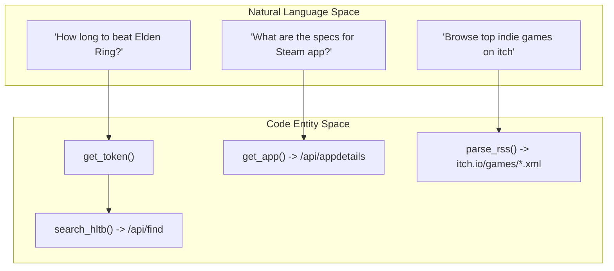
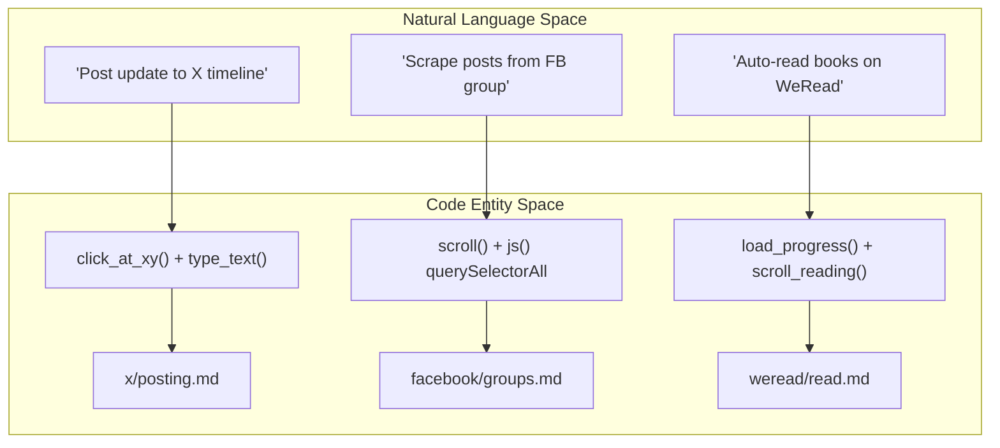

<!-- source: DeepWiki mcp.deepwiki.com · repo browser-use/browser-harness · page 4.4 Media, Entertainment & Social Platforms · fetched 2026-10-30 -->

# Media, Entertainment & Social Platforms

Relevant source files

The following files were used as context for generating this wiki page:

- [agent-workspace/domain-skills/bilibili/navigation.md](agent-workspace/domain-skills/bilibili/navigation.md)
- [agent-workspace/domain-skills/dev-to/scraping.md](agent-workspace/domain-skills/dev-to/scraping.md)
- [agent-workspace/domain-skills/facebook/groups.md](agent-workspace/domain-skills/facebook/groups.md)
- [agent-workspace/domain-skills/facebook/pages.md](agent-workspace/domain-skills/facebook/pages.md)
- [agent-workspace/domain-skills/genius/scraping.md](agent-workspace/domain-skills/genius/scraping.md)
- [agent-workspace/domain-skills/goodreads/scraping.md](agent-workspace/domain-skills/goodreads/scraping.md)
- [agent-workspace/domain-skills/gutenberg/scraping.md](agent-workspace/domain-skills/gutenberg/scraping.md)
- [agent-workspace/domain-skills/howlongtobeat/scraping.md](agent-workspace/domain-skills/howlongtobeat/scraping.md)
- [agent-workspace/domain-skills/imdb/scraping.md](agent-workspace/domain-skills/imdb/scraping.md)
- [agent-workspace/domain-skills/itch-io/scraping.md](agent-workspace/domain-skills/itch-io/scraping.md)
- [agent-workspace/domain-skills/letterboxd/scraping.md](agent-workspace/domain-skills/letterboxd/scraping.md)
- [agent-workspace/domain-skills/weread/read.md](agent-workspace/domain-skills/weread/read.md)
- [agent-workspace/domain-skills/x/article-source-recovery.md](agent-workspace/domain-skills/x/article-source-recovery.md)
- [agent-workspace/domain-skills/x/posting.md](agent-workspace/domain-skills/x/posting.md)
- [agent-workspace/domain-skills/xiaohongshu/scraping.md](agent-workspace/domain-skills/xiaohongshu/scraping.md)

This wiki page documents the scraping, automation, and data recovery skills for major media databases, streaming services, developer blogs, entertainment hubs, and social media platforms. These skills utilize a combination of public and internal REST APIs (discovered via network inspection), server-side rendered (SSR) hydration structures like `__NEXT_DATA__` [agent-workspace/domain-skills/goodreads/scraping.md:34-35]() and `window.__INITIAL_STATE__` [agent-workspace/domain-skills/xiaohongshu/scraping.md:56](), and coordinate-driven browser automation for complex posting, authentication, and continuous reading workflows.

---

## 1. Entertainment Databases (Books & Films)

### 1.1. Goodreads & Open Library
Goodreads uses a Next.js architecture, embedding its state inside an Apollo state object within the `__NEXT_DATA__` script block [agent-workspace/domain-skills/goodreads/scraping.md:34-35](). Because Goodreads shut down its public API in 2020, all scraping is HTML-based [agent-workspace/domain-skills/goodreads/scraping.md:15](). Open Library serves as a robust fallback via its public JSON API.

*   **Book Show Pages:** The `parse_book()` utility extracts the primary `Book` entity using its integer legacy ID, while fetching ratings and awards from the associated `Work` entity [agent-workspace/domain-skills/goodreads/scraping.md:38-47]().
*   **Fast Path JSON-LD:** When descriptive text and genres are unnecessary, parsing `application/ld+json` blocks reduces parsing overhead significantly [agent-workspace/domain-skills/goodreads/scraping.md:102-113]().
*   **Search Results:** Goodreads search relies on server-rendered microdata `<tr>` rows rather than Next.js payloads [agent-workspace/domain-skills/goodreads/scraping.md:143-154]().

**Sources:** [agent-workspace/domain-skills/goodreads/scraping.md:1-133]()

### 1.2. IMDb & Letterboxd
*   **IMDb:** Uses standard list items (`li.ipc-metadata-list-summary-item`) for Top 250 and MovieMeter charts [agent-workspace/domain-skills/imdb/scraping.md:38](). Recommendations and "More Like This" panels require explicit `scroll()` actions to trigger lazy-loaded `IntersectionObserver` elements [agent-workspace/domain-skills/imdb/scraping.md:168-170]().
*   **Letterboxd:** Fully server-rendered, permitting direct extraction of film metadata and user lists via `http_get`.

**Sources:** [agent-workspace/domain-skills/imdb/scraping.md:1-170](), [agent-workspace/domain-skills/letterboxd/scraping.md:1-100]()

### 1.3. Project Gutenberg
Discovery and searching are handled via the **Gutendex REST API** (`gutendex.com`), which returns structured JSON without authentication [agent-workspace/domain-skills/gutenberg/scraping.md:7-9]().
*   **Content Retrieval:** Direct plain-text files are fetched via `https://www.gutenberg.org/cache/epub/{id}/pg{id}.txt` [agent-workspace/domain-skills/gutenberg/scraping.md:137]().
*   **Boilerplate Stripping:** License headers and footers are excised by locating the `*** START OF THE PROJECT GUTENBERG EBOOK` and `*** END OF THE PROJECT GUTENBERG EBOOK` delimiters [agent-workspace/domain-skills/gutenberg/scraping.md:123-128]().

**Sources:** [agent-workspace/domain-skills/gutenberg/scraping.md:1-183]()

---

## 2. Gaming Platforms

### 2.1. Steam, itch.io & HowLongToBeat
*   **Steam:** App metadata is queried directly via the public `appdetails` endpoint [agent-workspace/domain-skills/steam/scraping.md:7-9]().
*   **itch.io:** Browse paths expose `.xml` RSS feeds (e.g., `top-rated.xml`) returning up to 36 game records per request [agent-workspace/domain-skills/itch-io/scraping.md:23-42]().
*   **HowLongToBeat (HLTB):** HLTB guards its completion data behind a token-gated POST endpoint at `/api/find` [agent-workspace/domain-skills/howlongtobeat/scraping.md:9-11](). Automation must first fetch an ephemeral session token from `/api/find/init`, which encodes IP, User-Agent, and timestamp variables along with honeypot keys (`hpKey`, `hpVal`) [agent-workspace/domain-skills/howlongtobeat/scraping.md:17-50]().

Title: "Gaming Data Entity Mapping"

**Sources:** [agent-workspace/domain-skills/howlongtobeat/scraping.md:7-156](), [agent-workspace/domain-skills/itch-io/scraping.md:1-140]()

---

## 3. Social Media & Content Platforms

### 3.1. X (Twitter) & Facebook
*   **X (Twitter) Posting & Auth:** Authentication requires navigating directly to `https://x.com/i/flow/login` rather than the root domain [agent-workspace/domain-skills/x/posting.md:5](). Google sign-in via FedCM cannot be automated because CDP mouse events do not register as trusted user gestures within sandboxed cross-origin iframes (`accounts.google.com`) [agent-workspace/domain-skills/x/posting.md:7-11](). Standard posting interacts with `[data-testid="tweetTextarea_0"]` and `[data-testid="tweetButtonInline"]` [agent-workspace/domain-skills/x/posting.md:26-40]().
*   **X Article Source Recovery:** When public article cards redirect anonymous visitors to login gates, the underlying status page can still be parsed in the DOM, or authors' cross-posts on platforms like LinkedIn can be inspected [agent-workspace/domain-skills/x/article-source-recovery.md:3-20]().
*   **Facebook Groups & Pages:** Because Facebook virtualizes feeds and unmounts scrolled-past articles, automation must use a "collect-as-you-go" loop anchored on `div[role="article"]` elements [agent-workspace/domain-skills/facebook/groups.md:38, 52-54](). External links wrapped in `l.facebook.com/l.php?u=` must be decoded via `parse_qs` to extract canonical URLs [agent-workspace/domain-skills/facebook/groups.md:97-102]().

### 3.2. Bilibili, Xiaohongshu & WeRead
*   **Bilibili:** Navigates personal spaces (`space.bilibili.com/{UID}`) and video pages [agent-workspace/domain-skills/bilibili/navigation.md:16-26](). Supports the platform's signature "Triple-tap" (三连) interaction—long-pressing the like button to trigger liking, coin donation, and favoriting simultaneously [agent-workspace/domain-skills/bilibili/navigation.md:175-177]().
*   **Xiaohongshu:** Search results are reliably loaded by constructing direct URLs (`/search_result?keyword=...`) rather than interacting with the home input widget [agent-workspace/domain-skills/xiaohongshu/scraping.md:7-11](). Sorting by latest requires navigating the `筛选` panel rather than top-level tabs [agent-workspace/domain-skills/xiaohongshu/scraping.md:21-25]().
*   **WeRead (WeChat Reading):** Executes a persistent state machine handling QR code WeChat authentication, tracking reading progress in `progress.json`, and simulating human-like scroll pacing and chapter progression [agent-workspace/domain-skills/weread/read.md:8-24]().

### 3.3. Dev.to & Medium
*   **Dev.to:** Exposes a public REST API at `https://dev.to/api/articles` that serves clean JSON in under 250ms with no browser requirement [agent-workspace/domain-skills/dev-to/scraping.md:7-11]().
*   **Medium:** Relies on hydration state blocks containing article text and metadata.

Title: "Social Media Interaction Mapping"

**Sources:** [agent-workspace/domain-skills/x/posting.md:1-67](), [agent-workspace/domain-skills/x/article-source-recovery.md:1-41](), [agent-workspace/domain-skills/facebook/groups.md:1-152](), [agent-workspace/domain-skills/facebook/pages.md:1-295](), [agent-workspace/domain-skills/bilibili/navigation.md:1-292](), [agent-workspace/domain-skills/xiaohongshu/scraping.md:1-84](), [agent-workspace/domain-skills/dev-to/scraping.md:1-323](), [agent-workspace/domain-skills/weread/read.md:1-323]()

---

## 4. Music, Lyrics & Audio

### 4.1. Genius
Genius blocks bare default `User-Agent` strings with HTTP 403 errors [agent-workspace/domain-skills/genius/scraping.md:8-10](). Requests must include an OS token within the User-Agent header (e.g., `Macintosh; Intel Mac OS X`) [agent-workspace/domain-skills/genius/scraping.md:10-11]().
*   **Internal API:** `genius.com/api/songs/{id}` returns complete track metadata, release dates, and contributor stats in ~0.13s without authentication [agent-workspace/domain-skills/genius/scraping.md:38-66]().
*   **Lyrics Extraction:** Lyrics are parsed from `
` elements distributed across the song page [agent-workspace/domain-skills/genius/scraping.md:167-169]().

### 4.2. Spotify & SoundCloud
Streaming platforms are accessed primarily via oEmbed endpoints or by querying embedded SSR hydration data stores such as `window.__spotify` or `window.__sc_hydration`.

**Sources:** [agent-workspace/domain-skills/genius/scraping.md:1-511]()

---

