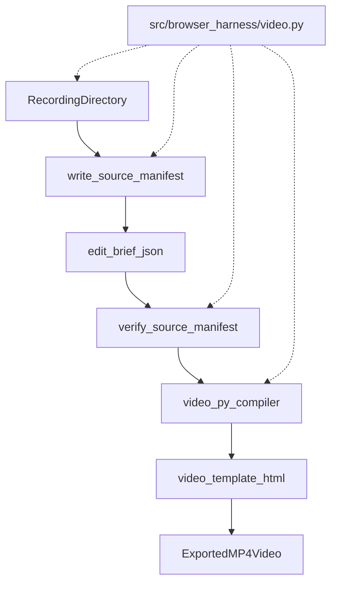
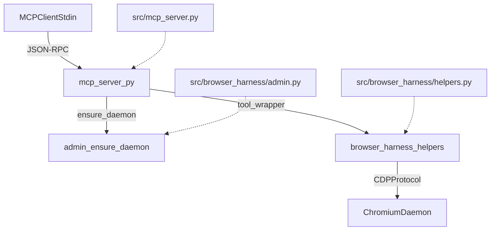

<!-- source: DeepWiki mcp.deepwiki.com · repo browser-use/browser-harness · page 5 Recording, Video & MCP Integrations · fetched 2026-10-30 -->

# Recording, Video & MCP Integrations

Relevant source files

The following files were used as context for generating this wiki page:

- [AGENTS.md](AGENTS.md)
- [CLAUDE.md](CLAUDE.md)
- [docs/MCP.md](docs/MCP.md)
- [interaction-skills/make-video.md](interaction-skills/make-video.md)
- [src/browser_harness/recorder.py](src/browser_harness/recorder.py)
- [src/browser_harness/video.py](src/browser_harness/video.py)
- [src/mcp_server.py](src/mcp_server.py)
- [tests/unit/test_mcp_server.py](tests/unit/test_mcp_server.py)
- [tests/unit/test_recorder.py](tests/unit/test_recorder.py)

## Purpose and Scope

This page provides a high-level overview of the auxiliary subsystems layered on top of the browser harness core: session recording (`src/browser_harness/recorder.py`), the deterministic video compilation and rendering pipeline (`src/browser_harness/video.py`), and the Model Context Protocol (MCP) server (`src/mcp_server.py`). These subsystems enable reproducible tracing, privacy-validated video rendering, and external agent integration without modifying the core CDP interaction layer.

For detailed instructions, refer to the child pages:
- [Recording Pipeline (recorder.py)](#5.1)
- [Video Compilation & Rendering](#5.2)
- [MCP Server & CLI](#5.3)

Sources: `src/browser_harness/recorder.py:1-22` [], `src/browser_harness/video.py:1-15` [], `src/mcp_server.py:4-12` [].

---

## 5.1 Recording Pipeline (`recorder.py`)

Session recording captures the browser's visual state by taking a viewport screenshot and logging a structured trace line after every mutating action [src/browser_harness/recorder.py:1-10](). 

Recordings are stored under the workspace directory as isolated folders containing a `meta.json` file, an `events.jsonl` log of actions, and sequential JPEG frame snapshots [src/browser_harness/recorder.py:3-10](). Read-only operations (such as `page_info()` or `js()`) are filtered out to prevent visual bloat, while mutating actions defined in `ACTIONS` trigger captures [src/browser_harness/recorder.py:28-36](). Sensitive query and fragment parameters are automatically scrubbed from URLs using `_scrub_url()` to prevent credential leakage [src/browser_harness/recorder.py:41-54]().

For deep technical details, configuration parameters (`BH_RECORD`), test suites (`test_recorder.py`), and CLI controls (`browser-harness recordings`), see [Recording Pipeline (recorder.py)](#5.1).

Sources: `src/browser_harness/recorder.py:1-190` [], `tests/unit/test_recorder.py:31-97` [].

---

## 5.2 Video Compilation & Rendering

The video pipeline turns raw recordings into polished MP4 artifacts through a multi-step contract: initialization, editing brief authoring, review, and export [interaction-skills/make-video.md:1-18](). 

The compilation engine (`src/browser_harness/video.py`) loads an `edit-brief.json` configuration file, validates source manifests (`video-source.json`), enforces house styling and reading speed budgets (e.g., `readingWpm` set to 380), and verifies privacy redaction specifications before rendering via `video-template.html` [src/browser_harness/video.py:15-55]().

*Figure 5.1: Video compilation pipeline mapping data inputs in `video.py` to the HTML template renderer.*

Sources: `src/browser_harness/video.py:15-95` [], `interaction-skills/make-video.md:1-106` [].

For details on authoring edit briefs, duration budgets, and privacy validation, see [Video Compilation & Rendering](#5.2).

---

## 5.3 MCP Server & CLI

The Model Context Protocol integration (`src/mcp_server.py`) exposes core browser-harness helper functions as remote tool definitions over standard input/output (`stdio`) [src/mcp_server.py:4-12](). 

Each tool invocation automatically ensures the harness daemon is running via `ensure_daemon()`, redirects standard output streams to prevent protocol corruption via `_stderr_stdout()`, executes the underlying helper function from `browser_harness.helpers`, and formats return values into JSON text or raises an `mcp.server.mcpserver.exceptions.ToolError` [src/mcp_server.py:100-136]().

*Figure 5.2: MCP server routing architecture bridging client JSON-RPC over `stdio` to `mcp_server.py` and `helpers.py`.*

Sources: `src/mcp_server.py:4-53` [], `docs/MCP.md:1-50` [], `tests/unit/test_mcp_server.py:1-39` [].

For client setup guides (Claude Code, Devin, Cursor, MCP Inspector) and tool schemas, see [MCP Server & CLI](#5.3).

---

