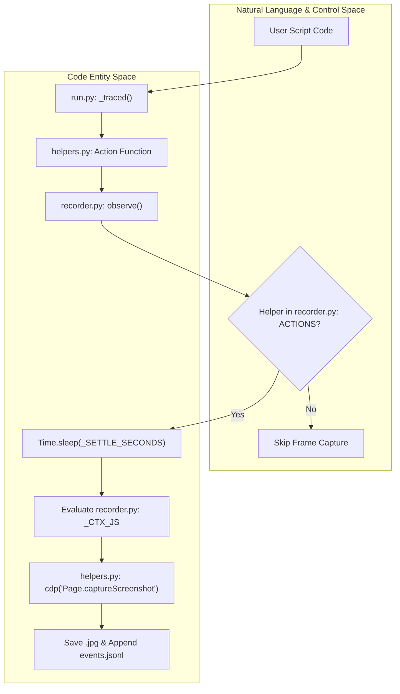
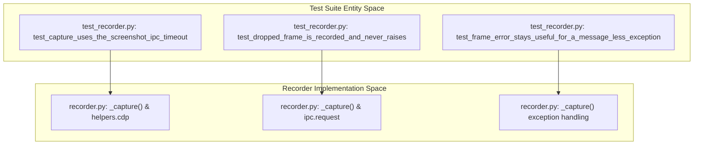

<!-- source: DeepWiki mcp.deepwiki.com · repo browser-use/browser-harness · page 5.1 Recording Pipeline (recorder.py) · fetched 2026-10-30 -->

# Recording Pipeline (recorder.py)

<details>
<summary>Relevant source files</summary>

The following files were used as context for generating this wiki page:

- [src/browser_harness/recorder.py](src/browser_harness/recorder.py)
- [src/browser_harness/run.py](src/browser_harness/run.py)
- [tests/unit/test_recorder.py](tests/unit/test_recorder.py)
- [tests/unit/test_run.py](tests/unit/test_run.py)

</details>


### Purpose and Scope

The recording pipeline in `browser-harness` captures visual and structured logs of browser automation sessions [src/browser_harness/recorder.py:1-22](). It operates as an auxiliary subsystem built on top of the browser harness execution engine. Its primary role is to record state-changing browser interactions by pairing a viewport screenshot (`.jpg`) with a structured trace entry (`events.jsonl`) for each qualifying action, maintaining persistent session archives under the agent workspace [src/browser_harness/recorder.py:3-10](). Recording failures are explicitly swallowed to ensure that background telemetry or video capture errors never interrupt or crash core agent automation [src/browser_harness/recorder.py:13-14]().

Sources: [src/browser_harness/recorder.py:1-22]()

---

## CLI & Configuration Layer (`BH_RECORD`, Commands & Preferences)

Automatic and manual recording are governed by CLI commands, environment variables, and persisted configuration settings [src/browser_harness/recorder.py:16-18]().

### CLI Commands
* `browser-harness recordings`: Lists existing recording directories from newest to oldest [src/browser_harness/run.py:60](), [src/browser_harness/recorder.py:139-151]().
* `browser-harness recordings --latest`: Prints the absolute path to the newest recording directory [src/browser_harness/run.py:61](), [src/browser_harness/recorder.py:154-158]().
* `browser-harness recordings enable`: Enables automatic persistence of browser actions locally by default [src/browser_harness/run.py:62](), [src/browser_harness/recorder.py:180-187]().
* `browser-harness recordings disable`: Disables default automatic recording [src/browser_harness/run.py:63](), [src/browser_harness/recorder.py:180-187]().

### Configuration Precedence
Recording activation is resolved with the following precedence:
1. **Environment Override (`BH_RECORD`)**: If `BH_RECORD` is set to `1`, `true`, `yes`, or `off` (case-insensitive variants mapped via `_env_override()`), it strictly forces recording on or off regardless of stored configuration [src/browser_harness/recorder.py:86-91](). `BH_RECORD=0` completely disables recording and raises a `RuntimeError` if explicit `start_recording()` is attempted [src/browser_harness/recorder.py:17-18](), [src/browser_harness/recorder.py:102-103]().
2. **Persistent Configuration (`recording.json`)**: Stored in the harness configuration directory (`paths.config_dir() / "recording.json"`), managed via `set_auto_recording()` [src/browser_harness/recorder.py:74-84](), [src/browser_harness/recorder.py:180-187]().
3. **Default State**: Disabled by default [src/browser_harness/recorder.py:168]().

Sources: [src/browser_harness/recorder.py:70-190](), [src/browser_harness/run.py:60-63]()

---

## Helper Trace Instrumentation (`run.py` & `_traced`)

When scripts execute via `browser-harness`, helper functions are dynamically instrumented to report their invocations to the recorder [src/browser_harness/run.py:156-189]().

* **Instrumentation Wrapper (`_traced`)**: Wraps callable helper functions in `helpers.py` using `functools.wraps` [src/browser_harness/run.py:156-178](). It tracks execution duration using `time.monotonic()` [src/browser_harness/run.py:166](), catches exceptions to record error messages [src/browser_harness/run.py:169-172](), and dispatches observation data to the recorder via `recorder.observe(name, args, kwargs, entry["duration_seconds"])` [src/browser_harness/run.py:174]().
* **Trace Limits**: `_MAX_TRACED_STEPS` caps the in-memory trace buffer at `500` steps [src/browser_harness/run.py:145](), and `_MAX_STEP_ARGS_LENGTH` truncates serialized argument strings at `300` characters to prevent log bloat [src/browser_harness/run.py:146]().
* **Automatic Hooking**: `_install_helper_trace()` inspects `helpers` module exports at runtime, skipping private symbols and already-traced functions [src/browser_harness/run.py:181-189]().

Sources: [src/browser_harness/run.py:145-189]()

---

## Artifact Layout: `meta.json` & `events.jsonl`

A recording session occupies a dedicated folder located under `<BH_AGENT_WORKSPACE>/recordings/<name>/` [src/browser_harness/recorder.py:3-9]().

```
<BH_AGENT_WORKSPACE>/recordings/rec-20260330-120000/
├── meta.json
├── events.jsonl
├── 0001.jpg
├── 0002.jpg
└── ...
```

### File Formats
* **`meta.json`**: Contains session-level metadata written at initialization [src/browser_harness/recorder.py:107-108]():
  ```json
  {
    "name": "rec-20260330-120000",
    "title": "Optional Session Title",
    "started": 1743336000.123
  }
  ```
* **`events.jsonl`**: Contains one JSON object per recorded action. Each entry captures execution timings, helper names, scrubbed arguments, viewport dimensions, and DOM state via `_CTX_JS` [src/browser_harness/recorder.py:7](), [src/browser_harness/recorder.py:58-67]().

### URL Secret Scrubbing
To prevent leakage of sensitive user credentials, OAuth tokens, session identifiers, and API keys into shared recording folders, `_scrub_url()` automatically sanitizes query parameters and fragment identifiers matching `_URL_SECRETS` [src/browser_harness/recorder.py:42-53](). Parameters such as `code`, `access_token`, `refresh_token`, `token`, `secret`, `api_key`, and `authorization` have their values replaced with `REDACTED` [src/browser_harness/recorder.py:44-53]().

Sources: [src/browser_harness/recorder.py:3-67]()

---

## Frame Capture & Robustness (`_capture`)

Frame capture is restricted to state-modifying actions defined in the `ACTIONS` set [src/browser_harness/recorder.py:31-36](). Read-only inspection functions (such as `js()`, `page_info()`, or `capture_screenshot()`) are intentionally excluded to prevent recording bloat [src/browser_harness/recorder.py:28-30]().

* **Settle Delay**: A configurable settle period (`_SETTLE_SECONDS = 0.15` seconds) allows the browser to render paint updates before capturing the post-action frame [src/browser_harness/recorder.py:39]().
* **IPC Timeout Handling**: Frame captures utilize `SCREENSHOT_IPC_RESPONSE_TIMEOUT_SECONDS` (higher than the default IPC timeout) to prevent cloud browser screenshot timeouts from dropping frames [tests/unit/test_recorder.py:31-47]().
* **Error Resilience**: If a screenshot fails or times out, the error is caught and logged under `frame_error` in the `events.jsonl` entry rather than raising an exception, ensuring test runs continue uninterrupted [tests/unit/test_recorder.py:54-88]().

### Diagram: Action Execution and Capture Pipeline

The following diagram bridges the conceptual action flow to code entities in `run.py`, `recorder.py`, and `helpers.py`.



Sources: [src/browser_harness/recorder.py:23-67](), [src/browser_harness/run.py:156-178](), [tests/unit/test_recorder.py:31-88]()

---

## Recorder Unit Tests (`tests/unit/test_recorder.py`)

The recorder test suite verifies IPC timeout compliance, frame drop resilience, and error message sanitization [tests/unit/test_recorder.py:31-96]().

### Key Test Cases
1. **`test_capture_uses_the_screenshot_ipc_timeout`**: Asserts that `Page.captureScreenshot` passes `_response_timeout` set to `SCREENSHOT_IPC_RESPONSE_TIMEOUT_SECONDS`, guaranteeing that cloud environments do not prematurely time out during frame capture [tests/unit/test_recorder.py:31-53]().
2. **`test_dropped_frame_is_recorded_and_never_raises`**: Simulates an IPC timeout (`TimeoutError`) during screenshot capture, confirming that the failure writes a detailed `frame_error` string to `events.jsonl` without propagating an exception [tests/unit/test_recorder.py:54-88]().
3. **`test_frame_error_stays_useful_for_a_message_less_exception`**: Validates that bare exceptions (such as `RuntimeError()`) are cleanly normalized into descriptive error strings without trailing colons [tests/unit/test_recorder.py:89-96]().

### Diagram: Test Verification Architecture

The following diagram maps validation routines in `test_recorder.py` to their target functions in `recorder.py` and `helpers.py`.



Sources: [tests/unit/test_recorder.py:31-96]()

---

