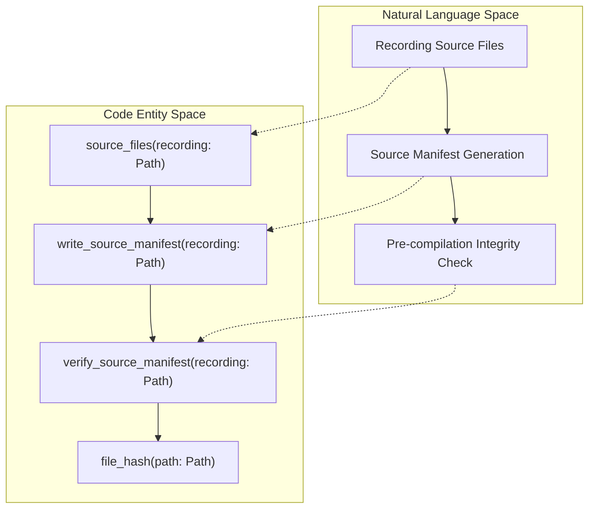
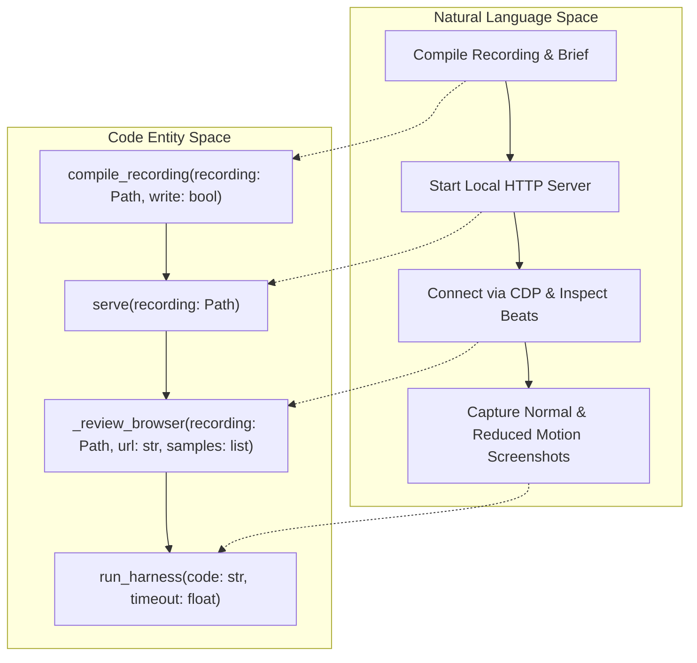

<!-- source: DeepWiki mcp.deepwiki.com · repo browser-use/browser-harness · page 5.2 Video Compilation & Rendering · fetched 2026-10-30 -->

# Video Compilation & Rendering

<details>
<summary>Relevant source files</summary>

The following files were used as context for generating this wiki page:

- [AGENTS.md](AGENTS.md)
- [CLAUDE.md](CLAUDE.md)
- [docs/download-latest-20-x-videos.gif](docs/download-latest-20-x-videos.gif)
- [interaction-skills/make-video.md](interaction-skills/make-video.md)
- [src/browser_harness/video-template.html](src/browser_harness/video-template.html)
- [src/browser_harness/video.py](src/browser_harness/video.py)
- [src/browser_harness/video_render.py](src/browser_harness/video_render.py)
- [tests/unit/test_video_render.py](tests/unit/test_video_render.py)

</details>


## Purpose & Scope
This page details the deterministic video compilation, review, and export pipeline managed by `src/browser_harness/video.py` and `src/browser_harness/video_render.py`. The subsystem transforms raw browser recordings (`events.jsonl`, `meta.json`, and timestamped `.jpg` frames) into structured, privacy-vetted explanatory videos rendered via HTML5 canvas and exported as WebM/MP4 files.

Sources: `[src/browser_harness/video.py:1-15]`, `[src/browser_harness/video_render.py:1-21]()`

---

## The Video Pipeline CLI (`video init/review/export`)

The video rendering workflow follows a three-step CLI contract described in `interaction-skills/make-video.md`:

```bash
browser-harness video init <recording> --require-explicit
# write <recording>/edit-brief.json
browser-harness video review <recording>
# inspect video-review-contact-sheet.jpg and every image in .privacy-review/
browser-harness video export <recording> --reviewed
```

1. **`video init`**: Generates the source manifest (`video-source.json`) and scaffolds an initial `edit-brief.json` pointing to recorded events and frames `[interaction-skills/make-video.md:13-14]()`.
2. **`video review`**: Compiles the brief against recording summaries, boots a local HTTP server, and uses CDP automation to inspect visual pacing, preflight errors, and click sequences across normal and reduced-motion states `[src/browser_harness/video_render.py:45-185]()`.
3. **`video export`**: Validates the reviewed state and uses a headless browser or MediaRecorder harness to render and output the final WebM/MP4 file `[interaction-skills/make-video.md:17]`, `[tests/unit/test_video_render.py:6-22]()`.

Sources: `[interaction-skills/make-video.md:6-18]`, `[src/browser_harness/video_render.py:45-185]`, `[tests/unit/test_video_render.py:6-22]()`

---

## Source Manifest Hashing & Integrity Enforcement

Before any compilation or review takes place, `video.py` ensures recording provenance using cryptographic hashing of source artifacts.


*Figure 1: Source manifest integrity validation bridging natural language description to file-level Python functions in `video.py`.*

* **Source File Discovery**: `source_files()` identifies `events.jsonl`, `meta.json`, `recording-summary.json`, and all digit-stemmed `.jpg` frames `[src/browser_harness/video.py:140-144]()`.
* **Manifest Generation**: `write_source_manifest()` computes SHA-256 hashes for every file using `file_hash()` and persists them to `video-source.json` (`[src/browser_harness/video.py:110-111]`, `[src/browser_harness/video.py:146-157]()`).
* **Integrity Verification**: `verify_source_manifest()` reads `video-source.json` and asserts that no source files have been added, removed, or modified since initialization, raising a `BriefError` if any hash mismatch occurs `[src/browser_harness/video.py:160-173]()`.

Sources: `[src/browser_harness/video.py:110-173]()`

---

## House Style & Duration Budgets

Videos adhere to a strict visual house style and timing constraints defined by `HOUSE_STYLE` in `src/browser_harness/video.py` (`[src/browser_harness/video.py:29-55]()`).

* **Reading Speed & Pacing**: Default reading speed is set to `380` WPM (`[src/browser_harness/video.py:32]()`). Pacing rules configure `captionBaseSeconds` (0.35s), `captionSecondsPerWord` (0.2s), and `rawToCardHoldSeconds` (0.55s) (`[src/browser_harness/video.py:36-38]()`).
* **Duration Budgets**: The base duration budget is `22` seconds with an allowed maximum duration budget of `32` seconds (`[src/browser_harness/video.py:39-42]()`).
* **Card Duration Calculation**: `card_duration()` computes required hold times based on title, summary, and detail word counts against the reading speed (`[src/browser_harness/video.py:198-206]()`). Similar card target calculations exist in the HTML canvas template (`[src/browser_harness/video-template.html:66-93]()`).

Sources: `[src/browser_harness/video.py:29-55]`, `[src/browser_harness/video.py:198-206]`, `[src/browser_harness/video-template.html:66-93]()`

---

## Privacy Redaction Validation

To prevent leakage of sensitive user data, API keys, and private URLs, recordings undergo strict privacy validation before export.

* **Review Contract**: Every frame used in a beat must be explicitly listed in `privacy.reviewedFrames` after full-resolution inspection (`[interaction-skills/make-video.md:85-88]`, `[src/browser_harness/video-template.html:110-131]()`).
* **Opaque Redactions**: `privacy.redact` accepts coordinate mappings (`x`, `y`, `w`, `h`) to mask sensitive regions with opaque rectangles (`[interaction-skills/make-video.md:87]()`).
* **Preflight Validation**: The canvas preflight routine (`window.videoPreflight()`) checks composition schema version, frame style (`native`), duration limits, plan item counts (2–5 steps), and verifies that every used frame exists within `reviewedFrames` (`[src/browser_harness/video-template.html:116-131]()`).

Sources: `[interaction-skills/make-video.md:85-105]`, `[src/browser_harness/video-template.html:116-131]()`

---

## HTML Template Rendering & Review (`video_render.py`)

The `video_render.py` module orchestrates local compilation, HTTP serving, and automated CDP inspection of the generated HTML template (`video-template.html`).


*Figure 2: Rendering and review pipeline mapping natural workflow steps to functions in `video_render.py`.*

* **Compilation**: `compile_recording()` verifies the source manifest, loads `recording-summary.json` and `edit-brief.json`, compiles the brief via `video.compile_brief()`, and writes `composition.js` (`[src/browser_harness/video_render.py:45-54]()`).
* **Local Server**: The `serve()` context manager spins up a `ThreadingHTTPServer` running `_QuietHandler` to serve recording assets locally on `127.0.0.1` (`[src/browser_harness/video_render.py:81-100]()`).
* **CDP Inspection**: `_review_browser()` launches or attaches to a tab, navigates to `video.html`, waits for `window.videoReady()`, and emulates both normal and `prefers-reduced-motion: reduce` media states while capturing screenshots across beat samples and click moments (`[src/browser_harness/video_render.py:126-185]()`).

Sources: `[src/browser_harness/video_render.py:45-185]()`

---

