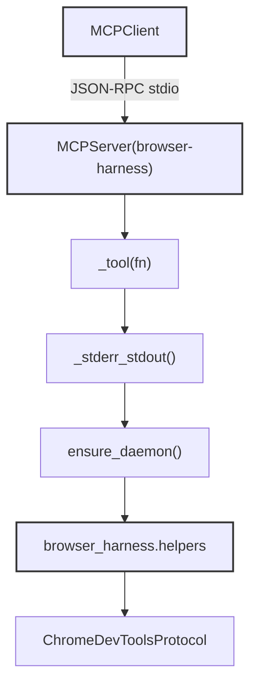
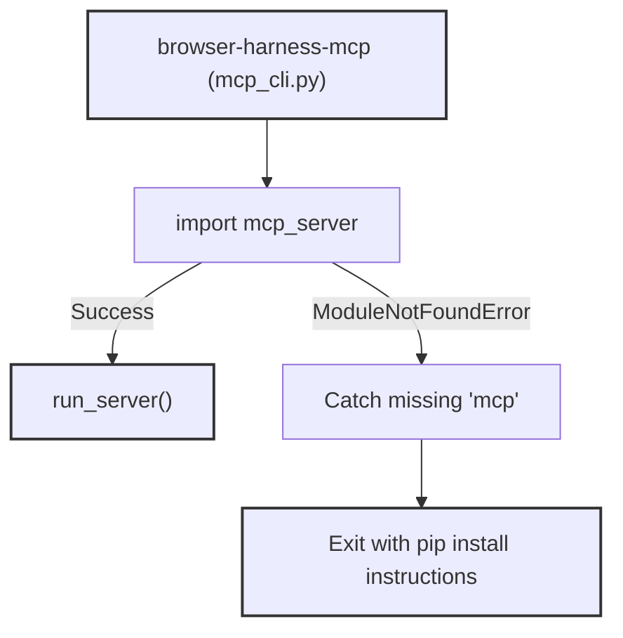

<!-- source: DeepWiki mcp.deepwiki.com · repo browser-use/browser-harness · page 5.3 MCP Server & CLI · fetched 2026-10-30 -->

# MCP Server & CLI

<details>
<summary>Relevant source files</summary>

The following files were used as context for generating this wiki page:

- [docs/MCP.md](docs/MCP.md)
- [src/browser_harness/mcp_cli.py](src/browser_harness/mcp_cli.py)
- [src/mcp_server.py](src/mcp_server.py)
- [tests/unit/test_mcp_cli.py](tests/unit/test_mcp_cli.py)
- [tests/unit/test_mcp_server.py](tests/unit/test_mcp_server.py)

</details>


The Model Context Protocol (MCP) server integration in `browser-harness` bridges AI clients with browser automation primitives. By exposing `browser_harness.helpers` as standard MCP tools over `stdio`, the MCP server allows LLM coding assistants and agents (such as Claude Code, Devin, and Cursor) to interact directly with local Chrome instances without duplicating CDP or daemon management logic [src/mcp_server.py:4-12](), [docs/MCP.md:3-6]().

---

## 1. Architecture & Protocol Layer (`src/mcp_server.py`)

The server initializes an instance of `MCPServer` named `"browser-harness"` [src/mcp_server.py:55](). It maps browser automation helpers into MCP tool definitions using the `@_tool` decorator [src/mcp_server.py:116-136]().

Key internal subsystems within `src/mcp_server.py` include:
- **Serialization Safety**: Non-finite floating-point numbers (`NaN`, `Inf`) returned by JavaScript evaluations are normalized via `_normalize()` to avoid `json.dumps()` exceptions [src/mcp_server.py:58-74](). Fallback serialization is handled by `_json_default()` for bytes, datetimes, decimals, and paths [src/mcp_server.py:76-87]().
- **Stdio Wire Protection**: The `_stderr_stdout()` context manager temporarily redirects `sys.stdout` to `sys.stderr` [src/mcp_server.py:100-114](). Because the MCP protocol relies on clean JSON-RPC messaging over `stdio`, any status prints from helpers like `start_recording` or `stop_recording` are prevented from corrupting the wire format [src/mcp_server.py:100-107]().
- **Lifecycle & Error Handling**: The `_tool` wrapper automatically invokes `ensure_daemon()` prior to executing any helper function [src/mcp_server.py:116-128](). Any operational failure or browser error is caught and raised as an MCP `ToolError`, allowing the MCP client to handle errors gracefully without crashing the server process [src/mcp_server.py:127-134](), [docs/MCP.md:48-49]().


*Figure 1: Data flow from MCP client request to the browser-harness helper layer.*

Sources: [src/mcp_server.py:1-136]()

---

## 2. Entrypoint and Optional Dependency Management (`src/browser_harness/mcp_cli.py`)

Because the `mcp` library is an optional dependency (bundled under the `[mcp]` extra package profile), the console entry point `browser-harness-mcp` is isolated inside `src/browser_harness/mcp_cli.py` [src/browser_harness/mcp_cli.py:1-16]().

When invoked, `main()` attempts to import and run the server [src/browser_harness/mcp_cli.py:4-7](). If the `mcp` package is missing, it captures `ModuleNotFoundError` and exits gracefully with an actionable installation instruction [src/browser_harness/mcp_cli.py:8-14]():

```python
raise SystemExit(
    "browser-harness-mcp requires MCP support. "
    "Install it with: pip install 'browser-harness[mcp]'"
)
```


*Figure 2: Entry point resolution logic for optional MCP dependencies.*

Sources: [src/browser_harness/mcp_cli.py:1-16]()

---

## 3. Client Configuration & Integration (`docs/MCP.md`)

The MCP server is packaged to run via `uvx` or `uv run` [docs/MCP.md:12](), [docs/MCP.md:98](). All exposed tools adopt a `browser_` prefix corresponding to underlying helper operations [docs/MCP.md:21-47]().

### Supported Client Configurations

- **Claude Code**:
  ```bash
  claude mcp add browser-harness \
    uvx --from 'browser-harness[mcp]' browser-harness-mcp
  ```
  [docs/MCP.md:63-65]()

- **Devin**:
  ```bash
  devin mcp add -s project browser-harness -- \
    uvx --from 'browser-harness[mcp]' browser-harness-mcp
  ```
  [docs/MCP.md:70-72]()

- **Cursor / OpenClaw**:
  ```json
  {
    "mcpServers": {
      "browser-harness": {
        "command": "uvx",
        "args": [
          "--from",
          "browser-harness[mcp]",
          "browser-harness-mcp"
        ]
      }
    }
  }
  ```
  [docs/MCP.md:76-89]()

- **MCP Inspector**:
  ```bash
  npx @modelcontextprotocol/inspector \
    uvx --from 'browser-harness[mcp]' browser-harness-mcp
  ```
  [docs/MCP.md:94-96]()

Sources: [docs/MCP.md:1-99]()

---

## 4. Unit Testing and Error Handling (`tests/unit/test_mcp_server.py`, `tests/unit/test_mcp_cli.py`)

Testing ensures that helper failures correctly manifest as MCP `ToolError` responses rather than unhandled Python tracebacks, and that missing optional dependencies produce user-friendly error messages.

- **`tests/unit/test_mcp_server.py`**:
  - `test_helper_failure_uses_mcp_tool_error()` mocks `ensure_daemon` and simulates a runtime failure in `page_info`, asserting that `result.is_error` is `True` and the error message wraps the sentinel failure [tests/unit/test_mcp_server.py:17-29]().
  - `test_helper_success_remains_a_normal_tool_result()` mocks successful execution and verifies that tool payloads return valid JSON text without error flags [tests/unit/test_mcp_server.py:31-38]().

- **`tests/unit/test_mcp_cli.py`**:
  - `test_main_explains_missing_mcp_extra()` intercepts built-in imports to force a `ModuleNotFoundError` on `"mcp"`, ensuring `mcp_cli.main()` catches it and exits with the expected `pip install` guidance [tests/unit/test_mcp_cli.py:10-21]().

Sources: [tests/unit/test_mcp_server.py:1-38](), [tests/unit/test_mcp_cli.py:1-21]()

---

