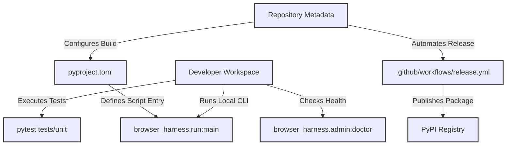
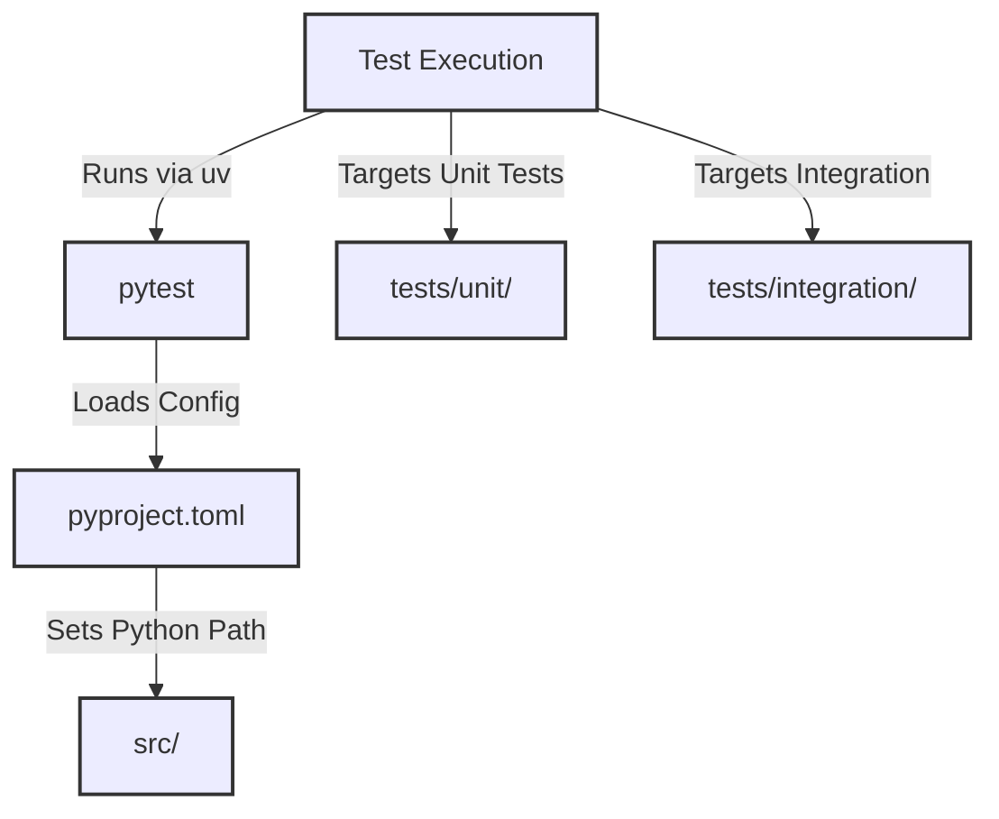
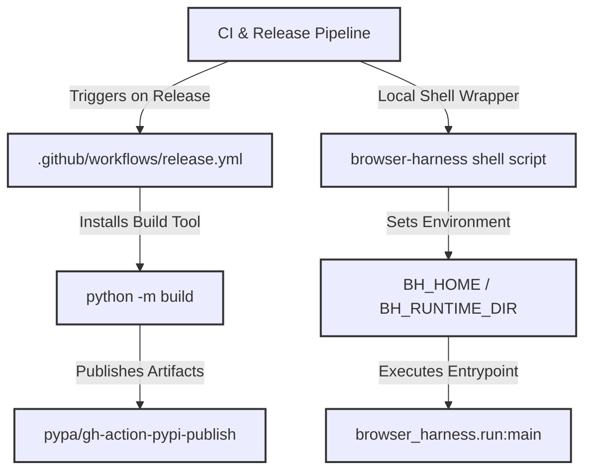

<!-- source: DeepWiki mcp.deepwiki.com · repo browser-use/browser-harness · page 6 Development, Testing & Release · fetched 2026-10-30 -->

# Development, Testing & Release

Relevant source files

The following files were used as context for generating this wiki page:

- [.github/workflows/release.yml](.github/workflows/release.yml)
- [AGENTS.md](AGENTS.md)
- [CLAUDE.md](CLAUDE.md)
- [CONTRIBUTING.md](CONTRIBUTING.md)
- [browser-harness](browser-harness)
- [interaction-skills/make-video.md](interaction-skills/make-video.md)
- [pyproject.toml](pyproject.toml)
- [src/browser_harness/SKILL.md](src/browser_harness/SKILL.md)
- [src/browser_harness/video.py](src/browser_harness/video.py)

This wiki page provides an overview of contributor workflows, repository conventions, test suites, CI pipelines, and release automation for `browser-harness`. As a parent page, it summarizes core development guidelines defined in repository documentation and configuration files, directing you to child pages for in-depth technical procedures.

For repository guidelines, code priorities (clarity, precision, low verbosity, and versatility), and developer command shortcuts, see `AGENTS.md` [AGENTS.md:1-44]() and `CLAUDE.md` [CLAUDE.md:1-6](). For contribution rules and local testing workflows, see `CONTRIBUTING.md` [CONTRIBUTING.md:1-35]().

*Figure 1: High-level developer workflow bridging local execution scripts and packaging metadata.*

Sources: [`AGENTS.md:1-44`data](), [`CLAUDE.md:1-6`data](), [`pyproject.toml:1-37`data](), [`.github/workflows/release.yml:1-26`data]()

---

## 6.1 Test Suite & Fixtures

The test suite is structured to validate core browser automation primitives, IPC protocols, daemon lifecycle management, and skill synchronization without requiring manual intervention [AGENTS.md:38-47](). Unit tests are isolated under `tests/unit/` and execute rapidly without needing a live browser instance, while integration tests under `tests/integration/` interact with live CDP endpoints when available [AGENTS.md:47]().

Testing configuration is centralized in `pyproject.toml`, which configures `pytest` with the source directory added to the Python path (`pythonpath = ["src"]`) [pyproject.toml:53-54](). Developers can execute unit tests locally using `uv` via standard test runner invocations [AGENTS.md:39](). For fake socket simulation, process mock fixtures, and detailed execution instructions, see [Test Suite & Fixtures](#6.1).

*Figure 2: Test suite structure and configuration flow.*

Sources: [`pyproject.toml:53-55`data](), [`AGENTS.md:38-47`data]()

---

## 6.2 Packaging, CI & Contribution Workflow

Packaging metadata, build requirements, and entry points are defined in `pyproject.toml`, which specifies Python `>=3.11`, runtime dependencies (`cdp-use`, `fetch-use`, `pillow`, `websockets`), optional MCP dependencies, and console script entry points (`browser-harness` mapping to `browser_harness.run:main` and `browser-harness-mcp` mapping to `browser_harness.mcp_cli:main`) [pyproject.toml:1-37](). Local development leverages the `browser-harness` shell wrapper script, which configures environment variables like `BH_HOME`, `BH_RUNTIME_DIR`, and `BH_TMP_DIR` before delegating execution to a virtual environment, `uv`, or `python3` [browser-harness:1-34]().

Automated release management is handled via GitHub Actions in `.github/workflows/release.yml`, which triggers upon the publication of a GitHub release, builds distributions using `build==1.6.0`, and publishes packages to PyPI via OIDC trusted publishing (`pypa/gh-action-pypi-publish`) [.github/workflows/release.yml:1-25](). For complete packaging details, contribution guidelines, issue templates, self-update logic (`--update`), and licensing information, see [Packaging, CI & Contribution Workflow](#6.2).

*Figure 3: CI release automation and local execution wrapper integration.*

Sources: [`pyproject.toml:1-37`data](), [`.github/workflows/release.yml:1-26`data](), [`browser-harness:1-35`data]()

---

