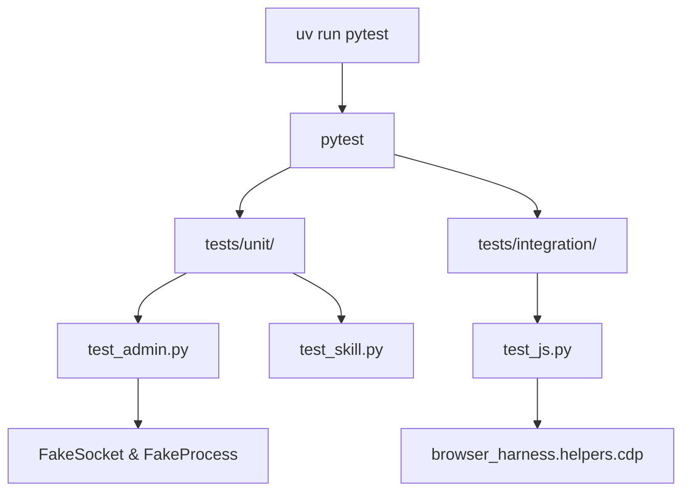
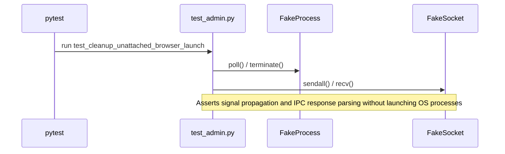

<!-- source: DeepWiki mcp.deepwiki.com · repo browser-use/browser-harness · page 6.1 Test Suite & Fixtures · fetched 2026-10-30 -->

# Test Suite & Fixtures

<details>
<summary>Relevant source files</summary>

The following files were used as context for generating this wiki page:

- [tests/__init__.py](tests/__init__.py)
- [tests/conftest.py](tests/conftest.py)
- [tests/integration/__init__.py](tests/integration/__init__.py)
- [tests/integration/test_js.py](tests/integration/test_js.py)
- [tests/unit/__init__.py](tests/unit/__init__.py)
- [tests/unit/test_admin.py](tests/unit/test_admin.py)
- [tests/unit/test_skill.py](tests/unit/test_skill.py)

</details>


## Purpose & Scope
This page details the testing infrastructure of `browser-harness`. It covers the directory structure of `tests/unit` and `tests/integration`, shared fixtures defined in `tests/conftest.py`, mock objects (`FakeSocket`, `FakeProcess`) used to test daemon and admin lifecycle mechanics without launching a physical browser instance, metadata synchronization tests for packaged skills, and JavaScript execution tests via mocked Chrome DevTools Protocol (CDP) clients. Finally, it outlines how to invoke the test suite using `uv`.

---

## 1. Test Suite Organization & Execution via `uv`
The repository separates tests into isolated unit tests and integration tests under the `tests/` directory:
- `tests/unit/`: Fast-running tests validating standalone logic, configuration guards, admin process handlers, and skill frontmatter structures.
- `tests/integration/`: Tests validating subsystems that interact with CDP event loops, script transformations, or helper functions via monkeypatching and function patching.
- `tests/conftest.py`: Global pytest configuration and shared test fixtures.

To run the full test suite or specific subsets using `uv`, developers execute standard `pytest` commands wrapped in the isolated environment:
```bash
uv run pytest
uv run pytest tests/unit/test_admin.py
uv run pytest tests/integration/test_js.py
```

### Diagram: Test Execution & Architecture Mapping

Sources: [tests/unit/test_admin.py:1-42](), [tests/unit/test_skill.py:1-35](), [tests/integration/test_js.py:1-193]()

---

## 2. Shared Fixtures (`tests/conftest.py`)
Global pytest fixtures are implemented in `tests/conftest.py` to support visual and image-dependent test cases. Specifically, `make_png` generates in-memory base64-encoded PNG image buffers using PIL `Image`.

- `make_png(width, height)`: Helper function that creates a blank white `PIL.Image` of specified dimensions and returns its base64-encoded payload [tests/conftest.py:8-12]().
- `fake_png` fixture: Exposes the `make_png` helper to tests requiring image artifacts [tests/conftest.py:14-16]().

Sources: [tests/conftest.py:1-16]()

---

## 3. Daemon & Admin Unit Tests (`tests/unit/test_admin.py`)
To test administrative flows, process management, and IPC client-server handshakes without spawning real Google Chrome or Chromium instances, `tests/unit/test_admin.py` defines lightweight mock classes: `FakeSocket` and `FakeProcess`.

### Key Mock Classes
- `FakeSocket`: Simulates a raw socket connection. Implements `sendall(data)`, `recv(_size)`, and `close()` to mock JSON-RPC responses over IPC or CDP channels [tests/unit/test_admin.py:13-28]().
- `FakeProcess`: Simulates a managed subprocess (`subprocess.Popen`). Implements `poll()`, `terminate()`, and tracks process state via attributes like `pid`, `returncode`, and `terminated` [tests/unit/test_admin.py:30-41]().

### Administrative Test Scenarios
1. **Unattached Browser Launch Cleanup (`_cleanup_unattached_browser_launch`)**: Tests verify that orphaned browser instances are terminated via `os.killpg` on POSIX systems if the devtools port fails to become live [tests/unit/test_admin.py:43-53](), while active CDP browsers are correctly preserved [tests/unit/test_admin.py:55-61]().
2. **Explicit Chrome Path Retention**: Parametrized checks validate that setting `BH_CHROME_PATH` or `CHROME_PATH` correctly handles profile retention across Linux, Darwin, and Windows environments [tests/unit/test_admin.py:72-123]().
3. **Update Banner Control**: Verifies that setting `BH_UPDATE_CHECK` to disabling values (e.g., `"0"`, `"false"`, `"NO"`) bypasses cache reading and network checks [tests/unit/test_admin.py:141-149]().
4. **Daemon Existence Probes**: Tests `require_existing_daemon` exception throwing when a target daemon is absent [tests/unit/test_admin.py:170-175]().

### Diagram: Mock Interaction Flow for Admin & JS Tests

Sources: [tests/unit/test_admin.py:1-179]()

---

## 4. Skill Synchronization & Metadata Tests (`tests/unit/test_skill.py`)
The packaging integrity and frontmatter contract of the primary `browser-harness` skill are verified in `tests/unit/test_skill.py`. 

- `_frontmatter(text)`: Parses YAML-like frontmatter blocks delimited by `---` from the packaged `SKILL.md` resource file [tests/unit/test_skill.py:4-9]().
- `test_packaged_skill_frontmatter_is_valid_simple_yaml()`: Loads `SKILL.md` from the `browser_harness` package using `importlib.resources`, extracts its frontmatter metadata, and asserts that required fields (`name` and `description`) conform to expected values [tests/unit/test_skill.py:11-35]().

Sources: [tests/unit/test_skill.py:1-35]()

---

## 5. CDP Interaction & JavaScript Evaluation Tests (`tests/integration/test_js.py`)
JavaScript injection and expression evaluation helpers (`helpers.js`) are tested in `tests/integration/test_js.py` by mocking the low-level `browser_harness.helpers.cdp` function.

### Key Helper Fixtures in `test_js.py`
- `_capture_cdp()`: Returns a fake CDP dispatcher and an accumulator list capturing all invoked CDP methods and keyword arguments [tests/integration/test_js.py:10-15]().
- `_illegal_return_then_success()`: Simulates a syntax error on top-level `return` statements (raising an illegal return statement error on the first evaluation) and verifies that the helper successfully retries by wrapping the expression in an IIFE `(function(){...})()` [tests/integration/test_js.py:26-38]().

### Test Coverage Highlights
- **Expression Passthrough**: Validates simple expressions like `document.title` are sent directly to `Runtime.evaluate` [tests/integration/test_js.py:41-46]().
- **IIFE Wrapping**: Confirms that top-level `return` statements trigger automatic IIFE wrapping, whereas pre-wrapped IIFEs or strings/comments containing the word `return` are left untouched [tests/integration/test_js.py:48-63](), [tests/integration/test_js.py:120-134]().
- **Exception Mapping**: Asserts that CDP syntax errors, runtime reference errors, and primitive exception values properly raise `RuntimeError` with detailed stack and line context [tests/integration/test_js.py:65-118](), [tests/integration/test_js.py:170-185]().
- **Unserializable Values**: Verifies proper Python translation of special numeric constants such as `NaN`, `Infinity`, `-Infinity`, `-0.0`, and BigInts (`1n`) [tests/integration/test_js.py:144-168]().

Sources: [tests/integration/test_js.py:1-193]()

---

