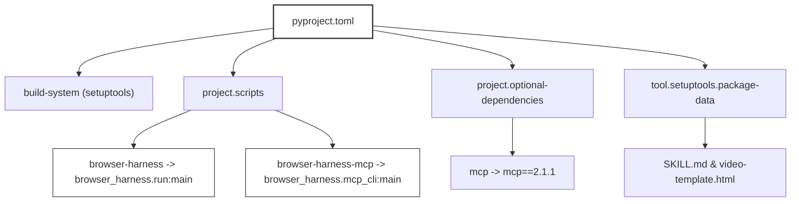
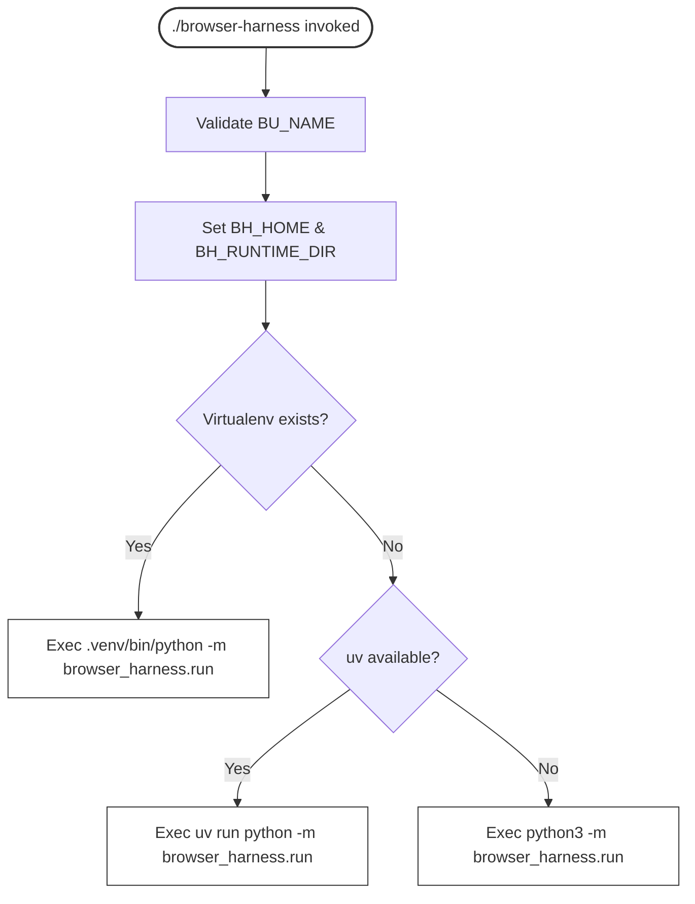
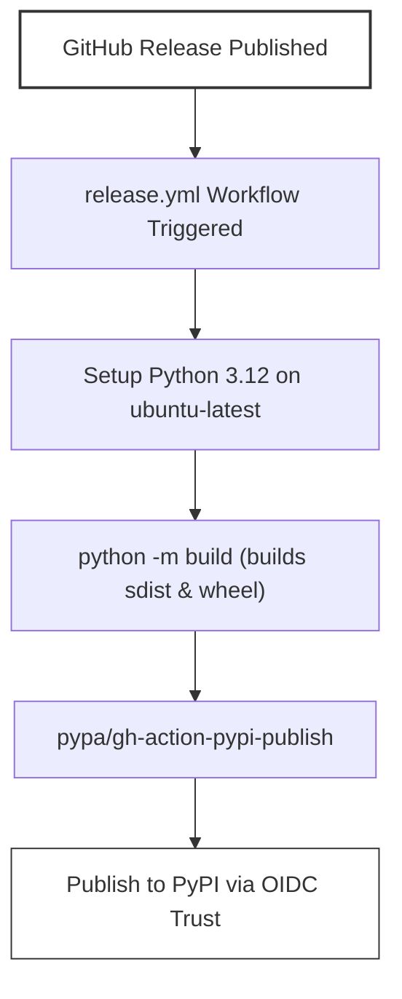

<!-- source: DeepWiki mcp.deepwiki.com · repo browser-use/browser-harness · page 6.2 Packaging, CI & Contribution Workflow · fetched 2026-10-30 -->

# Packaging, CI & Contribution Workflow

Relevant source files

The following files were used as context for generating this wiki page:

- [.github/ISSUE_TEMPLATE/bug-report.yml](.github/ISSUE_TEMPLATE/bug-report.yml)
- [.github/ISSUE_TEMPLATE/config.yml](.github/ISSUE_TEMPLATE/config.yml)
- [.github/ISSUE_TEMPLATE/feature-request.yml](.github/ISSUE_TEMPLATE/feature-request.yml)
- [.github/workflows/release.yml](.github/workflows/release.yml)
- [CONTRIBUTING.md](CONTRIBUTING.md)
- [LICENSE](LICENSE)
- [browser-harness](browser-harness)
- [pyproject.toml](pyproject.toml)
- [src/browser_harness/SKILL.md](src/browser_harness/SKILL.md)

This page details the packaging configuration, local shell wrapper infrastructure, GitHub Actions release automation, contributor guidelines, issue templates, and licensing for `browser-harness`. It covers how Python entry points are defined in `pyproject.toml`, how the development launcher script sets up environment namespacing, and how releases are automatically published to PyPI.

---

## 1. Project Metadata & Entry Points (`pyproject.toml`)

The project packaging is defined via `pyproject.toml` using `setuptools==84.0.0` as the build backend [pyproject.toml:1-3](). The package metadata specifies Python `>=3.11`, MIT licensing, and key runtime dependencies [pyproject.toml:5-29]().

### Dependencies and Optional Features
* **Core Dependencies**: `cdp-use==1.4.5`, `fetch-use==0.4.0`, `pillow==12.3.0`, and `websockets==15.0.1` [pyproject.toml:24-29]().
* **Optional Dependencies**: The `mcp` extra installs `mcp==2.1.1` to support Model Context Protocol exposure [pyproject.toml:31-32]().

### Script Entry Points and Package Data
The package exposes two primary command-line entry points [pyproject.toml:34-37]():
* `browser-harness = "browser_harness.run:main"` [pyproject.toml:35]()
* `browser-harness-mcp = "browser_harness.mcp_cli:main"` [pyproject.toml:36]()

Package data configuration includes bundling `SKILL.md` and `video-template.html` inside the `browser_harness` package namespace [pyproject.toml:50-52]().

Sources: [pyproject.toml:1-54]()

---

## 2. The Development Shell Wrapper (`browser-harness`)

For local checkouts and development, the repository provides a bash shell wrapper script named `./browser-harness` [browser-harness:1-34](). This script allows developers to run commands against the working tree without manually activating a virtual environment or installing the package globally [CONTRIBUTING.md:8-10]().

### Wrapper Execution and Isolation Logic
1. **Root & Dev ID Resolution**: Locates the script's directory as `ROOT` and generates a unique `DEV_ID` using `cksum` [browser-harness:4-5]().
2. **Namespacing (`BU_NAME`)**: Inspects `BU_NAME` (defaulting to `default`), validating that names contain only alphanumeric characters, hyphens, and underscores [browser-harness:6-13]().
3. **Directory Environment Variables**: Configures isolated runtime paths if not already set [browser-harness:15-23]():
   * `BH_HOME`: Defaults to `$ROOT/.browser-harness-dev` [browser-harness:15]()
   * `BH_RUNTIME_DIR`: Defaults to `/tmp/bh-dev-$DEV_ID/runtime` [browser-harness:17]()
   * `BH_TMP_DIR`: Defaults to `$BH_HOME/tmp` [browser-harness:21]()
4. **Interpreter Fallback Chain**: Attempts execution in the following order [browser-harness:25-34]():
   * `$ROOT/.venv/bin/python` [browser-harness:25-27]()
   * `uv --directory "$ROOT" run python` [browser-harness:29-31]()
   * System `python3` with updated `PYTHONPATH` [browser-harness:33-34]()

Sources: [browser-harness:1-34](), [CONTRIBUTING.md:8-10]()

---

## 3. Continuous Integration & PyPI Release Workflow (`release.yml`)

Automated packaging and publishing to PyPI are handled by GitHub Actions defined in `.github/workflows/release.yml` [.github/workflows/release.yml:1-25]().

### Release Job Mechanics
* **Trigger Event**: Executes whenever a new GitHub release is published (`types: [published]`) [.github/workflows/release.yml:3-5]().
* **Runner Environment**: Runs on `ubuntu-latest` using Python `3.12` [.github/workflows/release.yml:9-19]().
* **Permissions**: Configured with OIDC token generation (`id-token: write`) for secure, passwordless Trusted Publishing to PyPI [.github/workflows/release.yml:12-14]().
* **Build Step**: Installs `build==1.6.0` and creates source and wheel distributions using `python -m build` [.github/workflows/release.yml:20-23]().
* **Publish Step**: Uses `pypa/gh-action-pypi-publish@release/v1` to upload the distributions [.github/workflows/release.yml:24-25]().

Sources: [.github/workflows/release.yml:1-25]()

---

## 4. Issue Templates & Contribution Guidelines

Contributions are managed via strict issue templates and workflow documentation.

### Contribution Guidance (`CONTRIBUTING.md`)
* **Local Development**: Employs `./browser-harness` to test working trees [CONTRIBUTING.md:8-10]().
* **Domain Skills**: Domain skills should be agent-generated rather than hand-authored [CONTRIBUTING.md:26-27](). Contributors copy generated folders from `domain-skills/<site>/` into `agent-workspace/domain-skills/` when contributing [CONTRIBUTING.md:28-29]().

### Issue Template Preflight Checks
To minimize noise, issue templates enforce strict preflight criteria before bugs or feature requests can be submitted:
* **Bug Reports (`bug-report.yml`)**: Require checking that duplicates were searched, `browser-harness --doctor` was executed, and the troubleshooting guide was reviewed [.github/ISSUE_TEMPLATE/bug-report.yml:5-17]().
* **Feature Requests (`feature-request.yml`)**: Require confirming that existing discussions and issues were searched [.github/ISSUE_TEMPLATE/feature-request.yml:5-11]().
* **Configuration Support (`config.yml`)**: Disables blank issues and routes questions directly to GitHub Discussions [.github/ISSUE_TEMPLATE/config.yml:1-5]().

Sources: [CONTRIBUTING.md:1-35](), [.github/ISSUE_TEMPLATE/bug-report.yml:1-51](), [.github/ISSUE_TEMPLATE/feature-request.yml:1-37](), [.github/ISSUE_TEMPLATE/config.yml:1-8]()

---

## 5. Licensing and Self-Update Path

### Licensing (`LICENSE`)
The repository is licensed under the MIT License, protecting software usage, modification, and distribution under Copyright (c) 2026 Browser Use [LICENSE:1-21]().

### Self-Update Mechanism (`--update`)
The harness supports in-place updates via command-line flags managed in admin and CLI routines [admin.py](). When requested, the update path pulls the latest package versions or repository updates to ensure compatibility with remote CDP endpoints and skill definitions.

Sources: [LICENSE:1-21]()

---

